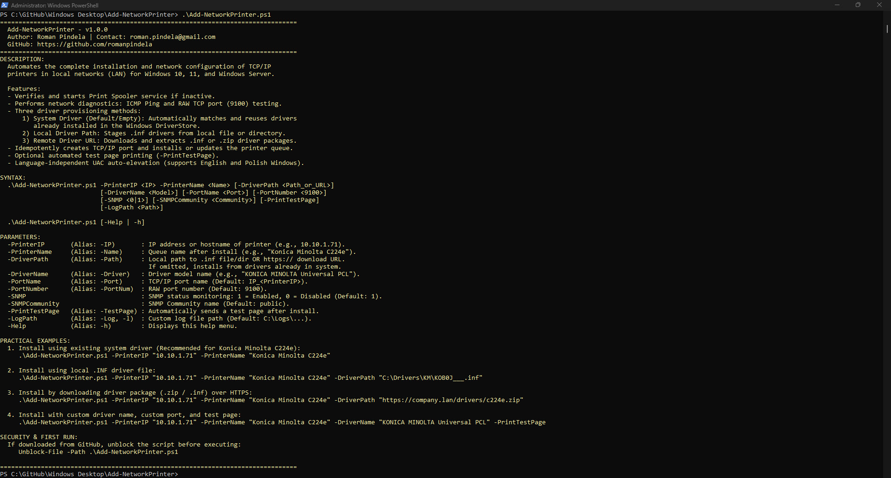
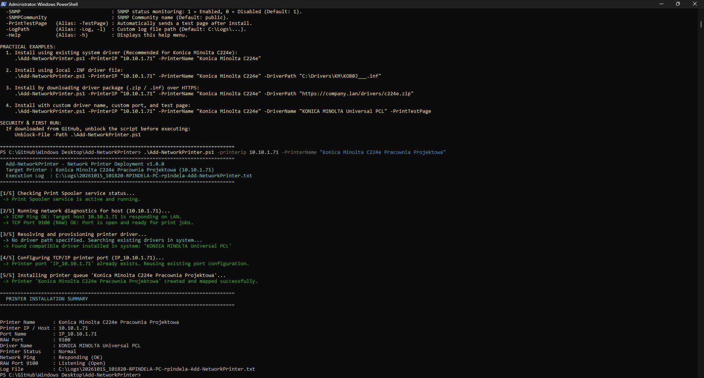
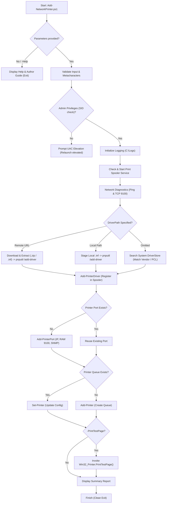

# Add Network Printer (`Add-NetworkPrinter`)

**Version:** 1.0.0  
**Release Date:** 2026-10-15  
**Author:** Roman Pindela  
**License:** MIT  

An enterprise-grade, clean-code PowerShell automation script for installing and configuring network TCP/IP printers in local area networks (LAN) across **Windows 10**, **Windows 11**, and **Windows Server** (x64 / ARM64).

---

## 📋 Project Information

| Parameter | Value |
| :--- | :--- |
| **Project Name** | Add Network Printer |
| **Script Name** | `Add-NetworkPrinter.ps1` |
| **Author** | Roman Pindela |
| **Email** | [roman.pindela@gmail.com](mailto:roman.pindela@gmail.com) |
| **GitHub** | [https://github.com/romanpindela](https://github.com/romanpindela) |
| **Version** | 1.0.0 |
| **Release Date** | 2026-10-15 |
| **License** | MIT |

---

## 🚀 Overview

Adding network printers manually across workstations or server environments often involves cumbersome GUI wizards, inconsistent driver selection, or complex port mapping procedures.

`Add-NetworkPrinter.ps1` standardizes and automates this procedure end-to-end:
* Ensures the **Print Spooler** service is healthy and active.
* Conducts live **network diagnostics** (ICMP Ping & RAW TCP Port 9100).
* Provides flexible **three-way driver provisioning**:
  1. **Pre-installed System Drivers:** Automatically searches and reuses existing drivers in the Windows DriverStore (e.g. vendor universal PCL drivers).
  2. **Local `.INF` Files or Directories:** Automatically stages and registers driver packages from local or network storage using `pnputil`.
  3. **Remote Web Downloads (`http://` / `https://`):** Automatically downloads and extracts `.inf` or `.zip` archives from intranet file servers or manufacturer repositories.
* Idempotently creates the **Standard TCP/IP Port** (`IP_<PrinterIP>`) with SNMP monitoring.
* Adds or updates the **Printer Queue** cleanly without duplicating devices or ports.
* Supports automated **Test Page Printing** and detailed **Audit Logging**.

---

## 🌟 Key Features

* **Zero-Parameter Interactive Help:** Running the script without parameters or with `-Help` / `-h` immediately displays the syntax, options, version, author info, and practical examples without triggering an unnecessary UAC prompt.
* **Language-Agnostic UAC Auto-Elevation:** Verifies administrative privileges using well-known SIDs (`WellKnownSidType::BuiltInAdministratorsSid`), ensuring 100% compatibility across both English (`Administrators`) and Polish (`Administratorzy`) Windows operating systems. Automatically prompts for elevation while preserving all command-line arguments.
* **Input Sanitization & Security Shield:** Validates IP addresses, printer queue names, paths, and URLs against malicious command injection or dangerous metacharacters.
* **Smart Driver Discovery:** Automatically derives driver search patterns from the specified printer name (e.g., matching `"Konica Minolta C224e"` against `"KONICA MINOLTA Universal PCL"`).
* **Enterprise Audit Logging:** Colorized console output combined with timestamped logs recorded to `C:\Logs` or a designated custom file.

---

## 📂 Directory Structure

```shell
Add-NetworkPrinter/
├── assets/
│   ├── Adding_printer.jpg          # Screenshot of printer installation and diagnostic summary
│   └── Standard_run.jpg            # Screenshot of zero-parameter run / interactive help menu
├── Add-NetworkPrinter.ps1          # Main PowerShell deployment script
└── README.md                       # Technical documentation and deployment guide
```

---

## 💻 System Requirements

* **Operating System:** Windows 10, Windows 11, Windows Server 2016 / 2019 / 2022 / 2025 (x64 and ARM64).
* **PowerShell Version:** Windows PowerShell 5.1 or PowerShell 7+.
* **Privileges:** Administrator privileges required for printer installation and driver staging (script automatically requests elevation via UAC if launched in a non-elevated session). Viewing help (`-h`) runs under standard user rights.

---

## 📥 Getting Started

### 1. Unblock the Script (Required After Download)

When downloading PowerShell scripts from GitHub or the Internet, Windows marks them with an alternate data stream (`Zone.Identifier`). Unblock the file before execution:

```powershell
Unblock-File -Path .\Add-NetworkPrinter.ps1
```

If execution is restricted by PowerShell execution policy, enable script execution for the current user:

```powershell
Set-ExecutionPolicy -ExecutionPolicy RemoteSigned -Scope CurrentUser
```

---

## 📖 Parameter Reference

| Parameter | Alias | Type | Default | Description |
| :--- | :--- | :--- | :--- | :--- |
| `-PrinterIP` | `-IP`, `-Address` | `[string]` | *Mandatory* | IPv4/IPv6 address or hostname of the printer (e.g., `10.10.1.71`). |
| `-PrinterName` | `-Name` | `[string]` | *Mandatory* | Name of the printer queue after install (e.g., `"Konica Minolta C224e"`). |
| `-DriverPath` | `-Path`, `-DriverUrl`| `[string]` | `$null` | Local `.inf` file, directory containing `.inf`, or `https://` URL (points to `.inf` or `.zip`). If omitted, uses existing system driver. |
| `-DriverName` | `-Driver` | `[string]` | `$null` | Specific driver model name (e.g., `"KONICA MINOLTA Universal PCL"`). |
| `-PortName` | `-Port` | `[string]` | `IP_<PrinterIP>`| TCP/IP port name in Windows Print Spooler. |
| `-PortNumber` | `-PortNum` | `[int]` | `9100` | RAW TCP port number used for printing. |
| `-SNMP` | | `[int]` | `1` | SNMP monitoring state: `1` = Enabled, `0` = Disabled. |
| `-SNMPCommunity`| | `[string]` | `"public"` | SNMP Community name. |
| `-PrintTestPage`| `-TestPage` | `[switch]` | `$false` | Sends a test page to the printer upon successful deployment. |
| `-LogPath` | `-Log`, `-l` | `[string]` | `C:\Logs\...` | Custom path to the execution log file. |
| `-Help` | `-h` | `[switch]` | `$false` | Displays interactive help menu and exits. |

---

## 💡 Practical Usage Examples

### Example 1: Interactive Help & Syntax Overview
Running without parameters or using `-h` displays the help screen:
```powershell
.\Add-NetworkPrinter.ps1
```
or
```powershell
.\Add-NetworkPrinter.ps1 -Help
```

---

### Example 2: Install Using Existing System Drivers (Konica Minolta C224e)
When the driver is already staged on the computer (e.g., Konica Minolta Universal PCL), simply specify the printer's IP and desired name:
```powershell
.\Add-NetworkPrinter.ps1 -PrinterIP "10.10.1.71" -PrinterName "Konica Minolta C224e"
```
* The script pings `10.10.1.71`, tests port `9100`, detects the installed `KONICA MINOLTA Universal PCL` driver, configures port `IP_10.10.1.71`, and creates the printer queue.

---

### Example 3: Install from Local `.INF` Driver File
When using manufacturer drivers stored locally or on an SMB share:
```powershell
.\Add-NetworkPrinter.ps1 -PrinterIP "10.10.1.71" -PrinterName "Konica Minolta C224e" -DriverPath "C:\Drivers\KM_C224e\KOB0J___.inf"
```
* The script stages the `.inf` driver into the Windows DriverStore via `pnputil`, registers it in the spooler, and creates the queue.

---

### Example 4: Install by Downloading Driver Package (.ZIP or .INF) via HTTPS
Download and deploy directly from an internal repository or web server:
```powershell
.\Add-NetworkPrinter.ps1 -PrinterIP "10.10.1.71" -PrinterName "Konica Minolta C224e" -DriverPath "https://company.lan/drivers/KM_C224e_PCL.zip"
```
* The package is securely downloaded to a temporary directory, extracted, staged, and installed automatically.

---

### Example 5: Custom Driver Name, Custom Port, and Test Page
```powershell
.\Add-NetworkPrinter.ps1 -PrinterIP "10.10.1.71" -PrinterName "Konica Minolta C224e" -DriverName "KONICA MINOLTA Universal PCL" -PortName "Konica_Office_Port" -PrintTestPage
```
* Creates a customized port `Konica_Office_Port`, assigns the exact driver, maps the printer queue, and submits a Windows test page to verify printing.

---

## 📸 Screenshots & Visual Verification

### 1. Standard Run & Interactive Help Menu (`.\Add-NetworkPrinter.ps1`)


### 2. Network Printer Deployment & Summary (`10.10.1.71` - Konica Minolta C224e)


---

## 🔄 Installation Workflow



---

## 🔒 Security & Quality Standards

1. **UAC Auto-Elevation:** Automatically validates administrative rights using SID `S-1-5-32-544` (`WellKnownSidType::BuiltInAdministratorsSid`), ensuring seamless execution on English and Polish Windows editions.
2. **Input Sanitization:** Rejects commands containing shell injection tokens (`&`, `|`, `;`, `>`, `<`, `` ` ``) or illegal file/printer path sequences.
3. **Idempotence:** Safe to run repeatedly; existing ports and queues are updated rather than throwing errors.
4. **Clean Code & Strict Mode:** Built under `Set-StrictMode -Version Latest` with structured error handling (`try/catch/finally`).

---

## 👤 Author & Support

* **Author:** Roman Pindela
* **Email:** [roman.pindela@gmail.com](mailto:roman.pindela@gmail.com)
* **GitHub:** [https://github.com/romanpindela](https://github.com/romanpindela)
* **License:** MIT
