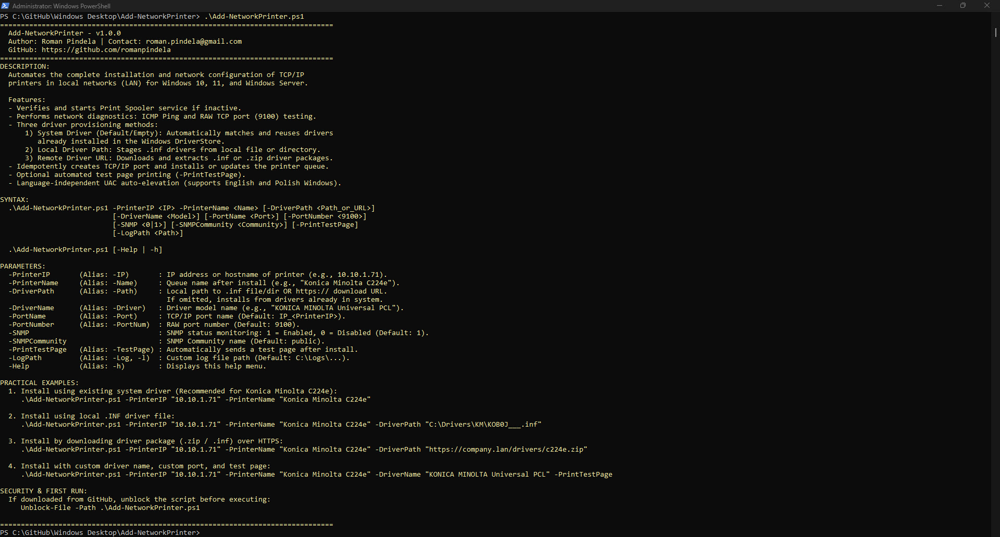
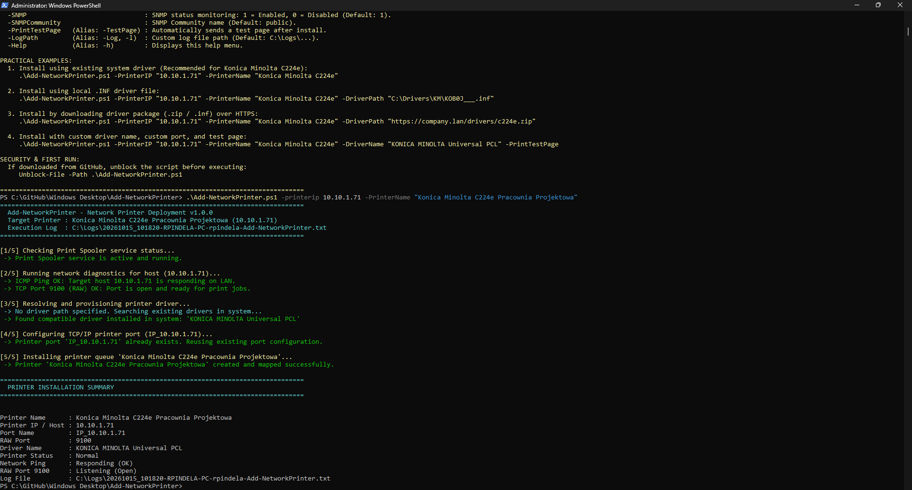

# Add-NetworkPrinter

[](https://microsoft.com/powershell)
[](https://www.microsoft.com/windows)
[](https://opensource.org/licenses/MIT)

## Problem Statement

Manually deploying network TCP/IP printers across Windows workstations and servers involves repetitive GUI wizards, inconsistent driver selection, manual TCP/IP port configuration, and time-consuming troubleshooting when Print Spooler or network connectivity issues occur.

## Overview

`Add-NetworkPrinter.ps1` automates end-to-end deployment of network TCP/IP printers in local area networks (LAN) by verifying Print Spooler and network reachability, staging drivers from the Windows DriverStore, local `.inf` paths, or remote HTTP/HTTPS packages, and idempotently configuring TCP/IP ports and printer queues.

## Environment & Prerequisites

* **Operating System:** Windows 10, Windows 11, Windows Server 2016 / 2019 / 2022 / 2025 (x64 and ARM64; English & Polish editions).
* **PowerShell Version:** Windows PowerShell 5.1 or PowerShell 7+.
* **Required Modules & Tools:** Built-in `PrintManagement` module (`Add-Printer`, `Add-PrinterPort`, `Add-PrinterDriver`, `Set-Printer`), `pnputil.exe` for driver staging, and network reachability to the target printer (ICMP Ping and RAW TCP port 9100 by default).

## Permissions Required

* **Admin** — Administrator privileges are required to start the Print Spooler service, stage drivers via `pnputil.exe`, and create TCP/IP ports and printer queues. The script validates privileges using Well-Known SID `S-1-5-32-544` and automatically prompts for UAC elevation while preserving all parameters (displaying help with `-Help` / `-h` or zero parameters runs under standard `User` rights).

## Safety & Impact

* **Risk Level:** `Modifies system state` — starts the Print Spooler service if stopped, optionally stages printer drivers into the Windows DriverStore, creates or updates standard TCP/IP ports and printer queues, and writes UTF-8 logs to `C:\Logs\`.
* **Simulation & Backup:** Does **not** support `-WhatIf` or `-Confirm` (`SupportsShouldProcess` is not enabled) and does **not** create configuration backups; port and queue creation is idempotent for existing configurations.

## Usage Examples

### 1. Unblock the Script (Required After Download)

```powershell
Unblock-File -Path .\Add-NetworkPrinter.ps1
```

### 2. Display Help & Syntax Overview

```powershell
.\Add-NetworkPrinter.ps1
.\Add-NetworkPrinter.ps1 -Help
```

### 3. Install Using Existing System Drivers

```powershell
.\Add-NetworkPrinter.ps1 -PrinterIP "10.10.1.71" -PrinterName "Konica Minolta C224e"
```

### 4. Install from Local `.INF` Driver File

```powershell
.\Add-NetworkPrinter.ps1 -PrinterIP "10.10.1.71" -PrinterName "Konica Minolta C224e" -DriverPath "C:\Drivers\KM_C224e\KOB0J___.inf"
```

### 5. Install by Downloading Driver Package (`.ZIP` or `.INF`) via HTTPS

```powershell
.\Add-NetworkPrinter.ps1 -PrinterIP "10.10.1.71" -PrinterName "Konica Minolta C224e" -DriverPath "https://company.lan/drivers/KM_C224e_PCL.zip"
```

### 6. Custom Driver Name, Custom Port, and Test Page

```powershell
.\Add-NetworkPrinter.ps1 -PrinterIP "10.10.1.71" -PrinterName "Konica Minolta C224e" -DriverName "KONICA MINOLTA Universal PCL" -PortName "Konica_Office_Port" -PrintTestPage
```

---

## Key Features

* **Zero-Parameter Interactive Help:** Running the script without parameters or with `-Help` / `-h` immediately displays syntax, options, version, author info, and practical examples without triggering an unnecessary UAC prompt.
* **Language-Agnostic UAC Auto-Elevation:** Verifies administrative privileges using well-known SIDs (`WellKnownSidType::BuiltInAdministratorsSid`), ensuring compatibility across English (`Administrators`) and Polish (`Administratorzy`) Windows editions.
* **Input Sanitization & Security Shield:** Validates IP addresses, printer queue names, paths, and URLs against command injection or dangerous metacharacters.
* **Smart Driver Discovery:** Automatically derives driver search patterns from the specified printer name (e.g., matching `"Konica Minolta C224e"` against `"KONICA MINOLTA Universal PCL"`).
* **Enterprise Audit Logging:** Colorized console output combined with timestamped logs recorded to `C:\Logs\` or a designated custom file.

---

## Parameter Reference

| Parameter | Alias | Type | Default | Description |
| :--- | :--- | :--- | :--- | :--- |
| `-PrinterIP` | `-IP`, `-Address`, `-Host` | `[string]` | *Mandatory* | IPv4/IPv6 address or hostname of the printer (e.g., `10.10.1.71`). |
| `-PrinterName` | `-Name` | `[string]` | *Mandatory* | Name of the printer queue after install (e.g., `"Konica Minolta C224e"`). |
| `-DriverPath` | `-Path`, `-DriverLocation`, `-DriverSource`, `-DriverUrl` | `[string]` | `$null` | Local `.inf` file, directory containing `.inf`, or `http(s)://` URL (`.inf` or `.zip`). If omitted, uses existing system driver. |
| `-DriverName` | `-Driver`, `-DriverModel` | `[string]` | `$null` | Specific driver model name (e.g., `"KONICA MINOLTA Universal PCL"`). |
| `-PortName` | `-Port` | `[string]` | `IP_<PrinterIP>` | TCP/IP port name in Windows Print Spooler. |
| `-PortNumber` | `-PortNum` | `[int]` | `9100` | RAW TCP port number used for printing. |
| `-SNMP` | | `[int]` | `1` | SNMP monitoring state: `1` = Enabled, `0` = Disabled. |
| `-SNMPCommunity` | | `[string]` | `"public"` | SNMP Community name. |
| `-PrintTestPage` | `-TestPage`, `-TestPrint` | `[switch]` | `$false` | Sends a test page to the printer upon successful deployment. |
| `-LogPath` | `-Log`, `-l` | `[string]` | `C:\Logs\...` | Custom path to the execution log file. |
| `-Help` | `-h` | `[switch]` | `$false` | Displays interactive help menu and exits. |

---

## Directory Structure

```shell
Add-NetworkPrinter/
├── assets/
│   ├── Adding_printer.jpg          # Screenshot of printer installation and diagnostic summary
│   └── Standard_run.jpg            # Screenshot of zero-parameter run / interactive help menu
├── Add-NetworkPrinter.ps1          # Main PowerShell deployment script
└── README.md                       # Technical documentation and deployment guide
```

---

## Screenshots & Visual Verification

### 1. Standard Run & Interactive Help Menu (`.\Add-NetworkPrinter.ps1`)


### 2. Network Printer Deployment & Summary (`10.10.1.71` - Konica Minolta C224e)


---

## Author

* **Author:** Roman Pindela
* **Email:** [roman.pindela@gmail.com](mailto:roman.pindela@gmail.com)
* **GitHub:** [https://github.com/romanpindela](https://github.com/romanpindela)
* **Version:** 1.0.0
* **Release Date:** 2026-10-15
* **License:** MIT
