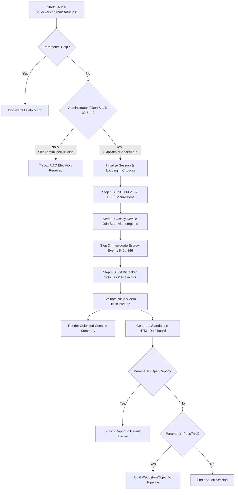

# Audit-BitLockerAndTpmStatus

[](https://microsoft.com/powershell)
[](https://www.microsoft.com/windows)
[]()
[]()
[](https://opensource.org/licenses/MIT)

> **Enterprise cryptographic and hardware trust audit tool for Windows 10, Windows 11, and Windows Server systems, verifying EU NIS2 Directive, Zero-Trust Architecture, and data-at-rest encryption compliance.**

---

## 📌 Business Objective & Compliance Context

The European Union **NIS2 Directive (Network and Information Systems Directive 2022/2555)** establishes rigorous cybersecurity risk management requirements for essential and important entities across their endpoint estates and supply chains. A foundational technical control is guaranteeing the physical and cryptographic integrity of workstations, ensuring robust protection of *data-at-rest* against physical theft, device loss, or offline extraction attacks.

**`Audit-BitLockerAndTpmStatus.ps1`** delivers automated, non-invasive auditing across three core defense-in-depth layers:
1. **Hardware Root of Trust:** Audits the presence, readiness state, activation, and specification version of the TPM chip (TPM 2.0 required for NIS2 compliance), as well as UEFI Secure Boot enforcement.
2. **BitLocker Volume Encryption:** Validates complete volume encryption (100%), verifies robust cipher algorithms (XTS-AES 128 / XTS-AES 256), and audits the hygiene of key protectors (hardware TPM, TPM+PIN, and recovery passwords).
3. **Recovery Key Escrow Verification:** Inspects machine identity and directory registration (Microsoft Entra ID / Active Directory Domain Services) and interrogates event logs to confirm successful recovery key archival in cloud or domain repositories (`EventID 845` vs `EventID 846`).

---

## ⚡ Key Capabilities

* **Hardware Root of Trust (TPM Module):**
  * Multi-layered detection utilizing `Get-Tpm`, WMI/CIM (`root\CIMv2\Security\MicrosoftTpm:Win32_Tpm`), and PnP device fallback (`Win32_PnPEntity`).
  * Chip architecture classification: **dTPM** (dedicated discrete hardware cryptoprocessor, e.g., Infineon, STMicroelectronics, Nuvoton) vs **fTPM** (firmware TPM, e.g., AMD fTPM, Intel PTT).
  * Validates critical properties: `TpmPresent`, `TpmReady`, `TpmEnabled`, `TpmActivated`, manufacturer ID, and firmware version.
* **UEFI Firmware & Secure Boot:**
  * Detects boot firmware environment (UEFI vs Legacy BIOS).
  * Validates Secure Boot status via `Confirm-SecureBootUEFI` with exception handling and registry state fallback (`UEFISecureBootEnabled`).
* **BitLocker Volume Encryption:**
  * Complete inventory of logical volumes (OS drive, Fixed Data drives, and Removable media).
  * Verifies encryption completeness (`FullyEncrypted`) and percentage (`EncryptionPercentage == 100%`).
  * Audits encryption algorithms (`XtsAes256`, `XtsAes128`, `Aes256`, `Aes128`).
  * Enumerates key protectors (`Tpm`, `TpmPin`, `RecoveryPassword`, `NumericalPassword`).
  * **Privacy & Secret Protection:** Strictly avoids logging or exposing plaintext recovery passwords (records only KeyProtector GUIDs).
* **Cloud & Directory Escrow Verification:**
  * Machine join state discovery via `dsregcmd /status`: Microsoft Entra ID Joined, Hybrid Entra ID Joined, Active Directory Domain Joined, or Standalone Workgroup.
  * Interrogates `Microsoft-Windows-BitLocker/BitLocker Management` event log for `EventID 845` (escrow success) and `EventID 846` (escrow failure).
  * Unambiguous escrow status resolution: `SUCCESS_ENTRA`, `SUCCESS_AD`, `FAILED_NO_ESCROW`, `STANDALONE_NOT_APPLICABLE`.
* **Modern Standalone HTML Dashboard (Dark / Light Mode):**
  * 100% self-contained HTML file without any remote CDN dependencies — fully operational in air-gapped environments.
  * Apple-inspired clean UI with interactive theme switch persisted in `localStorage`.
  * Visual KPI metric cards, detailed volume tables with status badges, and categorized security findings with remediation guidance.
  * Print and PDF export optimization (`@media print`).
* **Console Experience & Audit Logging:**
  * Formatted console summary table with colorized status tags: `[PASS]` (Green), `[WARN]` (Yellow), `[FAIL]` (Red).
  * Microsecond-precision audit logging saved to `C:\Logs\Audit-BitLockerAndTpmStatus_yyyyMMdd_HHmmss.log` in UTF-8.
  * Pipeline-native `[PSCustomObject]` output when `-PassThru` is requested.

---

## 🏗️ Execution Architecture & Workflow



---

## 🛠️ Prerequisites & Privileges

* **Operating System:** Windows 10, Windows 11, or Windows Server 2016+ (x64 / ARM64).
* **PowerShell Runtime:** Windows PowerShell 5.1 or PowerShell 7+.
* **Privileges:** Requires an elevated Administrator session (token containing Well-Known SID `S-1-5-32-544`). Administrative elevation is mandatory to access hardware TPM status, Secure Boot configurations, and the `root\CIMv2\Security\MicrosoftVolumeEncryption` WMI namespace.

---

## 📋 Script Parameters

| Parameter | Type | Default Value | Description |
| :--- | :--- | :--- | :--- |
| `-PathHtmlReport` | `[string]` | `C:\Logs\Audit-BitLockerAndTpmStatus_<timestamp>.html` | Custom file destination for the generated HTML audit report. |
| `-OpenReport` | `[switch]` | `$false` | Automatically opens the generated HTML report in the system default web browser upon completion. |
| `-EnforceAes256` | `[switch]` | `$false` | Enforces military-grade cipher compliance: flags algorithms other than `XtsAes256` or `Aes256` as `[FAIL]` instead of `[PASS]`/`[WARN]`. |
| `-PassThru` | `[switch]` | `$false` | Returns the comprehensive audit dataset as a structured `[PSCustomObject]` to the PowerShell pipeline. |
| `-SkipAdminCheck` | `[switch]` | `$false` | Bypasses the mandatory UAC elevation check (useful for automated testing and non-privileged diagnostics). |
| `-Help`, `-h` | `[switch]` | `$false` | Displays the interactive CLI help guide and syntax examples in the console. |

---

## 💡 CLI Usage Examples

### 1. Standard workstation security audit
Performs full cryptographic audit, displays colorized table in the console, and writes the default HTML report and log to `C:\Logs\`:
```powershell
.\Audit-BitLockerAndTpmStatus.ps1
```

### 2. Audit with automatic browser dashboard display
Generates the audit report and immediately displays it in the default browser:
```powershell
.\Audit-BitLockerAndTpmStatus.ps1 -OpenReport
```

### 3. Enforcing strict AES-256 encryption policy
Flags any drives encrypted with 128-bit algorithms as non-compliant (`[FAIL]`):
```powershell
.\Audit-BitLockerAndTpmStatus.ps1 -EnforceAes256 -PathHtmlReport "C:\Reports\Audit-BitLocker-AES256.html" -OpenReport
```

### 4. Pipeline ingestion and querying unprotected drives
```powershell
$audit = .\Audit-BitLockerAndTpmStatus.ps1 -PassThru
$audit.Volumes | Where-Object { $_.ProtectionStatus -ne 'On' } | Select-Object MountPoint, VolumeStatus, EncryptionPercentage
```

### 5. Display interactive command-line help
```powershell
.\Audit-BitLockerAndTpmStatus.ps1 -Help
```

---

## 📊 NIS2 Directive Compliance Assessment Matrix

| Component | Compliant `[PASS]` | Warning `[WARN]` | Critical Deficiency `[FAIL]` |
| :--- | :--- | :--- | :--- |
| **TPM Module** | TPM 2.0 active, enabled, and in ready state (`Ready: True`). | TPM 1.2 or TPM 2.0 present but not activated in BIOS/UEFI. | TPM chip missing, disabled in firmware, or malfunctioning. |
| **Secure Boot** | UEFI mode active with Secure Boot enabled (`Enabled`). | UEFI mode active, but Secure Boot disabled by user. | Motherboard running in Legacy BIOS mode (no Secure Boot support). |
| **OS System Drive** | Fully encrypted (100%), Protection On, TPM protector + recovery key present. | 128-bit encryption method (under standard policy) or missing TPM protector. | Drive fully decrypted, encryption incomplete (<100%), or protection disabled (`Protection: Off`). |
| **Fixed Data Drives** | Fully encrypted (100%), auto-unlock or passphrase protector active. | Drive undergoing encryption or incomplete coverage. | Unencrypted volume hosting business or sensitive operational data. |
| **Escrow Backup** | Confirmed recovery key archival in Entra ID or Active Directory (`EventID 845`). | Device is joined to directory/cloud, but escrow events are missing. | Explicit escrow backup error (`EventID 846`) on managed enterprise machine. |

---

## 📁 Log & Report File Structure

All execution telemetry and reports are saved to `C:\Logs\` by default:
* **Execution Log:** `C:\Logs\Audit-BitLockerAndTpmStatus_yyyyMMdd_HHmmss.log`
  * Format: `yyyy-MM-dd HH:mm:ss.fff [LEVEL] Message`
  * Encoding: UTF-8
* **HTML Dashboard:** `C:\Logs\Audit-BitLockerAndTpmStatus_yyyyMMdd_HHmmss.html`
  * Self-contained responsive dashboard with Dark / Light theme toggle.

---

## 📸 Screenshots & Visual Verification

### 1. Interactive CLI Help Menu (`.\Audit-BitLockerAndTpmStatus.ps1 -Help`)


### 2. Standard Audit Execution & Console Summary (`.\Audit-BitLockerAndTpmStatus.ps1`)


### 3. Standalone Responsive HTML Audit Report (`.\Audit-BitLockerAndTpmStatus.ps1 -OpenReport`)


---

## 👤 Author & License

* **Author:** Roman Pindela
* **Email:** [roman.pindela@gmail.com](mailto:roman.pindela@gmail.com)
* **GitHub:** [https://github.com/romanpindela](https://github.com/romanpindela)
* **Repository:** [Windows-Desktop](https://github.com/romanpindela/Windows-Desktop)
* **Version:** 1.0.0
* **Release Date:** 2026-11-09
* **License:** [MIT](https://opensource.org/licenses/MIT)
