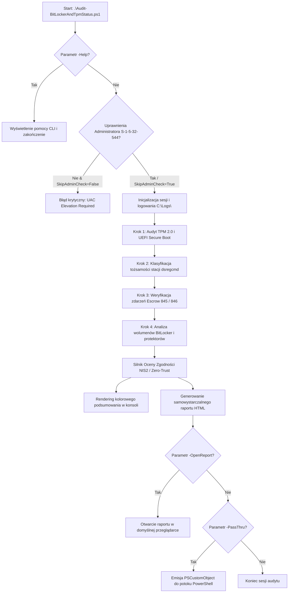
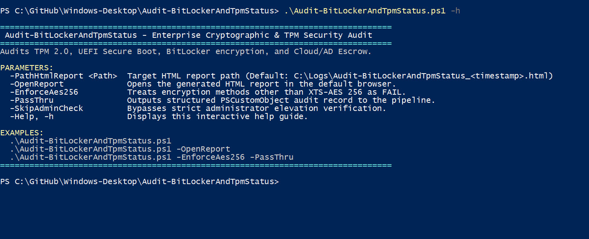
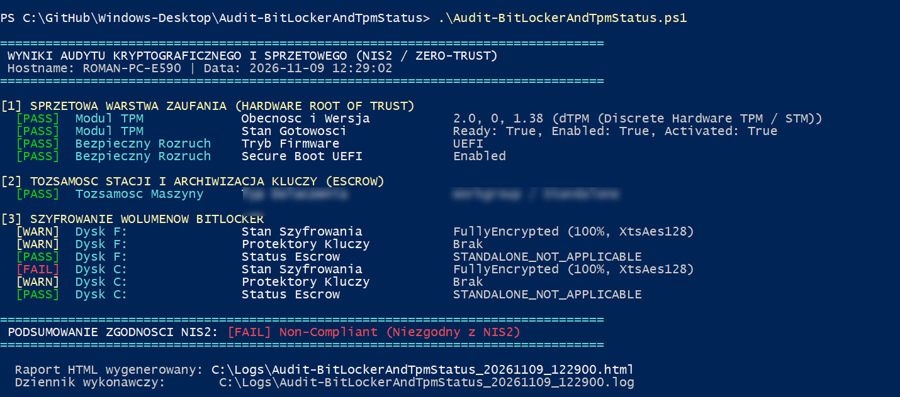
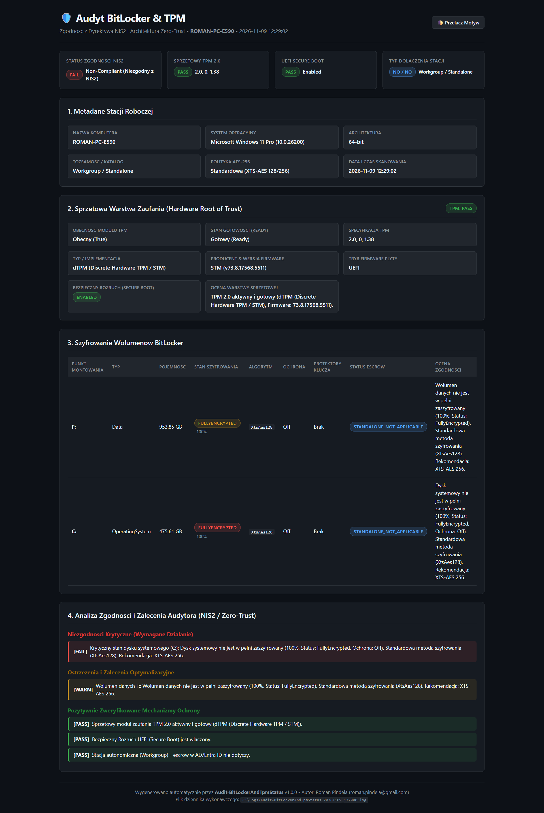

# Audit-BitLockerAndTpmStatus

[](https://microsoft.com/powershell)
[](https://www.microsoft.com/windows)
[]()
[]()
[](https://opensource.org/licenses/MIT)

> **Kompleksowy audyt kryptograficzny stacji roboczych Windows 10/11 i Windows Server pod kątem wymagań Dyrektywy NIS2, architektury Zero-Trust oraz polityk ochrony danych at-rest.**

---

## 📌 Cel Biznesowy i Kontekst Zgodności

Dyrektywa Unii Europejskiej **NIS2 (Network and Information Systems Directive 2022/2555)** nakłada na podmioty kluczowe i ważne rygorystyczne obowiązki w zakresie zarządzania ryzykiem cyberbezpieczeństwa stacji końcowych oraz ochrony łańcucha dostaw. Jednym z fundamentalnych wymogów technicznych jest zapewnienie integralności fizycznej urządzeń oraz ochrona danych spoczywających (*data-at-rest*) przed nieautoryzowanym odczytem w przypadku kradzieży, zagubienia lub ataku offline.

Narzędzie **`Audit-BitLockerAndTpmStatus.ps1`** realizuje zautomatyzowaną inspekcję trzech krytycznych filarów bezpieczeństwa:
1. **Sprzętowa warstwa zaufania (Hardware Root of Trust):** Weryfikacja obecności, stanu gotowości i wersji specyfikacji modułu TPM (wymagany TPM 2.0) oraz Bezpiecznego Rozruchu (UEFI Secure Boot).
2. **Szyfrowanie wolumenów dyskowych (BitLocker):** Sprawdzenie kompletności zaszyfrowania (100%), zastosowanych algorytmów (XTS-AES 128 / XTS-AES 256) oraz obecności protektorów sprzętowych (TPM) i kluczy odzyskiwania.
3. **Weryfikacja Escrow (Kopia zapasowa kluczy odzyskiwania):** Audyt rejestracji stacji w katalogu tożsamości (Microsoft Entra ID / Active Directory Domain Services) oraz weryfikacja zdarzeń poprawnej archiwizacji klucza odzyskiwania w chmurze lub domenie (`EventID 845` vs `EventID 846`).

---

## ⚡ Główne Funkcjonalności

* **Moduł TPM (Trusted Platform Module):**
  * Sprawdzenie stanu za pomocą cmdletu `Get-Tpm`, warstwy CIM/WMI (`root\CIMv2\Security\MicrosoftTpm:Win32_Tpm`) oraz urządzeń PnP (`Win32_PnPEntity`).
  * Detekcja typu modułu: **dTPM** (fizyczny procesor kryptograficzny, np. Infineon, STMicroelectronics, Nuvoton) vs **fTPM** (firmware TPM, np. AMD fTPM, Intel PTT).
  * Weryfikacja właściwości: `TpmPresent`, `TpmReady`, `TpmEnabled`, `TpmActivated`, identyfikator i wersja firmware producenta.
* **Firmware UEFI & Secure Boot:**
  * Weryfikacja trybu uruchomienia (UEFI vs Legacy BIOS).
  * Sprawdzenie flagi bezpiecznego rozruchu za pomocą `Confirm-SecureBootUEFI` z obsługą wyjątków oraz odczytem rejestru systemowego.
* **Szyfrowanie Wolumenów BitLocker:**
  * Inwentaryzacja dysków logicznych (dysk systemowy OS, wolumeny danych stałych, dyski wymienne).
  * Kontrola statusu `FullyEncrypted` i wskaźnika `EncryptionPercentage == 100%`.
  * Identyfikacja metody szyfrowania (`XtsAes256`, `XtsAes128`, `Aes256`, `Aes128`).
  * Inspekcja protektorów kluczy (`Tpm`, `TpmPin`, `RecoveryPassword`, `NumericalPassword`).
  * **Ochrona prywatności:** Pełne wykluczenie ujawniania haseł i kluczy odzyskiwania w logach oraz raportach (zapis wyłącznie identyfikatorów GUID KeyProtector).
* **Weryfikacja Escrow (Kopia Zapasowa Kluczy):**
  * Detekcja typu stacji na podstawie `dsregcmd /status`: Microsoft Entra ID Joined, Hybrid Entra ID Joined, Active Directory Domain Joined lub Standalone Workgroup.
  * Inspekcja dziennika `Microsoft-Windows-BitLocker/BitLocker Management` pod kątem zdarzeń `EventID 845` (sukces escrow) oraz `EventID 846` (błąd escrow).
  * Jednoznaczna klasyfikacja statusu: `SUCCESS_ENTRA`, `SUCCESS_AD`, `FAILED_NO_ESCROW`, `STANDALONE_NOT_APPLICABLE`.
* **Nowoczesny Raport HTML (Dark / Light Mode):**
  * W 100% samowystarczalny (self-contained) plik HTML bez jakichkolwiek zewnętrznych zależności CDN – pełna funkcjonalność w sieciach odizolowanych (air-gapped).
  * Przełącznik motywu Dark / Light z zapamiętywaniem stanu w `localStorage`.
  * Wizualne karty wskaźników KPI, tabele wolumenów z etykietami statusu oraz sekcja zaleceń audytowych z podziałem na błędy, ostrzeżenia i sukcesy.
  * Stylowanie zoptymalizowane pod kątem druku i eksportu do formatu PDF (`@media print`).
* **Formatowanie Konsolowe & Dziennik Zdarzeń:**
  * Czytelna prezentacja wyników w konsoli ze znacznikami `[PASS]` (zielony), `[WARN]` (żółty), `[FAIL]` (czerwony).
  * Zapis szczegółowego logu do `C:\Logs\Audit-BitLockerAndTpmStatus_yyyyMMdd_HHmmss.log` z precyzją milisekundową w standardzie UTF-8.
  * Zwracanie kompletnego obiektu `[PSCustomObject]` do potoku PowerShell (`-PassThru`).

---

## 🏗️ Architektura Przepływu Audytu



---

## 🛠️ Wymagania Wstępne i Uprawnienia

* **System operacyjny:** Windows 10, Windows 11 lub Windows Server 2016+ (x64 / ARM64).
* **Środowisko PowerShell:** Windows PowerShell 5.1 lub PowerShell 7+.
* **Uprawnienia:** Wymagane uruchomienie w sesji administratora z podniesionymi uprawnieniami (token UAC z grupą SID `S-1-5-32-544`). Dostęp administracyjny jest niezbędny do odczytu stanu TPM, Secure Boot oraz przestrzeni WMI `root\CIMv2\Security\MicrosoftVolumeEncryption`.

---

## 📋 Parametry Skryptu

| Parametr | Typ | Wartość domyślna | Opis |
| :--- | :--- | :--- | :--- |
| `-PathHtmlReport` | `[string]` | `C:\Logs\Audit-BitLockerAndTpmStatus_<timestamp>.html` | Niestandardowa ścieżka zapisu generowanego raportu HTML. |
| `-OpenReport` | `[switch]` | `$false` | Automatyczne otwarcie wygenerowanego raportu HTML w domyślnej przeglądarce internetowej. |
| `-EnforceAes256` | `[switch]` | `$false` | Rygorystyczna polityka kryptograficzna: traktuje metody inne niż `XtsAes256` lub `Aes256` jako `[FAIL]` zamiast `[PASS]`/`[WARN]`. |
| `-PassThru` | `[switch]` | `$false` | Zwraca końcowy obiekt audytu jako `[PSCustomObject]` do potoku PowerShell (ułatwia integrację z SIEM / MDM). |
| `-SkipAdminCheck` | `[switch]` | `$false` | Omija sprawdzanie uprawnień administratora (przydatne do automatycznych testów jednostkowych i diagnostyki). |
| `-Help`, `-h` | `[switch]` | `$false` | Wyświetla interaktywną pomoc i przykłady użycia w konsoli. |

---

## 💡 Przykłady Użycia CLI

### 1. Standardowy audyt stacji roboczej
Wykonuje pełny audyt kryptograficzny, wyświetla podsumowanie w konsoli i zapisuje domyślny raport HTML oraz plik logu w `C:\Logs\`:
```powershell
.\Audit-BitLockerAndTpmStatus.ps1
```

### 2. Audyt z automatycznym otwarciem raportu HTML
Generuje raport i natychmiast otwiera go w domyślnej przeglądarce:
```powershell
.\Audit-BitLockerAndTpmStatus.ps1 -OpenReport
```

### 3. Wymuszenie rygorystycznej polityki AES-256 (zgodność z normami militarnymi/rządowymi)
Oznacza wolumeny zaszyfrowane algorytmem 128-bitowym jako niespełniające wymogów (`[FAIL]`):
```powershell
.\Audit-BitLockerAndTpmStatus.ps1 -EnforceAes256 -PathHtmlReport "C:\Raporty\Audyt-BitLocker-AES256.html" -OpenReport
```

### 4. Pobranie danych do potoku PowerShell i filtrowanie niezabezpieczonych dysków
```powershell
$audyt = .\Audit-BitLockerAndTpmStatus.ps1 -PassThru
$audyt.Volumes | Where-Object { $_.ProtectionStatus -ne 'On' } | Select-Object MountPoint, VolumeStatus, EncryptionPercentage
```

### 5. Wyświetlenie pomocy CLI
```powershell
.\Audit-BitLockerAndTpmStatus.ps1 -Help
```

---

## 📊 Kryteria Oceny Zgodności z Dyrektywą NIS2

| Komponent | Stan Zgodny `[PASS]` | Ostrzeżenie `[WARN]` | Niezgodność Krytyczna `[FAIL]` |
| :--- | :--- | :--- | :--- |
| **Moduł TPM** | TPM 2.0 aktywny, włączony i w stanie gotowości (`Ready: True`). | TPM 1.2 lub TPM 2.0 obecny, lecz nieaktywowany w BIOS/UEFI. | Brak modułu TPM, TPM wyłączony lub uszkodzony. |
| **Secure Boot** | Tryb UEFI aktywny, Bezpieczny Rozruch włączony (`Enabled`). | Tryb UEFI aktywny, lecz Secure Boot wyłączony przez użytkownika. | Płyta główna w trybie Legacy BIOS (brak wsparcia Secure Boot). |
| **Dysk Systemowy (OS)** | Szyfrowanie 100%, Ochrona włączona, protektor TPM + klucz odzyskiwania. | Szyfrowanie metodą 128-bitową (przy standardowej polityce) lub brak protektora TPM. | Dysk odszyfrowany, szyfrowanie w toku (<100%), ochrona wyłączona (`Protection: Off`). |
| **Dyski Danych (Fixed)** | Wolumen w pełni zaszyfrowany (100%), auto-unlock lub hasło aktywne. | Wolumen w trakcie operacji szyfrowania lub niepełne zabezpieczenie. | Wolumen z danymi wrażliwymi całkowicie odszyfrowany. |
| **Kopia Escrow (Klucze)** | Potwierdzenie wysłania klucza do Microsoft Entra ID lub AD (`EventID 845`). | Stacja w domenie / chmurze, lecz brak wpisów w dzienniku zdarzeń. | Błąd wysyłania klucza do chmury/AD (`EventID 846`) na urządzeniu zarządzanym. |

---

## 📁 Struktura Logów i Raportów

Wszystkie pliki wykonawcze trafiają domyślnie do katalogu `C:\Logs\`:
* **Dziennik wykonawczy:** `C:\Logs\Audit-BitLockerAndTpmStatus_yyyyMMdd_HHmmss.log`
  * Format: `yyyy-MM-dd HH:mm:ss.fff [LEVEL] Komunikat`
  * Kodowanie: UTF-8
* **Raport HTML:** `C:\Logs\Audit-BitLockerAndTpmStatus_yyyyMMdd_HHmmss.html`
  * Responsywny dashboard z przełącznikiem Dark / Light theme.

---

## 📸 Zrzuty Ekranu & Weryfikacja Wizualna

### 1. Interaktywne menu pomocy CLI (`.\Audit-BitLockerAndTpmStatus.ps1 -Help`)


### 2. Standardowe wykonanie audytu i podsumowanie konsolowe (`.\Audit-BitLockerAndTpmStatus.ps1`)


### 3. Samowystarczalny responsywny raport audytu HTML (`.\Audit-BitLockerAndTpmStatus.ps1 -OpenReport`)


---

## 👤 Autor i Metadane

* **Autor:** Roman Pindela
* **E-mail:** `roman.pindela@gmail.com`
* **GitHub:** [https://github.com/romanpindela](https://github.com/romanpindela)
* **Repozytorium:** [Windows-Desktop](https://github.com/romanpindela/Windows-Desktop)
* **Wersja:** 1.0.0
* **Data wydania:** 2026-11-09
