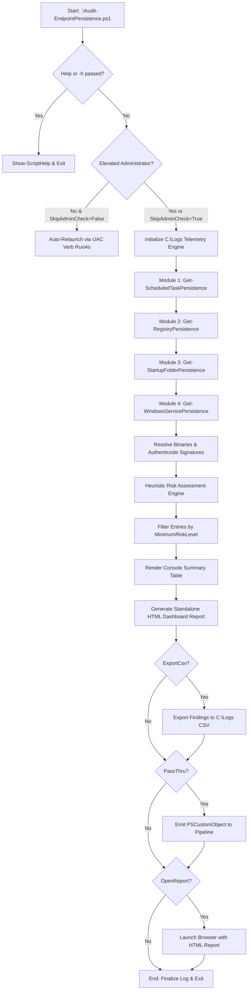
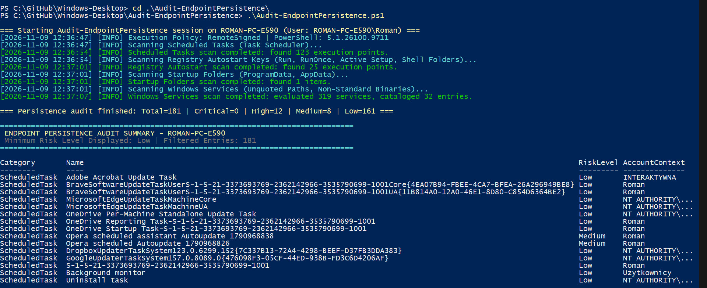
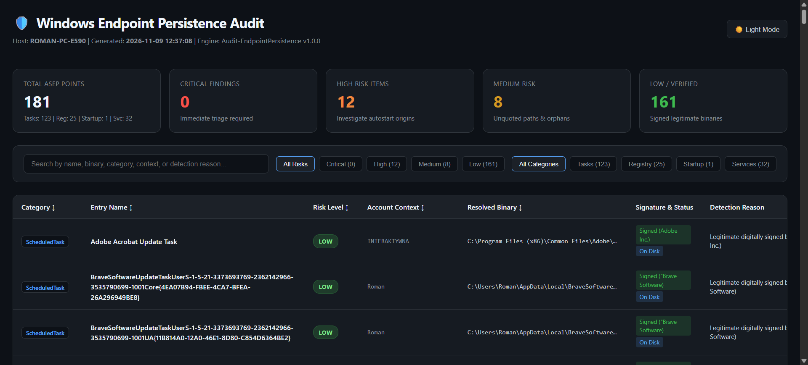

# Audit-EndpointPersistence

[](https://microsoft.com/powershell)
[](https://www.microsoft.com/windows)
[](https://opensource.org/licenses/MIT)
[]()
[]()

> **Enterprise PowerShell Security Suite for Windows Auto-Start Execution Points (ASEP) Auditing, Threat Hunting, Persistence Detection, and Standalone HTML Reporting.**

---

## 📌 Overview & Purpose

Persistence mechanisms (Auto-Start Execution Points - ASEP) represent one of the primary post-exploitation tactics used by advanced adversaries, malware, and unauthorized actors to maintain survivability across system restarts, user logoffs, and administrative interventions (**MITRE ATT&CK® Tactics: Persistence TA0003, Privilege Escalation TA0004**).

`Audit-EndpointPersistence.ps1` is a production-grade endpoint security auditing and threat detection suite designed for Windows 10, Windows 11, and Windows Server. It conducts exhaustive inspection across the four primary Windows persistence vectors:
1. **Scheduled Tasks (Harmonogram Zadań):** Identifies elevated tasks (`NT AUTHORITY\SYSTEM`, `Administrators`), scripts running from user-writable paths, and orphaned task entries.
2. **Registry Autostart Keys (ASEP):** Audits 64-bit and 32-bit (WOW6432Node) `Run` / `RunOnce`, Shell Folders redirection, Active Setup `StubPath` commands, and obfuscated LOLBin script executions.
3. **Startup Folders:** Inspects ProgramData and user profile Startup locations, resolving shortcut (`.lnk`) targets, parameters, and direct executable drops.
4. **Windows Services:** Detects Unquoted Service Paths (**CWE-428**), services executing from non-standard paths outside `%SystemRoot%` and `%ProgramFiles%`, and services hosted in user profiles or removable media.

Every discovered entry is evaluated by an integrated **Heuristic Risk Engine**, verified with Authenticode signature inspection (`Get-AuthenticodeSignature`), logged to `C:\Logs\`, and rendered into a **100% self-contained, Apple-inspired responsive HTML report** requiring zero external CDN dependencies.

---

## ⚡ Key Capabilities

* **Scheduled Task Security Auditing:**
  * Context-aware privilege evaluation (`NT AUTHORITY\SYSTEM`, `BUILTIN\Administrators`, elevated token flags).
  * High-risk folder path detection (`%TEMP%`, `%APPDATA%`, `%LOCALAPPDATA%`, `C:\Users\Public\`).
  * Detection of orphaned scheduled tasks referencing deleted binaries on disk.
* **Registry ASEP Inspection:**
  * Comprehensive inspection of `HKLM` and `HKCU` `Run` and `RunOnce` keys across native 64-bit and WOW6432Node hives.
  * Hijacking detection for `Explorer\User Shell Folders` (`Common Startup`, `Startup`).
  * Inspection of `Active Setup\Installed Components` (`StubPath` commands executed on user logon).
  * Pattern detection for encoded / stealthy script interpreters (`powershell.exe -enc`, `mshta.exe`, `wscript.exe`, `cscript.exe`, `rundll32.exe`).
* **Startup Folder Deep Resolution:**
  * Audits global `C:\ProgramData\Microsoft\Windows\Start Menu\Programs\Startup`.
  * Audits active user profile `$env:APPDATA\Microsoft\Windows\Start Menu\Programs\Startup`.
  * Optional multi-profile discovery (`-IncludeAllProfiles`) scanning all user profiles residing in `C:\Users\`.
  * Deep `.lnk` shortcut parsing via `WScript.Shell` extracting `TargetPath`, `Arguments`, and working directories.
* **Windows Services & CWE-428 Detection:**
  * Unquoted Service Path detection: Identifies unquoted binary paths containing space characters vulnerable to intermediate binary planting.
  * Service origin validation: Flags services executing from outside protected Windows system paths.
* **Authenticode Digital Signature Verification:**
  * Direct validation using `Get-AuthenticodeSignature` to confirm signature validity (`Valid`, `HashMismatch`, `NotSigned`) and extract the publisher Common Name (CN).
* **Standalone Responsive HTML Dashboard:**
  * 100% self-contained offline architecture (zero external CDN or web font requirements).
  * Apple / Cyber-Audit dark theme with instant light/dark toggle.
  * Executive Summary KPI metric cards: Total ASEP Points, Critical, High, Medium, and Low risk counts.
  * Interactive client-side real-time text search and instant filtering by Risk Level or Category.
  * Print & PDF export styling (`@media print`).
* **Enterprise Telemetry & Pipeline Integration:**
  * Standardized logging to `C:\Logs\Audit-EndpointPersistence.log` with millisecond timestamps and severity levels.
  * Structured CSV export (`-ExportCsv`).
  * Strongly typed `[PSCustomObject]` pipeline output (`-PassThru`) for SIEM streaming or PowerShell automation.

---

## 🏗️ Architecture & Execution Flow



---

## 🛡️ Risk Assessment Engine Matrix

| Risk Level | Heuristic Conditions & Detection Criteria |
|---|---|
| **Critical** | - Execution from `C:\Users\Public`, `%TEMP%`, or `%APPDATA%` under `NT AUTHORITY\SYSTEM` or `Administrators` context.<br>- Unquoted Service Path located outside `Program Files` in a user-writable directory.<br>- Encoded / stealthy PowerShell execution (`-enc`, `-w hidden`, `downloadstring`, `iex`) in registry autostart.<br>- Remote MSHTA payload invocation (`http:`, `https:`, `javascript:`) in autostart entries.<br>- Windows Service binary located inside a user profile or removable drive. |
| **High** | - Registry `Run` / `RunOnce` entries pointing directly to `%APPDATA%` or `%TEMP%`.<br>- Administrative / SYSTEM scheduled task executing unsigned binaries or scripts.<br>- Executable binaries (`.exe`, `.bat`, `.cmd`, `.vbs`, `.ps1`) placed directly inside user Startup folders.<br>- Windows Services executing from non-standard directories outside `%SystemRoot%` and `%ProgramFiles%`. |
| **Medium** | - Unquoted Service Path residing within `C:\Program Files\` (default ACLs require Administrator rights to plant binary).<br>- Orphaned persistence entries referencing non-existent executable binaries on disk.<br>- Unsigned binaries executing from within standard Windows system or Program Files folders. |
| **Low** | - Standard autostart items, services, or scheduled tasks installed in `%ProgramFiles%` or `%SystemRoot%` with valid digital signatures. |

---

## 💻 CLI Parameters Reference

| Parameter | Type | Default | Description |
|---|---|---|---|
| `-ReportPath` | `string` | `C:\Logs\Audit-EndpointPersistence_Report.html` | Destination file path for the standalone HTML audit report. |
| `-LogPath` | `string` | `C:\Logs\Audit-EndpointPersistence.log` | Destination file path for execution log telemetry. |
| `-MinimumRiskLevel` | `string` | `Low` | Filters console table and pipeline objects (`Low`, `Medium`, `High`, `Critical`). |
| `-IncludeAllProfiles` | `switch` | `False` | Audits startup folders across all existing user profiles on the host (`C:\Users\*\AppData\...`). |
| `-OpenReport` | `switch` | `False` | Automatically launches the HTML report in the default browser upon audit completion. |
| `-SkipAdminCheck` | `switch` | `False` | Bypasses UAC administrator check (for CI/CD pipelines, SCCM/Intune, or SYSTEM context). |
| `-ExportCsv` | `switch` | `False` | Exports all evaluated findings to a structured CSV file. |
| `-CsvPath` | `string` | `C:\Logs\Audit-EndpointPersistence.csv` | Custom destination file path for CSV export. |
| `-PassThru` | `switch` | `False` | Emits structured `PSCustomObject` items to the PowerShell pipeline. |
| `-Help` (`-h`) | `switch` | `False` | Displays the interactive CLI help guide. |

---

## 🚀 Execution Examples

### 1. Default Comprehensive Audit
Performs a full audit across all 4 persistence vectors, writes microsecond logs to `C:\Logs\`, generates the HTML report, and displays the summary in the console:
```powershell
.\Audit-EndpointPersistence.ps1
```

### 2. High & Critical Threat Hunting with Browser Report
Filters console output to High and Critical findings and automatically opens the interactive HTML report in the browser:
```powershell
.\Audit-EndpointPersistence.ps1 -MinimumRiskLevel High -OpenReport
```

### 3. Multi-Profile Audit with CSV Export
Audits startup folders across all user profiles on disk, generates HTML and CSV reports:
```powershell
.\Audit-EndpointPersistence.ps1 -IncludeAllProfiles -ExportCsv
```

### 4. Automated / Headless Execution (Intune / SCCM / CI-CD)
Runs non-interactively under SYSTEM or deployment runner context without UAC elevation prompts:
```powershell
.\Audit-EndpointPersistence.ps1 -SkipAdminCheck -ReportPath "C:\Reports\Persistence.html" -ExportCsv -CsvPath "C:\Reports\Persistence.csv"
```

### 5. Pipeline Analysis & SIEM Forwarding
Pipes critical persistence entries directly to downstream PowerShell filtering:
```powershell
.\Audit-EndpointPersistence.ps1 -PassThru | Where-Object { $_.RiskLevel -eq 'Critical' } | Format-Table -AutoSize
```

### 6. Interactive Command Help
```powershell
.\Audit-EndpointPersistence.ps1 -Help
```

---

## 📊 Output Object Schema (`PSCustomObject`)

Each identified persistence entry emits a standardized object conforming to Section 6 of the engineering specification:

```powershell
[PSCustomObject]@{
    Category        = "ScheduledTask" # ScheduledTask | RegistryRun | StartupFolder | WindowsService
    Name            = "UpdateCheckHelper"
    PathOrCommand   = "C:\Users\Public\update.exe /silent"
    ResolvedBinary  = "C:\Users\Public\update.exe"
    AccountContext  = "NT AUTHORITY\SYSTEM"
    RiskLevel       = "Critical"     # Low | Medium | High | Critical
    DetectionReason = "SYSTEM context executing binary from C:\Users\Public"
    IsSigned        = $false
    Signer          = $null
    FileExists      = $true
}
```

---

## 🔧 Hardening & Remediation Playbook

### 1. Remediating Unquoted Service Paths (CWE-428)
Enclose the executable binary path inside double quotes in the Windows Service Control Manager to eliminate binary planting vulnerabilities:
```powershell
# Identify the service binary path and wrap in quotes:
sc.exe config "<ServiceName>" binPath= "\"C:\Program Files\Vendor\Service.exe\""
```

### 2. Purging Rogue Scheduled Tasks
Remove persistence tasks running from user-writable directories or executing unauthorized scripts:
```powershell
Unregister-ScheduledTask -TaskName "<TaskName>" -Confirm:$false
```

### 3. Cleaning Suspicious Autostart Registry Entries
Delete suspicious entries from Run / RunOnce keys:
```powershell
# From HKLM:
Remove-ItemProperty -Path "HKLM:\Software\Microsoft\Windows\CurrentVersion\Run" -Name "<EntryName>"

# From HKCU:
Remove-ItemProperty -Path "HKCU:\Software\Microsoft\Windows\CurrentVersion\Run" -Name "<EntryName>"
```

### 4. Cleaning Orphaned Autostart References
Remove dead shortcuts and registry references pointing to missing files:
```powershell
Remove-Item -Path "$env:APPDATA\Microsoft\Windows\Start Menu\Programs\Startup\<ShortcutName>.lnk" -Force
```

---

## 📸 Screenshots & Visual Verification

### 1. Console Execution & Live ASEP Audit (`.\Audit-EndpointPersistence.ps1`)


### 2. Standalone Responsive HTML Audit Dashboard (`.\Audit-EndpointPersistence.ps1 -OpenReport`)


---

## 📁 Repository Structure

```
c:\Dane\rpindela\GitHub\Windows-Desktop\Audit-EndpointPersistence\
├── assets/
│   ├── Endpoint-Persistence-Audit-ROMAN-PC-E590-11-09-2026_12_38_PM.png
│   └── Running.jpg
├── Audit-EndpointPersistence.ps1              # Production persistence auditing tool
└── README.md                                  # Architectural documentation & operational guide
```

---

## 👤 Author & Metadata

* **Author:** Roman Pindela
* **Email:** roman.pindela@gmail.com
* **GitHub:** [https://github.com/romanpindela](https://github.com/romanpindela)
* **Repository:** [Windows-Desktop](https://github.com/romanpindela/Windows-Desktop)
* **Version:** `1.0.0`
* **Release Date:** `2026-11-09`
* **License:** MIT
