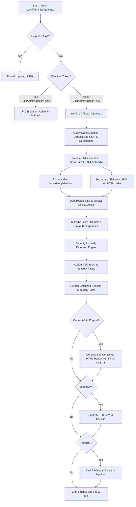

# Audit-LocalAdministrators

[](https://microsoft.com/powershell)
[](https://www.microsoft.com/windows)
[](https://opensource.org/licenses/MIT)
[]()
[]()

> **Enterprise PowerShell Security Suite for Local Administrators Group Auditing, Hybrid/Cloud SID Classification, Orphaned Identity Detection, and Standalone HTML Reporting.**

---

## 📌 Overview & Purpose

The local `Administrators` security group (`S-1-5-32-544`) represents the ultimate privilege boundary on Windows endpoints. Misconfigurations, leftover orphaned accounts from deleted domain or local identities, unmanaged built-in Administrator accounts, and untracked cloud identities (Microsoft Entra ID / Azure AD) introduce severe attack surfaces and privilege escalation vectors.

`Audit-LocalAdministrators.ps1` resolves the local Administrators group strictly via its **language-independent Well-Known SID (`S-1-5-32-544`)**, eliminating localization failures across localized Windows environments (e.g., Polish `"Administratorzy"`, German `"Administratoren"`, French `"Administrateurs"`). It performs deep inspection of all group members across local, Active Directory, and Entra ID boundaries, performs advanced security anomaly detection, logs timestamped telemetry to `C:\Logs\`, exports structured CSV data, and produces a **100% self-contained, Apple-inspired responsive HTML report** with zero external CDN dependencies.

---

## ⚡ Key Capabilities

* **Language-Independent SID Resolution:**
  * Uses Well-Known SID `S-1-5-32-544` to resolve local group identity regardless of system language.
  * Resilient dual-layer discovery: combines `Get-LocalGroupMember` with an underlying ADSI `WinNT` provider fallback to ensure enumeration succeeds even when lingering or broken domain trusts exist.
* **Hybrid & Cloud Account Classification:**
  * **Built-in Administrator (RID 500):** Identifies `S-1-5-21-*-500` and validates Windows LAPS (modern policy) or Legacy LAPS governance.
  * **Local Standard Users (Elevated):** Detects standard local accounts promoted to the Administrators group (`RID >= 1000`).
  * **Active Directory Domain Accounts:** Resolves AD Domain Users and Domain Groups (e.g., `Domain Admins`, `Enterprise Admins`).
  * **Microsoft Entra ID (Azure AD):** Resolves cloud roles and cloud users mapped via `S-1-12-1-*` SIDs and `AzureAD\*` principals (such as Entra ID Global Administrators and Device Local Administrators).
  * **Orphaned / Unresolved SIDs:** Flags deleted local and domain identities that linger inside the local Administrators group.
* **Advanced Anomaly & Risk Engine:**
  * Detects active RID 500 accounts running without LAPS password management.
  * Detects lingering orphaned SIDs (deleted accounts retaining admin token rights).
  * Detects credential sprawl (multiple active local administrators).
  * Identifies stale administrator passwords (> 90 / 180 days without rotation).
  * Identifies dormant elevated accounts (> 90 days without interactive or network logon).
  * Flags accounts with passwords configured to never expire.
* **Standalone Responsive HTML Audit Report:**
  * Zero remote bootstrap, web fonts, or CDN dependencies. Fully functional offline.
  * Apple-inspired dark/light mode responsive layout with card widgets (Total Admins, Local Accounts, Domain Accounts, Entra ID, Orphaned SIDs, Posture).
  * Interactive client-side real-time text filter and column sorting.
  * Print and PDF export optimized (`@media print`).
* **Standardized Logging (`C:\Logs\`):**
  * Auto-creates `C:\Logs\` (with graceful fallback to `%TEMP%\Logs`).
  * Microsecond timestamp logging: `[yyyy-MM-dd HH:mm:ss.fff] [<LEVEL>] <Message>`.
  * Standardized naming: `<yyyyMMdd-HHmmss>-Audit-LocalAdministrators-<COMPUTERNAME>-<USERNAME>.log`.
* **PowerShell Pipeline Native:**
  * Emits strongly typed `[PSCustomObject]` items enabling seamless piping into `Export-Csv`, `Out-GridView`, or SIEM forwarders.

---

## 🏗️ Architecture & Execution Flow



---

## 📋 Prerequisites & Installation

### System Requirements
* **Operating System:** Windows 10, Windows 11, or Windows Server 2016/2019/2022/2025.
* **PowerShell:** Windows PowerShell 5.1 or PowerShell 7+.
* **Privileges:** Administrator privileges (script auto-prompts for UAC elevation unless `-SkipAdminCheck` is passed).

### Unblock Script
If downloaded from GitHub or an intranet repository, unblock the file prior to execution:
```powershell
Unblock-File -Path ".\Audit-LocalAdministrators.ps1"
```

---

## 💻 CLI Parameters Reference

| Parameter | Type | Required | Default | Description |
| :--- | :--- | :---: | :--- | :--- |
| `-Audit` | `[switch]` | No | `$false` | Executes the standard audit workflow and outputs results to console. Alias: `-Scan`, `-Enumerate`. |
| `-GenerateHtmlReport` | `[switch]` | No | `$false` | Generates a standalone, styled responsive HTML audit report in `C:\Logs\`. |
| `-ReportPath` | `[string]` | No | `C:\Logs\...html` | Custom file path or directory for the HTML report. |
| `-ExportCsv` | `[switch]` | No | `$false` | Exports raw pipeline audit objects to a structured CSV file in `C:\Logs\`. |
| `-CsvPath` | `[string]` | No | `C:\Logs\...csv` | Custom file path or directory for CSV export. |
| `-LogDirectory` | `[string]` | No | `C:\Logs` | Target directory for execution logs and default reports. |
| `-IncludeDisabled` | `[bool]` | No | `$true` | Includes disabled administrator accounts in the audit. |
| `-SkipAdminCheck` | `[switch]` | No | `$false` | Bypasses automatic UAC elevation check (ideal for automated CI/CD runners or SYSTEM context). |
| `-PassThru` | `[switch]` | No | `$false` | Emits structured `[PSCustomObject]` records to the PowerShell pipeline. |
| `-Help`, `-h` | `[switch]` | No | `$false` | Displays visual CLI help and syntax reference. |

---

## 🚀 Usage Examples

### 1. Interactive Visual Help
```powershell
.\Audit-LocalAdministrators.ps1 -Help
```

### 2. Standard Audit with Console Summary & Log
```powershell
.\Audit-LocalAdministrators.ps1 -Audit
```

### 3. Generate Standalone Offline HTML Report
```powershell
.\Audit-LocalAdministrators.ps1 -GenerateHtmlReport
```
*Outputs an Apple-inspired dark/light mode responsive dashboard directly to `C:\Logs\<timestamp>-Audit-LocalAdministrators-<COMPUTERNAME>.html`.*

### 4. Full Enterprise Audit (HTML Report + CSV Export)
```powershell
.\Audit-LocalAdministrators.ps1 -Audit -GenerateHtmlReport -ExportCsv
```

### 5. Automated CI/CD or Remote Management Run
```powershell
.\Audit-LocalAdministrators.ps1 -Audit -GenerateHtmlReport -ExportCsv -SkipAdminCheck
```

### 6. Pipeline Chaining & Security Filtering
```powershell
# Filter for High or Critical security risk administrators
.\Audit-LocalAdministrators.ps1 -Audit -PassThru | Where-Object { $_.RiskLevel -in @('High', 'Critical') }

# Inspect administrators in interactive Out-GridView
.\Audit-LocalAdministrators.ps1 -Audit -PassThru | Out-GridView -Title "Local Administrators Audit"
```

---

## 📊 Exported Pipeline Object Fields

When `-PassThru` or pipeline redirection is used, each group member emits a `[PSCustomObject]` with the following properties:

| Field Name | Type | Description |
| :--- | :--- | :--- |
| `ComputerName` | `string` | Local computer hostname. |
| `AccountName` | `string` | Full identity name (e.g., `DOMAIN\User`, `COMPUTER\Admin`, or SID for orphaned objects). |
| `DomainOrSource` | `string` | Identity origin: `Local Machine`, Active Directory domain name, `Microsoft Entra ID`, or `Unresolved`. |
| `SID` | `string` | Security Identifier of the member object. |
| `AccountType` | `string` | Classification: `Built-in Local Administrator`, `Local User (Elevated)`, `Domain User`, `Domain Group`, `Entra ID Role/User`, or `Orphaned / Unresolved SID`. |
| `ObjectClass` | `string` | `User`, `Group`, or `Unknown`. |
| `Enabled` | `bool` | Account enablement status (`$true`, `$false`, or `$null` for unresolved accounts). |
| `PasswordLastSet` | `DateTime` | Timestamp when password was last rotated. |
| `PasswordAgeDays` | `int` | Number of elapsed days since last password change. |
| `LastLogon` | `DateTime` | Last interactive or network logon timestamp. |
| `LastLogonDays` | `int` | Number of days since last logon. |
| `PasswordExpires` | `DateTime` | Password expiration date/time. |
| `PasswordNeverExpires`| `bool` | Flag indicating whether password expiration is disabled. |
| `RiskLevel` | `string` | Risk severity: `Low`, `Medium`, `High`, or `Critical`. |
| `RiskScore` | `int` | Numeric risk score (0 to 3). |
| `Anomalies` | `string` | Semicolon-delimited list of specific security anomaly explanations. |
| `AuditTimestamp` | `DateTime` | Execution timestamp. |

---

## 🛡️ Anomaly Detection & Risk Matrix

| Risk Level | Trigger Condition | Recommended Remediation |
| :---: | :--- | :--- |
| 🔴 **Critical** | **Lingering Orphaned SID:** Unresolved SID remains in Administrators group after account deletion. | Remove the orphaned SID from the Administrators group immediately via `Remove-LocalGroupMember`. |
| 🔴 **Critical** | **Unmanaged RID 500:** Built-in Local Administrator account is `Enabled` without active Windows LAPS or Legacy LAPS governance. | Deploy Windows LAPS policy or disable the built-in RID 500 account in favor of tiered, managed credentials. |
| 🟠 **High** | **Active Domain Group:** AD Domain Group (e.g. `Domain Admins`) nested in local Administrators group. | Enforce Microsoft Privileged Access Workstation (PAW) architecture; restrict domain-wide administrative groups on workstations. |
| 🟠 **High** | **Stale Password (> 180 Days):** Administrator account password has not been rotated in over 180 days. | Enforce credential rotation or onboard account into automated password management. |
| 🟠 **High** | **Dormant Elevated Account:** Administrator account has not recorded a logon in over 90 days. | Audit necessity of account and disable or revoke local administrator rights if no longer required. |
| 🟡 **Medium** | **Password Never Expires:** Elevated account configured with non-expiring password. | Review enterprise password policy; enforce MFA and rotation or LAPS management. |
| 🟡 **Medium** | **Local Credential Sprawl:** Multiple active local administrator accounts detected on endpoint. | Standardize on centralized management; reduce permanent local admin accounts. |
| 🟢 **Low** | **Hardened Baseline:** Disabled built-in Administrator, compliant LAPS rotation, or standard managed accounts. | Maintain regular periodic audits and monitoring. |

---

## 📄 HTML Report Preview & Features

The generated standalone HTML report (`-GenerateHtmlReport`) provides:
1. **Interactive Metrics Cards:** Real-time visibility into overall security posture, total admins, local vs domain vs Entra ID counts, and orphaned SID counters.
2. **Apple-Inspired Dark/Light Theme:** Clean, high-contrast aesthetics with seamless toggle button and system color scheme auto-detection.
3. **Instant Table Search & Filter:** Filter accounts dynamically by name, SID, classification, or detected anomaly.
4. **Interactive Column Sorting:** Click any column header to sort alphabetically, numerically, or chronologically.
5. **Print & PDF Optimized:** Embedded print media queries format reports cleanly for executive presentations and security audits.

---

## 📸 Screenshots & Visual Verification

### 1. Interactive Help Menu & Syntax Guide (`.\Audit-LocalAdministrators.ps1`)


### 2. Security Audit Execution & Console Summary (`.\Audit-LocalAdministrators.ps1 -Audit`)


### 3. Standalone Responsive HTML Audit Report (`.\Audit-LocalAdministrators.ps1 -GenerateHtmlReport`)


---

## 👤 Author & License

* **Author:** Roman Pindela
* **Email:** [roman.pindela@gmail.com](mailto:roman.pindela@gmail.com)
* **GitHub:** [https://github.com/romanpindela](https://github.com/romanpindela)
* **Repository:** [Windows-Desktop](https://github.com/romanpindela/Windows-Desktop)
* **License:** [MIT](https://opensource.org/licenses/MIT)
