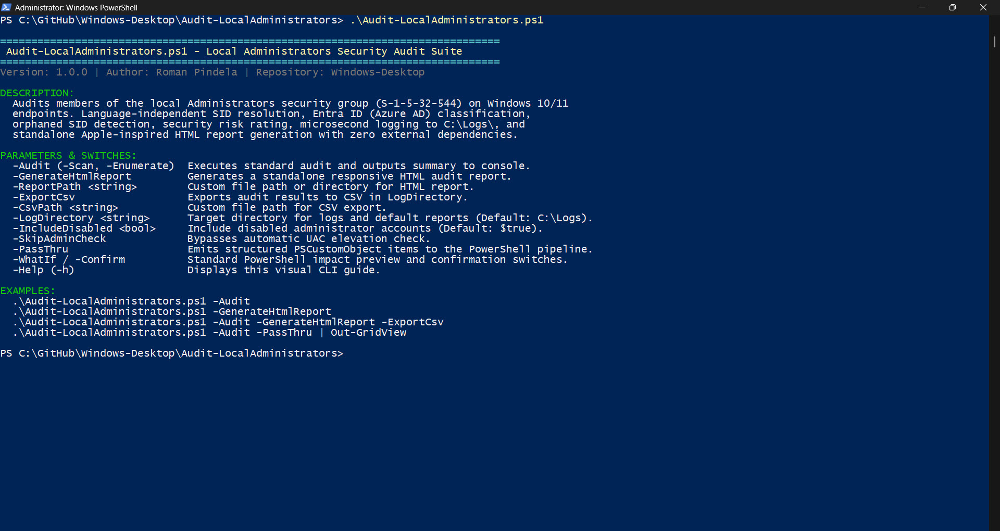
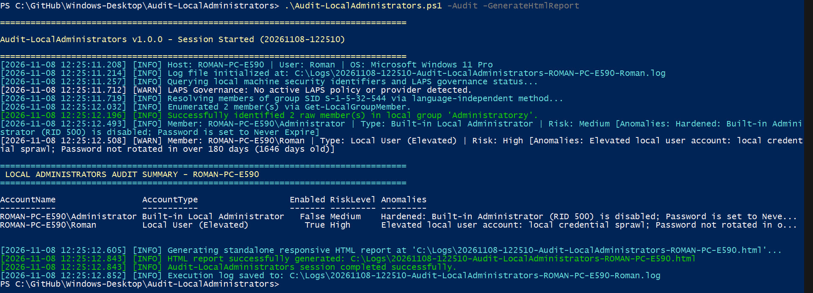
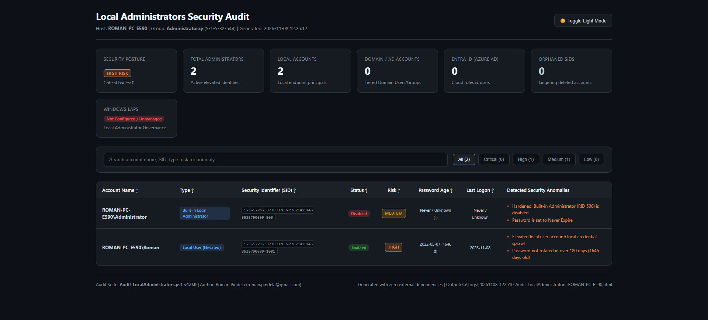

# Audit-LocalAdministrators

[](https://microsoft.com/powershell)
[](https://www.microsoft.com/windows)
[](https://opensource.org/licenses/MIT)
[]()
[]()

## Problem Statement

Unauthorized privilege escalation, lingering orphaned SIDs from deleted accounts, unmanaged built-in Administrator (RID 500) accounts lacking LAPS, and untracked Microsoft Entra ID or domain principals in the local `Administrators` group create critical security exposures—while localized OS group names (e.g., `"Administratorzy"` vs `"Administrators"`) often break standard audit scripts.

## Overview

`Audit-LocalAdministrators.ps1` resolves the local Administrators group via its language-independent Well-Known SID (`S-1-5-32-544`), classifies local, Active Directory, Microsoft Entra ID, and orphaned members, and flags security anomalies such as stale passwords, dormant accounts, and missing LAPS governance. It records UTF-8 logs to `C:\Logs\`, emits `[PSCustomObject]` records, and optionally generates a standalone HTML report and CSV export.

## Environment & Prerequisites

* **Operating System:** Windows 10, Windows 11, or Windows Server 2016 / 2019 / 2022 / 2025 (English, Polish, German, and other localized editions).
* **PowerShell Version:** Windows PowerShell 5.1 or PowerShell 7+.
* **Required Modules & APIs:** Built-in `Microsoft.PowerShell.LocalAccounts` module (`Get-LocalGroupMember`, `Get-LocalUser`) with ADSI `WinNT` provider fallback for resilient SID/group enumeration.

## Permissions Required

* **Admin** — Administrator privileges (Well-Known SID `S-1-5-32-544`) are required to inspect all local Administrators group memberships, query LAPS registry/policy state, and read account metadata. The script automatically requests UAC elevation unless `-SkipAdminCheck` is passed (help via `-Help` / `-h` or zero arguments runs under `User` rights).

## Safety & Impact

* **Risk Level:** `Read-Only / Non-destructive` — performs read-only queries against local security groups, ADSI/AD/Entra ID SIDs, and LAPS configuration; writes only log files and optional HTML/CSV reports in `C:\Logs\` (or `-LogDirectory`).
* **Simulation & Backup:** Supports `-WhatIf` and `-Confirm` (`SupportsShouldProcess = $true`, `ConfirmImpact = 'Medium'`); does not modify accounts or group memberships, so no backup is required.

## Usage Examples

### 1. Interactive Visual Help

```powershell
.\Audit-LocalAdministrators.ps1 -Help
```

### 2. Standard Audit with Console Summary & Log

```powershell
.\Audit-LocalAdministrators.ps1 -Audit
```

### 3. Generate Standalone Offline HTML Report

```powershell
.\Audit-LocalAdministrators.ps1 -GenerateHtmlReport
```

### 4. Full Enterprise Audit (HTML Report + CSV Export)

```powershell
.\Audit-LocalAdministrators.ps1 -Audit -GenerateHtmlReport -ExportCsv
```

### 5. Automated CI/CD or Remote Management Run

```powershell
.\Audit-LocalAdministrators.ps1 -Audit -GenerateHtmlReport -ExportCsv -SkipAdminCheck
```

### 6. Pipeline Chaining & Security Filtering

```powershell
.\Audit-LocalAdministrators.ps1 -Audit -PassThru | Where-Object { $_.RiskLevel -in @('High', 'Critical') }
```

---

## Key Capabilities

* **Language-Independent SID Resolution:** Uses Well-Known SID `S-1-5-32-544` with `Get-LocalGroupMember` and ADSI `WinNT` fallback so enumeration works even with broken domain trusts or non-English locales.
* **Hybrid & Cloud Account Classification:** Distinguishes Built-in Administrator (RID 500) + LAPS state, elevated local users (`RID >= 1000`), Active Directory users/groups, Microsoft Entra ID principals (`S-1-12-1-*`), and orphaned/unresolved SIDs.
* **Security Anomaly Engine:** Flags orphaned SIDs, unmanaged RID 500 accounts without LAPS, credential sprawl, stale passwords (> 90/180 days), dormant accounts (> 90 days), and non-expiring passwords.
* **Standalone HTML Report & Logging:** Generates an offline responsive dark/light mode HTML dashboard with instant filtering/sorting alongside microsecond logs in `C:\Logs\`.

---

## CLI Parameters Reference

| Parameter | Type | Required | Default | Description |
| :--- | :--- | :---: | :--- | :--- |
| `-Audit` | `[switch]` | No | `$false` | Executes the standard audit workflow and outputs results to console. Alias: `-Scan`, `-Enumerate`. |
| `-GenerateHtmlReport` | `[switch]` | No | `$false` | Generates a standalone, styled responsive HTML audit report in `C:\Logs\`. |
| `-ReportPath` | `[string]` | No | `C:\Logs\...html` | Custom file path or directory for the HTML report. |
| `-ExportCsv` | `[switch]` | No | `$false` | Exports raw pipeline audit objects to a structured CSV file in `C:\Logs\`. |
| `-CsvPath` | `[string]` | No | `C:\Logs\...csv` | Custom file path or directory for CSV export. |
| `-LogDirectory` | `[string]` | No | `C:\Logs` | Target directory for execution logs and default reports. |
| `-IncludeDisabled` | `[bool]` | No | `$true` | Includes disabled administrator accounts in the audit. |
| `-SkipAdminCheck` | `[switch]` | No | `$false` | Bypasses automatic UAC elevation check (for automated runners or SYSTEM context). |
| `-PassThru` | `[switch]` | No | `$false` | Emits structured `[PSCustomObject]` records to the PowerShell pipeline. |
| `-Help`, `-h` | `[switch]` | No | `$false` | Displays visual CLI help and syntax reference. |

---

## Anomaly Detection & Risk Matrix

| Risk Level | Trigger Condition | Recommended Remediation |
| :---: | :--- | :--- |
| **Critical** | **Lingering Orphaned SID:** Unresolved SID remains in Administrators group after account deletion. | Remove the orphaned SID via `Remove-LocalGroupMember`. |
| **Critical** | **Unmanaged RID 500:** Built-in Local Administrator account is `Enabled` without Windows LAPS or Legacy LAPS. | Deploy Windows LAPS policy or disable the built-in RID 500 account. |
| **High** | **Active Domain Group / Stale Password (>180d) / Dormant Account (>90d):** Broad domain group nesting or unrotated/unused elevated credentials. | Restrict nested domain groups (PAW), enforce rotation, or revoke unused rights. |
| **Medium** | **Password Never Expires / Local Credential Sprawl:** Non-expiring passwords or multiple active local admins. | Enforce password rotation/LAPS and minimize permanent local admin accounts. |
| **Low** | **Hardened Baseline:** Disabled built-in Administrator, compliant LAPS rotation, or standard managed accounts. | Maintain periodic audits. |

---

## Screenshots & Visual Verification

### 1. Interactive Help Menu & Syntax Guide (`.\Audit-LocalAdministrators.ps1`)


### 2. Security Audit Execution & Console Summary (`.\Audit-LocalAdministrators.ps1 -Audit`)


### 3. Standalone Responsive HTML Audit Report (`.\Audit-LocalAdministrators.ps1 -GenerateHtmlReport`)


---

## Author

* **Author:** Roman Pindela
* **Email:** [roman.pindela@gmail.com](mailto:roman.pindela@gmail.com)
* **GitHub:** [https://github.com/romanpindela](https://github.com/romanpindela)
* **Repository:** [Windows-Desktop](https://github.com/romanpindela/Windows-Desktop)
* **License:** [MIT](https://opensource.org/licenses/MIT)
