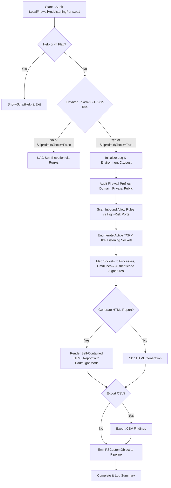
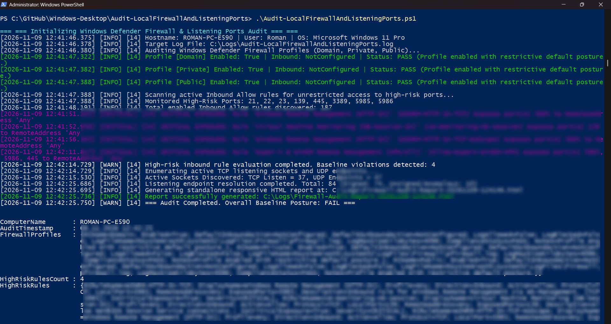

# Audit-LocalFirewallAndListeningPorts

[](https://microsoft.com/powershell)
[](https://www.microsoft.com/windows)
[](https://opensource.org/licenses/MIT)
[]()
[]()

> **Enterprise PowerShell Security Suite for Windows Defender Firewall Posture Auditing, Critical Inbound Exposure Detection, Active Network Socket Inventory, Process Authenticode Signature Verification, and Standalone Responsive HTML Reporting.**

---

## 📌 Overview & Purpose

Network perimeters and local firewall configurations form the first line of defense against lateral movement, ransomware spread, and remote exploitation. Unrestricted firewall rules (`RemoteAddress: Any / * / 0.0.0.0/0`) allowing external access to sensitive management services (e.g., RDP, WinRM, SMB) significantly enlarge an endpoint's attack surface. Concurrently, rogue or compromised listening sockets hosted by unsigned or tampered executables introduce stealthy persistence and backdoor vectors.

`Audit-LocalFirewallAndListeningPorts.ps1` provides an automated, rigorous, and dependency-free auditing solution that evaluates:

1. **Firewall Profile Hardening:** Inspects `Domain`, `Private`, and `Public` profiles for operational status (`Enabled`), default inbound/outbound traffic postures, and event logging configuration (`LogAllowed`, `LogBlocked`).
2. **Critical Exposure Detection:** Identifies active Inbound Allow rules permitting unrestricted remote access (`Any`, `*`, `Internet`, `0.0.0.0/0`, `::/0`) to critical administrative and lateral movement ports (RDP `3389`, WinRM `5985`/`5986`, SMB `445`/`139`, SSH `22`, FTP `21`, Telnet `23`).
3. **Active Network Socket & Service Inventory:** Enumerates all active TCP listening sockets (`Get-NetTCPConnection -State Listen`) and UDP endpoints (`Get-NetUDPEndpoint`), correlates them with owning process identifiers (PID), command-line arguments, and verifies cryptographic Authenticode digital signatures (`Get-AuthenticodeSignature`) to identify unsigned, untrusted, or ghost processes.
4. **Standalone Responsive HTML Reporting:** Generates a 100% self-contained, offline HTML audit dashboard featuring Apple-inspired dark/light mode, real-time client-side search, interactive protocol and signature filtering, and print/PDF optimization.
5. **Telemetry & Automation Native:** Writes microsecond-precision logs to `C:\Logs\`, exports structured CSV inventories, and emits strongly typed `[PSCustomObject]` items directly to the PowerShell pipeline.

---

## ⚡ Key Capabilities

* **Dual PowerShell Engine Compatibility:** Fully compliant with Windows PowerShell 5.1 and modern PowerShell 7+.
* **Language-Independent UAC Self-Elevation:** Automatically validates administrative tokens against Well-Known SID `S-1-5-32-544` (`BuiltInAdministratorsSid`), restarting with elevated privileges (`-Verb RunAs`) while preserving all bound CLI arguments.
* **Granular Baseline Rule Auditing:** Detects broad inbound access across user-defined and standard administrative ports.
* **Process Integrity & Signature Validation:** Flags unsigned binaries, invalid hash signatures, and phantom processes (active listening port whose owning PID no longer exists).
* **High-Performance Caching:** Pre-indexes process trees and caches digital signature verifications to minimize disk I/O and optimize scan latency across hundreds of open sockets.
* **Zero External Dependencies:** The HTML report requires no CDN, internet connection, or external JavaScript libraries.

---

## 🏗️ Architecture & Execution Flow



---

## 📋 Parameter Reference

| Parameter | Type | Default | Description |
| :--- | :--- | :--- | :--- |
| `-LogDirectory` | `string` | `C:\Logs` | Directory where logs, reports, and CSV exports are written (falls back to `%TEMP%\Logs` if unavailable). |
| `-ReportPath` | `string` | `<LogDirectory>\Firewall-Audit-Report-<Timestamp>.html` | Custom destination file path for the standalone HTML audit report. |
| `-HighRiskPorts` | `int[]` | `21, 22, 23, 139, 445, 3389, 5985, 5986` | Array of port numbers evaluated for unrestricted remote inbound exposure. |
| `-NoHtmlReport` | `switch` | `$false` | Suppresses the generation of the standalone HTML audit report. |
| `-ShowReportInBrowser` | `switch` | `$false` | Automatically launches the generated HTML audit report in the default browser upon completion. |
| `-Quiet` | `switch` | `$false` | Suppresses standard console output; detailed logs remain written to the log file. |
| `-SkipAdminCheck` | `switch` | `$false` | Bypasses the UAC elevation check (useful for automated CI/CD runners or SYSTEM contexts). |
| `-ExportCsv` | `switch` | `$false` | Exports listening sockets and process inventory to a structured CSV file. |
| `-CsvPath` | `string` | `<LogDirectory>\Firewall-Audit-Report-<Timestamp>.csv` | Custom destination file path for the CSV export. |
| `-PassThru` | `switch` | `$false` | Explicitly emits the structured `[PSCustomObject]` summary to the PowerShell pipeline. |
| `-Help` (`-h`) | `switch` | `$false` | Displays interactive CLI help and parameter syntax documentation. |

---

## 💻 Usage Examples

### 1. Interactive Help Reference
```powershell
.\Audit-LocalFirewallAndListeningPorts.ps1 -Help
```

### 2. Standard Audit with Default Settings
Performs a comprehensive audit, logs to `C:\Logs\Audit-LocalFirewallAndListeningPorts.log`, and generates a standalone HTML report:
```powershell
.\Audit-LocalFirewallAndListeningPorts.ps1
```

### 3. Open HTML Report Automatically in Browser
Runs the full audit and opens the resulting HTML report immediately:
```powershell
.\Audit-LocalFirewallAndListeningPorts.ps1 -ShowReportInBrowser
```

### 4. Custom High-Risk Port Definition & CSV Export
Audits custom ports (e.g., SSH `22`, HTTP `80`, HTTPS `443`, RDP `3389`, Web Alt `8080`) and exports inventory to CSV:
```powershell
.\Audit-LocalFirewallAndListeningPorts.ps1 -HighRiskPorts @(22, 80, 443, 3389, 8080) -ExportCsv
```

### 5. Automated Pipeline Filtering for SecOps
Query high-risk exposures and pipe findings downstream:
```powershell
$audit = .\Audit-LocalFirewallAndListeningPorts.ps1 -PassThru
$audit.HighRiskRules | Select-Object DisplayName, LocalPort, RemoteAddress, Action | Format-Table -AutoSize
```

### 6. Filter Unsigned Listening Processes
Find listening sockets belonging to unsigned or anomalous software:
```powershell
$audit = .\Audit-LocalFirewallAndListeningPorts.ps1 -PassThru
$audit.ListeningEndpoints | Where-Object { -not $_.IsSigned -and $_.OwningProcess -notin @(0, 4) } | Format-Table Protocol, LocalPort, ProcessName, ExecutablePath -AutoSize
```

---

## 📊 Pipeline Data Model (`[PSCustomObject]`)

The script returns a structured object to the PowerShell pipeline:

```powershell
[PSCustomObject]@{
    ComputerName       = "ROMAN-PC-E590"
    AuditTimestamp     = [datetime]"2026-11-09T12:31:54"
    FirewallProfiles   = @( ... ) # Array of profile status objects
    HighRiskRulesCount = 4
    HighRiskRules      = @( ... ) # Array of detected baseline rule violations
    ListeningEndpoints = @( ... ) # Array of 87 listening socket and process inventory objects
    SummaryStatus      = "FAIL"   # PASS if 0 high risk rules and all profiles enabled; otherwise FAIL
}
```

### Endpoint Object Properties:
* `Protocol`: `TCP` or `UDP`
* `LocalAddress`: Local IP address bound to the socket (e.g., `0.0.0.0`, `127.0.0.1`, `::`)
* `LocalPort`: Bound port number (e.g., `5985`, `445`)
* `OwningProcess`: Process ID (PID)
* `ProcessName`: Process image name (e.g., `svchost.exe`, `System`)
* `ExecutablePath`: Full path to binary on disk
* `CommandLine`: Exact command line invocation (via CIM/WMI)
* `AuthenticodeStatus`: `Valid`, `NotSigned`, `HashMismatch`, `Protected System Process`, etc.
* `IsSigned`: Boolean signature validation flag
* `SignerSubject`: Common Name (CN) or subject of the signing certificate
* `SignerIssuer`: Issuer certificate authority
* `IsPhantom`: Boolean flag indicating whether the owning process has terminated or vanished

---

## 🎨 HTML Report Features

The generated HTML audit report is self-contained with no external CDN or web font dependencies:

* **Executive Metrics Grid:** High-level summary cards (Firewall Profiles Active, High-Risk Exposure Violations, Total Listening Sockets, Authenticode Signature Coverage).
* **Theme Switching:** Dark/Light mode toggle with persistence during session.
* **Interactive Live Filter:** Client-side real-time search box filtering by port number, IP address, process name, PID, or certificate authority.
* **Filter Pills:** One-click filtering for `All`, `Unsigned Only`, `TCP Only`, and `UDP Only` endpoints.
* **Color-Coded Badges:** Red highlight for critical baseline exposures; yellow/orange alerts for unsigned listening services; green badges for passing controls.
* **Print-Friendly Styles:** Integrated `@media print` CSS for clean PDF export or compliance documentation.

---

## 🛡️ Default Monitored High-Risk Ports

| Port | Protocol / Service | Threat & Lateral Movement Risk |
| :---: | :---: | :--- |
| **3389** | Remote Desktop Protocol (RDP) | Brute-force credential attacks, BlueKeep-style exploitation, interactive remote compromise. |
| **5985** | Windows Remote Management (WinRM HTTP) | Remote PowerShell execution, automated lateral movement, pass-the-hash persistence. |
| **5986** | Windows Remote Management (WinRM HTTPS) | Encrypted remote administrative command execution without perimeter restriction. |
| **445** | Server Message Block (SMB) | EternalBlue / WannaCry exploits, pass-the-hash / ticket attacks, unauthorized share enumeration. |
| **139** | NetBIOS Session Service | Legacy SMB relay attacks, NetBIOS name spoofing, network reconnaissance. |
| **22** | Secure Shell (SSH) | Unauthorized remote shell access, automated credential brute forcing. |
| **21** | File Transfer Protocol (FTP) | Plaintext credential transmission, unauthorized file exfiltration or staging. |
| **23** | Telnet | Insecure plaintext terminal access, credential sniffing. |

---

## 📁 Repository Structure

```text
Windows-Desktop/
└── Audit-LocalFirewallAndListeningPorts/
    ├── Audit-LocalFirewallAndListeningPorts.ps1
    ├── README.md
    └── SPECIFICATION-Audit-LocalFirewallAndListeningPorts.md
```

---

## 📸 Screenshots & Visual Verification

### Security Audit Execution & Console Summary (`.\Audit-LocalFirewallAndListeningPorts.ps1`)


---

## 👤 Author & Support

* **Author:** Roman Pindela
* **Email:** roman.pindela@gmail.com
* **GitHub:** [https://github.com/romanpindela](https://github.com/romanpindela)
* **Repository:** [Windows-Desktop](https://github.com/romanpindela/Windows-Desktop)
* **Version:** 1.0.0
* **Date:** 2026-11-09
