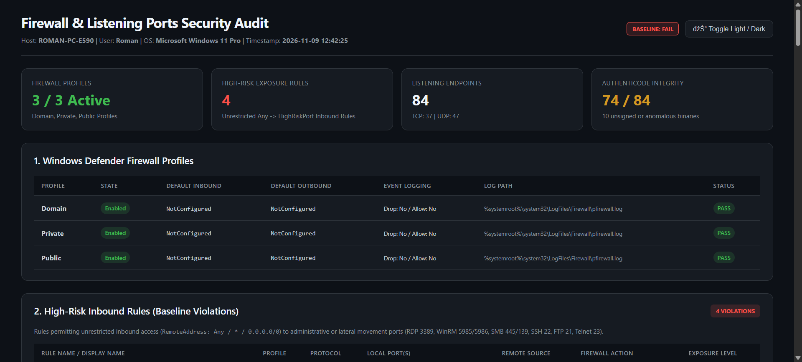

# Audit-LocalFirewallAndListeningPorts

[](https://microsoft.com/powershell)
[](https://www.microsoft.com/windows)
[](https://opensource.org/licenses/MIT)
[]()
[]()

## Problem Statement

Unrestricted inbound Windows Firewall rules (`RemoteAddress: Any / * / 0.0.0.0/0`) exposing administrative services (RDP, WinRM, SMB, SSH) and listening network sockets owned by unsigned or phantom binaries significantly widen the endpoint attack surface and hide potential backdoors.

## Overview

`Audit-LocalFirewallAndListeningPorts.ps1` audits Windows Defender Firewall profiles (`Domain`, `Private`, `Public`), flags unrestricted inbound rules targeting high-risk ports, and inventories active TCP/UDP listening sockets along with owning process paths, command lines, and Authenticode digital signatures. It outputs console summaries, UTF-8 logs, CSV/pipeline data, and a standalone offline HTML dashboard.

## Environment & Prerequisites

* **Operating System:** Windows 10, Windows 11, or Windows Server 2016 / 2019 / 2022 / 2025.
* **PowerShell Version:** Windows PowerShell 5.1 or PowerShell 7+.
* **Required Modules & APIs:** Built-in `NetSecurity` (`Get-NetFirewallProfile`, `Get-NetFirewallRule`), `NetTCPIP` (`Get-NetTCPConnection`, `Get-NetUDPEndpoint`), `Microsoft.PowerShell.Security` (`Get-AuthenticodeSignature`), and CIM (`Win32_Process`).

## Permissions Required

* **Admin** — Administrator privileges (Well-Known SID `S-1-5-32-544`) are required to inspect all firewall profiles/rules, query process command lines and paths for SYSTEM/elevated listening sockets, and verify executable signatures across protected folders. Automatically self-elevates via UAC unless `-SkipAdminCheck` is passed (help via `-Help` / `-h` runs without elevation).

## Safety & Impact

* **Risk Level:** `Read-Only / Non-destructive` — performs read-only inspection of firewall profiles, rules, listening sockets, process metadata, and Authenticode signatures; writes only log files (`C:\Logs\`) and optional HTML/CSV reports.
* **Simulation & Backup:** Declares `[CmdletBinding(SupportsShouldProcess = $true, ConfirmImpact = 'Medium')]` (accepting `-WhatIf` / `-Confirm` common parameters); no firewall rules or system settings are altered, so no backup is required.

## Usage Examples

### 1. Interactive Help Reference

```powershell
.\Audit-LocalFirewallAndListeningPorts.ps1 -Help
```

### 2. Standard Audit with Default Settings

```powershell
.\Audit-LocalFirewallAndListeningPorts.ps1
```

### 3. Open HTML Report Automatically in Browser

```powershell
.\Audit-LocalFirewallAndListeningPorts.ps1 -ShowReportInBrowser
```

### 4. Custom High-Risk Port Definition & CSV Export

```powershell
.\Audit-LocalFirewallAndListeningPorts.ps1 -HighRiskPorts @(22, 80, 443, 3389, 8080) -ExportCsv
```

### 5. Automated Pipeline Filtering for SecOps

```powershell
$audit = .\Audit-LocalFirewallAndListeningPorts.ps1 -PassThru
$audit.HighRiskRules | Select-Object DisplayName, LocalPort, RemoteAddress, Action | Format-Table -AutoSize
```

### 6. Filter Unsigned Listening Processes

```powershell
$audit = .\Audit-LocalFirewallAndListeningPorts.ps1 -PassThru
$audit.ListeningEndpoints | Where-Object { -not $_.IsSigned -and $_.OwningProcess -notin @(0, 4) } | Format-Table Protocol, LocalPort, ProcessName, ExecutablePath -AutoSize
```

---

## Parameter Reference

| Parameter | Type | Default | Description |
| :--- | :--- | :--- | :--- |
| `-LogDirectory` | `string` | `C:\Logs` | Directory where logs, reports, and CSV exports are written (falls back to `%TEMP%\Logs`). |
| `-ReportPath` | `string` | `<LogDirectory>\Firewall-Audit-Report-<Timestamp>.html` | Custom destination file path for the standalone HTML audit report. |
| `-HighRiskPorts` | `int[]` | `21, 22, 23, 139, 445, 3389, 5985, 5986` | Port numbers evaluated for unrestricted remote inbound exposure. |
| `-NoHtmlReport` | `switch` | `$false` | Suppresses generation of the standalone HTML audit report. |
| `-ShowReportInBrowser` | `switch` | `$false` | Automatically launches the HTML audit report in the default browser. |
| `-Quiet` | `switch` | `$false` | Suppresses console output; telemetry remains written to the log file. |
| `-SkipAdminCheck` | `switch` | `$false` | Bypasses UAC elevation check (for CI/CD runners or SYSTEM contexts). |
| `-ExportCsv` | `switch` | `$false` | Exports listening sockets and process inventory to a CSV file. |
| `-CsvPath` | `string` | `<LogDirectory>\Firewall-Audit-Report-<Timestamp>.csv` | Custom destination file path for the CSV export. |
| `-PassThru` | `switch` | `$false` | Emits the structured `[PSCustomObject]` summary to the PowerShell pipeline. |
| `-Help` (`-h`) | `switch` | `$false` | Displays interactive CLI help and parameter syntax documentation. |

---

## Default Monitored High-Risk Ports

| Port | Protocol / Service | Threat & Lateral Movement Risk |
| :---: | :---: | :--- |
| **3389** | Remote Desktop Protocol (RDP) | Brute-force credential attacks, remote exploitation, interactive compromise. |
| **5985 / 5986** | Windows Remote Management (WinRM) | Remote PowerShell execution, lateral movement, pass-the-hash persistence. |
| **445 / 139** | SMB / NetBIOS Session Service | Wormable exploits, pass-the-hash/relay attacks, unauthorized share enumeration. |
| **22** | Secure Shell (SSH) | Unauthorized remote shell access, credential brute forcing. |
| **21 / 23** | FTP / Telnet | Plaintext credential transmission and unencrypted terminal access. |

---

## Directory Structure

```text
Audit-LocalFirewallAndListeningPorts/
├── assets/
│   ├── Firewall-Listening-Ports-Security-Audit-ROMAN-PC-E590-11-09-2026_12_45_PM.png
│   └── Raport.jpg
├── Audit-LocalFirewallAndListeningPorts.ps1
└── README.md
```

---

## Screenshots & Visual Verification

### 1. Security Audit Execution & Console Summary (`.\Audit-LocalFirewallAndListeningPorts.ps1`)


### 2. Standalone Responsive HTML Audit Report (`.\Audit-LocalFirewallAndListeningPorts.ps1 -ShowReportInBrowser`)


---

## Author

* **Author:** Roman Pindela
* **Email:** [roman.pindela@gmail.com](mailto:roman.pindela@gmail.com)
* **GitHub:** [https://github.com/romanpindela](https://github.com/romanpindela)
* **Repository:** [Windows-Desktop](https://github.com/romanpindela/Windows-Desktop)
* **Version:** 1.0.0
* **Release Date:** 2026-11-09
* **License:** MIT
