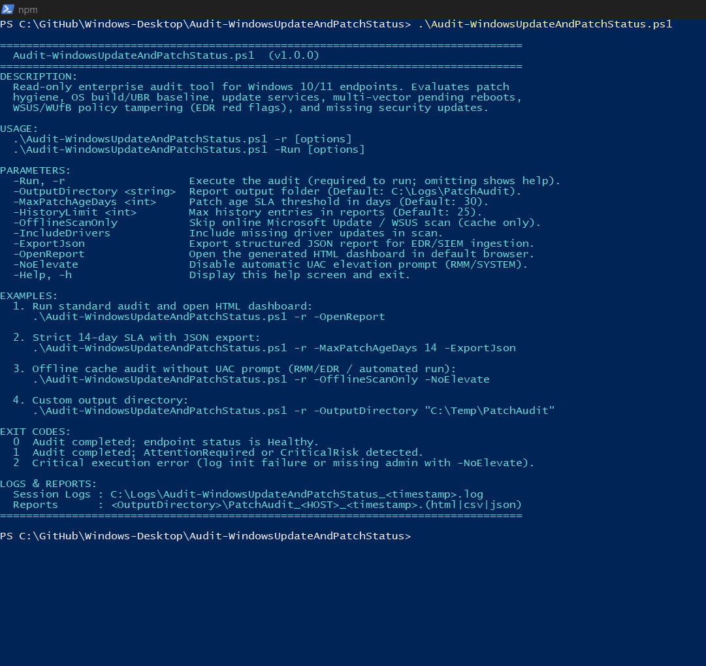
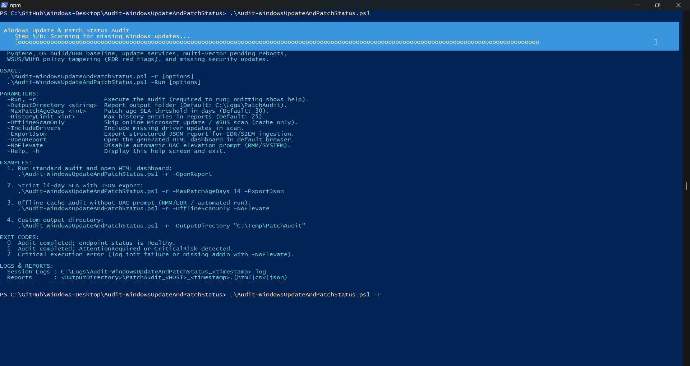
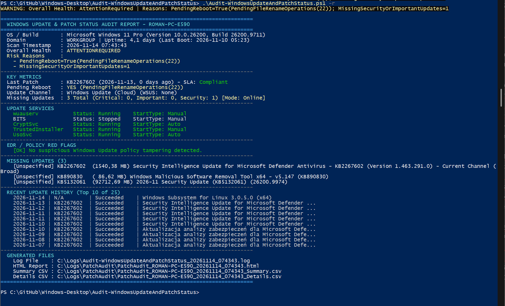
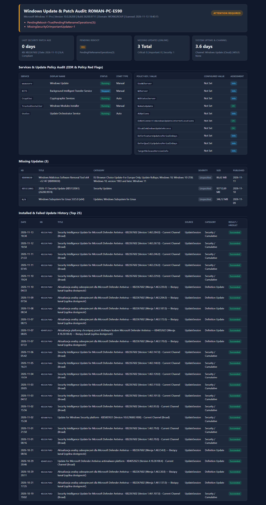
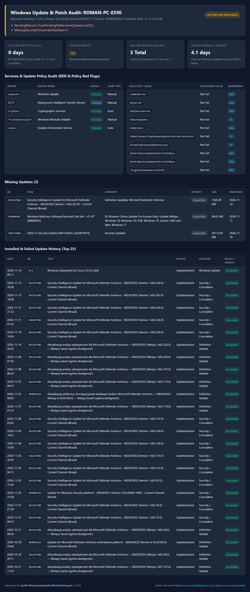

# Audit-WindowsUpdateAndPatchStatus

[](https://microsoft.com/powershell)
[](https://www.microsoft.com/windows)
[]()

## Problem Statement

Unpatched endpoints, stalled reboot loops, disabled Windows Update services, or orphaned/tampered WSUS policy settings expose Windows workstations to known vulnerabilities and complicate incident response or compliance audits. Administrators and SOC/EDR teams need an offline-capable, zero-dependency script that evaluates update channels, patch age SLAs, pending reboots, and missing security updates across local endpoints and outputs structured reports without changing system configuration.

## Overview

`Audit-WindowsUpdateAndPatchStatus.ps1` performs a read-only audit of Windows Update health, patch age, pending reboot flags, update channel policies, and missing updates on Windows 10 and Windows 11 systems. It generates console output, timestamped logs, an offline HTML dashboard, summary/detail CSV files, optional SIEM/EDR JSON output, and deterministic exit codes (`0`, `1`, `2`).

### Audited Areas

1. **Host & OS Baseline:** Hostname, domain/workgroup, OS caption, version, build number, **UBR (Update Build Revision)** from `HKLM:\SOFTWARE\Microsoft\Windows NT\CurrentVersion`, system uptime (`LastBootUpTime`, `UptimeDays`), and service status/startup type for `wuauserv`, `bits`, `cryptsvc`, `TrustedInstaller`, and `UsoSvc`.
2. **Installed Patches & Patch Age:** Dual-source patch history combining `Get-HotFix` (`Win32_QuickFixEngineering`) and COM API `Microsoft.Update.Session` (`QueryHistory`), including failed installations with `HResult` codes and SLA compliance against `-MaxPatchAgeDays` (default `30` days).
3. **Multi-Vector Pending Reboot Detection:** Checks CBS (`RebootPending`, `RebootInProgress`, `PackagesPending`), Windows Update (`RebootRequired`, `PostRebootReporting`), Session Manager (`PendingFileRenameOperations`), Computer Rename / Domain Join mismatch, and SCCM/ConfigMgr (`CCM_ClientUtilities.DetermineIfRebootPending()`).
4. **Update Channel & EDR Policy Red Flags:** Identifies `Windows Update (Cloud)`, `WSUS`, or `Windows Update for Business (WUfB)` and flags `NoAutoUpdate=1`, `DisableWindowsUpdateAccess=1`, `DoNotConnectToWindowsUpdateInternetLocations=1` (without WSUS), and unreachable or loopback `WUServer` targets.
5. **Missing Updates Scan:** Queries `Microsoft.Update.Session` for missing `Software` (and optionally `Driver`) updates categorized by `MsrcSeverity` and classification.

## Environment & Prerequisites

- **OS:** Windows 10 / Windows 11 (Enterprise / Pro)
- **PowerShell:** Windows PowerShell 5.1 or PowerShell 7.x+
- **Dependencies:** Native Windows COM API (`Microsoft.Update.Session`) and WMI/CIM; no external PowerShell modules or internet CDN dependencies for HTML reports (use `-OfflineScanOnly` for air-gapped hosts).

## Permissions Required

**Admin** — Requires Local Administrator (SID `S-1-5-32-544`) or `NT AUTHORITY\SYSTEM` (SID `S-1-5-18`) to query protected Windows Update registry keys, COM update searcher APIs, CBS/SCCM reboot state, and write default logs to `C:\Logs`. If launched from a standard user account without `-NoElevate`, the script automatically requests UAC elevation while preserving all CLI parameters; omitting `-Run` or passing `-Help` prints help without elevation.

## Safety & Impact

- **Risk Level:** `Read-Only / Non-destructive` — Performs audit queries only and does not install updates, restart services, or modify registry policies.
- **WhatIf / Confirm & Backup:** Does not support `-WhatIf` / `-Confirm` (`SupportsShouldProcess` is `$false`) and requires no backups because it makes no system state changes (writes audit logs and report files only).

## Usage Examples

```powershell
# Display CLI help guide and usage examples
.\Audit-WindowsUpdateAndPatchStatus.ps1
.\Audit-WindowsUpdateAndPatchStatus.ps1 -h

# Standard interactive audit (prompts UAC if not elevated)
.\Audit-WindowsUpdateAndPatchStatus.ps1 -r -OpenReport

# Strict 14-day SLA with JSON export for SIEM/EDR
.\Audit-WindowsUpdateAndPatchStatus.ps1 -r -MaxPatchAgeDays 14 -ExportJson

# Non-interactive RMM/EDR execution using local update cache only
.\Audit-WindowsUpdateAndPatchStatus.ps1 -r -OfflineScanOnly -NoElevate -OutputDirectory "C:\Logs\PatchAudit"
```

### Parameters

| Parameter | Type | Default | Description |
| :--- | :--- | :--- | :--- |
| `-Run`, `-r` | `[switch]` | `$false` | Executes the audit. Omitting `-Run` displays the CLI help guide and examples. |
| `-OutputDirectory` | `[string]` | `C:\Logs\PatchAudit` | Target directory for generated HTML, CSV, and JSON reports. |
| `-MaxPatchAgeDays` | `[int]` | `30` | Maximum acceptable age in days since the last security/cumulative patch. |
| `-HistoryLimit` | `[int]` | `25` | Number of recent update history entries included in detailed reports. |
| `-OfflineScanOnly` | `[switch]` | `$false` | Skips online queries to Microsoft Update / WSUS (`UpdateSearcher.Online = $false`). |
| `-IncludeDrivers` | `[switch]` | `$false` | Includes missing driver updates (`Type='Driver'`) in the scan. |
| `-ExportJson` | `[switch]` | `$false` | Generates an additional `.json` report for EDR/SIEM ingestion. |
| `-OpenReport` | `[switch]` | `$false` | Automatically opens the generated HTML dashboard in the default browser. |
| `-NoElevate` | `[switch]` | `$false` | Disables automatic UAC elevation (for RMM/EDR agents or non-interactive runs). |
| `-Help`, `-h` | `[switch]` | `$false` | Displays the interactive CLI help guide and usage examples. |

### Output Files

- **Session Log:** `C:\Logs\Audit-WindowsUpdateAndPatchStatus_<YYYYMMDD_HHmmss>.log`
- **HTML Dashboard:** `<OutputDirectory>\PatchAudit_<HOST>_<TIMESTAMP>.html`
- **Summary CSV:** `<OutputDirectory>\PatchAudit_<HOST>_<TIMESTAMP>_Summary.csv`
- **Details CSV:** `<OutputDirectory>\PatchAudit_<HOST>_<TIMESTAMP>_Details.csv`
- **JSON Report (optional):** `<OutputDirectory>\PatchAudit_<HOST>_<TIMESTAMP>.json`

### EDR / Security Interpretation & Exit Codes

- **`Healthy` (`0`):** Patch age within SLA, no pending reboot, no missing critical/important security updates, all update services enabled, and no policy red flags.
- **`AttentionRequired` (`1`):** Pending reboot detected, patch age exceeded (`> MaxPatchAgeDays`), missing important/security updates, high uptime (`> 30` days), or recent failed update installations.
- **`CriticalRisk` (`1`):** Missing `Critical` updates, patch age `> 2 * MaxPatchAgeDays`, disabled update service, or EDR policy red flags (`NoAutoUpdate=1`, `DisableWindowsUpdateAccess=1`, unreachable/loopback `WUServer`).
- **`2`:** Critical execution error (e.g., log initialization failure or missing admin rights with `-NoElevate`).

### Screenshots











## Author

- **Roman Pindela**
- **Email:** [roman.pindela@gmail.com](mailto:roman.pindela@gmail.com)
- **GitHub:** [https://github.com/romanpindela](https://github.com/romanpindela)
- **Repository:** [Windows-Desktop](https://github.com/romanpindela/Windows-Desktop)
