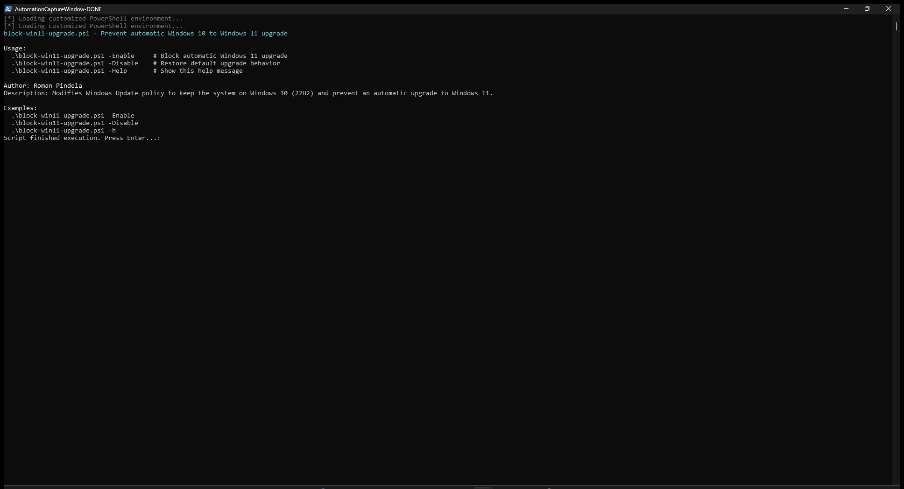

# Block-Win11Upgrade

[](https://microsoft.com/powershell)
[](https://www.microsoft.com/windows)

## Problem Statement

Windows 10 endpoints managed in small offices or legacy environments can receive unexpected automatic feature upgrades to Windows 11, causing driver incompatibilities, user disruption, or broken line-of-business software. Administrators need a quick, reversible CLI tool to pin Windows 10 systems to `22H2` through official Windows Update policy keys or remove that block when ready to upgrade.

## Overview

`Block-Win11Upgrade.ps1` manages Windows Update target-release registry policies (`TargetReleaseVersion`, `ProductVersion`, and `TargetReleaseVersionInfo`) under `HKLM:\SOFTWARE\Policies\Microsoft\Windows\WindowsUpdate` and restarts the Windows Update service (`wuauserv`). Running the script with `-Enable` pins the system to Windows 10 `22H2`, `-Disable` removes those policy values, and omitting parameters or passing `-ShowHelp` displays usage instructions.

## Environment & Prerequisites

- **OS:** Windows 10 (Pro, Enterprise, or Education recommended for policy support)
- **PowerShell:** Windows PowerShell 5.1 or PowerShell 7.x+
- **Modules / Dependencies:** Native PowerShell cmdlets and `wuauserv` service; no external modules required.

## Permissions Required

**Admin** — Modifying `HKLM:\SOFTWARE\Policies\Microsoft\Windows\WindowsUpdate` and restarting the `wuauserv` service require an elevated Administrator session. Viewing help (`-ShowHelp` or no parameters) works as a standard `User`.

## Safety & Impact

- **Risk Level:** `Modifies system state` — Writes or removes Windows Update policy values in `HKLM` and restarts the `wuauserv` service (`-Enable` / `-Disable`).
- **WhatIf / Confirm & Backup:** Does not support `-WhatIf` / `-Confirm` and does not create an automatic registry backup before applying or removing policy keys.

## Usage Examples

```powershell
# Display built-in help and usage examples (also shown when run without parameters)
.\Block-Win11Upgrade.ps1 -ShowHelp
.\Block-Win11Upgrade.ps1 -h

# Block automatic upgrades by pinning Windows 10 22H2
.\Block-Win11Upgrade.ps1 -Enable

# Remove the upgrade block and allow Windows 11 upgrades again
.\Block-Win11Upgrade.ps1 -Disable
```

### Parameters

| Parameter | Alias | Type | Default | Description |
| :--- | :--- | :--- | :--- | :--- |
| `-Enable` | | `[switch]` | `$false` | Sets Windows Update policy keys to pin Windows 10 `22H2` and restarts `wuauserv`. |
| `-Disable` | | `[switch]` | `$false` | Removes the Windows 10 target-version policy keys and restarts `wuauserv`. |
| `-ShowHelp` | `-h`, `-help` | `[switch]` | `$false` | Displays interactive help and usage examples. |

### Screenshots



## Author

- **Roman Pindela**
- **Email:** [roman.pindela@gmail.com](mailto:roman.pindela@gmail.com)
- **GitHub:** [https://github.com/romanpindela](https://github.com/romanpindela)
