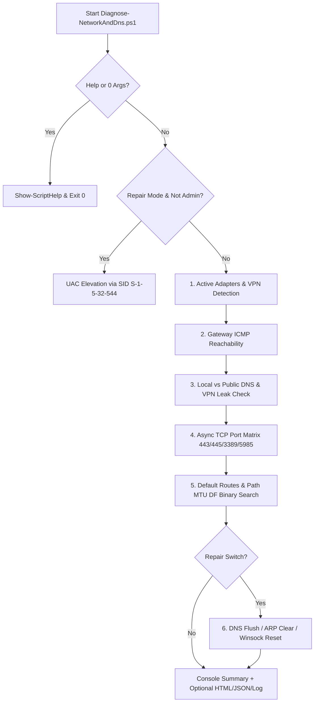

# Diagnose-NetworkAndDns

[](https://microsoft.com/powershell)
[](https://www.microsoft.com/windows)
[]()
[]()
[](https://opensource.org/licenses/MIT)

## Problem Statement

When an end user reports broken internet access, slow internal resources, or VPN issues, technicians typically juggle half a dozen manual utilities (`ipconfig`, `ping`, `nslookup`, `route print`, `Test-NetConnection`, `netsh`). Diagnosing split-tunnel DNS leaks, Path MTU blackholes, or blocked administrative ports (`443`, `445`, `3389`, `5985`) manually is slow and inconsistent across Polish and English Windows locales.

## Overview

`Diagnose-NetworkAndDns.ps1` provides a single-pass, language-independent Windows network diagnostic and safe remediation utility. It inspects active network adapters and VPN tunnels, validates default gateway reachability, compares local DNS resolution against public reference resolvers (`1.1.1.1` and `8.8.8.8`), flags potential VPN DNS leaks, probes key TCP ports asynchronously, checks default routing metrics, discovers Path MTU via ICMP Don't-Fragment binary search, and offers an optional `-Repair` mode (DNS flush, ARP cache clear, Winsock reset) protected by `-WhatIf` and SID-based UAC elevation (`S-1-5-32-544`).

---

## Technical Architecture



```text
+-----------------------------------------------------------------------+
|                     Diagnose-NetworkAndDns.ps1                        |
+-------------------+-----------------------+---------------------------+
| Network & VPN     | DNS & Routing         | Connectivity & Repair     |
| - Get-NetAdapter  | - Resolve-DnsName     | - .NET Async TcpClient    |
| - Get-VpnConn     |   (Local vs 1.1.1.1   |   (443, 445, 3389, 5985)  |
| - .NET Ping GW    |    and 8.8.8.8)       | - DF-Bit Path MTU Search  |
| - Interface MTU   | - NRPT & Metric Leak  | - -Repair (DNS/ARP/       |
|                   |   Heuristics          |   Winsock + -WhatIf)      |
+-------------------+-----------------------+---------------------------+
```

---

## Prerequisites & Unblocking

* **Operating System:** Windows 10, Windows 11, or Windows Server 2016+ (EN / PL locale-independent).
* **PowerShell Version:** Windows PowerShell 5.1 or PowerShell 7+.
* **Permissions:**
  * `-Run` (read-only diagnostics): Standard User.
  * `-Repair` (DNS/ARP/Winsock remediation): Administrator (`S-1-5-32-544`, automatic UAC prompt).
* **Unblock Downloaded Script:**
  ```powershell
  Unblock-File -Path ".\Diagnose-NetworkAndDns.ps1"
  ```

---

## Script Parameters

| Parameter | Alias | Type | Default | Description |
| :--- | :--- | :--- | :--- | :--- |
| `-Run` | `-Diagnose`, `-All` | `[switch]` | `$false` | Executes the full read-only network, DNS, VPN, TCP port, routing, and MTU diagnostic suite. |
| `-Repair` | — | `[switch]` | `$false` | Flushes DNS cache, clears ARP neighbor cache, and resets Winsock catalog (Admin + `-WhatIf`). |
| `-SkipWinsockReset` | — | `[switch]` | `$false` | Skips `netsh winsock reset` during `-Repair` (avoids reboot recommendation). |
| `-TargetHost` | — | `[string[]]` | `cloudflare.com`, `microsoft.com`, `google.com` | Hostnames resolved for local vs public DNS comparison. |
| `-PublicDnsServers` | — | `[string[]]` | `1.1.1.1`, `8.8.8.8` | Reference public DNS resolvers. |
| `-PortTarget` | — | `[string]` | Auto (Gateway / `microsoft.com`) | Explicit target host or IP for TCP port probing. |
| `-Ports` | — | `[int[]]` | `443, 445, 3389, 5985` | TCP ports to probe asynchronously. |
| `-TcpTimeoutMs` | — | `[int]` | `2000` | Timeout in milliseconds per TCP port probe (`250`–`15000`). |
| `-MtuTarget` | — | `[string]` | `1.1.1.1` | Target IP/hostname for ICMP DF-bit Path MTU discovery. |
| `-GenerateHtmlReport` | `-ExportHtml` | `[switch]` | `$false` | Exports a standalone responsive Dark/Light HTML report. |
| `-ReportPath` | `-ExportPath` | `[string]` | `C:\Logs\Diagnose-NetworkAndDns_<host>_<ts>.html` | Custom HTML report file or directory path. |
| `-OpenReport` | — | `[switch]` | `$false` | Opens the generated HTML report in the default browser. |
| `-ExportJson` | — | `[switch]` | `$false` | Exports full structured results to JSON. |
| `-JsonPath` | — | `[string]` | `C:\Logs\Diagnose-NetworkAndDns_<host>_<ts>.json` | Custom JSON file or directory path. |
| `-PassThru` | — | `[switch]` | `$false` | Returns the structured `[PSCustomObject]` to the pipeline. |
| `-EnableLogging` | `-Log` | `[switch]` | `$false` | Writes structured UTF-8 execution logs to `C:\Logs\`. |
| `-LogDirectory` | — | `[string]` | `C:\Logs` | Base output directory for logs and default reports (falls back to `%TEMP%\Logs`). |
| `-SkipAdminCheck` | — | `[switch]` | `$false` | Bypasses automatic UAC elevation check (for testing / `-WhatIf`). |
| `-Help` | `-h` | `[switch]` | `$false` | Displays interactive console help and exits cleanly. |

---

## Usage Examples

### 1. Run Full Network & DNS Diagnostics
```powershell
.\Diagnose-NetworkAndDns.ps1 -Run
```

### 2. Target an Internal Server & Open HTML Report
```powershell
.\Diagnose-NetworkAndDns.ps1 -Run -PortTarget "dc01.corp.local" -GenerateHtmlReport -OpenReport
```

### 3. Dry-Run Safe Network Repair (`-WhatIf`)
```powershell
.\Diagnose-NetworkAndDns.ps1 -Repair -WhatIf
```

### 4. Flush DNS & ARP Only (No Winsock Reset) with Logging
```powershell
.\Diagnose-NetworkAndDns.ps1 -Run -Repair -SkipWinsockReset -EnableLogging
```

### 5. Pipeline Automation (`-PassThru`)
```powershell
$net = .\Diagnose-NetworkAndDns.ps1 -Run -PassThru
$net.DnsDiagnostics | Select-Object VpnDetected, DnsLeakRisk, DnsLeakNotes
```

### 6. Run Directly from GitHub (via `Invoke-GitHubScript.ps1`)
```powershell
.\Invoke-GitHubScript.ps1 -UrlToDownload "https://github.com/romanpindela/Windows-Desktop/blob/main/Diagnose-NetworkAndDns/Diagnose-NetworkAndDns.ps1" -ScriptArgs "-Run"
```

---

## Assets

Screenshots and sample HTML report captures can be stored in the local `assets/` directory (`Diagnose-NetworkAndDns/assets/`).

---

## Logging & Troubleshooting

* **Log Path:** `C:\Logs\<yyyyMMdd-HHmmss>-Diagnose-NetworkAndDns-<COMPUTERNAME>-<USERNAME>.log` (when `-EnableLogging` is enabled; automatically falls back to `$env:TEMP\Logs` if `C:\Logs` is not writable).
* **Path MTU shows `Undetermined`:** Some corporate firewalls or ISPs drop ICMP Echo Requests with the Don't-Fragment bit set. Try `-MtuTarget` pointing to your internal router or VPN gateway.
* **Winsock Reset Reboot Notice:** When `-Repair` runs without `-SkipWinsockReset`, Windows requires a reboot for the refreshed Winsock catalog to take full effect.

---

## Changelog

### v1.0.0 (2026-11-19)
* Initial release featuring active adapter & VPN detection, language-independent gateway ping, local vs public DNS comparison, VPN DNS leak heuristics, async TCP port matrix, routing analysis, DF-bit Path MTU binary search, safe `-Repair` mode, and standalone HTML/JSON reporting.

---

## Author & Metadata

* **Author:** Roman Pindela
* **Email:** roman.pindela@gmail.com
* **GitHub:** [https://github.com/romanpindela](https://github.com/romanpindela)
* **Version:** `1.0.0` (SemVer)
* **Last Modified:** `2026-11-19`
