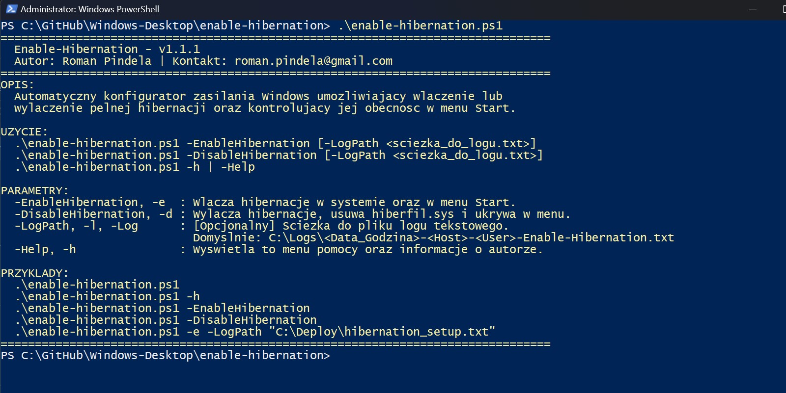
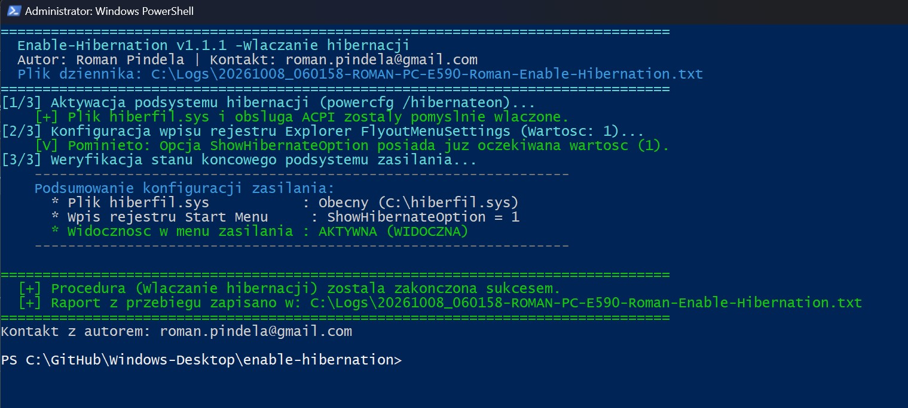
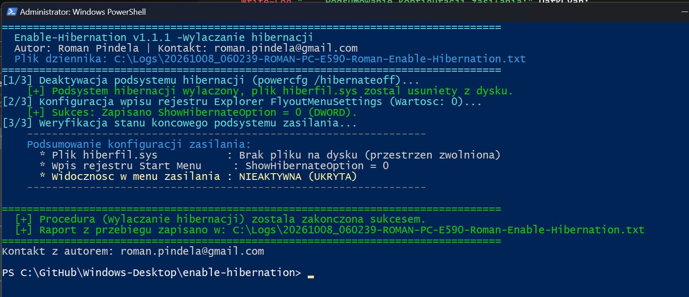

# Enable-Hibernation

[](https://microsoft.com/powershell)
[](https://www.microsoft.com/windows)

## Problem Statement

On Windows 10 and 11 systems, hibernation may be disabled at the kernel level (`hiberfil.sys` absent) or hidden from the Start Menu power options even when enabled, while virtual machines or SSD-constrained workstations may need hibernation disabled cleanly to reclaim gigabytes of disk space. Administrators need a quick utility to toggle both `powercfg.exe` hibernation state and Start Menu visibility together with execution logging.

## Overview

`Enable-Hibernation.ps1` manages the Windows hibernation subsystem via `powercfg /hibernate` and updates the Start Menu power visibility registry value (`ShowHibernateOption` under `HKLM:\SOFTWARE\Microsoft\Windows\CurrentVersion\Explorer\FlyoutMenuSettings`). Using `-EnableHibernation` allocates `hiberfil.sys` and shows Hibernate in the power menu, `-DisableHibernation` removes `hiberfil.sys` and hides the option, and running without action parameters or with `-Help` prints usage help.

## Environment & Prerequisites

- **OS:** Windows 10 / Windows 11 (x64)
- **PowerShell:** Windows PowerShell 5.1 or PowerShell 7.x+
- **Dependencies:** Native `powercfg.exe` utility and Windows Registry; no external modules required.

## Permissions Required

**Admin** — Executing `powercfg /hibernate on|off` and modifying `HKLM:\SOFTWARE\Microsoft\Windows\CurrentVersion\Explorer\FlyoutMenuSettings` require elevated Administrator privileges (`S-1-5-32-544`), and the script automatically requests UAC elevation when `-EnableHibernation` or `-DisableHibernation` is run from a standard session. Running without parameters or with `-Help` works as a standard `User`.

## Safety & Impact

- **Risk Level:** `Modifies system state` — Allocates or deletes `C:\hiberfil.sys` via `powercfg.exe` and creates or updates `ShowHibernateOption` under `HKLM`.
- **WhatIf / Confirm & Backup:** Does not support `-WhatIf` / `-Confirm` and does not create a registry backup before applying changes; writes timestamped UTF-8 logs to `C:\Logs\` by default (or `-LogPath`).

## Usage Examples

```powershell
# Display built-in help and usage examples (zero-parameter run)
.\Enable-Hibernation.ps1
.\Enable-Hibernation.ps1 -h

# Enable hibernation and reveal Hibernate in the Start Menu power options
.\Enable-Hibernation.ps1 -EnableHibernation

# Disable hibernation, delete hiberfil.sys, and hide Hibernate in the Start Menu
.\Enable-Hibernation.ps1 -DisableHibernation

# Enable hibernation with a custom execution log path
.\Enable-Hibernation.ps1 -e -LogPath "C:\Logs\hibernation_setup.txt"
```

### Parameters

| Parameter | Alias | Type | Default | Description |
| :--- | :--- | :--- | :--- | :--- |
| `-EnableHibernation` | `-e`, `-Enable` | `[switch]` | `$false` | Enables hibernation via `powercfg` and shows Hibernate in the Start Menu. |
| `-DisableHibernation` | `-d`, `-Disable` | `[switch]` | `$false` | Disables hibernation, deletes `hiberfil.sys`, and hides Hibernate in the Start Menu. |
| `-LogPath` | `-l`, `-Log` | `[string]` | `C:\Logs\...` | Custom path for the UTF-8 execution log file. |
| `-Help` | `-h` | `[switch]` | `$false` | Displays interactive help, version, and author details. |

### Screenshots







## Author

- **Roman Pindela**
- **Email:** [roman.pindela@gmail.com](mailto:roman.pindela@gmail.com)
- **GitHub:** [https://github.com/romanpindela](https://github.com/romanpindela)
- **License:** MIT
