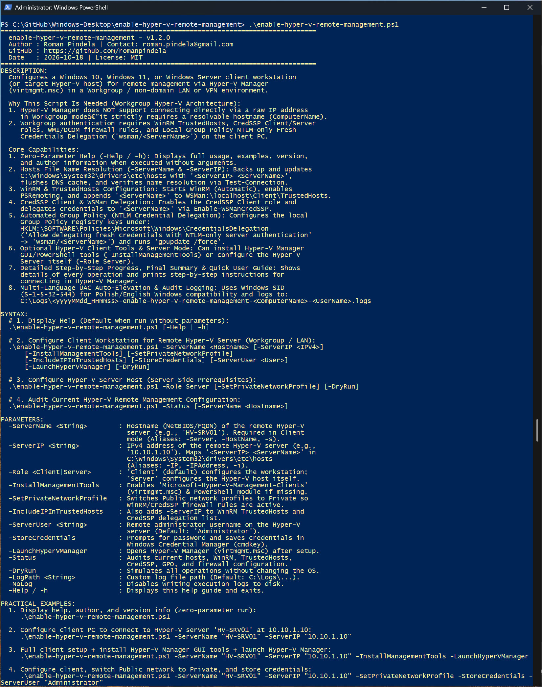
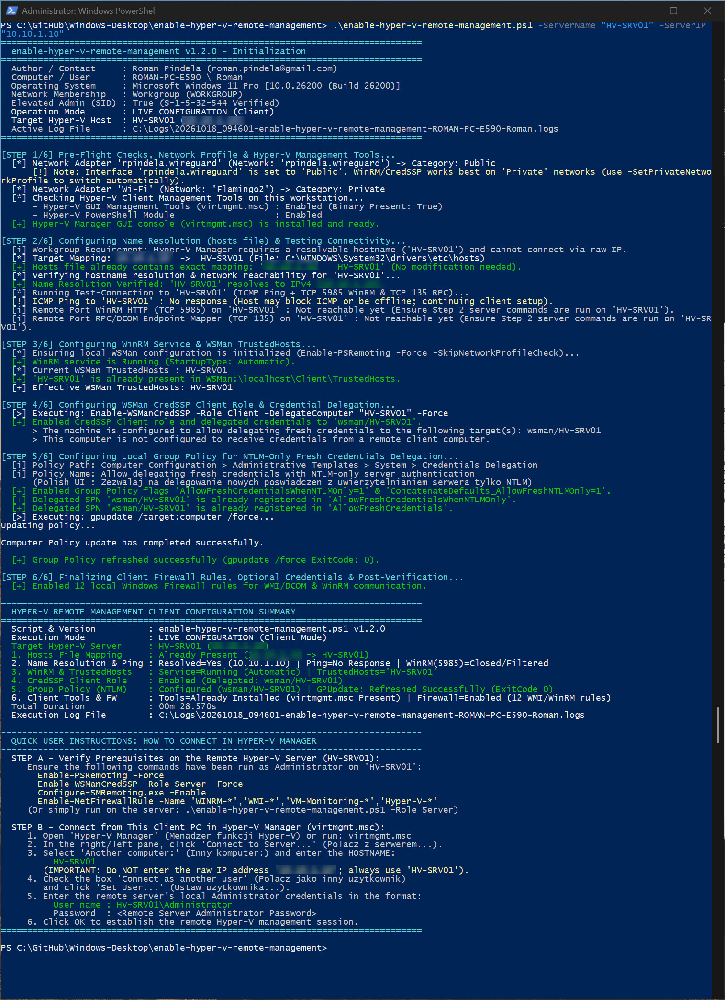

# Enable-HyperVRemoteManagement

[](https://microsoft.com/powershell)
[](https://www.microsoft.com/windows)

## Problem Statement

Connecting Hyper-V Manager (`virtmgmt.msc`) from a Windows client to a standalone or workgroup Hyper-V host routinely fails due to raw IP restrictions, missing `hosts` resolution, untrusted WinRM targets, disabled CredSSP client delegation, and blocked NTLM-only fresh credential delegation in Local Group Policy. Administrators need a unified, idempotent script that automates every client (and optional server) prerequisite cleanly across Polish and English Windows editions.

## Overview

`Enable-HyperVRemoteManagement.ps1` automates client-side (and optional `-Role Server`) configuration for remote Hyper-V Manager connectivity in workgroup or LAN environments. It backs up and updates `C:\Windows\System32\drivers\etc\hosts`, verifies connectivity via `Test-Connection`, configures WinRM `TrustedHosts`, enables `CredSSP` delegation, sets Local Group Policy `Allow delegating fresh credentials with NTLM-only server authentication` (`wsman/<ServerName>`), runs `gpupdate /force`, and optionally installs Hyper-V Management Tools or stores credentials in Windows Credential Manager (`cmdkey`).

## Environment & Prerequisites

- **OS:** Windows 10, Windows 11, or Windows Server (language-agnostic: Polish and English editions)
- **PowerShell:** Windows PowerShell 5.1 or PowerShell 7.x+
- **Dependencies:** Native Windows WinRM, CredSSP, `gpupdate`, DISM/OptionalFeatures, and `cmdkey`; no external modules required.

## Permissions Required

**Admin** — Modifying `hosts`, WinRM/TrustedHosts/CredSSP, Local Group Policy registry keys under `HKLM`, firewall rules, network profiles, and optional Windows features require Local Administrator privileges (`S-1-5-32-544`). The script automatically requests UAC elevation unless `-SkipAdminCheck` is passed; zero-parameter or `-Help` runs display help without elevation.

## Safety & Impact

- **Risk Level:** `Modifies system state` — Updates `hosts`, WinRM service/TrustedHosts, CredSSP delegation, `HKLM` GPO registry values, and optionally firewall/network profiles or Windows features (`-Status` and `-DryRun` do not modify the system).
- **WhatIf / Confirm & Backup:** Supports `-WhatIf` / `-Confirm` (`SupportsShouldProcess`) and `-DryRun` simulation. Always creates a timestamped backup copy of `C:\Windows\System32\drivers\etc\hosts` before modifying host entries and logs actions to `C:\Logs\...`.

## Usage Examples

```powershell
# Display built-in help and usage examples without elevation
.\Enable-HyperVRemoteManagement.ps1
.\Enable-HyperVRemoteManagement.ps1 -Help

# Configure client workstation for a workgroup Hyper-V host
.\Enable-HyperVRemoteManagement.ps1 -ServerName "HV-SRV01" -ServerIP "10.10.1.10"

# Configure client, install Hyper-V Management Tools, and launch virtmgmt.msc
.\Enable-HyperVRemoteManagement.ps1 -ServerName "HV-SRV01" -ServerIP "10.10.1.10" -InstallManagementTools -LaunchHyperVManager

# Switch Public network profile to Private and store remote admin credentials
.\Enable-HyperVRemoteManagement.ps1 -ServerName "HV-SRV01" -ServerIP "10.10.1.10" -SetPrivateNetworkProfile -StoreCredentials -ServerUser "Administrator"

# Configure prerequisites on the target Hyper-V host itself
.\Enable-HyperVRemoteManagement.ps1 -Role Server

# Audit current Hyper-V remote management settings without changes
.\Enable-HyperVRemoteManagement.ps1 -Status

# Simulate client configuration in Dry-Run mode
.\Enable-HyperVRemoteManagement.ps1 -ServerName "HV-SRV01" -ServerIP "10.10.1.10" -DryRun
```

### Parameters

| Parameter | Alias | Type | Default | Description |
| :--- | :--- | :--- | :--- | :--- |
| `-ServerName` | `-Server`, `-HostName`, `-ComputerName`, `-TargetServer`, `-s` | `[string]` | `$null` | Hostname or FQDN of the remote Hyper-V server (required in `Client` mode). |
| `-ServerIP` | `-IP`, `-IPAddress`, `-TargetIP`, `-i` | `[string]` | `$null` | IPv4 address of the remote Hyper-V server to map in `hosts`. |
| `-Role` | `-Mode` | `[string]` | `Client` | Configuration mode: `Client` or `Server`. |
| `-InstallManagementTools` | `-EnableHyperVTools`, `-InstallTools` | `[switch]` | `$false` | Enables Hyper-V Manager GUI and PowerShell management tools if missing. |
| `-SetPrivateNetworkProfile` | | `[switch]` | `$false` | Changes active `Public` network profiles to `Private`. |
| `-IncludeIPInTrustedHosts` | | `[switch]` | `$false` | Adds `-ServerIP` alongside `-ServerName` in `TrustedHosts` and CredSSP. |
| `-ServerUser` | `-User`, `-RemoteUser` | `[string]` | `Administrator` | Remote Hyper-V administrator username. |
| `-StoreCredentials` | `-SaveCredentials` | `[switch]` | `$false` | Prompts for password and stores credentials in Windows Credential Manager (`cmdkey`). |
| `-LaunchHyperVManager` | `-OpenGUI`, `-StartManager` | `[switch]` | `$false` | Opens `virtmgmt.msc` after configuration completes. |
| `-Status` | `-Check`, `-Verify`, `-Info` | `[switch]` | `$false` | Audits current `hosts`, WinRM, CredSSP, GPO, and Hyper-V tools status. |
| `-DryRun` | `-Simulate`, `-Preview` | `[switch]` | `$false` | Simulates all operations without modifying the OS. |
| `-SkipAdminCheck` | | `[switch]` | `$false` | Skips automatic UAC elevation check. |
| `-PassThru` | | `[switch]` | `$false` | Outputs a structured `[PSCustomObject]` summary to the pipeline. |
| `-LogPath` | `-Log`, `-l` | `[string]` | `C:\Logs\...` | Custom path for the UTF-8 execution log file. |
| `-NoLog` | | `[switch]` | `$false` | Disables writing execution logs to disk. |
| `-Help` | `-h` | `[switch]` | `$false` | Displays interactive help, version, and author details. |

### Screenshots





## Author

- **Roman Pindela**
- **Email:** [roman.pindela@gmail.com](mailto:roman.pindela@gmail.com)
- **GitHub:** [https://github.com/romanpindela](https://github.com/romanpindela)
- **License:** MIT
