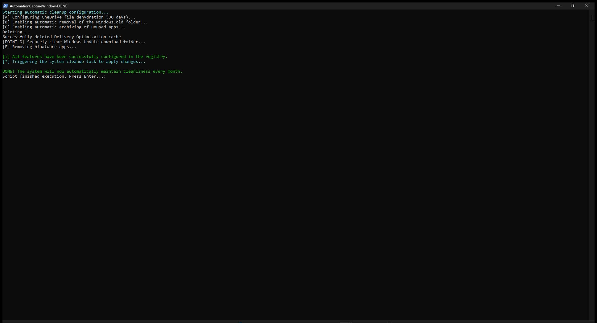
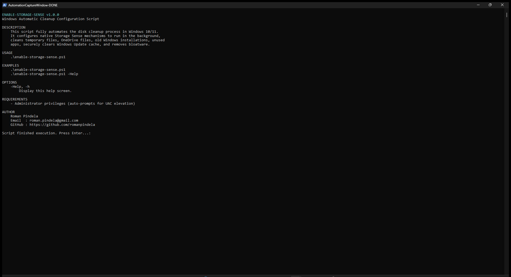

# Enable-StorageSense

[](https://microsoft.com/powershell)
[](https://www.microsoft.com/windows)

## Problem Statement

Windows workstations quickly run low on system drive space due to forgotten temporary files, Recycle Bin items, cached Delivery Optimization payloads, residual `Windows.old` folders, `SoftwareDistribution` download caches, and preinstalled consumer bloatware apps. Support engineers need a hands-free script that configures Storage Sense policies consistently and triggers immediate system cleanup.

## Overview

`Enable-StorageSense.ps1` configures Windows Storage Sense registry policies under `HKCU:\Software\Microsoft\Windows\CurrentVersion\StorageSense\Parameters\StoragePolicy` (monthly run interval `RunStorageSense = 30`, temporary file cleanup, 60-day Recycle Bin age threshold `CleanRecycleBinAge = 60`, 30-day OneDrive cloud dehydration `DehydrateOneDriveFilesAge = 30`, `Windows.old` removal, and unused app archival). It also clears Delivery Optimization and Windows Update download caches, removes selected Microsoft consumer Appx packages for all users, and starts the `SilentCleanup` scheduled task.

## Environment & Prerequisites

- **OS:** Windows 10 / Windows 11
- **PowerShell:** Windows PowerShell 5.1 or PowerShell 7.x+
- **Dependencies:** Native Windows Registry, `Appx`, and `ScheduledTasks` cmdlets; no external modules required.

## Permissions Required

**Admin** — Removing provisioned Appx packages for all users, clearing `C:\Windows\SoftwareDistribution\Download\*`, and invoking the `SilentCleanup` task require elevated Administrator privileges. If started unprivileged without `-Help`/`-h`, the script automatically requests UAC elevation (`Start-Process -Verb RunAs`). Note that `HKCU:` Storage Sense keys apply to the elevated user context.

## Safety & Impact

- **Risk Level:** `Modifies system state` — Modifies `HKCU` Storage Sense policies, deletes Windows Update and Delivery Optimization caches, uninstalls selected Appx packages (`Microsoft.BingNews`, `Microsoft.BingWeather`, `Microsoft.XboxApp`, `Microsoft.YourPhone`), and executes `SilentCleanup`.
- **WhatIf / Confirm & Backup:** Does not support `-WhatIf` / `-Confirm` and creates no backups prior to deleting cache files or removing Appx packages.

## Usage Examples

```powershell
# Display built-in help and usage details without elevation
.\Enable-StorageSense.ps1 -Help
.\Enable-StorageSense.ps1 -h

# Enable Storage Sense policies, clear system caches, and launch SilentCleanup
.\Enable-StorageSense.ps1
```

### Parameters

| Parameter | Alias | Type | Default | Description |
| :--- | :--- | :--- | :--- | :--- |
| `-Help` | | `[switch]` | `$false` | Displays interactive help and exits. |
| `-h` | | `[switch]` | `$false` | Short alias switch to display help and exit. |

### Screenshots





## Author

- **Roman Pindela**
- **Email:** [roman.pindela@gmail.com](mailto:roman.pindela@gmail.com)
- **GitHub:** [https://github.com/romanpindela](https://github.com/romanpindela)
