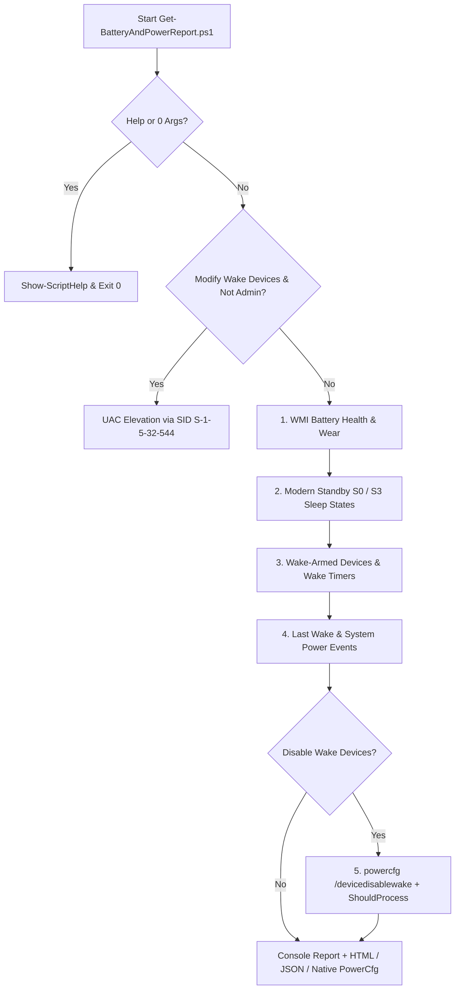
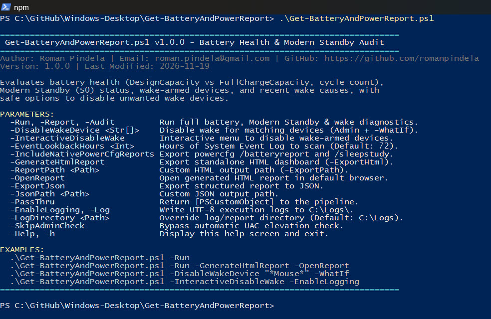
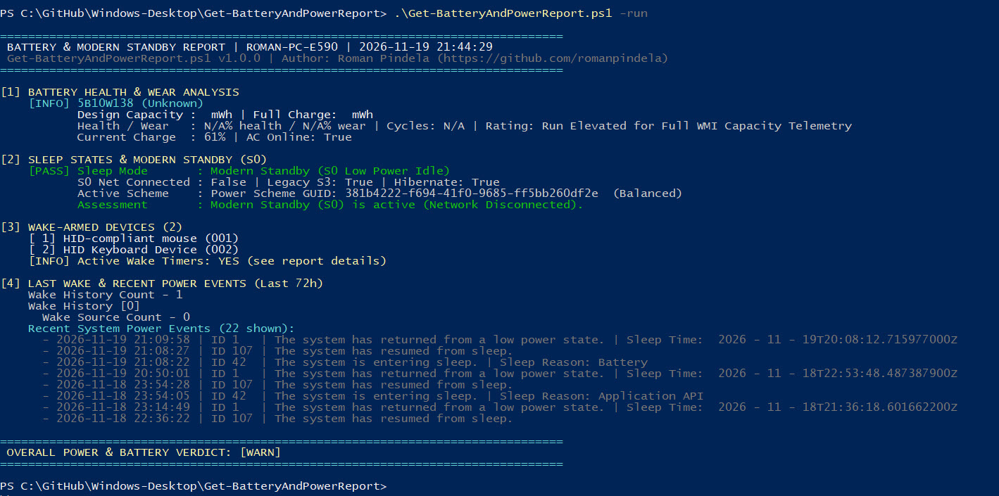

# Get-BatteryAndPowerReport

[](https://microsoft.com/powershell)
[](https://www.microsoft.com/windows)
[]()
[]()
[](https://opensource.org/licenses/MIT)

## Problem Statement

Modern Windows 11 laptops frequently suffer from **Modern Standby (S0 Low Power Idle)** battery drain, overheating inside laptop bags, unexpected wakeups triggered by mice/network adapters, and degraded battery cells. Gathering `DesignCapacity`, `FullChargeCapacity`, cycle count, `powercfg /a`, `powercfg /devicequery wake_armed`, `powercfg /lastwake`, and `Power-Troubleshooter` event logs manually requires multiple commands and elevated utilities.

## Overview

`Get-BatteryAndPowerReport.ps1` consolidates battery health telemetry (`DesignCapacity` vs `FullChargeCapacity`, wear percentage, cycle count), Modern Standby (S0) vs Legacy Sleep (S3) detection, wake-armed device enumeration, active wake timers, and System Event Log wake history into one structured console and HTML/JSON report — with safe options (`-DisableWakeDevice` / `-InteractiveDisableWake`) to disable unwanted wake devices using `powercfg /devicedisablewake` and `-WhatIf` support.

---

## Technical Architecture



```text
+-----------------------------------------------------------------------+
|                    Get-BatteryAndPowerReport.ps1                      |
+-------------------+-----------------------+---------------------------+
| Battery Telemetry | Standby & Wake Audit  | Remediation & Export      |
| - root\WMI        | - powercfg /a (S0/S3) | - -DisableWakeDevice      |
|   Design vs Full  | - wake_armed devices  | - -InteractiveDisableWake |
| - Wear % & Cycles | - powercfg /lastwake  | - -IncludeNativePowerCfg  |
| - Win32_Battery   | - Power-Troubleshooter| - Standalone HTML & JSON  |
+-------------------+-----------------------+---------------------------+
```

---

## Prerequisites & Unblocking

* **Operating System:** Windows 10, Windows 11, or Windows Server 2016+ (gracefully handles desktops/VMs without batteries).
* **PowerShell Version:** Windows PowerShell 5.1 or PowerShell 7+.
* **Permissions:**
  * `-Run` (read-only): Standard User (Administrator recommended for full `root\WMI` battery capacity/cycle counters and `powercfg /sleepstudy`).
  * `-DisableWakeDevice` / `-InteractiveDisableWake`: Administrator (`S-1-5-32-544`, automatic UAC elevation).
* **Unblock Downloaded Script:**
  ```powershell
  Unblock-File -Path ".\Get-BatteryAndPowerReport.ps1"
  ```

---

## Script Parameters

| Parameter | Alias | Type | Default | Description |
| :--- | :--- | :--- | :--- | :--- |
| `-Run` | `-Report`, `-Audit`, `-All` | `[switch]` | `$false` | Executes the full battery health, Modern Standby, wake-armed devices, and wake history audit. |
| `-DisableWakeDevice` | — | `[string[]]` | — | Exact device names or wildcards matching `wake_armed` devices to disable (`powercfg /devicedisablewake`). |
| `-InteractiveDisableWake` | — | `[switch]` | `$false` | Opens an interactive numbered menu of wake-armed devices to disable selectively. |
| `-EventLookbackHours` | — | `[int]` | `72` | Hours of System Event Log to scan for Power-Troubleshooter / Kernel-Power events (`1`–`720`). |
| `-IncludeNativePowerCfgReports` | — | `[switch]` | `$false` | Generates Windows built-in `powercfg /batteryreport` and `powercfg /sleepstudy` HTML reports. |
| `-GenerateHtmlReport` | `-ExportHtml` | `[switch]` | `$false` | Exports a standalone responsive Dark/Light HTML report. |
| `-ReportPath` | `-ExportPath` | `[string]` | `C:\Logs\Get-BatteryAndPowerReport_<host>_<ts>.html` | Custom HTML report file or directory path. |
| `-OpenReport` | — | `[switch]` | `$false` | Opens the generated HTML report in the default web browser. |
| `-ExportJson` | — | `[switch]` | `$false` | Exports structured diagnostic data to JSON. |
| `-JsonPath` | — | `[string]` | `C:\Logs\Get-BatteryAndPowerReport_<host>_<ts>.json` | Custom JSON file or directory path. |
| `-PassThru` | — | `[switch]` | `$false` | Returns the structured `[PSCustomObject]` to the PowerShell pipeline. |
| `-EnableLogging` | `-Log` | `[switch]` | `$false` | Writes structured UTF-8 execution logs to `C:\Logs\`. |
| `-LogDirectory` | — | `[string]` | `C:\Logs` | Base directory for logs and default report exports (falls back to `%TEMP%\Logs`). |
| `-SkipAdminCheck` | — | `[switch]` | `$false` | Bypasses automatic UAC elevation check (useful for testing / `-WhatIf`). |
| `-Help` | `-h` | `[switch]` | `$false` | Displays interactive console help and exits cleanly. |

---

## Usage Examples

### 1. Run Full Battery & Modern Standby Audit
```powershell
.\Get-BatteryAndPowerReport.ps1 -Run
```

### 2. Generate HTML Dashboard + Native Windows Battery/SleepStudy Reports
```powershell
.\Get-BatteryAndPowerReport.ps1 -Run -GenerateHtmlReport -IncludeNativePowerCfgReports -OpenReport
```

### 3. Preview Disabling Wake for Any Mouse Device (`-WhatIf`)
```powershell
.\Get-BatteryAndPowerReport.ps1 -DisableWakeDevice "*Mouse*" -WhatIf
```

### 4. Interactively Choose Wake-Armed Devices to Disable
```powershell
.\Get-BatteryAndPowerReport.ps1 -InteractiveDisableWake -EnableLogging
```

### 5. Pipeline Automation (`-PassThru`)
```powershell
$pwr = .\Get-BatteryAndPowerReport.ps1 -Run -PassThru
$pwr.BatterySummary.Batteries | Select-Object BatteryName, HealthPercent, WearLevelPercent, CycleCount
```

### 6. Run Directly from GitHub (via `Invoke-GitHubScript.ps1`)
```powershell
.\Invoke-GitHubScript.ps1 -UrlToDownload "https://github.com/romanpindela/Windows-Desktop/blob/main/Get-BatteryAndPowerReport/Get-BatteryAndPowerReport.ps1" -ScriptArgs "-Run"
```

---

## Screenshots & Visual Verification

### 1. Standard Execution & Interactive Help (`.\Get-BatteryAndPowerReport.ps1`)


### 2. Battery Health, Modern Standby & Wake Audit (`.\Get-BatteryAndPowerReport.ps1 -Run`)


---

## Logging & Troubleshooting

* **Log Path:** `C:\Logs\<yyyyMMdd-HHmmss>-Get-BatteryAndPowerReport-<COMPUTERNAME>-<USERNAME>.log` (when `-EnableLogging` is enabled).
* **Full WMI Battery Capacity Missing:** On some systems, `root\WMI` (`BatteryStaticData` / `BatteryFullChargedCapacity`) requires an elevated Administrator PowerShell session.
* **No Battery Detected:** On desktop PCs and virtual machines, the script cleanly marks the Battery section as `[INFO]` and still reports sleep states, wake-armed devices, and wake history.

---

## Changelog

### v1.0.0 (2026-11-19)
* Initial release featuring `root\WMI` battery health/wear/cycle metrics, Modern Standby (S0) vs S3 detection, `wake_armed` device and wake timer auditing, `lastwake` + System Event Log history, safe wake-device disabling with `-WhatIf`, native `powercfg` report generation, and standalone HTML/JSON dashboards.

---

## Author & Metadata

* **Author:** Roman Pindela
* **Email:** roman.pindela@gmail.com
* **GitHub:** [https://github.com/romanpindela](https://github.com/romanpindela)
* **Version:** `1.0.0` (SemVer)
* **Last Modified:** `2026-11-19`
