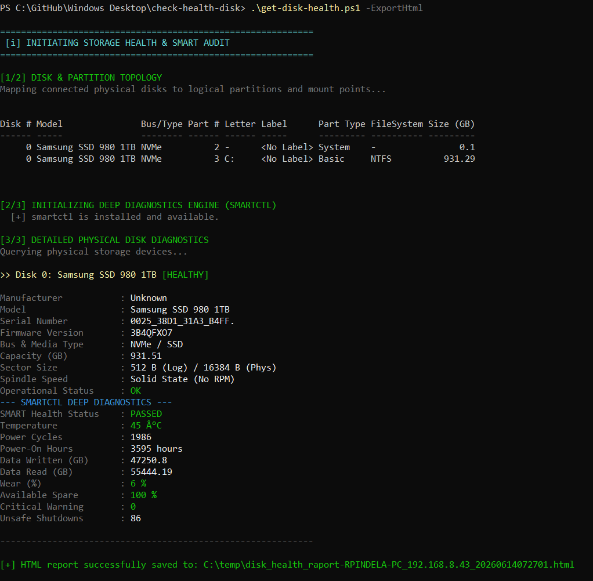
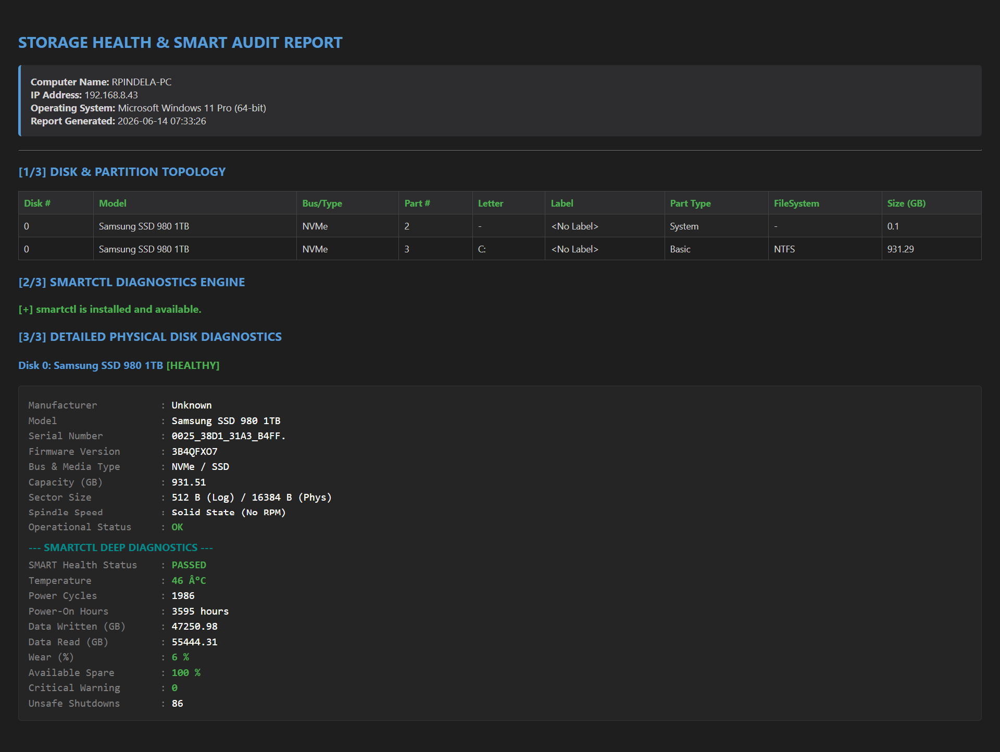

# Get-DiskHealth

[](https://microsoft.com/powershell)
[](https://www.microsoft.com/windows)

## Problem Statement

Checking SSD/HDD health on Windows often requires third-party GUI tools or manual WMI queries because native Windows storage counters omit detailed NVMe wear, spare sectors, unsafe shutdowns, and TBW metrics on many storage drivers. Administrators need an automated disk health script that maps physical drives to partitions/volumes, gathers SMART attributes via `smartctl` (with fallback to `Get-StorageReliabilityCounter`), and optionally produces a styled HTML report.

## Overview

`Get-DiskHealth.ps1` audits physical disk topology (bus type, partitions, drive letters, file systems, and free space) alongside SMART diagnostics. If `smartctl.exe` is absent, the script attempts to install `Smartmontools.smartmontools` via `winget` automatically before querying SMART attributes (`-j -x`) and falling back to Windows Storage Reliability Counters when needed, with optional HTML export (`-ExportHtml` / `-ExportPath`).

## Environment & Prerequisites

- **OS:** Windows 10, Windows 11, or Windows Server
- **PowerShell:** Windows PowerShell 5.1 or PowerShell 7.x+
- **Dependencies:** Native `Storage` cmdlets; optionally `smartctl.exe` (installed automatically via `winget install Smartmontools.smartmontools` if missing and `winget` is available).

## Permissions Required

**Admin** — Querying low-level SMART device counters (`/dev/pdX`), physical disk reliability counters, and silently installing `smartmontools` require elevated Administrator privileges (`S-1-5-32-544`). When executed without elevation (and without `-Help` / `-H`), the script automatically prompts for UAC elevation (`Start-Process -Verb RunAs`). Viewing `-Help` runs as a standard `User`.

## Safety & Impact

- **Risk Level:** `Modifies system state` (conditionally installs package) — All disk/SMART queries are read-only, **but if `smartctl` is not installed and `winget` is present, the script automatically installs `Smartmontools.smartmontools` silently**. Otherwise writes only optional HTML reports (`C:\temp\...` or `-ExportPath`).
- **WhatIf / Confirm & Backup:** Does not support `-WhatIf` / `-Confirm` and creates no backups.

## Usage Examples

```powershell
# Display built-in help and usage details without elevation
.\Get-DiskHealth.ps1 -Help
.\Get-DiskHealth.ps1 -H

# Run disk topology and SMART diagnostics in the console
.\Get-DiskHealth.ps1

# Run diagnostics and save an HTML report to C:\temp\
.\Get-DiskHealth.ps1 -ExportHtml

# Run diagnostics and save the HTML report to a custom file path
.\Get-DiskHealth.ps1 -ExportPath "D:\Reports\MyServer.html"
```

### Parameters

| Parameter | Alias | Type | Default | Description |
| :--- | :--- | :--- | :--- | :--- |
| `-ExportHtml` | | `[switch]` | `$false` | Exports a styled HTML audit report to `C:\temp\`. |
| `-ExportPath` | | `[string]` | `$null` | Custom directory or `.html` file path for the HTML report. |
| `-Help` | | `[switch]` | `$false` | Displays help and exits without elevation. |
| `-H` | | `[switch]` | `$false` | Short switch to display help and exit. |

### Screenshots





## Author

- **Roman Pindela**
- **Email:** [roman.pindela@gmail.com](mailto:roman.pindela@gmail.com)
- **GitHub:** [https://github.com/romanpindela](https://github.com/romanpindela)
