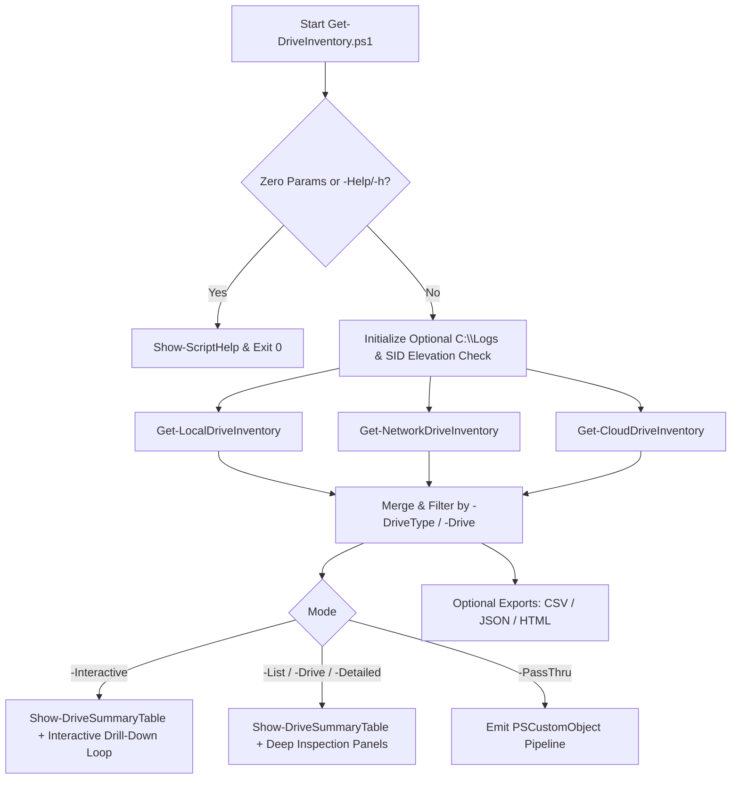
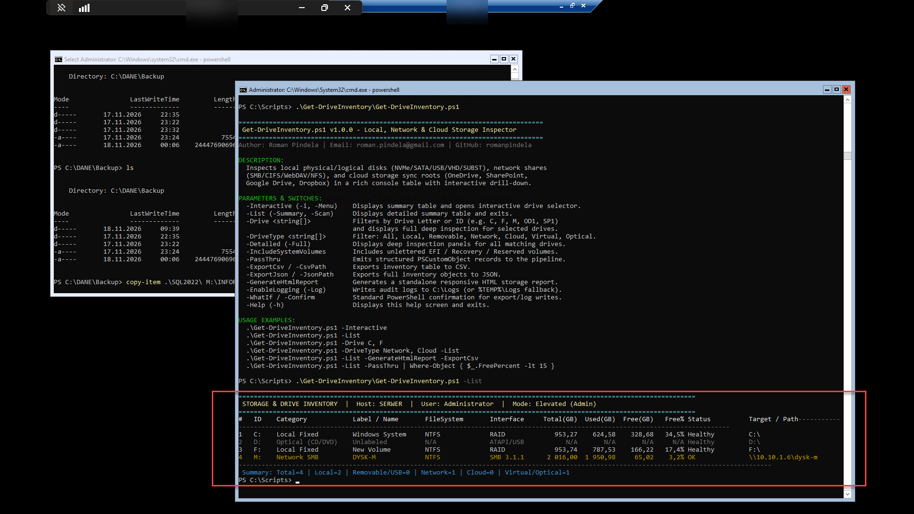

# Get-DriveInventory

[](https://microsoft.com/powershell)
[](https://www.microsoft.com/windows)
[](https://github.com/romanpindela/Windows-Desktop)

## Problem Statement

Inspecting storage on a modern Windows workstation requires piecing together multiple fragmented tools: `Get-Volume` omits mapped SMB/CIFS network drives, `Win32_LogicalDisk` cannot distinguish an external USB SSD from an internal NVMe drive without correlating `Get-Partition` and `Get-Disk`, and cloud sync mounts (OneDrive Personal/Business, SharePoint document libraries, Google Drive streaming folders, Dropbox) do not always expose standard drive letters. Administrators and power users need a single, read-only PowerShell console tool that presents **all storage tiers** in one detailed table and allows instant **interactive drill-down** into any selected drive.

## Overview

`Get-DriveInventory.ps1` correlates Windows Storage, Networking, and Cloud Sync subsystems into a unified, color-coded console table and an interactive deep-inspection browser:

- **Local & Attached Storage:** Internal NVMe/SATA/SAS/RAID disks, external USB drives, removable flash/SD cards, optical CD/DVD drives, VHD/VHDX virtual disks, `SUBST` mappings, and optional unlettered EFI/Recovery partitions (`-IncludeSystemVolumes`).
- **Network Shares:** Mapped network drives and disconnected/unlettered UNC mappings across **SMB** (including SMB2/SMB3 dialect, encryption, and signing), **CIFS (SMB1)**, **WebDAV/HTTPS**, and **NFS**.
- **Cloud Storage & Sync Mounts:** Microsoft **OneDrive** (Personal & Business), **SharePoint Online** synced document libraries (`ScopeIdToMountPointPathCache`), **Google Drive for Desktop** (drive-letter or streaming folder volume), and **Dropbox** (`info.json`).
- **Two-Stage Inspection:** Rich summary table (`Total GB`, `Used GB`, `Free GB`, `Free %`, `FileSystem`, `Interface`, `Media`, `Status`, `Target / Path`) followed by an exhaustive multi-section **Deep Inspection View** when selecting a drive interactively (`-Interactive`) or via `-Drive`.
- **Exports & Pipeline:** Supports `-PassThru` structured `[PSCustomObject]` pipeline output, CSV (`-ExportCsv`), JSON (`-ExportJson`), and standalone responsive dark-mode HTML reports (`-GenerateHtmlReport`).

---

## Technical Architecture



```text
+------------------------------------------------------------------------------+
|                         Get-DriveInventory.ps1                               |
+-----------------------+--------------------------+---------------------------+
| Local Storage Engine  | Network Share Engine     | Cloud Sync Engine         |
| - Get-Volume          | - Get-SmbMapping         | - HKCU OneDrive Accounts  |
| - Get-Partition       | - Win32_LogicalDisk(4)   | - ScopeIdToMountPointCache|
| - Get-Disk / Physical | - Win32_NetworkConnection| - Win32_Volume (DriveFS)  |
| - StorageReliability  | - Get-SmbConnection      | - Dropbox info.json       |
| - BitLocker / SUBST   |   (Admin-enriched)       |                           |
+-----------------------+--------------------------+---------------------------+
```

---

## Environment & Prerequisites

- **OS:** Windows 10, Windows 11, or Windows Server (Language-independent: works on Polish, English, and other Windows locales)
- **PowerShell:** Windows PowerShell 5.1+ or PowerShell 7.x+
- **Execution Policy / Unblocking Downloaded Scripts:**
  If you download the script directly from GitHub, Windows marks it with a `Zone.Identifier` (Mark of the Web). Unblock it before running:

  ```powershell
  Unblock-File -Path ".\Get-DriveInventory.ps1"
  ```

---

## Permissions & Safety

- **Permissions Required:** **User** (Standard User)
  - Running as a standard User is intentional by default: Windows isolates user-session mapped SMB drives (`M:`, `Z:`) and `HKCU` OneDrive/SharePoint sync keys from an elevated Administrator token unless linked connections are enabled.
  - When launched from an **elevated Administrator** session (`S-1-5-32-544`), the script automatically enriches local physical disks with **BitLocker protection status**, **SMART / Storage Reliability Counters** (temperature, wear, errors, power-on hours), and **SMB dialect/encryption/signing** telemetry (`Get-SmbConnection`).
- **Risk Level:** `Read-Only` (writes files only when `-ExportCsv`, `-ExportJson`, `-GenerateHtmlReport`, or `-EnableLogging` is explicitly specified; supports `-WhatIf` and `-Confirm`).

---

## Parameters

| Parameter | Alias | Type | Default | Description |
| :--- | :--- | :--- | :--- | :--- |
| `-Interactive` | `-i`, `-Menu`, `-Browse` | `[switch]` | `$false` | Displays summary table and opens interactive drive selector loop. |
| `-List` | `-Summary`, `-Scan`, `-All` | `[switch]` | `$false` | Displays detailed summary table in console and exits. |
| `-Drive` | `-DriveLetter`, `-Id`, `-Target` | `[string[]]` | `$null` | Filters by Drive Letter or ID (e.g. `C`, `F`, `M`, `OD1`) and prints deep details. |
| `-DriveType` | `-Category`, `-Type` | `[string[]]` | `@('All')` | Filters by category: `All`, `Local`, `Removable`, `Network`, `Cloud`, `Virtual`, `Optical`. |
| `-Detailed` | `-Full` | `[switch]` | `$false` | Prints full deep-inspection panels for all matching drives. |
| `-IncludeSystemVolumes` | `-IncludeUnlettered` | `[switch]` | `$false` | Includes unlettered EFI System Partition, Recovery, and Reserved volumes. |
| `-PassThru` | | `[switch]` | `$false` | Emits structured `PSCustomObject` items to the pipeline. |
| `-ExportCsv` | | `[switch]` | `$false` | Exports inventory table to CSV in `LogDirectory`. |
| `-CsvPath` | | `[string]` | `$null` | Custom file path or directory for CSV export. |
| `-ExportJson` | | `[switch]` | `$false` | Exports full nested inventory objects to JSON. |
| `-JsonPath` | | `[string]` | `$null` | Custom file path or directory for JSON export. |
| `-GenerateHtmlReport` | `-ExportHtml` | `[switch]` | `$false` | Generates a standalone responsive HTML inventory report. |
| `-ReportPath` | `-ExportPath` | `[string]` | `$null` | Custom file path or directory for the HTML report. |
| `-EnableLogging` | `-Log` | `[switch]` | `$false` | Writes execution logs to `C:\Logs` (or `%TEMP%\Logs` fallback). |
| `-LogDirectory` | | `[string]` | `'C:\Logs'` | Target directory for logs and default exports. |
| `-Help` | `-h` | `[switch]` | `$false` | Displays built-in CLI help and exits cleanly (`exit 0`). |

---

## Usage Examples

```powershell
# 1. Display built-in help (also shown automatically when run with no parameters)
.\Get-DriveInventory.ps1 -Help
.\Get-DriveInventory.ps1 -h

# 2. Launch interactive table + drill-down browser (Recommended)
.\Get-DriveInventory.ps1 -Interactive

# 3. Print full summary table in console
.\Get-DriveInventory.ps1 -List

# 4. Inspect specific drives (table + deep detail panels for C: and F:)
.\Get-DriveInventory.ps1 -Drive C, F

# 5. Inspect only Network (SMB/CIFS/WebDAV) and Cloud (OneDrive/SharePoint/Google Drive) drives
.\Get-DriveInventory.ps1 -DriveType Network, Cloud -List

# 6. Include unlettered EFI / Recovery partitions and show full details
.\Get-DriveInventory.ps1 -List -IncludeSystemVolumes -Detailed

# 7. Pipeline filtering for drives below 15% free space
.\Get-DriveInventory.ps1 -List -PassThru | Where-Object { $null -ne $_.FreePercent -and $_.FreePercent -lt 15 }

# 8. Export CSV, JSON, and HTML reports with -WhatIf dry-run preview
.\Get-DriveInventory.ps1 -List -ExportCsv -GenerateHtmlReport -WhatIf
.\Get-DriveInventory.ps1 -List -ExportCsv -ExportJson -GenerateHtmlReport
```

### Run Directly from GitHub (via `Invoke-GitHubScript.ps1`)

```powershell
.\Invoke-GitHubScript.ps1 -UrlToDownload "https://github.com/romanpindela/Windows-Desktop/blob/main/Get-DriveInventory/Get-DriveInventory.ps1" -ScriptArgs "-Interactive"
```

---

## Assets & Logging

### Screenshots



- **Assets Directory:** `Get-DriveInventory/assets/`
- **Logging:** When `-EnableLogging` is enabled, logs are saved to:
  `C:\Logs\<yyyyMMdd-HHmmss>-Get-DriveInventory-<COMPUTERNAME>-<USERNAME>.log`
  If `C:\Logs` is not writable under a standard User account, logging falls back gracefully to `$env:TEMP\Logs\`.
- **Troubleshooting:**
  - If `SMART` or `BitLocker` fields report `Requires Admin to query`, run PowerShell as Administrator (`Run as Administrator`).
  - If user-mapped network drives (`M:`) disappear when elevated, run without elevation or enable `EnableLinkedConnections` in Windows policies.

---

## Changelog

### v1.0.0 (2026-11-18)
- Initial release of `Get-DriveInventory.ps1`.
- Correlates local disks (`NVMe`, `SATA`, `USB`, `VHD`, `SUBST`), network shares (`SMB`, `CIFS`, `WebDAV`, `NFS`), and cloud sync mounts (`OneDrive`, `SharePoint`, `Google Drive`, `Dropbox`).
- Added color-coded summary table, interactive drill-down selector (`-Interactive`), `-Drive` deep inspection, `-PassThru` pipeline output, and CSV/JSON/HTML exports.

---

## Author

- **Roman Pindela**
- **Email:** [roman.pindela@gmail.com](mailto:roman.pindela@gmail.com)
- **GitHub:** [https://github.com/romanpindela](https://github.com/romanpindela)
