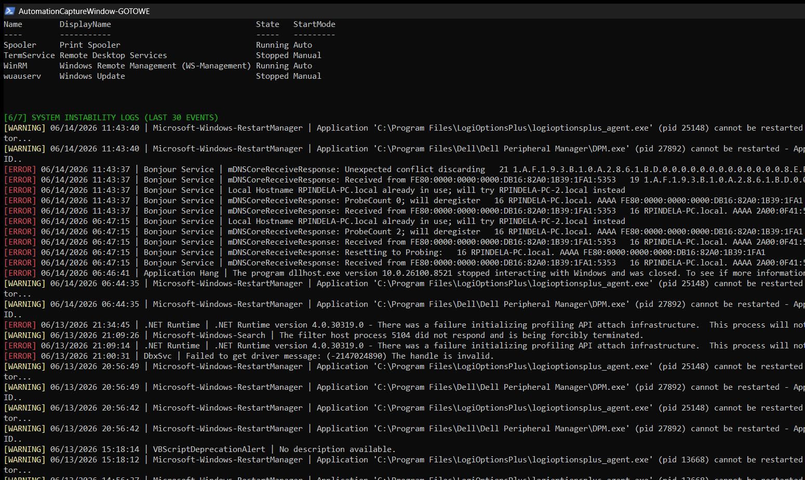
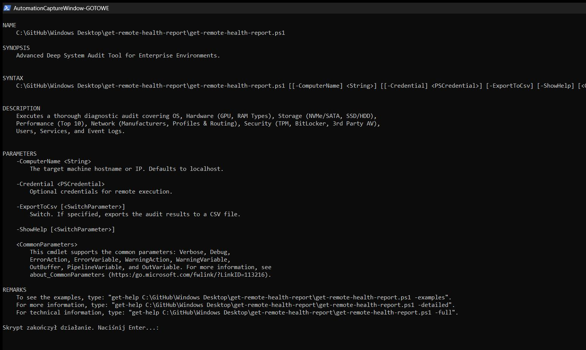

# Get-RemoteHealthReport

[](https://microsoft.com/powershell)
[](https://www.microsoft.com/windows)

## Problem Statement

Diagnosing sluggish endpoints, hardware bottlenecks, full disks, missing encryption, disabled antivirus products, or recurring system crashes locally or across a LAN normally requires querying dozens of disconnected WMI namespaces and event logs manually. System administrators need a unified diagnostic script that gathers hardware, storage, top processes, network configuration, security status, services, and critical event logs in a single pass.

## Overview

`Get-RemoteHealthReport.ps1` performs a multi-category local or remote system audit over CIM/WMI (with optional `-Credential` and `-ComputerName`) and displays a structured report covering OS, hardware (CPU, GPU, physical RAM sticks), physical disks/volumes, top 10 processes by RAM/CPU, network adapters/profiles/routes, AV/TPM/BitLocker, running services, and the last 30 Error/Warning events from System and Application logs. Optionally exports findings to a CSV file when `-ExportToCsv` is specified.

## Environment & Prerequisites

- **OS:** Windows 10, Windows 11, or Windows Server
- **PowerShell:** Windows PowerShell 5.1 or PowerShell 7.x+
- **Dependencies:** Native CIM/WMI and WinRM (for remote `-ComputerName` targets); no third-party modules required.

## Permissions Required

**Admin** — Although `-ShowHelp` runs as `User` and partial metrics load unprivileged, Local Administrator privileges (locally or via `-Credential` on remote hosts) are required to query storage physical disks, network connection profiles, BitLocker volumes, and `SecurityCenter2` without `Access Denied` errors.

## Safety & Impact

- **Risk Level:** `Read-Only / Non-destructive` — Performs read-only CIM/WMI and Event Log queries only (optionally writes a CSV report file when `-ExportToCsv` is specified).
- **WhatIf / Confirm & Backup:** Does not support `-WhatIf` / `-Confirm` and requires no backups because it does not modify system configuration.

## Usage Examples

```powershell
# Display script help
.\Get-RemoteHealthReport.ps1 -ShowHelp
.\Get-RemoteHealthReport.ps1 -h

# Run a full health audit on the local computer
.\Get-RemoteHealthReport.ps1

# Run a remote audit against a workstation and export results to CSV
.\Get-RemoteHealthReport.ps1 -ComputerName "PC-01" -ExportToCsv
```

### Parameters

| Parameter | Alias | Type | Default | Description |
| :--- | :--- | :--- | :--- | :--- |
| `-ComputerName` | | `[string]` | `$env:COMPUTERNAME` | Target hostname or IP address to audit. |
| `-Credential` | | `[PSCredential]` | `$null` | Optional credentials for remote CIM session execution. |
| `-ExportToCsv` | | `[switch]` | `$false` | Exports audit results to a timestamped CSV file. |
| `-ShowHelp` | `-h`, `-Help` | `[switch]` | `$false` | Displays `Get-Help -Detailed` documentation and exits. |

### Screenshots





## Author

- **Roman Pindela**
- **Email:** [roman.pindela@gmail.com](mailto:roman.pindela@gmail.com)
- **GitHub:** [https://github.com/romanpindela](https://github.com/romanpindela)
