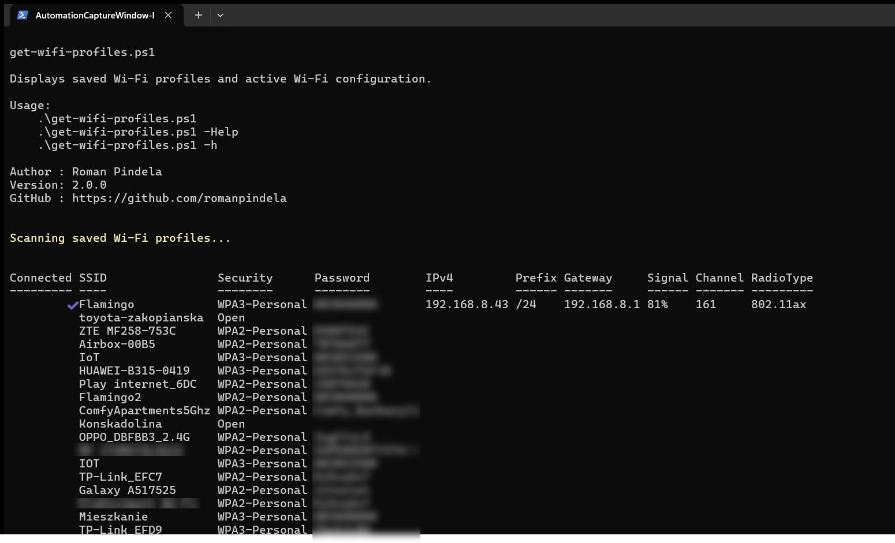
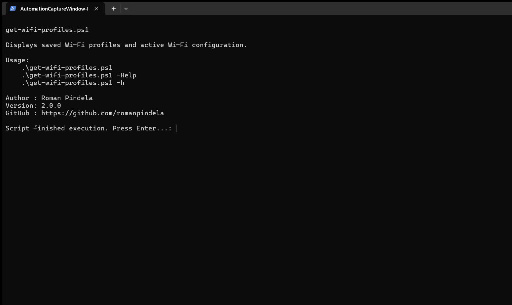

# Get-WifiProfiles

[](https://microsoft.com/powershell)
[](https://www.microsoft.com/windows)

## Problem Statement

When migrating workstations, re-imaging laptops, or troubleshooting wireless connectivity drops on Windows, users and technicians frequently need to recover saved Wi-Fi SSIDs, security types, plaintext passphrases, and active link telemetry (channel, signal percentage, IPv4, gateway, DNS) without navigating through deep GUI dialogs or relying on locale-specific GUI menus.

## Overview

`Get-WifiProfiles.ps1` queries `netsh wlan` across both English and Polish Windows localization patterns to enumerate every saved Wi-Fi profile with its authentication type and stored password (`key=clear`), plus detailed telemetry for the currently active Wi-Fi interface.

## Environment & Prerequisites

- **OS:** Windows 10 / Windows 11 (supports English and Polish `netsh wlan` output)
- **PowerShell:** Windows PowerShell 5.1 or PowerShell 7.x+
- **Dependencies:** Native `netsh.exe` and `WLAN AutoConfig` (`wlansvc`) service; no external modules required.

## Permissions Required

**User** — Standard users can list saved Wi-Fi profiles and view passwords for user/accessible profiles (`Admin` may be required on hardened systems to reveal machine-wide shared profile keys via `netsh wlan show profile key=clear`).

## Safety & Impact

- **Risk Level:** `Read-Only / Non-destructive` — Queries wireless profiles and interface state only without modifying network configuration or writing files. Notice that stored Wi-Fi keys are printed in cleartext to the console.
- **WhatIf / Confirm & Backup:** Does not support `-WhatIf` / `-Confirm` and requires no backups because no system changes occur.

## Usage Examples

```powershell
# Display built-in help and usage details
.\Get-WifiProfiles.ps1 -Help
.\Get-WifiProfiles.ps1 -h

# Display saved Wi-Fi profiles, passwords, and active connection status
.\Get-WifiProfiles.ps1
```

### Parameters

| Parameter | Alias | Type | Default | Description |
| :--- | :--- | :--- | :--- | :--- |
| `-Help` | | `[switch]` | `$false` | Displays help and exits. |
| `-h` | | `[switch]` | `$false` | Short help switch and exits. |

### Screenshots





## Author

- **Roman Pindela**
- **Email:** [roman.pindela@gmail.com](mailto:roman.pindela@gmail.com)
- **GitHub:** [https://github.com/romanpindela](https://github.com/romanpindela)
