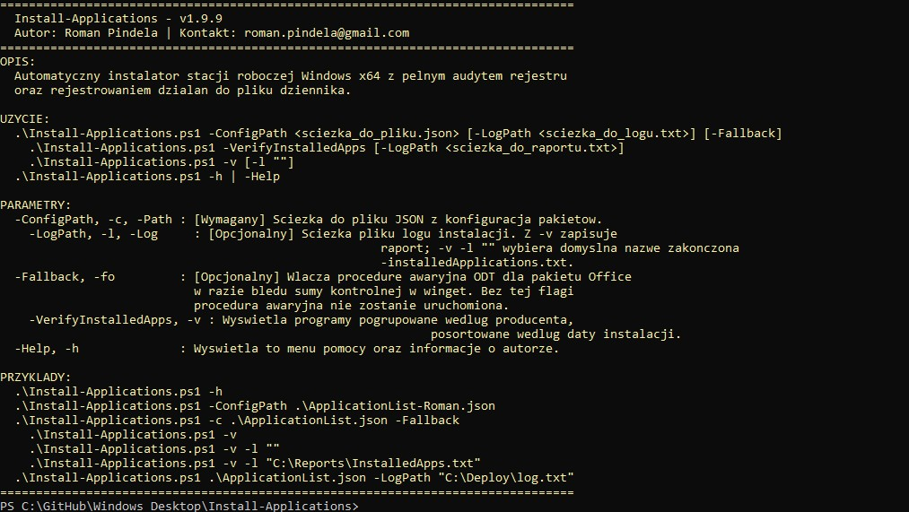
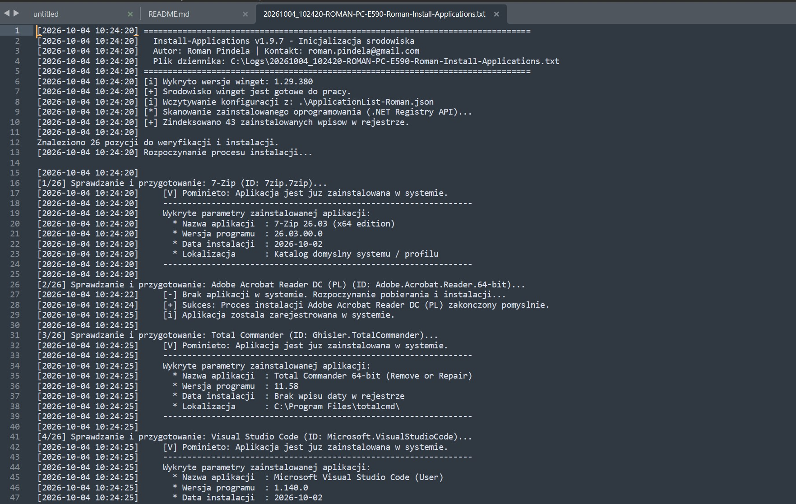
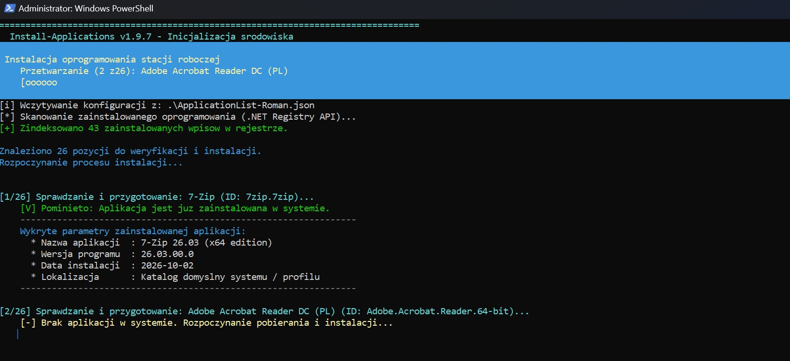
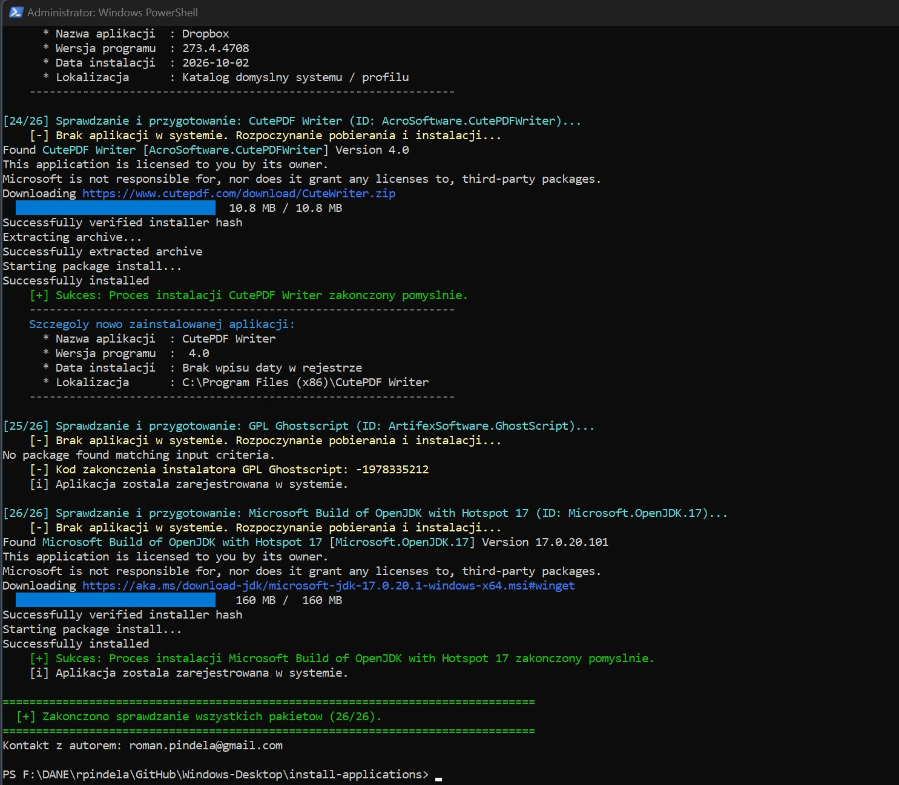

# install-applications (Windows Workstation Deployment)
Technical documentation for the automation script facilitating system auditing, downloading, installing, upgrading, and unattended deployment of software on Windows workstations.

## Project Information

| Parameter | Value |
| :--- | :--- |
| **Project Name** | install-applications (Windows Workstation Deployment) |
| **Author** | Roman Pindela |
| **Contact** | roman.pindela@gmail.com |
| **Version** | 2.0.0 |
| **Release Date** | 2026-10-12 |
| **License** | MIT |
| **Repository** | [GitHub - romanpindela/Windows-Desktop](https://github.com/romanpindela/Windows-Desktop) |

---

## Key Features

* **JSON-Driven Batch Deployment:** The application list is parsed dynamically from a user-specified JSON configuration file without hardcoded packages.
* **Workstation Software Upgrades (`-Upgrade` / `-u`):** Automatically queries WinGet for outdated applications, displays an upgrade overview table (Current vs. Available versions), and upgrades all packages in sequence or targets a specific package (`-UpgradeTarget`).
* **Single Package Installation with Disambiguation (`-Install` / `-Package` / `-i`):** Directly installs any software package by name or ID. If the search query is ambiguous (multiple matching packages found), displays a structured candidate list and guides the user to specify the exact package ID.
* **Online WinGet Catalog Search (`-Search` / `-s`):** Queries online WinGet repositories for any keyword or pattern (e.g., `"Google"`), matching application names, package IDs/publishers, monikers, and tags.
* **In-Memory Registry Audit via .NET Registry API:** Fast, single-pass in-memory software inventory via native `[Microsoft.Win32.RegistryKey]`. Scans the following hives:
  * `HKLM` 64-bit (`SOFTWARE\Microsoft\Windows\CurrentVersion\Uninstall`)
  * `HKLM` 32-bit / WOW6432Node (`SOFTWARE\WOW6432Node\Microsoft\Windows\CurrentVersion\Uninstall`)
  * `HKCU` logged-on user profile (`SOFTWARE\Microsoft\Windows\CurrentVersion\Uninstall`)
* **Smart Matching & Idempotence:** Skips programs already installed on the workstation, immediately displaying their detected metadata (`DisplayName`, `DisplayVersion`, `InstallDate`, `InstallLocation`).
* **Automatic User-Context Installation (Non-Admin Fallback):** Packages rejecting elevated administrator contexts (error code `0x8A150056` / `-1978335146`, e.g., Spotify) are automatically dispatched to run under the interactive user profile (`--scope user`) via a temporary `ScheduledTask`.
* **Optional Office 365 Fallback (ODT):** Executed **strictly when `-Fallback` is specified** in situations where winget encounters a hash checksum mismatch (`-1978335215`). Disabled by default to avoid unintended downloads.
* **Installed Applications Report (`-VerifyInstalledApps` / `-v`):** Generates a comprehensive audit report grouped by software publisher and sorted by install date, including architecture, installation scope, and disk footprint.
* **Structured Text Logging:** Generates comprehensive log files with timestamps `[YYYY-MM-DD HH:MM:SS]`.
  * Default path: `C:\Logs\<DateTime>-<Computer>-<User>-Install-Applications.txt`.
  * Custom paths supported via `-LogPath`.
* **Automated WinGet Self-Repair:** Validates the minimum required package manager version (>= 1.7.0) and repairs the installation via `Microsoft.WinGet.Client` when needed.
* **Visual Progress Tracking:** Real-time console progress bar using `Write-Progress` with `[X/Y]` task indices.

---

## Deployment Directory Structure

```shell
install-applications/
├── Install-Applications.ps1       # Main PowerShell installation & management script
├── ApplicationList-Roman.json     # Custom workstation package list
├── ApplicationList.json           # Default template package list
└── README.md                      # Technical documentation
```

---

## System Requirements
* **Operating System:** Windows 10 / Windows 11 (64-bit architecture).
* **Privileges:** PowerShell running with Administrator privileges for workstation-wide package installations and upgrades. Online catalog search (`-Search`) and audit reporting (`-VerifyInstalledApps`) can be executed without elevation.
* **Network Connectivity:** Internet access to official vendor CDNs and the WinGet package repository.

---

## Usage Guide

### 1. Allow Script Execution (If Restricted)
```powershell
Set-ExecutionPolicy -ExecutionPolicy RemoteSigned -Scope CurrentUser
```

### 2. Display Help Menu & Author Information
```powershell
.\Install-Applications.ps1 -h
```

### 3. Upgrade Installed Workstation Applications via WinGet
Upgrade all installed applications that have newer versions available:
```powershell
.\Install-Applications.ps1 -Upgrade
# Short form:
.\Install-Applications.ps1 -u
```
Upgrade a specific application:
```powershell
.\Install-Applications.ps1 -Upgrade -Target "7zip.7zip"
```

### 4. Install a Single Application by Package Name or ID
Install by exact ID or name:
```powershell
.\Install-Applications.ps1 -Install "Google.Chrome"
# Aliases: -Package, -i
.\Install-Applications.ps1 -Package "7zip.7zip"
```
If an ambiguous name is supplied (e.g., `"Chrome"`), the script lists all matching candidates and prompts for clarification:
```powershell
.\Install-Applications.ps1 -Install "Chrome"
```

### 5. Search Online WinGet Catalog by Pattern
Search for applications matching a keyword, publisher, or pattern (e.g., `"Google"`):
```powershell
.\Install-Applications.ps1 -Search "Google"
# Short form:
.\Install-Applications.ps1 -s "Google"
# Save search results to a log file:
.\Install-Applications.ps1 -s "Google" -LogPath "C:\Logs\Google-Search.txt"
```

### 6. Batch Installation from JSON Configuration File
Deploy software defined in a JSON package list:
```powershell
.\Install-Applications.ps1 -ConfigPath .\ApplicationList-Roman.json
# Positional syntax:
.\Install-Applications.ps1 .\ApplicationList.json
# With emergency Office 365 ODT fallback enabled:
.\Install-Applications.ps1 -c .\ApplicationList.json -Fallback
```

### 7. Generate Installed Applications Audit Report
```powershell
.\Install-Applications.ps1 -VerifyInstalledApps
# Short form:
.\Install-Applications.ps1 -v
# Save to default file in C:\Logs (suffix -installedApplications.txt):
.\Install-Applications.ps1 -v -l ""
# Save to a custom path:
.\Install-Applications.ps1 -v -l "C:\Reports\InstalledApps.txt"
```

---

## Parameters Reference

| Parameter | Aliases | Mode | Description |
| :--- | :--- | :--- | :--- |
| `-ConfigPath` | `-c`, `-Path` | Config | Path to JSON file containing application package list. |
| `-Upgrade` | `-u`, `-Update`, `-UpgradeAll` | Upgrade | Upgrades installed applications via winget. |
| `-UpgradeTarget` | `-Target`, `-TargetPackage`, `-TargetApp` | Upgrade | Target package ID or name to upgrade. |
| `-Install` | `-Package`, `-PackageName`, `-Id`, `-Name`, `-App`, `-i` | InstallPackage | Installs an application by package name or ID with disambiguation. |
| `-Search` | `-s`, `-Find`, `-Query` | Search | Searches online winget repository by pattern (e.g. "Google"). |
| `-VerifyInstalledApps` | `-v` | Verify | Displays installed applications grouped by publisher and install date. |
| `-Fallback` | `-fo`, `-FallbackOffice` | Config / InstallPackage | Enables emergency ODT procedure for Office 365 on checksum mismatch. |
| `-LogPath` | `-l`, `-Log` | All | Custom path for log file or audit report. |
| `-Help` | `-h` | Help | Displays help guide, syntax, and examples. |

---

## JSON Configuration Format & Example
The JSON file contains an array of objects, each defining a human-readable `Name` and its corresponding `Id` in the winget repository:

```json
[
  { "Name": "7-Zip", "Id": "7zip.7zip" },
  { "Name": "Adobe Acrobat Reader DC (PL)", "Id": "Adobe.Acrobat.Reader.64-bit" },
  { "Name": "Sublime Text 4", "Id": "SublimeHQ.SublimeText.4" },
  { "Name": "Total Commander", "Id": "Ghisler.TotalCommander" },
  { "Name": "Visual Studio Code", "Id": "Microsoft.VisualStudioCode" },
  { "Name": "Google Drive", "Id": "Google.GoogleDrive" },
  { "Name": "Microsoft OneDrive", "Id": "Microsoft.OneDrive" },
  { "Name": "Microsoft 365 Apps (Office)", "Id": "Microsoft.Office" },
  { "Name": "Google Chrome", "Id": "Google.Chrome" },
  { "Name": "IrfanView", "Id": "IrfanSkiljan.IrfanView" },
  { "Name": "VLC Media Player", "Id": "VideoLAN.VLC" },
  { "Name": "Spotify", "Id": "Spotify.Spotify" },
  { "Name": "Microsoft Teams", "Id": "Microsoft.Teams" },
  { "Name": "Mozilla Firefox", "Id": "Mozilla.Firefox" },
  { "Name": "Opera Stable", "Id": "Opera.Opera" },
  { "Name": "Brave Browser", "Id": "Brave.Brave" },
  { "Name": "Microsoft PowerToys", "Id": "Microsoft.PowerToys" },
  { "Name": "TeamViewer", "Id": "TeamViewer.TeamViewer" },
  { "Name": "Git for Windows", "Id": "Git.Git" },
  { "Name": "Notepad++", "Id": "Notepad++.Notepad++" },
  { "Name": "Windows Terminal", "Id": "Microsoft.WindowsTerminal" }
]
```

---

## Sample Console Output During Run

### 1. Workstation Software Upgrade (`-Upgrade`)
```shell
================================================================================
  Install-Applications v2.0.0 - Workstation Software Upgrade
  Author: Roman Pindela | Contact: roman.pindela@gmail.com
  Log File: C:\Logs\20261012_233320-ROMAN-PC-E590-Roman-Install-Applications.txt
================================================================================
[*] Checking for available software upgrades via winget...
[*] Found 7 application(s) with available upgrades:

Application                                                  Package ID                   Current Version Available Version
-----------                                                  ----------                   --------------- -----------------
7-Zip 26.03 (x64 edition)                                    7zip.7zip                    26.03.00.0      26.04
Adobe Acrobat (64-bit)                                       Adobe.Acrobat.Reader.64-bit  26.002.21931    26.002.21996
Antigravity 2.21.1                                           Google.Antigravity           2.21.1          2.22.0
IrfanView 4.75 (64-bit)                                      IrfanSkiljan.IrfanView       4.75            4.76
Microsoft Visual C++ v14 Redistributable (x64) - 14.50.35719 Microsoft.VCRedist.2015+.x64 14.50.35719.0   14.51.36247.0
Microsoft Visual C++ v14 Redistributable (x86) - 14.50.35719 Microsoft.VCRedist.2015+.x86 14.50.35719.0   14.51.36247.0
Mozilla Firefox (x64 en-US)                                  Mozilla.Firefox              157.0           157.0.1
```

### 2. Disambiguation on Ambiguous Package Name (`-Install "Chrome"`)
```shell
================================================================================
  Install-Applications v2.0.0 - Single Package Installation
  Author: Roman Pindela | Contact: roman.pindela@gmail.com
  Log File: C:\Logs\20261012_233046-ROMAN-PC-E590-Roman-Install-Applications.txt
  ODT Fallback  : DISABLED (default)
================================================================================
[*] Resolving package in winget repositories: 'Chrome'...

[!] Nie znaleziono jednoznacznego pakietu dla: 'Chrome'
[!] Znaleziono 48 pasujących pakietów. Proszę doprecyzować wybór:

Application                                     Package ID                         Version        Match                 Source
-----------                                     ----------                         -------        -----                 ------
Google Chrome                                   Google.Chrome                      155.0.8059.40  Moniker: chrome       winget
Google Chrome Beta                              Google.Chrome.Beta                 156.0.8078.17                        winget
Google Chrome Canary                            Google.Chrome.Canary               157.0.8100.0                         winget
Google Chrome Dev                               Google.Chrome.Dev                  157.0.8092.0                         winget
Chrome Remote Desktop Host                      Google.ChromeRemoteDesktopHost     154.0.8037.40                        winget

[*] Aby zainstalować wybrany pakiet, uruchom ponownie skrypt podając dokładny identyfikator (Id):
    .\Install-Applications.ps1 -Install <PackageId>
    Przykład: .\Install-Applications.ps1 -Install "Google.Chrome"
```

### 3. Already-Installed Package Detection (`-Install "7zip.7zip"`)
```shell
================================================================================
  Install-Applications v2.0.0 - Single Package Installation
  Author: Roman Pindela | Contact: roman.pindela@gmail.com
  Log File: C:\Logs\20261012_233141-ROMAN-PC-E590-Roman-Install-Applications.txt
  ODT Fallback  : DISABLED (default)
================================================================================
[*] Resolving package in winget repositories: '7zip.7zip'...
[+] Found exact package ID match: 7-Zip (7zip.7zip)
[*] Scanning installed software (.NET Registry API)...
    [V] Skipped: Application '7-Zip' is already installed on system.
    ----------------------------------------------------------------
    Detected parameters of installed application:
      * Application Name : 7-Zip 26.03 (x64 edition)
      * Program Version  : 26.03.00.0
      * Install Date     : 2026-10-02
      * Location         : Default system / profile directory
    ----------------------------------------------------------------
```

---

## Exit Codes & Diagnostics

| Status / Exit Code | Technical Meaning | Script Action |
| --- | --- | --- |
| **0** | Installer success | Retrieves and logs metadata of newly installed package. |
| **-1978335189 (0x8A15002B)** | Package is already registered in system | Pulls entry from registry inventory, displays metadata, and skips install. |
| **-1978335146 (0x8A150056)** | Elevated admin context blocked by installer | Automatically dispatches user profile install via scheduled task (`--scope user`). |
| **-1978335215 (0x8A150011)** | Hash checksum mismatch (*Hash Mismatch*) | Executes emergency fallback routine (if `-Fallback` was specified). |
| **-1073741819 (0xC0000005)** | Legacy winget critical crash | Automated repair and update via `Microsoft.WinGet.Client`. |

---

## Screenshots - Execution View

### Standard Run


### Log File


### Installing Apps


### Installing Apps 2


---

## Contact & Support
For deployment questions or technical support:
* **Author:** Roman Pindela
* **Email:** roman.pindela@gmail.com
* **GitHub:** [https://github.com/romanpindela](https://github.com/romanpindela)
* **License:** MIT License
