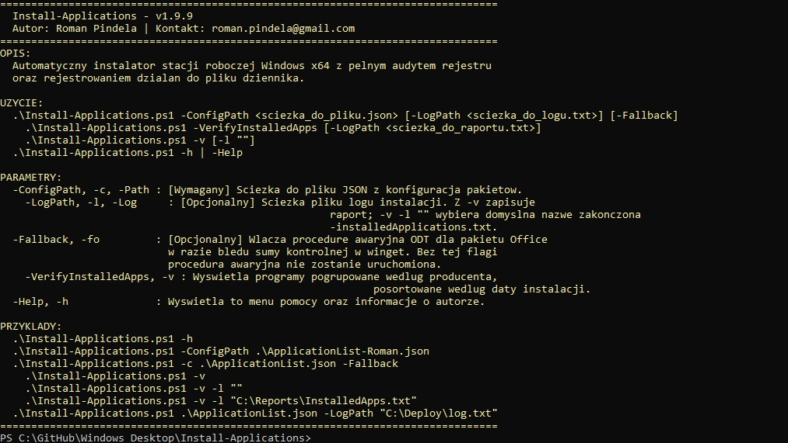
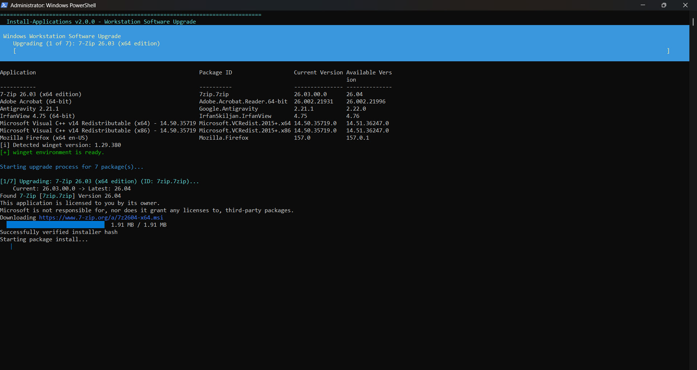
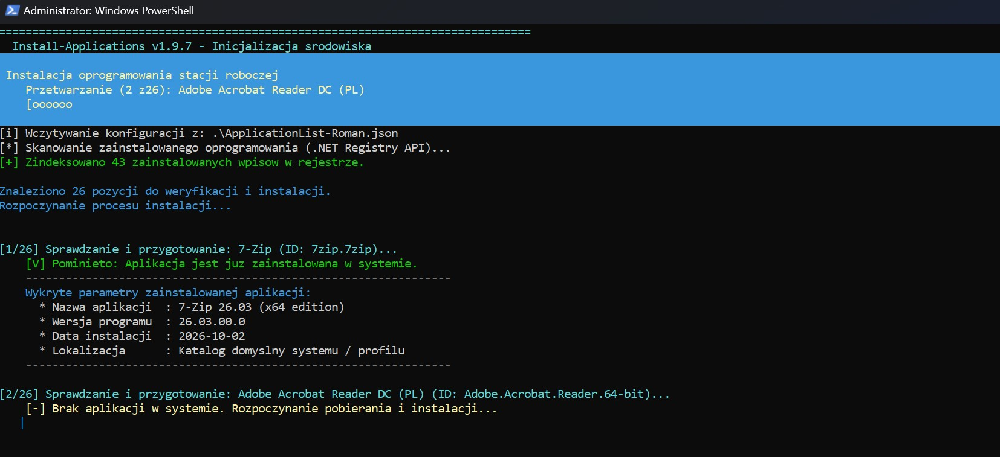
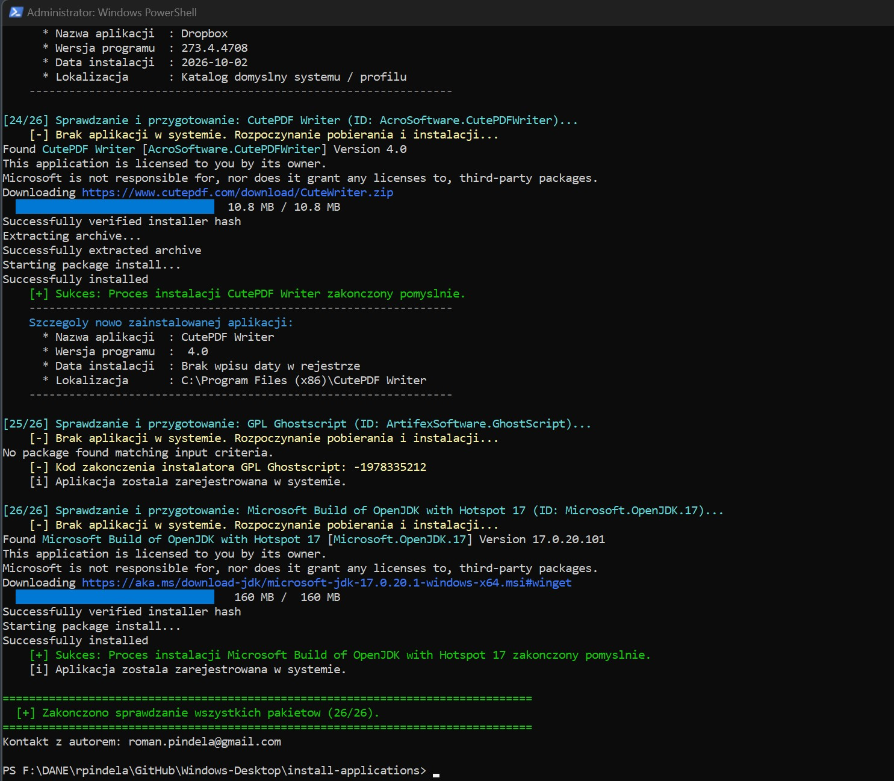
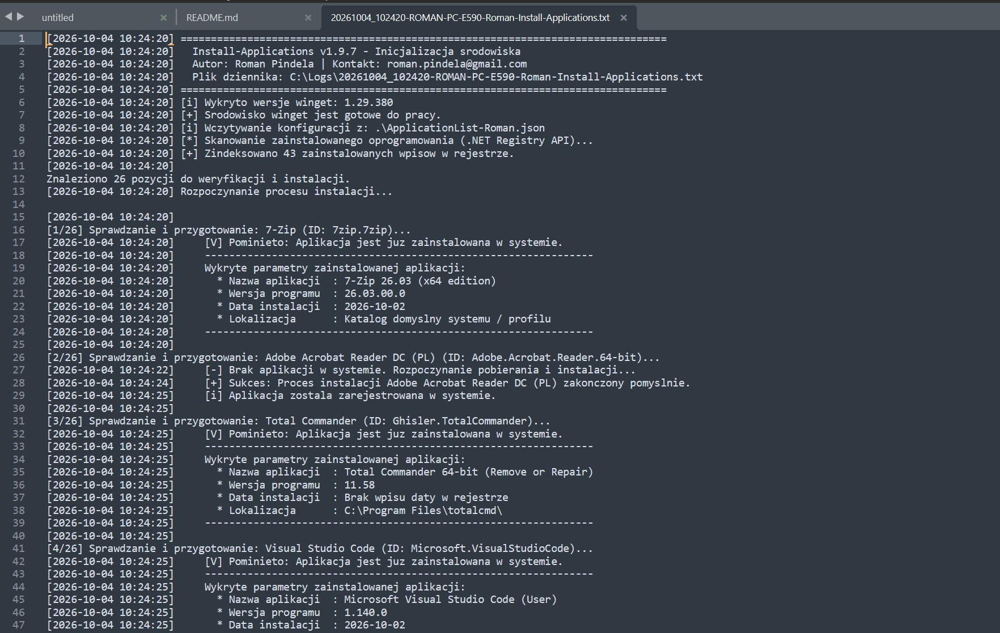

# Install-Applications

[](https://microsoft.com/powershell)
[](https://www.microsoft.com/windows)

## Problem Statement

Manual software provisioning on new or re-imaged Windows workstations is slow, inconsistent across technicians, and prone to failure on user-scoped packages (such as Spotify under elevation), outdated `winget` clients, or hash-mismatch installers. Support engineers need a single script that audits existing registry inventory, supports interactive catalog search, installs or upgrades packages from JSON lists or CLI arguments, and writes structured logs.

## Overview

`Install-Applications.ps1` automates Windows x64 software deployment, upgrades, online WinGet catalog search (`-Search`), and installed software auditing (`-VerifyInstalledApps`). It reads packages from a JSON file (`-ConfigPath`) or installs/upgrades single packages (`-Package` / `-Install` / `-Upgrade`), detects already-installed software via `.NET` Registry APIs, falls back to user-scoped scheduled tasks for elevation-restricted installers (`0x8A150056`), repairs outdated `winget` clients (`>= 1.7.0`), and supports optional Office Deployment Tool fallback when `-Fallback` is specified.

## Environment & Prerequisites

- **OS:** Windows 10 / Windows 11 (64-bit)
- **PowerShell:** Windows PowerShell 5.1 or PowerShell 7.x+
- **Dependencies:** Windows Package Manager (`winget.exe` >= 1.7.0; auto-repaired via `Microsoft.WinGet.Client` if needed) and internet access to WinGet/vendor CDNs.

## Permissions Required

**Admin** — Installing, upgrading, and repairing workstation software via `winget` requires elevated Administrator privileges (`S-1-5-32-544`), while `-Search`, `-VerifyInstalledApps`, and `-Help` run as a standard `User`. Packages requiring user context automatically fall back to a scheduled task (`--scope user`).

## Safety & Impact

- **Risk Level:** `Modifies system state` — Installs/upgrades software packages, may repair `winget`, creates temporary scheduled tasks for user-scoped packages, and writes UTF-8 logs to `C:\Logs\` (read-only when using `-Search`, `-VerifyInstalledApps`, or `-Help`).
- **WhatIf / Confirm & Backup:** Does not support `-WhatIf` / `-Confirm` and creates no system backups prior to installing or upgrading software; skips packages already present in registry inventory and restricts Office ODT fallback to explicit `-Fallback` runs.

## Usage Examples

```powershell
# Display built-in help and usage details
.\Install-Applications.ps1 -Help
.\Install-Applications.ps1 -h

# Batch deploy applications defined in a JSON list
.\Install-Applications.ps1 -ConfigPath .\ApplicationList-Roman.json

# Batch deploy with emergency Office 365 ODT fallback enabled
.\Install-Applications.ps1 -c .\ApplicationList-User-Roman.json -Fallback

# Install a single package by ID or search online WinGet catalog
.\Install-Applications.ps1 -Install "Google.Chrome"
.\Install-Applications.ps1 -Search "Google"

# Upgrade all installed applications (or a specific package)
.\Install-Applications.ps1 -Upgrade
.\Install-Applications.ps1 -Upgrade -Package "7zip.7zip"

# Generate installed applications inventory report
.\Install-Applications.ps1 -VerifyInstalledApps -LogPath "C:\Reports\InstalledApps.txt"
```

### Parameters Reference

| Parameter | Aliases | Mode | Description |
| :--- | :--- | :--- | :--- |
| `-ConfigPath` | `-c`, `-Path` | Config | Path to JSON file containing application package list. |
| `-Upgrade` | `-u`, `-Update`, `-UpgradeAll` | Upgrade | Upgrades installed applications via `winget`. |
| `-Package` | `-Install`, `-Target`, `-UpgradeTarget`, `-PackageName`, `-Id`, `-Name`, `-App`, `-i` | InstallPackage / Upgrade | Target package ID or name to install or upgrade. |
| `-Search` | `-s`, `-Find`, `-Query` | Search | Searches online `winget` repository by pattern. |
| `-VerifyInstalledApps` | `-v` | Verify | Displays installed applications grouped by publisher and install date. |
| `-Fallback` | `-fo`, `-FallbackOffice` | Config / InstallPackage | Enables emergency ODT procedure for Office 365 on checksum mismatch. |
| `-LogPath` | `-l`, `-Log` | All | Custom path for log file or audit report. |
| `-Help` | `-h` | Help | Displays help guide, syntax, and examples. |

### JSON Configuration Format

```json
[
  { "Name": "7-Zip", "Id": "7zip.7zip" },
  { "Name": "Google Chrome", "Id": "Google.Chrome" },
  { "Name": "Visual Studio Code", "Id": "Microsoft.VisualStudioCode" }
]
```

### Exit Codes & Diagnostics

| Status / Exit Code | Technical Meaning | Script Action |
| :--- | :--- | :--- |
| **0** | Installer success | Retrieves and logs metadata of newly installed package. |
| **-1978335189 (0x8A15002B)** | Package is already registered in system | Pulls entry from registry inventory, displays metadata, and skips install. |
| **-1978335146 (0x8A150056)** | Elevated admin context blocked by installer | Dispatches user profile install via scheduled task (`--scope user`). |
| **-1978335215 (0x8A150011)** | Hash checksum mismatch | Executes emergency fallback routine (only if `-Fallback` was specified). |
| **-1073741819 (0xC0000005)** | Legacy `winget` critical crash | Automated repair and update via `Microsoft.WinGet.Client`. |

### Screenshots











## Author

- **Roman Pindela**
- **Email:** [roman.pindela@gmail.com](mailto:roman.pindela@gmail.com)
- **GitHub:** [https://github.com/romanpindela](https://github.com/romanpindela)
- **License:** MIT
