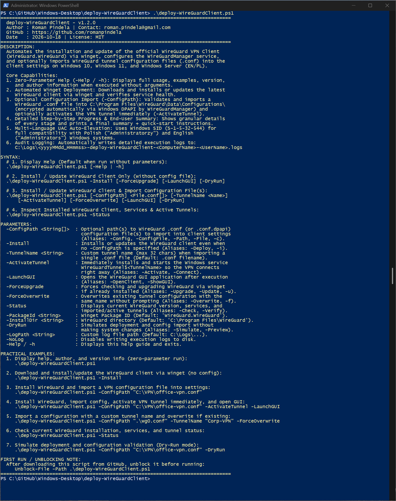
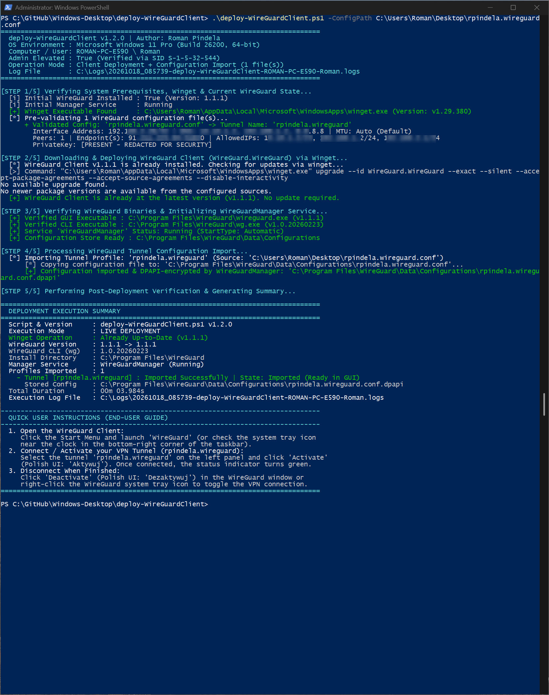

# Install-WireGuardClient

[](https://microsoft.com/powershell)
[](https://www.microsoft.com/windows)

## Problem Statement

Rolling out WireGuard VPN to end-user workstations manually involves installing the client, configuring the `WireGuardManager` service, importing `.conf` profiles securely without exposing private keys in logs, and optionally activating the tunnel service for unattended users. IT support teams need a single script that installs or updates WireGuard via `winget`, validates and imports `.conf` files into WireGuard's DPAPI store, and verifies active tunnel state across both Polish and English Windows editions.

## Overview

`Install-WireGuardClient.ps1` deploys or upgrades the official WireGuard VPN client (`WireGuard.WireGuard`) using `winget`, ensures the `WireGuardManager` service is running, and optionally imports `.conf` or `.conf.dpapi` profiles into `C:\Program Files\WireGuard\Data\Configurations\`. It supports key-redacted config inspection, immediate tunnel service activation (`-ActivateTunnel`), client status diagnostics (`-Status`), and simulation mode (`-DryRun`).

## Environment & Prerequisites

- **OS:** Windows 10, Windows 11, or Windows Server (language-agnostic: Polish and English editions)
- **PowerShell:** Windows PowerShell 5.1 or PowerShell 7.x+
- **Dependencies:** Windows Package Manager (`winget`) for client installation/upgrades; no external PowerShell modules required.

## Permissions Required

**Admin** — Installing/upgrading WireGuard via `winget`, writing to `C:\Program Files\WireGuard\Data\Configurations\`, and installing/starting `WireGuardTunnel$<Name>` services require Local Administrator privileges (`S-1-5-32-544`). The script automatically elevates via UAC unless `-SkipAdminCheck` is passed; zero-parameter or `-Help` runs display help without elevation.

## Safety & Impact

- **Risk Level:** `Modifies system state` — Installs/upgrades WireGuard software, manages Windows services, and writes encrypted tunnel configurations (`-Status` and `-DryRun` are read-only/non-modifying).
- **WhatIf / Confirm & Backup:** Supports PowerShell `-WhatIf` / `-Confirm` (`SupportsShouldProcess`) and `-DryRun` simulation. Prompts for confirmation before replacing an existing tunnel profile unless `-ForceOverwrite` is specified; does not create automatic file backups of overwritten profiles, and redacts `PrivateKey`/`PresharedKey` from console/log output (`C:\Logs\...`).

## Usage Examples

```powershell
# Display built-in help and usage examples without elevation
.\Install-WireGuardClient.ps1
.\Install-WireGuardClient.ps1 -Help

# Install or verify the WireGuard client via winget only
.\Install-WireGuardClient.ps1 -Install

# Install WireGuard and import a .conf tunnel profile into DPAPI storage
.\Install-WireGuardClient.ps1 -ConfigPath "C:\VPN\office-vpn.conf"

# Import profile, start the Windows tunnel service immediately, and launch GUI
.\Install-WireGuardClient.ps1 -ConfigPath "C:\VPN\office-vpn.conf" -ActivateTunnel -LaunchGUI

# Import profile with a custom tunnel name and overwrite existing config unattended
.\Install-WireGuardClient.ps1 -ConfigPath "C:\VPN\client01.conf" -TunnelName "Corp-HQ" -ForceOverwrite

# Inspect installed WireGuard version, services, profiles, and active interfaces
.\Install-WireGuardClient.ps1 -Status

# Simulate deployment and configuration validation without system changes
.\Install-WireGuardClient.ps1 -ConfigPath "C:\VPN\office-vpn.conf" -ActivateTunnel -DryRun
```

### Parameters

| Parameter | Alias | Type | Default | Description |
| :--- | :--- | :--- | :--- | :--- |
| `-ConfigPath` | `-Config`, `-ConfigFile`, `-Path`, `-File`, `-c` | `[string[]]` | `$null` | Path(s) to WireGuard `.conf` or `.conf.dpapi` profile(s) to import. |
| `-Install` | `-Deploy`, `-Setup`, `-i` | `[switch]` | `$false` | Deploys or updates WireGuard via `winget` even without `-ConfigPath`. |
| `-TunnelName` | `-Name` | `[string]` | `$null` | Custom tunnel name (1–32 chars) when importing a single `.conf` file. |
| `-ActivateTunnel` | `-Activate`, `-Connect`, `-StartTunnel` | `[switch]` | `$false` | Installs and starts the `WireGuardTunnel$<TunnelName>` service after import. |
| `-LaunchGUI` | `-OpenClient`, `-ShowGUI` | `[switch]` | `$false` | Launches `wireguard.exe` after deployment completes. |
| `-ForceUpgrade` | `-Upgrade`, `-Update`, `-u` | `[switch]` | `$false` | Forces a `winget upgrade` check for the WireGuard client. |
| `-ForceOverwrite` | `-Overwrite`, `-Force`, `-f` | `[switch]` | `$false` | Overwrites an existing tunnel configuration without prompting. |
| `-Status` | `-Check`, `-Verify`, `-Info` | `[switch]` | `$false` | Inspects WireGuard version, services, imported profiles, and active `wg.exe show` interfaces. |
| `-PackageId` | | `[string]` | `WireGuard.WireGuard` | Winget package identifier for WireGuard. |
| `-InstallDir` | | `[string]` | `C:\Program Files\WireGuard` | WireGuard installation directory. |
| `-DryRun` | `-Simulate`, `-Preview` | `[switch]` | `$false` | Simulates installation and profile import without modifying the system. |
| `-SkipAdminCheck` | | `[switch]` | `$false` | Skips automatic UAC elevation check. |
| `-PassThru` | | `[switch]` | `$false` | Returns a structured `[PSCustomObject]` summary to the pipeline. |
| `-LogPath` | `-Log`, `-l` | `[string]` | `C:\Logs\...` | Custom path for the UTF-8 execution log file. |
| `-NoLog` | | `[switch]` | `$false` | Disables writing execution logs to disk. |
| `-Help` | `-h` | `[switch]` | `$false` | Displays interactive help, version, and author details. |

### Screenshots





## Author

- **Roman Pindela**
- **Email:** [roman.pindela@gmail.com](mailto:roman.pindela@gmail.com)
- **GitHub:** [https://github.com/romanpindela](https://github.com/romanpindela)
