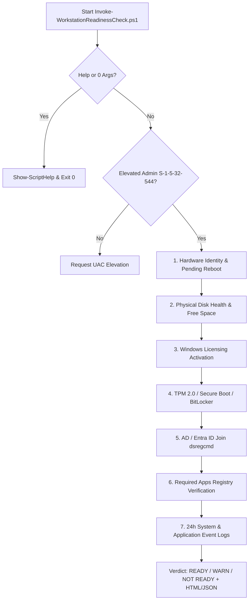
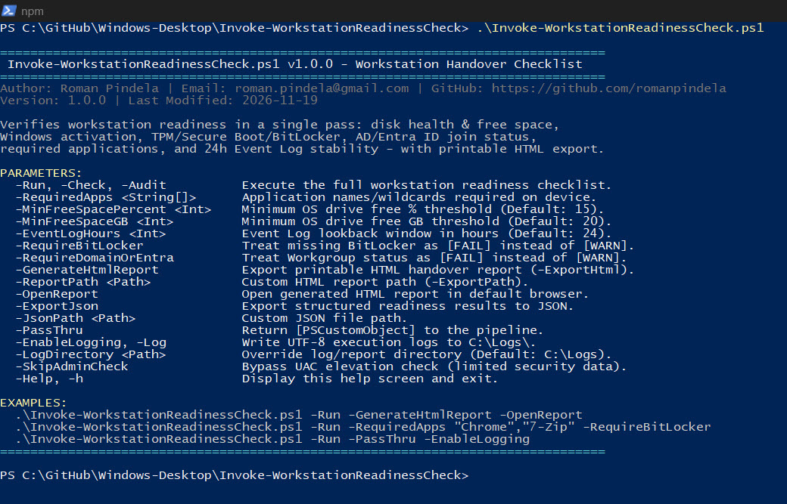
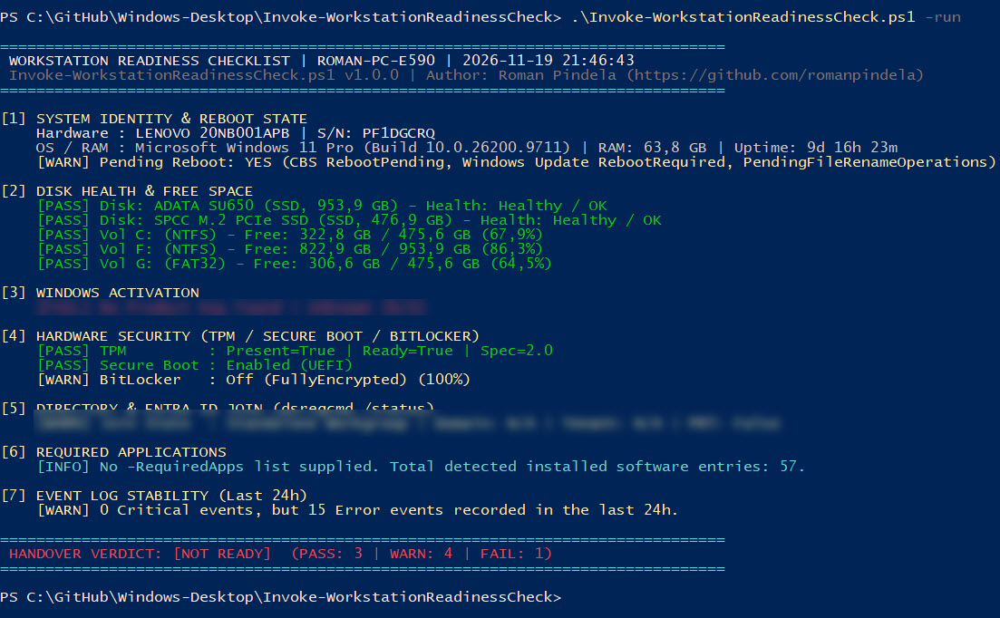

# Invoke-WorkstationReadinessCheck

[](https://microsoft.com/powershell)
[](https://www.microsoft.com/windows)
[]()
[]()
[](https://opensource.org/licenses/MIT)

## Problem Statement

Issuing a newly provisioned, reimaged, or post-service laptop to an employee without a standardized acceptance check leads to avoidable helpdesk tickets: unactivated Windows licenses, missing BitLocker encryption, broken Entra ID / AD join, missing corporate apps, low disk space, or hidden critical Event Log crashes from the previous 24 hours.

## Overview

`Invoke-WorkstationReadinessCheck.ps1` acts as an automated **Workstation Handover Acceptance Checklist**. In a single run, it validates hardware identity and pending reboot flags, physical disk health and free space thresholds, Windows licensing activation, TPM 2.0 / UEFI Secure Boot / BitLocker encryption, Active Directory & Entra ID join state (`dsregcmd /status`), required application presence, and 24-hour `System` + `Application` Event Log stability — producing a colorized console scorecard and a printable HTML Handover Acceptance Certificate with IT/Recipient sign-off lines.

---

## Technical Architecture



```text
+-----------------------------------------------------------------------+
|                 Invoke-WorkstationReadinessCheck.ps1                  |
+-------------------+-----------------------+---------------------------+
| Hardware & OS     | Security & Identity   | Software & Stability      |
| - Model & S/N     | - TPM 2.0 (Get-Tpm)   | - HKLM/HKCU Uninstall     |
| - Pending Reboot  | - UEFI Secure Boot    |   RequiredApps Check      |
| - Disks & Volumes | - BitLocker OS Drive  | - 24h Critical/Error Logs |
| - Win Activation  | - dsregcmd /status    | - Printable HTML Cert     |
+-------------------+-----------------------+---------------------------+
```

---

## Prerequisites & Unblocking

* **Operating System:** Windows 10, Windows 11, or Windows Server 2016+ (EN / PL locale-independent).
* **PowerShell Version:** Windows PowerShell 5.1 or PowerShell 7+.
* **Permissions:** Administrator (`S-1-5-32-544`, automatic UAC elevation) for TPM, Secure Boot, and BitLocker verification. Use `-SkipAdminCheck` for non-elevated preview runs.
* **Unblock Downloaded Script:**
  ```powershell
  Unblock-File -Path ".\Invoke-WorkstationReadinessCheck.ps1"
  ```

---

## Script Parameters

| Parameter | Alias | Type | Default | Description |
| :--- | :--- | :--- | :--- | :--- |
| `-Run` | `-Check`, `-Audit`, `-All` | `[switch]` | `$false` | Executes the full 7-pillar workstation readiness checklist. |
| `-RequiredApps` | — | `[string[]]` | — | Application names or wildcards required on the endpoint (e.g., `"Chrome"`, `"7-Zip"`). |
| `-MinFreeSpacePercent` | — | `[int]` | `15` | Minimum free space percentage threshold for the OS drive (`1`–`95`). |
| `-MinFreeSpaceGB` | — | `[int]` | `20` | Minimum free space in GB threshold for the OS drive (`1`–`10000`). |
| `-EventLogHours` | — | `[int]` | `24` | Lookback window in hours for Critical and Error Event Log checks (`1`–`720`). |
| `-RequireBitLocker` | — | `[switch]` | `$false` | Strict policy: marks missing/unprotected BitLocker as `[FAIL]` instead of `[WARN]`. |
| `-RequireDomainOrEntra` | — | `[switch]` | `$false` | Strict policy: marks Standalone Workgroup status as `[FAIL]` instead of `[WARN]`. |
| `-GenerateHtmlReport` | `-ExportHtml` | `[switch]` | `$false` | Generates a standalone printable HTML Handover Acceptance Report. |
| `-ReportPath` | `-ExportPath` | `[string]` | `C:\Logs\Invoke-WorkstationReadinessCheck_<host>_<ts>.html` | Custom HTML report file or directory path. |
| `-OpenReport` | — | `[switch]` | `$false` | Opens the generated HTML report in the default browser. |
| `-ExportJson` | — | `[switch]` | `$false` | Exports the structured readiness scorecard to JSON. |
| `-JsonPath` | — | `[string]` | `C:\Logs\Invoke-WorkstationReadinessCheck_<host>_<ts>.json` | Custom JSON file or directory path. |
| `-PassThru` | — | `[switch]` | `$false` | Returns the structured `[PSCustomObject]` to the pipeline. |
| `-EnableLogging` | `-Log` | `[switch]` | `$false` | Writes structured UTF-8 execution logs to `C:\Logs\`. |
| `-LogDirectory` | — | `[string]` | `C:\Logs` | Base directory for logs and default report exports (falls back to `%TEMP%\Logs`). |
| `-SkipAdminCheck` | — | `[switch]` | `$false` | Bypasses automatic UAC elevation check (TPM/BitLocker/Secure Boot may report limited status). |
| `-Help` | `-h` | `[switch]` | `$false` | Displays interactive console help and exits cleanly. |

---

## Usage Examples

### 1. Standard Workstation Handover Check + Printable HTML Certificate
```powershell
.\Invoke-WorkstationReadinessCheck.ps1 -Run -GenerateHtmlReport -OpenReport
```

### 2. Strict Corporate Baseline Check with Required Applications
```powershell
.\Invoke-WorkstationReadinessCheck.ps1 -Run -RequiredApps "Google Chrome","7-Zip","Microsoft Edge" -RequireBitLocker -RequireDomainOrEntra -GenerateHtmlReport -EnableLogging
```

### 3. Pipeline Verification & JSON Export
```powershell
$readiness = .\Invoke-WorkstationReadinessCheck.ps1 -Run -ExportJson -PassThru
$readiness | Select-Object ComputerName, OverallVerdict, PassCount, WarnCount, FailCount
```

### 4. Run Directly from GitHub (via `Invoke-GitHubScript.ps1`)
```powershell
.\Invoke-GitHubScript.ps1 -UrlToDownload "https://github.com/romanpindela/Windows-Desktop/blob/main/Invoke-WorkstationReadinessCheck/Invoke-WorkstationReadinessCheck.ps1" -ScriptArgs "-Run -GenerateHtmlReport -OpenReport"
```

---

## Screenshots & Visual Verification

### 1. Standard Execution & Interactive Help (`.\Invoke-WorkstationReadinessCheck.ps1`)


### 2. Full Workstation Readiness Checklist (`.\Invoke-WorkstationReadinessCheck.ps1 -Run`)


---

## Logging & Troubleshooting

* **Log Path:** `C:\Logs\<yyyyMMdd-HHmmss>-Invoke-WorkstationReadinessCheck-<COMPUTERNAME>-<USERNAME>.log` (when `-EnableLogging` is enabled).
* **Limited Security Data:** Running with `-SkipAdminCheck` as a standard user restricts access to `Get-Tpm`, `Confirm-SecureBootUEFI`, and `Get-BitLockerVolume`; run elevated for an authoritative handover verdict.
* **Printing to PDF:** Click the **Print / Save PDF** button in the HTML report header — navigation buttons are automatically hidden in print layout.

---

## Changelog

### v1.0.0 (2026-11-19)
* Initial release covering system identity & pending reboot, physical disk & volume thresholds, Windows activation, TPM/Secure Boot/BitLocker, `dsregcmd /status` AD/Entra ID join, required apps verification, 24h Event Log stability, and printable HTML handover reports.

---

## Author & Metadata

* **Author:** Roman Pindela
* **Email:** roman.pindela@gmail.com
* **GitHub:** [https://github.com/romanpindela](https://github.com/romanpindela)
* **Version:** `1.0.0` (SemVer)
* **Last Modified:** `2026-11-19`
