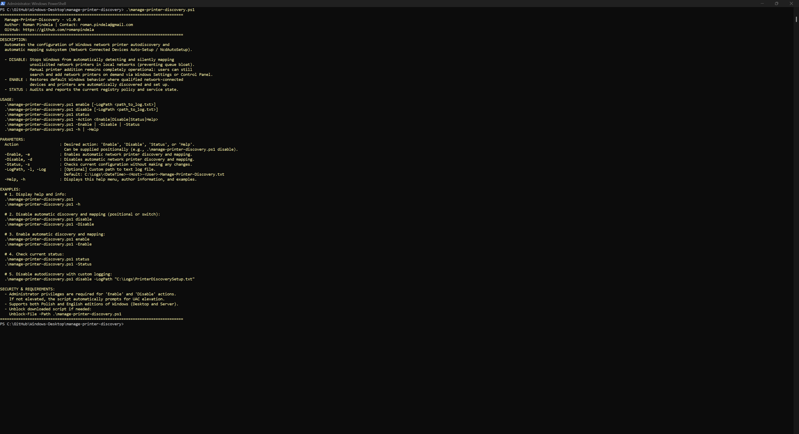
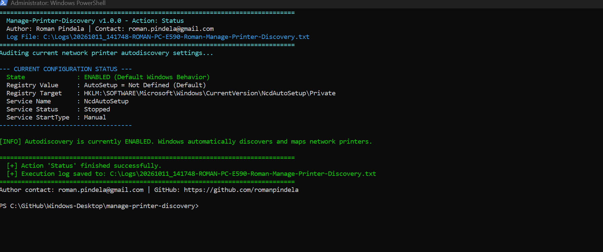

# Manage-PrinterDiscovery

[](https://microsoft.com/powershell)
[](https://www.microsoft.com/windows)

## Problem Statement

On shared office and enterprise networks, Windows automatically discovers broadcasted network printers (`WSD` / `mDNS` / `UPnP`) and installs unsolicited printer queues via the `NcdAutoSetup` subsystem, cluttering users' printer lists while potentially conflicting with managed print servers. IT administrators need a clean CLI toggle to disable or re-enable automatic network device printer discovery while keeping manual printer installation working normally.

## Overview

`Manage-PrinterDiscovery.ps1` controls Windows Network Connected Devices Auto-Setup (`NcdAutoSetup`) behavior via `HKLM:\SOFTWARE\Microsoft\Windows\CurrentVersion\NcdAutoSetup\Private\AutoSetup` and the `NcdAutoSetup` service. It supports positional or switch-based `Enable`, `Disable`, `Status` (audit), and `Help` modes, writes UTF-8 logs (`C:\Logs\` by default), and auto-elevates via UAC only for state-modifying actions (`Enable` / `Disable`).

## Environment & Prerequisites

- **OS:** Windows 10, Windows 11, or Windows Server 2016/2019/2022/2025 (English and Polish editions)
- **PowerShell:** Windows PowerShell 5.1 or PowerShell 7.x+
- **Dependencies:** Native Windows Registry and Service Control Manager (`NcdAutoSetup` service); no external modules required.

## Permissions Required

**Admin** (for `Enable` and `Disable`) — Modifying `HKLM:\...\NcdAutoSetup` and managing the `NcdAutoSetup` Windows service require elevated Administrator privileges (`S-1-5-32-544`), and the script automatically requests UAC elevation while preserving parameters. `Status` and `Help` run as a standard `User` without elevation.

## Safety & Impact

- **Risk Level:** `Modifies system state` (for `Enable` / `Disable`) — Toggles the `AutoSetup` DWORD registry key and configures/restarts the `NcdAutoSetup` service without preventing manual printer installation (`Status` and `Help` are `Read-Only / Non-destructive`).
- **WhatIf / Confirm & Backup:** Does not support `-WhatIf` / `-Confirm` and creates no registry backups (changes are cleanly reversible by running `-Enable` or `-Disable`); writes execution logs to `C:\Logs\...`.

## Usage Examples

```powershell
# Display built-in help guide without elevation
.\Manage-PrinterDiscovery.ps1
.\Manage-PrinterDiscovery.ps1 -Help

# Audit current network printer auto-discovery status (read-only, no elevation)
.\Manage-PrinterDiscovery.ps1 status
.\Manage-PrinterDiscovery.ps1 -Status

# Disable automatic network printer discovery and background mapping
.\Manage-PrinterDiscovery.ps1 disable
.\Manage-PrinterDiscovery.ps1 -Disable

# Re-enable default automatic network printer discovery
.\Manage-PrinterDiscovery.ps1 enable
.\Manage-PrinterDiscovery.ps1 -Enable

# Disable autodiscovery with a custom log path
.\Manage-PrinterDiscovery.ps1 disable -LogPath "C:\Logs\PrinterDiscoverySetup.txt"
```

### Parameters

| Parameter | Alias | Type | Default | Description |
| :--- | :--- | :--- | :--- | :--- |
| `-Action` | *(Positional 0)* | `[string]` | `$null` | Operation to execute: `Enable`, `Disable`, `Status`, or `Help`. |
| `-Enable` | `-e` | `[switch]` | `$false` | Enables automatic network printer discovery and mapping. |
| `-Disable` | `-d` | `[switch]` | `$false` | Disables automatic network printer discovery and mapping. |
| `-Status` | `-s` | `[switch]` | `$false` | Audits registry key and `NcdAutoSetup` service state without changes. |
| `-LogPath` | `-l`, `-Log` | `[string]` | `C:\Logs\...` | Custom path for the UTF-8 execution log file. |
| `-Help` | `-h` | `[switch]` | `$false` | Displays interactive help, examples, and author information. |

### Screenshots





## Author

- **Roman Pindela**
- **Email:** [roman.pindela@gmail.com](mailto:roman.pindela@gmail.com)
- **GitHub:** [https://github.com/romanpindela](https://github.com/romanpindela)
- **License:** MIT
