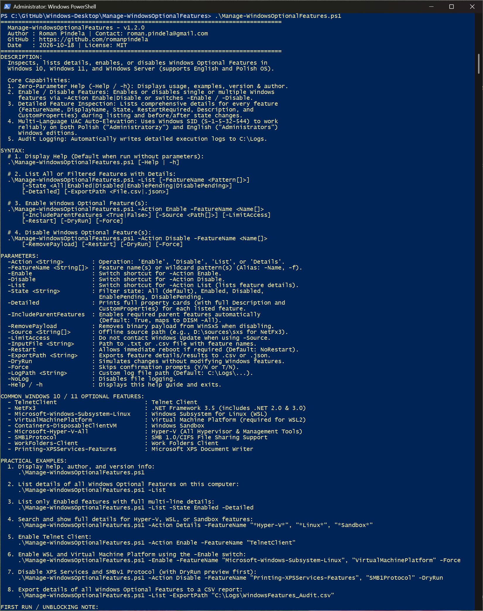
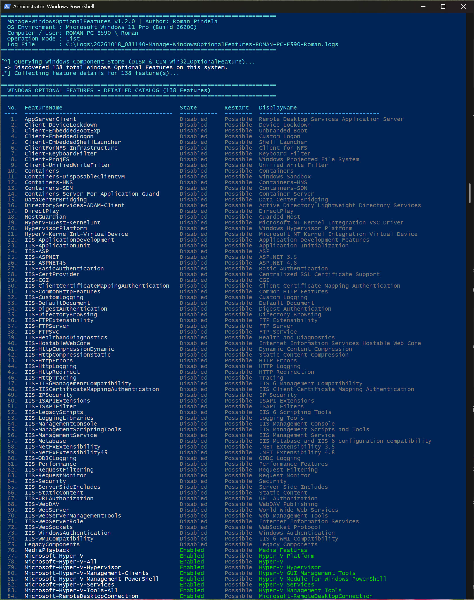
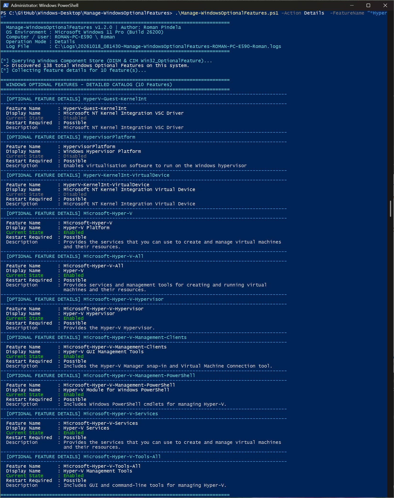
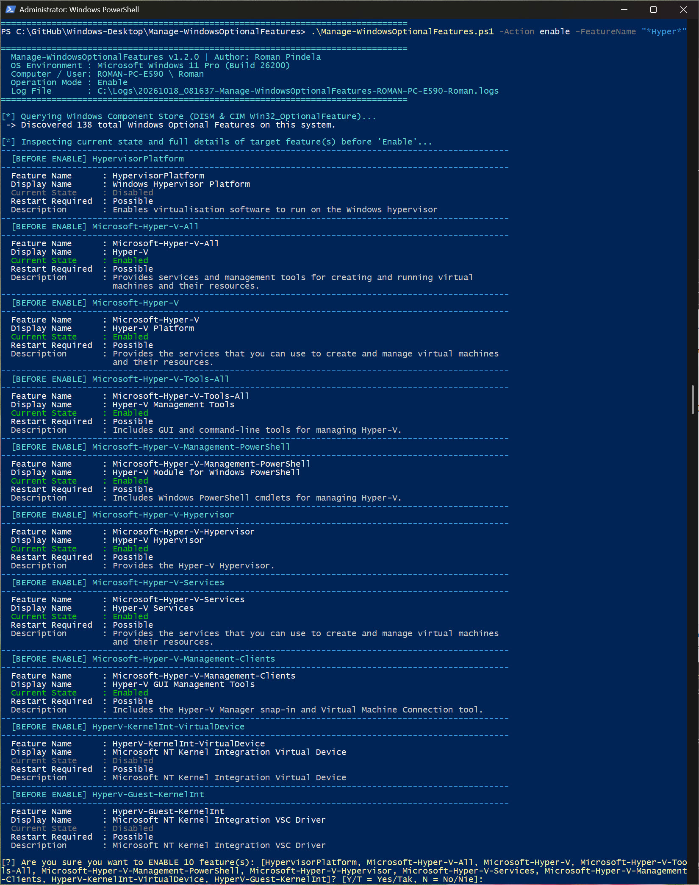

# Manage-WindowsOptionalFeatures

[](https://microsoft.com/powershell)
[](https://www.microsoft.com/windows)

## Problem Statement

Enabling or disabling Windows Optional Features (such as Hyper-V, WSL 2, Windows Sandbox, .NET 3.5, Telnet Client, or legacy SMB 1.0) manually through `optionalfeatures.exe` or localized DISM commands makes it slow to inspect detailed feature descriptions, handle parent feature dependencies, suppress surprise reboots, and bulk-process feature lists consistently across English and Polish Windows installations.

## Overview

`Manage-WindowsOptionalFeatures.ps1` provides a unified CLI wrapper around `Get-WindowsOptionalFeature`, `Enable-WindowsOptionalFeature`, `Disable-WindowsOptionalFeature`, and `Win32_OptionalFeature` to list, inspect (`-Detailed`), enable, or disable Windows Optional Features by name, wildcard, or input file (`.txt`/`.csv`). It supports offline sources (`-Source` / `-LimitAccess`), WinSxS payload removal (`-RemovePayload`), CSV/JSON export (`-ExportPath`), simulation (`-DryRun`), and UTF-8 logging (`C:\Logs\`).

## Environment & Prerequisites

- **OS:** Windows 10, Windows 11, or Windows Server 2016/2019/2022/2025 (English and Polish editions)
- **PowerShell:** Windows PowerShell 5.1 or PowerShell 7.x+
- **Modules / Dependencies:** Built-in `DISM` PowerShell module and WMI/CIM (`Win32_OptionalFeature`); optional Windows installation media (`SxS`) when enabling offline features with `-Source`.

## Permissions Required

**Admin** — Querying DISM optional feature states and enabling/disabling features require Local Administrator privileges (`S-1-5-32-544`), and the script automatically requests UAC elevation while preserving CLI parameters unless `-SkipAdminCheck` is passed. Zero-parameter and `-Help` runs display help without elevation.

## Safety & Impact

- **Risk Level:** `Modifies system state` (for `Enable` / `Disable`; `List` and `Details` are `Read-Only / Non-destructive`) — Installs or removes Windows OS components (`-NoRestart` by default unless `-Restart` is passed, or deletes WinSxS payloads when `-RemovePayload` is used).
- **WhatIf / Confirm & Backup:** Supports `-WhatIf` / `-Confirm` (`SupportsShouldProcess`) and `-DryRun` simulation, plus interactive confirmation prompts before enabling/disabling unless `-Force` is specified; creates no OS snapshot/backup (writes audit logs to `C:\Logs\...`).

## Usage Examples

```powershell
# Display built-in help and common feature names without elevation
.\Manage-WindowsOptionalFeatures.ps1
.\Manage-WindowsOptionalFeatures.ps1 -Help

# List all Windows Optional Features or filter by enabled state with full cards
.\Manage-WindowsOptionalFeatures.ps1 -List
.\Manage-WindowsOptionalFeatures.ps1 -List -State Enabled -Detailed

# Inspect matching features by wildcard and export catalog to CSV
.\Manage-WindowsOptionalFeatures.ps1 -Action Details -FeatureName "*Hyper-V*", "*Linux*", "*Sandbox*"
.\Manage-WindowsOptionalFeatures.ps1 -List -ExportPath "C:\Logs\WindowsOptionalFeatures_Audit.csv"

# Enable one or more features without interactive prompts
.\Manage-WindowsOptionalFeatures.ps1 -Action Enable -FeatureName "TelnetClient"
.\Manage-WindowsOptionalFeatures.ps1 -Action Enable -FeatureName "Microsoft-Windows-Subsystem-Linux", "VirtualMachinePlatform", "Containers-DisposableClientVM" -Force

# Simulate disabling legacy features with -DryRun before executing
.\Manage-WindowsOptionalFeatures.ps1 -Action Disable -FeatureName "SMB1Protocol", "WorkFolders-Client" -DryRun
.\Manage-WindowsOptionalFeatures.ps1 -Action Disable -FeatureName "SMB1Protocol", "WorkFolders-Client" -Force
```

### Parameters

| Parameter | Alias | Type | Default | Description |
| :--- | :--- | :--- | :--- | :--- |
| `-Action` | `-Mode`, `-Operation` | `[string]` | `$null` | Operation: `Enable`, `Disable`, `List`, or `Details`. |
| `-FeatureName` | `-Name`, `-Feature`, `-Features`, `-f` | `[string[]]` | `$null` | Optional feature name(s) or wildcard patterns. |
| `-Enable` | | `[switch]` | `$false` | Shortcut for `-Action Enable`. |
| `-Disable` | | `[switch]` | `$false` | Shortcut for `-Action Disable`. |
| `-List` | `-ShowAll`, `-Get` | `[switch]` | `$false` | Shortcut for `-Action List`. |
| `-State` | `-FilterState`, `-Status` | `[string]` | `All` | Filter state: `All`, `Enabled`, `Disabled`, `EnablePending`, or `DisablePending`. |
| `-Detailed` | | `[switch]` | `$false` | Prints full multi-line property cards including `Description` and `CustomProperties`. |
| `-IncludeParentFeatures` | | `[bool]` | `$true` | Enables parent dependencies via `Enable-WindowsOptionalFeature -All`. |
| `-RemovePayload` | | `[switch]` | `$false` | Removes feature payload from WinSxS (`-Remove`) when disabling. |
| `-Source` | | `[string[]]` | `$null` | Offline source path(s) (e.g., `D:\sources\sxs`). |
| `-LimitAccess` | | `[switch]` | `$false` | Prevents DISM from contacting Windows Update/WSUS. |
| `-InputFile` | `-FilePath`, `-Path` | `[string]` | `$null` | `.txt` or `.csv` file with feature names for batch actions. |
| `-Restart` | | `[switch]` | `$false` | Allows automatic reboot when required (default suppresses reboot via `-NoRestart`). |
| `-ExportPath` | `-ExportCsv`, `-ReportPath`, `-OutFile` | `[string]` | `$null` | Exports details or results to `.csv` or `.json`. |
| `-DryRun` | `-Simulate`, `-Preview` | `[switch]` | `$false` | Simulates enable/disable changes without modifying the OS. |
| `-Force` | | `[switch]` | `$false` | Suppresses interactive confirmation prompts. |
| `-SkipAdminCheck` | | `[switch]` | `$false` | Skips automatic UAC elevation check. |
| `-PassThru` | | `[switch]` | `$false` | Returns structured result objects to the pipeline. |
| `-LogPath` | `-Log`, `-l` | `[string]` | `C:\Logs\...` | Custom path for the UTF-8 execution log file. |
| `-NoLog` | | `[switch]` | `$false` | Disables writing execution logs to disk. |
| `-Help` | `-h` | `[switch]` | `$false` | Displays interactive help, examples, version, and author details. |

### Screenshots









## Author

- **Roman Pindela**
- **Email:** [roman.pindela@gmail.com](mailto:roman.pindela@gmail.com)
- **GitHub:** [https://github.com/romanpindela](https://github.com/romanpindela)
- **License:** MIT
