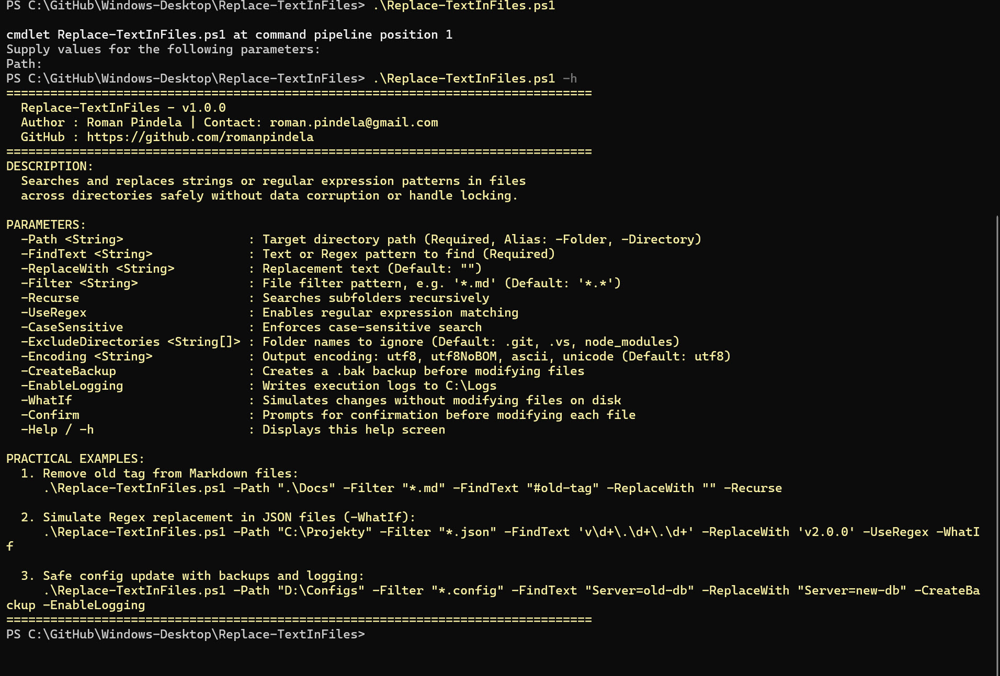
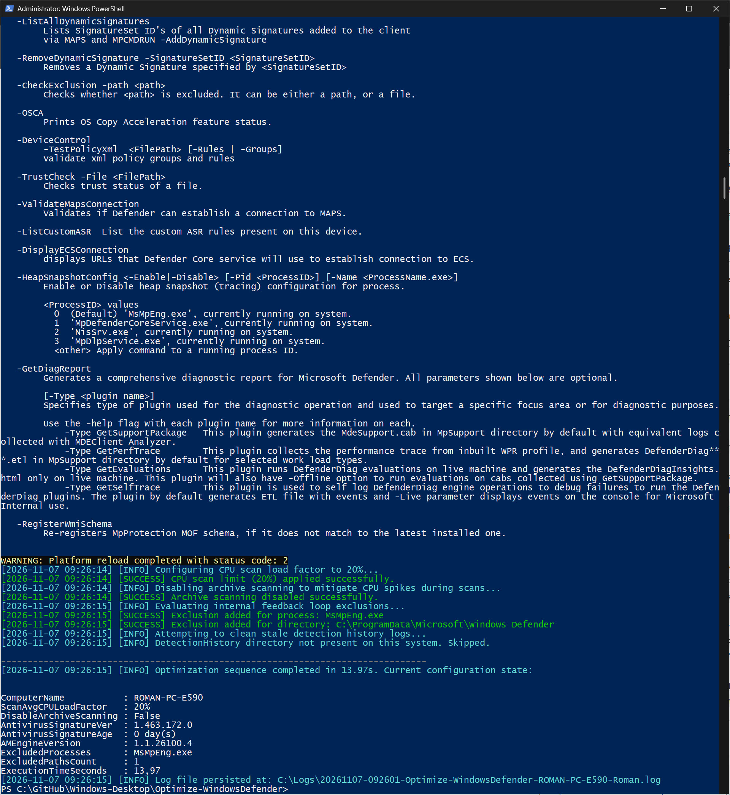

# Optimize Windows Defender (`Optimize-WindowsDefender`)

**Version:** 1.1.0  
**Release Date:** 2026-11-07  
**Author:** Roman Pindela  
**License:** MIT  

An enterprise-grade PowerShell optimization and maintenance utility for **Microsoft Defender Antivirus** (`WinDefend` / `MsMpEng.exe`) across **Windows 10**, **Windows 11**, and **Windows Server** (x64 / ARM64).

---

## 📋 Project Information

| Parameter | Value |
| :--- | :--- |
| **Project Name** | Optimize Windows Defender |
| **Script Name** | `Optimize-WindowsDefender.ps1` |
| **Author** | Roman Pindela |
| **Email** | [roman.pindela@gmail.com](mailto:roman.pindela@gmail.com) |
| **GitHub** | [https://github.com/romanpindela](https://github.com/romanpindela) |
| **Repository** | [Windows-Desktop](https://github.com/romanpindela/Windows-Desktop) |
| **Version** | 1.1.0 |
| **Release Date** | 2026-11-07 |
| **License** | MIT |

---

## 🚀 Overview

Workstations and developer machines frequently suffer from high CPU utilization, memory bloat, and disk I/O bottlenecks caused by Microsoft Defender Antivirus (`MsMpEng.exe`). Common root causes include:
* **Scanning Feedback Loops:** Defender scanning its own temporary engine caches, logs, and signature databases in `%ProgramData%\Microsoft\Windows Defender`.
* **Corrupted Definition Caches:** Incomplete or fragmented antimalware signature updates causing the engine to repeatedly recompile databases in the background.
* **Archive Decompression Spikes:** Full deep inspection of multi-gigabyte `.zip`, `.cab`, and `.iso` containers freezing CPU cores.
* **Developer I/O Bottlenecks:** Real-time scanning of active Git repositories, node_modules, build artifacts, and compiler temporary files.
* **Ghost GUI Notifications:** Locked or stale detection logs in `DetectionHistory` triggering recurrent false-positive notifications even after threats are cleaned.

`Optimize-WindowsDefender.ps1` resolves these issues safely while respecting Windows Security architecture (**Protected Process Light - PPL** and **Tamper Protection**). It does not attempt to terminate protected system services directly; instead, it uses official Microsoft platform CLI interfaces (`MpCmdRun.exe`) and native PowerShell CIM/WMI cmdlets (`Set-MpPreference`).

---

## 🌟 Key Features

* **Safe Cache & Signature Hygiene (`-ResetSignatures`):** Safely purges dynamic antimalware signature caches via `MpCmdRun.exe -RemoveDefinitions -All` and pulls clean definitions directly using `-SignatureUpdate`.
* **Tamper-Safe Platform Reload (`-RestartEngine`):** Triggers a non-disruptive platform reload via `MpCmdRun.exe -RestartPlatform` without violating service protection barriers.
* **Adaptive CPU Throttling (`-CpuLimit`):** Regulates maximum average CPU consumption factor allocated to Defender background and on-demand scans (default: 20%, configurable 5–100%).
* **Archive Scanning Bypass (`-DisableArchiveScanning`):** Disables deep scanning of large archive files during routine scans, preventing severe system-wide CPU freezes.
* **Scanning Feedback Loop Shield (`-ApplySelfExclusion`):** Idempotently excludes `MsMpEng.exe` and `%ProgramData%\Microsoft\Windows Defender` from recursive scanning loops.
* **Developer Workspace Exclusions (`-CustomExclusionPaths`):** Batch configures exclusions for high-throughput repositories, build directories, and package caches with pre-validation and fast cached set lookups.
* **Detection History Purge (`-CleanDetectionHistory`):** Cleans stale and unlocked entries from the `DetectionHistory` directory to clear persistent GUI notification warnings.
* **Language-Agnostic UAC Auto-Elevation:** Verifies administrative privileges using well-known SIDs (`WellKnownSidType::BuiltInAdministratorsSid`), ensuring 100% compatibility across English (`Administrators`) and Polish (`Administratorzy`) Windows systems. Seamlessly relaunches with all CLI parameters preserved.
* **Standard PowerShell Impact Mitigation:** Full native support for `-WhatIf` and `-Confirm` preview modes.
* **Enterprise Audit Logging & Pipeline Support:** Writes timestamped logs to `C:\Logs` (or `-LogPath`) and returns structured objects with execution metrics when invoked with `-PassThru`.

---

## 📂 Directory Structure

```shell
Optimize-WindowsDefender/
├── assets/
│   ├── Optimization.jpg            # Screenshot of complete optimization workflow execution
│   └── Standard_run.jpg            # Screenshot of zero-parameter run / architecture & maintenance guide
├── Optimize-WindowsDefender.ps1    # Main optimization and maintenance script
└── README.md                       # Comprehensive technical documentation
```

---

## 💻 System Requirements

* **Operating System:** Windows 10, Windows 11, Windows Server 2016 / 2019 / 2022 / 2025.
* **PowerShell Version:** Windows PowerShell 5.1 or PowerShell 7+.
* **Privileges:** Administrator privileges required to adjust Defender preferences and platform state. The script automatically requests elevation via UAC when launched in a non-elevated console.
* **Security Compatibility:** Fully compatible with Microsoft Defender Tamper Protection and Protected Process Light (PPL).

---

## 📥 Getting Started

### 1. Unblock the Script (Required After Download)

When downloading PowerShell scripts from GitHub, Windows attaches an alternate data stream mark (`Zone.Identifier`). Unblock the file prior to execution:

```powershell
Unblock-File -Path .\Optimize-WindowsDefender.ps1
```

If execution is restricted by PowerShell policy, allow local script execution:

```powershell
Set-ExecutionPolicy -ExecutionPolicy RemoteSigned -Scope CurrentUser
```

---

## 📖 Parameter Reference

| Parameter | Type | Default | Description |
| :--- | :--- | :--- | :--- |
| `-All` | `[switch]` | `False` | Executes the complete optimization sequence: signature refresh, platform reload, 20% CPU limit, archive scan bypass, self-exclusions, and history cleanup. |
| `-ResetSignatures` | `[switch]` | `False` | Purges definition caches (`-RemoveDefinitions -All`) and downloads fresh antimalware/NIS updates (`-SignatureUpdate`). |
| `-RestartEngine` | `[switch]` | `False` | Safely reloads the Defender platform services via `MpCmdRun.exe -RestartPlatform`. |
| `-CpuLimit` | `[int]` | `20` | Sets average scan CPU utilization cap (allowed range: `5` to `100`). |
| `-DisableArchiveScanning` | `[switch]` | `False` | Disables unpacking and scanning of large compressed archives during scans. (Automatically enabled with `-All`). |
| `-ApplySelfExclusion` | `[switch]` | `False` | Adds idempotent exclusions for `MsMpEng.exe` and `%ProgramData%\Microsoft\Windows Defender`. |
| `-CustomExclusionPaths` | `[string[]]` | `$null` | Array of directory paths to add to the Defender real-time exclusion list. |
| `-CleanDetectionHistory` | `[switch]` | `False` | Purges stale detection records from the service `DetectionHistory` directory. |
| `-LogPath` | `[string]` | `C:\Logs\...` | Custom target path for the UTF-8 execution log file. |
| `-SkipAdminCheck` | `[switch]` | `False` | Bypasses automatic UAC elevation check (ideal for unattended CI/CD or automation runners). |
| `-PassThru` | `[switch]` | `False` | Returns a structured `PSCustomObject` containing pre/post configuration metrics to the pipeline. |
| `-Help` / `-h` | `[switch]` | `False` | Displays the interactive console help guide and exits immediately without triggering elevation. |

---

## 💡 Practical Examples

### 1. Complete System Optimization (`-All`)

Runs the full maintenance lifecycle: refreshes signatures, restarts the platform, restricts scan CPU load factor to 20%, excludes Defender's internal directories, disables archive decompression, and clears stale detection logs:

```powershell
.\Optimize-WindowsDefender.ps1 -All
```

### 2. Signature Reset & Engine Platform Reload

Fixes corrupted signature databases, stuck update downloads, or engine synchronization issues:

```powershell
.\Optimize-WindowsDefender.ps1 -ResetSignatures -RestartEngine
```

### 3. Developer Workspace Optimization with Custom CPU Limit

Limits background scan CPU utilization to 15% and excludes high-I/O developer repositories:

```powershell
.\Optimize-WindowsDefender.ps1 -CpuLimit 15 -CustomExclusionPaths "C:\GitHub", "D:\BuildCaches", "C:\Users\Roman\.cargo"
```

### 4. Non-Destructive Simulation (`-WhatIf`)

Previews all changes that would be performed without modifying system configuration:

```powershell
.\Optimize-WindowsDefender.ps1 -All -CustomExclusionPaths "C:\GitHub" -WhatIf
```

### 5. Automated Pipeline Execution with `-PassThru`

Collects post-optimization status in an automated script or monitoring probe:

```powershell
$status = .\Optimize-WindowsDefender.ps1 -CpuLimit 25 -DisableArchiveScanning -PassThru -SkipAdminCheck
$status | Format-Table ComputerName, ScanAvgCPULoadFactor, AntivirusSignatureVer, ExecutionTimeSeconds
```

---

## 📸 Screenshots & Visual Verification

### 1. Interactive Help Menu & Syntax Guide (`.\Optimize-WindowsDefender.ps1`)


### 2. Complete Maintenance & Optimization Execution (`.\Optimize-WindowsDefender.ps1 -All`)


---

## 🔬 Technical Deep-Dive

### Protected Process Light (PPL) & Tamper Protection
Attempting to stop `WinDefend` using `Stop-Service`, `taskkill.exe`, or registry modifications fails with `Access Denied` on modern Windows systems due to kernel-level PPL enforcement. `Optimize-WindowsDefender.ps1` interacts strictly through:
1. **`MpCmdRun.exe` Platform Engine:** Dynamically located across `ProgramData\Microsoft\Windows Defender\Platform\CurrentVersion`, versioned platform folders, and system directories.
2. **`Set-MpPreference` / `Add-MpPreference`:** Microsoft's sanctioned CIM/WMI provider interfaces for Defender preferences.

### Elimination of CIM Query Bottlenecks
Standard scripts repeatedly invoke `Get-MpPreference` in loops, which costs 500–1500 ms per CIM round-trip. `Optimize-WindowsDefender.ps1` queries existing preferences once, builds case-insensitive in-memory hash sets (`HashSet<string>`), and performs instantaneous $O(1)$ membership tests before executing idempotent additions.

---

## 📄 License

This project is licensed under the [MIT License](https://opensource.org/licenses/MIT).
