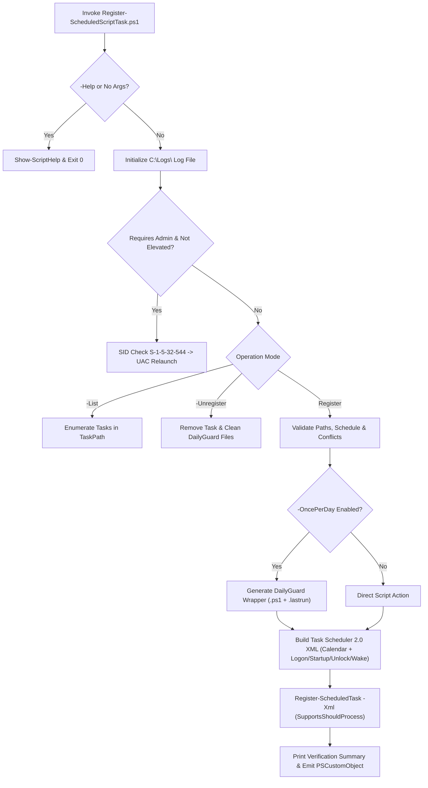
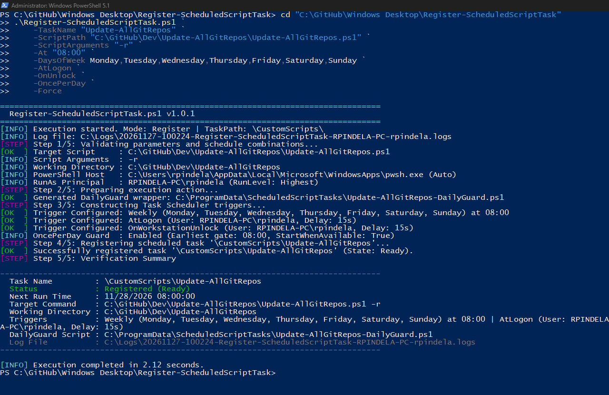

# Register-ScheduledScriptTask

[](https://learn.microsoft.com/powershell/)
[](https://www.microsoft.com/windows)
[](#changelog)
[](../LICENSE)

## Overview

**`Register-ScheduledScriptTask.ps1`** is a universal, production-grade Windows Task Scheduler automation tool that registers, inspects, and removes scheduled tasks for **any arbitrary PowerShell script (`.ps1`)** with custom arguments and working directory.

Built on top of the native **Windows Task Scheduler 2.0 COM API** (`Schedule.Service`) and the **`ScheduledTasks`** module, it overcomes native PowerShell CIM limitations (such as `MSFT_TaskMonthlyTrigger` failing on day numbers `17–31`) and introduces a smart **Once-Per-Day Execution Guard (`-OncePerDay`)** tailored for real-world laptops and workstations that are frequently powered off or hibernated.

### Key Capabilities

* **Universal Script Runner:** Registers any `.ps1` script with arbitrary `-ScriptArguments`, custom `-WorkingDirectory`, selectable host (`pwsh.exe` or `powershell.exe`), and window style (`Hidden`, `Minimized`, `Normal`).
* **Full Calendar Scheduling:** Daily (`-At`), Weekly (`-DaysOfWeek` + `-At`), and Monthly (`-DaysOfMonth 1..31` and/or `-LastDayOfMonth` + `-At`).
* **Event, Session & Power Triggers:** Combinable `-AtLogon`, `-AtStartup`, `-OnUnlock` (`TASK_SESSION_UNLOCK`), and `-OnWake` (`Power-Troubleshooter` Event ID `1` — resume from Sleep/Hibernation).
* **Smart Once-Per-Day Catch-Up (`-OncePerDay`):** Automatically runs on the **first user logon or screen unlock of the day after boot or hibernation resume** (optionally gated by `-At`, e.g., `08:00`, and allowed weekdays/month days) without firing repeatedly on subsequent screen unlocks.
* **Enterprise Safety & Observability:** Mandatory `-TaskName`, detailed color-coded console progress + `Write-Progress`, `-WhatIf` / `-Confirm` dry-run support, language-independent SID UAC elevation (`S-1-5-32-544`), structured `[PSCustomObject]` pipeline output (`-PassThru`), and full logging to `C:\Logs\`.

---

## Technical Architecture

### Execution & Trigger Flow (Mermaid)



### DailyGuard Catch-Up Flow (ASCII)

```text
  [08:00 Timer]  [Boot/Logon]  [Unlock after Hibernation]  [Wake Event ID 1]
        \             |                     |                      /
         +------------+---------------------+---------------------+
                                      |
                                      v
                        +---------------------------+
                        |   <Task>-DailyGuard.ps1   |
                        +---------------------------+
                                      |
                  +-------------------+-------------------+
                  |                                       |
         Already ran today?                     Before -At gate or
          (.lastrun == today)                   wrong day of week/month?
                  |                                       |
                 YES -> [SKIP & Exit 0]                  YES -> [SKIP & Exit 0]
                  |                                       |
                  +-------------------+-------------------+
                                      | (NO)
                                      v
                        +---------------------------+
                        | Set-Location WorkDir      |
                        | Execute TargetScript Args |
                        +---------------------------+
                                      |
                             ExitCode == 0 ?
                            /               \
                          YES                NO
                          /                   \
          Write today to .lastrun      Keep .lastrun unchanged
          Log [OK] to C:\Logs\         (allows retry on next trigger)
```

---

## Prerequisites

* **Operating System:** Windows 10, Windows 11, or Windows Server (language-independent PL/EN/DE).
* **PowerShell:** Windows PowerShell `5.1+` or PowerShell `7+` (`pwsh.exe`).
* **Permissions:** Administrator privileges (`S-1-5-32-544`) for `-RunLevel Highest`, `-AtStartup`, `-OnWake`, or `SYSTEM` tasks (automatic UAC elevation built in). Pass `-RunLevel Limited -SkipAdminCheck` for standard user-only tasks.
* **Unblock Downloaded Script:**
  ```powershell
  Unblock-File -Path ".\Register-ScheduledScriptTask.ps1"
  ```

---

## Parameters

| Parameter | Type | Required | Default | Description |
| :--- | :--- | :---: | :--- | :--- |
| `-TaskName` | `String` | Yes (`Register`, `Unregister`) | — | Mandatory name of the scheduled task. |
| `-ScriptPath` | `String` | Yes (`Register`) | — | Path to the target PowerShell (`.ps1`) script. |
| `-ScriptArguments` | `String` | No | `""` | Raw arguments forwarded verbatim to the target script (e.g., `"-r"`). |
| `-WorkingDirectory` | `String` | No | Parent of `-ScriptPath` | Working directory set prior to script execution. |
| `-TaskPath` | `String` | No | `\CustomScripts\` | Task Scheduler folder path. |
| `-Description` | `String` | No | Auto-generated | Description recorded in Task Scheduler. |
| `-At` | `String` | No* | — | Time of day (`HH:mm` or `HH:mm:ss`). Required with `-DaysOfWeek` / `-DaysOfMonth` / `-LastDayOfMonth`; also acts as earliest-run gate with `-OncePerDay`. |
| `-DaysOfWeek` | `DayOfWeek[]` | No | — | Weekly trigger days (`Monday`..`Sunday`). |
| `-DaysOfMonth` | `Int32[]` | No | — | Monthly trigger day numbers (`1..31`). |
| `-LastDayOfMonth` | `Switch` | No | `$false` | Triggers on the last day of each month. |
| `-AtLogon` | `Switch` | No | `$false` | Adds user logon trigger. |
| `-AtStartup` | `Switch` | No | `$false` | Adds system boot trigger (Admin required). |
| `-OnUnlock` | `Switch` | No | `$false` | Adds workstation unlock trigger (`StateChange = 8`), firing on unlock after sleep/hibernation. |
| `-OnWake` | `Switch` | No | `$false` | Adds Event trigger for `Power-Troubleshooter` Event ID `1` (resume from sleep/hibernation). |
| `-OncePerDay` | `Switch` | No | `$false` | Generates a DailyGuard wrapper ensuring at most one successful run per calendar day. |
| `-TriggerDelaySeconds` | `Int32` | No | `15` | Delay (`0..3600` seconds) applied to event/session triggers for network readiness. |
| `-StartWhenAvailable` | `Boolean` | No | `$true` | Enables Task Scheduler catch-up when a scheduled start was missed. |
| `-PowerShellHost` | `String` | No | `Auto` | `Auto` (prefers `pwsh.exe`), `WindowsPowerShell`, or `PowerShell7`. |
| `-WindowStyle` | `String` | No | `Hidden` | `Hidden`, `Minimized`, or `Normal`. |
| `-RunLevel` | `String` | No | `Highest` | `Highest` or `Limited`. |
| `-RunAsUser` | `String` | No | Current user | Account executing the task (`DOMAIN\User` or `SYSTEM`). |
| `-Force` | `Switch` | No | `$false` | Overwrites an existing task with the same name. |
| `-SkipPathValidation` | `Switch` | No | `$false` | Skips local existence check for `-ScriptPath` and `-WorkingDirectory`. |
| `-List` | `Switch` | Yes (`List`) | `$false` | Lists registered tasks in `-TaskPath`. |
| `-Unregister` | `Switch` | Yes (`Unregister`) | `$false` | Removes `-TaskName` and cleans up its DailyGuard wrapper files. |
| `-LogDirectory` | `String` | No | `C:\Logs` | Target directory for execution logs. |
| `-SkipAdminCheck` | `Switch` | No | `$false` | Bypasses automatic UAC elevation. |
| `-PassThru` | `Switch` | No | `$false` | Emits structured `[PSCustomObject]` output to the pipeline. |
| `-Help` / `-h` | `Switch` | No | `$false` | Displays interactive console help and exits `0`. |

---

## Usage Examples

### 1. Primary Example: `Update-AllGitRepos.ps1 -r` at 08:00 + First Logon / Unlock After Hibernation (Once Per Day)

Runs `C:\GitHub\Dev\Update-AllGitRepos\Update-AllGitRepos.ps1 -r` (in working directory `C:\GitHub\Dev\Update-AllGitRepos`) every weekday at `08:00`. If the laptop was turned off or hibernated at `08:00`, it automatically executes **once** on the first user logon or screen unlock at or after `08:00`:

```powershell
.\Register-ScheduledScriptTask.ps1 `
    -TaskName "Update-AllGitRepos" `
    -ScriptPath "C:\GitHub\Dev\Update-AllGitRepos\Update-AllGitRepos.ps1" `
    -ScriptArguments "-r" `
    -At "08:00" `
    -DaysOfWeek Monday,Tuesday,Wednesday,Thursday,Friday `
    -AtLogon `
    -OnUnlock `
    -OncePerDay `
    -Force
```

### 2. Daily at 08:00 + Wake from Hibernation / Unlock Catch-Up

```powershell
.\Register-ScheduledScriptTask.ps1 `
    -TaskName "Update-AllGitRepos-Daily" `
    -ScriptPath "C:\GitHub\Dev\Update-AllGitRepos\Update-AllGitRepos.ps1" `
    -ScriptArguments "-r" `
    -At "08:00" `
    -AtLogon `
    -OnUnlock `
    -OnWake `
    -OncePerDay `
    -TriggerDelaySeconds 20 `
    -Force
```

### 3. Monthly Schedule (1st, 15th, and Last Day of Month at 09:30)

```powershell
.\Register-ScheduledScriptTask.ps1 `
    -TaskName "Monthly-GitSync" `
    -ScriptPath "C:\GitHub\Dev\Update-AllGitRepos\Update-AllGitRepos.ps1" `
    -ScriptArguments "-r" `
    -At "09:30" `
    -DaysOfMonth 1,15 `
    -LastDayOfMonth `
    -Force
```

### 4. Safe Dry-Run Preview (`-WhatIf`)

```powershell
.\Register-ScheduledScriptTask.ps1 `
    -TaskName "Update-AllGitRepos" `
    -ScriptPath "C:\GitHub\Dev\Update-AllGitRepos\Update-AllGitRepos.ps1" `
    -ScriptArguments "-r" `
    -At "08:00" `
    -OnUnlock `
    -OncePerDay `
    -WhatIf
```

### 5. List & Remove Registered Tasks

```powershell
# List all tasks in \CustomScripts\
.\Register-ScheduledScriptTask.ps1 -List

# Remove task and clean up its DailyGuard files
.\Register-ScheduledScriptTask.ps1 -Unregister -TaskName "Update-AllGitRepos"
```

### 6. Remote Execution via `Invoke-GitHubScript.ps1`

```powershell
.\Invoke-GitHubScript.ps1 -UrlToDownload "https://github.com/romanpindela/Windows-Desktop/blob/main/Register-ScheduledScriptTask/Register-ScheduledScriptTask.ps1" -ScriptArgs "-Help"
```

---

## Screenshots & Assets

### Registering `Update-AllGitRepos` with Smart DailyGuard (`-OncePerDay`)



All static visual assets and screenshots are stored in the [`assets/`](assets/) directory.

---

## Logging & Troubleshooting

* **Registration & Management Logs:** Written automatically to:
  ```text
  C:\Logs\<yyyyMMdd-HHmmss>-Register-ScheduledScriptTask-<COMPUTERNAME>-<USERNAME>.logs
  ```
* **DailyGuard Runtime Logs:** When `-OncePerDay` is enabled, each trigger evaluation and execution is recorded in:
  ```text
  C:\Logs\<yyyy-MM-dd>-TaskGuard-<TaskName>-<COMPUTERNAME>.logs
  ```
* **Forcing a Re-Run Today (Resetting DailyGuard):** Delete the `.lastrun` file in `C:\ProgramData\ScheduledScriptTasks\` (or `%LOCALAPPDATA%\ScheduledScriptTasks\` for non-elevated tasks) and run the task manually via `Start-ScheduledTask -TaskPath "\CustomScripts\" -TaskName "<TaskName>"`.
* **Windows Task Scheduler Diagnostics:** Inspect `Event Viewer -> Applications and Services Logs -> Microsoft -> Windows -> TaskScheduler -> Operational`.

---

## Changelog

### `1.0.1` (2026-11-27)
* Fixed PowerShell here-string interpolation and quote escaping inside `New-DailyGuardWrapper` (`-OncePerDay`).

### `1.0.0` (2026-11-27)
* Initial production release supporting Daily, Weekly, Monthly (days 1..31 + LastDayOfMonth), Logon, Startup, Workstation Unlock, and Wake-from-Hibernation triggers.
* Added `-OncePerDay` DailyGuard launcher wrapper with earliest-time gate (`-At`) and day filtering.
* Added SID-based UAC elevation (`S-1-5-32-544`), `C:\Logs\` logging, `Write-Progress`, `-WhatIf`/`-Confirm`, `-List`, `-Unregister`, and `-PassThru`.

---

## Author

* **Author:** Roman Pindela
* **Email:** `roman.pindela@gmail.com`
* **GitHub:** [https://github.com/romanpindela](https://github.com/romanpindela)
* **Repository:** [Windows-Desktop](https://github.com/romanpindela/Windows-Desktop)
