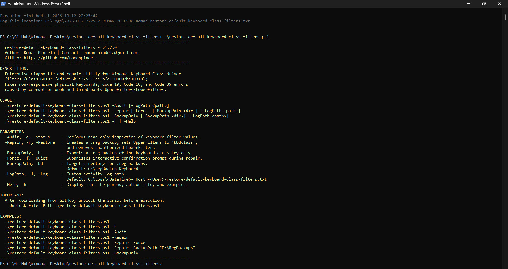
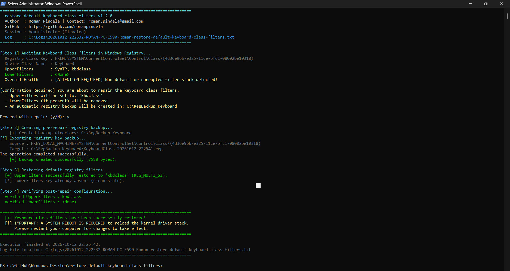

# Restore-DefaultKeyboardClassFilters

[](https://microsoft.com/powershell)
[](https://www.microsoft.com/windows)

## Problem Statement

Corrupted or leftover third-party keyboard filter drivers (installed by macro utilities, RGB suites, virtualization tools, or security agents) inside the Windows Keyboard Class registry key frequently break all physical and virtual keyboards with Device Manager **Code 19**, **Code 10**, or **Code 39** errors. Administrators need a safe, auditable recovery script that inspects filter values, exports a `.reg` backup, and restores `UpperFilters` to native `kbdclass`.

## Overview

`Restore-DefaultKeyboardClassFilters.ps1` audits, backs up, and repairs registry filter entries (`UpperFilters` and `LowerFilters`) under `HKLM:\SYSTEM\CurrentControlSet\Control\Class\{4d36e96b-e325-11ce-bfc1-08002be10318}`. Running `-Audit` inspects current filters read-only, `-BackupOnly` exports a timestamped `.reg` file, and `-Repair` backs up the registry key, resets `UpperFilters` to `kbdclass`, removes invalid `LowerFilters`, logs changes to `C:\Logs\`, and verifies the repaired state.

## Environment & Prerequisites

- **OS:** Windows 10, Windows 11, or Windows Server 2016/2019/2022/2025 (x64/x86/ARM64; English and Polish editions)
- **PowerShell:** Windows PowerShell 5.1 or PowerShell 7.x+
- **Dependencies:** Native .NET Registry API and `reg.exe` for `.reg` backup exports; no external modules required.

## Permissions Required

**Admin** (for `-Repair` and `-BackupOnly`) — Exporting and modifying `HKLM:\SYSTEM\CurrentControlSet\Control\Class\{4d36e96b-e325-11ce-bfc1-08002be10318}` require Local Administrator privileges (`BuiltInAdministratorsSid`), and the script automatically requests UAC elevation while preserving CLI switches. Running `-Audit`, `-Help`, or with no parameters works as a standard `User`.

## Safety & Impact

- **Risk Level:** `Modifies system state` (for `-Repair`; `-Audit`, `-BackupOnly`, and `-Help` do not modify registry settings) — Resets `UpperFilters` to `kbdclass` and removes `LowerFilters` (requires system reboot afterward to reload the keyboard driver stack).
- **WhatIf / Confirm & Backup:** Supports `-WhatIf` / `-Confirm` (`SupportsShouldProcess`) and interactive confirmation unless `-Force` is specified, and automatically exports a timestamped `.reg` backup to `C:\RegBackup_Keyboard\` (or `-BackupPath`) before applying changes (`reg.exe import <backup.reg>` allows rollback).

## Usage Examples

```powershell
# Display built-in help guide without elevation (zero-parameter default)
.\Restore-DefaultKeyboardClassFilters.ps1
.\Restore-DefaultKeyboardClassFilters.ps1 -h

# Perform non-destructive read-only audit of keyboard class filters
.\Restore-DefaultKeyboardClassFilters.ps1 -Audit

# Create a standalone .reg backup without modifying registry values
.\Restore-DefaultKeyboardClassFilters.ps1 -BackupOnly -BackupPath "C:\RegBackup_Keyboard"

# Prompt for confirmation, back up key, and restore default kbdclass filters
.\Restore-DefaultKeyboardClassFilters.ps1 -Repair

# Preview repair operations in -WhatIf simulation mode
.\Restore-DefaultKeyboardClassFilters.ps1 -Repair -WhatIf

# Run unattended silent repair with custom backup and log locations
.\Restore-DefaultKeyboardClassFilters.ps1 -Repair -BackupPath "D:\Backups\Registry" -LogPath "C:\Logs\KeyboardFix.txt" -Force
```

### Parameters

| Parameter | Alias | Type | Default | Description |
| :--- | :--- | :--- | :--- | :--- |
| `-Repair` | `-Restore`, `-Fix`, `-r` | `[switch]` | `$false` | Exports `.reg` backup, resets `UpperFilters` to `kbdclass`, and removes `LowerFilters`. |
| `-Audit` | `-Check`, `-Verify`, `-Status`, `-c` | `[switch]` | `$false` | Read-only audit of keyboard class registry filters. |
| `-BackupOnly` | `-b`, `-Backup` | `[switch]` | `$false` | Exports a `.reg` backup of the keyboard class key without changes. |
| `-Force` | `-f`, `-Quiet`, `-Silent` | `[switch]` | `$false` | Suppresses interactive confirmation prompts during `-Repair`. |
| `-BackupPath` | `-BackupDir`, `-bd` | `[string]` | `C:\RegBackup_Keyboard` | Target directory for timestamped `.reg` backups. |
| `-LogPath` | `-l`, `-Log` | `[string]` | `C:\Logs\...` | Custom path for the UTF-8 execution log file. |
| `-Help` | `-h` | `[switch]` | `$false` | Displays interactive help, syntax, and author details. |

### Screenshots





## Author

- **Roman Pindela**
- **Email:** [roman.pindela@gmail.com](mailto:roman.pindela@gmail.com)
- **GitHub:** [https://github.com/romanpindela](https://github.com/romanpindela)
- **License:** MIT
