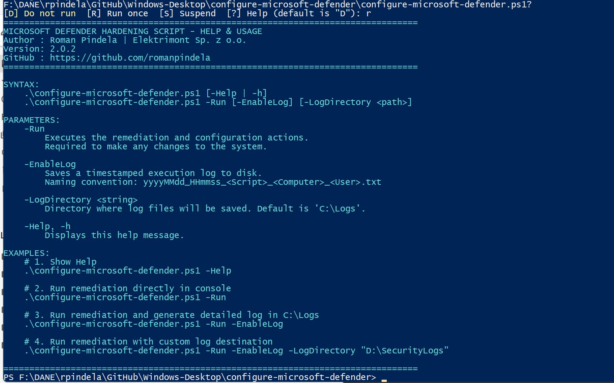
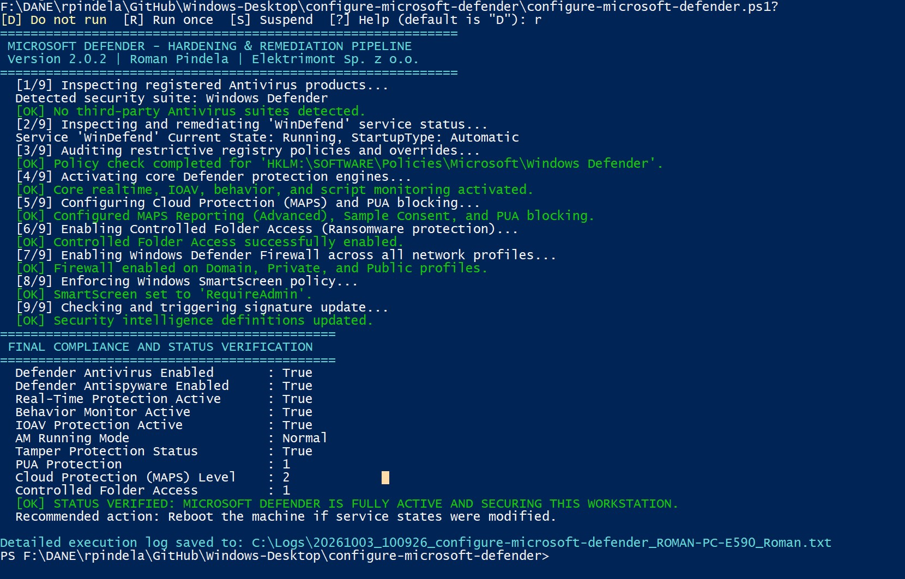

# Set-MicrosoftDefenderConfiguration

[](https://microsoft.com/powershell)
[](https://www.microsoft.com/windows)

## Problem Statement

Misconfigured endpoints, leftover Group Policy or registry overrides, or malware tampering frequently disable Microsoft Defender Antivirus real-time protection, cloud-delivered MAPS lookups, Controlled Folder Access, PUA blocking, or Windows Defender Firewall profiles. Administrators need a repeatable hardening and repair script that audits current security posture, clears blocking policy overrides, repairs core Defender services, and enforces baseline protection with optional file logging.

## Overview

`Set-MicrosoftDefenderConfiguration.ps1` performs an audit and remediation sequence for Microsoft Defender Antivirus and Windows Security features. When invoked with `-Run`, it inspects registered antivirus products, repairs `WinDefend` and Security Center services, clears restrictive policy overrides, enforces Real-Time/Behavior Monitoring, Cloud/MAPS protection, PUA protection, Controlled Folder Access, Windows Defender Firewall across all profiles, and SmartScreen, with optional timestamped logging to disk.

## Environment & Prerequisites

- **OS:** Windows 10, Windows 11, or Windows Server 2019+
- **PowerShell:** Windows PowerShell 5.1 or PowerShell 7.x+
- **Modules / Dependencies:** Built-in `Defender`, `NetSecurity`, and Windows security cmdlets; no third-party modules required.

## Permissions Required

**Admin** — Enforcing Microsoft Defender preferences, modifying security policies in `HKLM`, repairing Windows services, and configuring firewall profiles require elevated Administrator privileges. Viewing help (`-Help` or omitting `-Run`) runs without elevation.

## Safety & Impact

- **Risk Level:** `Modifies system state` — Changes Microsoft Defender Antivirus settings, registry policy overrides, service startup configuration, Windows Defender Firewall profiles, and SmartScreen configuration when run with `-Run`.
- **WhatIf / Confirm & Backup:** Does not support `-WhatIf` / `-Confirm` and does not create an automatic configuration backup prior to applying changes (writes execution logs only when `-EnableLog` is specified).

## Usage Examples

```powershell
# Display built-in help and usage guidelines (also shown when -Run is omitted)
.\Set-MicrosoftDefenderConfiguration.ps1 -Help
.\Set-MicrosoftDefenderConfiguration.ps1 -h

# Apply Defender and Windows Security hardening directly in the console
.\Set-MicrosoftDefenderConfiguration.ps1 -Run

# Apply hardening and write a detailed execution log to C:\Logs
.\Set-MicrosoftDefenderConfiguration.ps1 -Run -EnableLog

# Apply hardening and store the log file in a custom directory
.\Set-MicrosoftDefenderConfiguration.ps1 -Run -EnableLog -LogDirectory "D:\SecurityLogs"
```

### Parameters

| Parameter | Alias | Type | Default | Description |
| :--- | :--- | :--- | :--- | :--- |
| `-Run` | | `[switch]` | `$false` | Mandatory switch in the `Execute` parameter set to apply Defender and security hardening actions. |
| `-EnableLog` | | `[switch]` | `$false` | Writes a UTF-8 execution log (`yyyyMMdd_HHmmss_Set-MicrosoftDefenderConfiguration_<Computer>_<User>.txt`). |
| `-LogDirectory` | | `[string]` | `C:\Logs` | Target directory for log output when `-EnableLog` is enabled. |
| `-Help` | `-h` | `[switch]` | `$false` | Displays interactive help and usage guidelines. |

### Screenshots





## Author

- **Roman Pindela**
- **Email:** [roman.pindela@gmail.com](mailto:roman.pindela@gmail.com)
- **GitHub:** [https://github.com/romanpindela](https://github.com/romanpindela)
