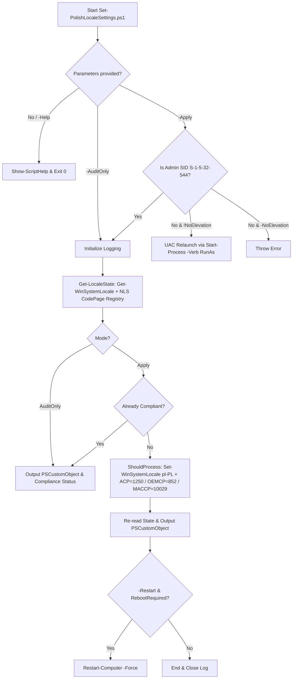
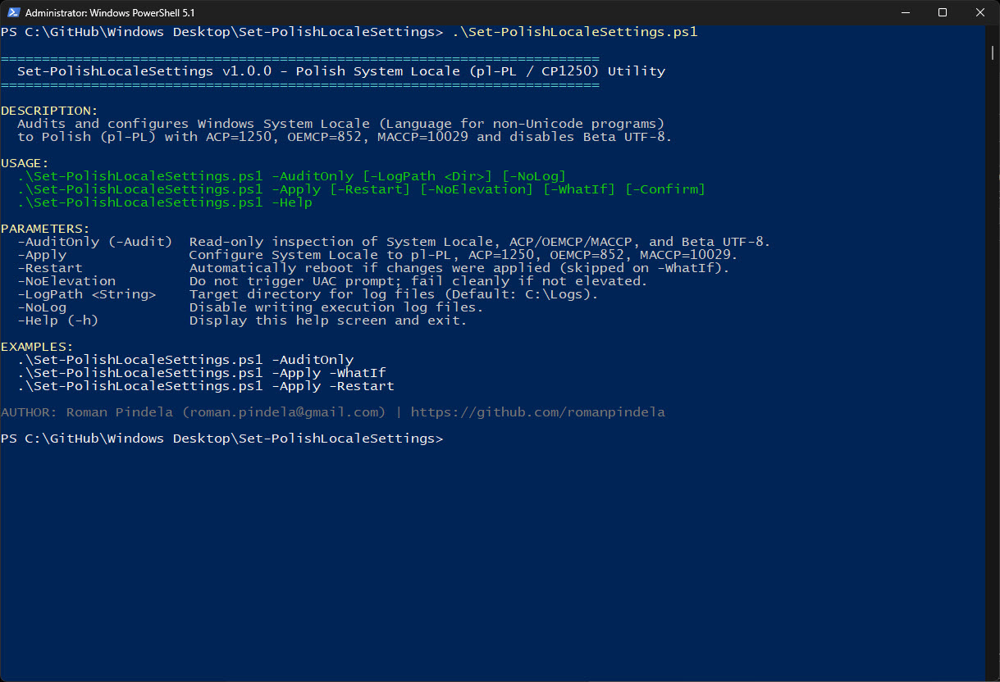
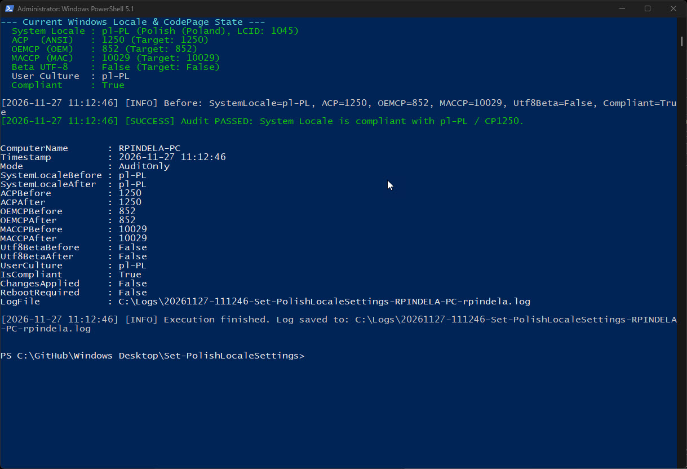

# Set-PolishLocaleSettings

[](https://microsoft.com/powershell)
[](https://www.microsoft.com/windows)
[](#changelog)

## Problem Statement

On English Windows installations (or machines where Windows' *Beta: Use Unicode UTF-8 for worldwide language support* option is enabled), the active ANSI code page (`ACP`) is set to `1252` (Western European) or `65001` (UTF-8) instead of `1250` (Central European). Opening ANSI/Windows-1250 CSV files in Microsoft Excel via double-click or running legacy Polish ERP/accounting tools results in garbled Polish diacritics (`ą, ć, ę, ł, ń, ó, ś, ź, ż` turning into `Ñ, ³, ¯, ¿`).

## Overview

`Set-PolishLocaleSettings.ps1` audits and enforces Windows **System Locale (Language for non-Unicode programs)** to **Polish (Poland) — `pl-PL` (LCID 1045)** with:
- **ANSI CodePage (`ACP`):** `1250` (Windows-1250)
- **OEM CodePage (`OEMCP`):** `852` (DOS Central European)
- **MAC CodePage (`MACCP`):** `10029`
- **Beta UTF-8 (`65001`):** Disabled

It supports non-elevated read-only auditing (`-AuditOnly`), idempotent configuration (`-Apply`), `-WhatIf` / `-Confirm` simulation, language-independent SID UAC auto-elevation (`S-1-5-32-544`), centralized logging under `C:\Logs\`, and structured `[PSCustomObject]` pipeline output.

---

## Technical Architecture



```text
[Invocation]
   ├─ (no args / -Help) ──> Show-ScriptHelp ──> Exit 0
   ├─ -AuditOnly        ──> Read SystemLocale + HKLM\...\Nls\CodePage ──> [PSCustomObject]
   └─ -Apply            ──> Check SID S-1-5-32-544 (auto-UAC)
                             └─ Set-WinSystemLocale pl-PL
                             └─ Enforce ACP=1250, OEMCP=852, MACCP=10029
                             └─ Output [PSCustomObject] ──> Optional -Restart
```

---

## Environment & Prerequisites

- **OS:** Windows 10, Windows 11, or Windows Server 2019/2022/2025 (English and Polish editions)
- **PowerShell:** Windows PowerShell 5.1 or PowerShell 7.x+
- **Modules:** Built-in Windows `International` module (`Get-WinSystemLocale`, `Set-WinSystemLocale`)
- **Unblock downloaded script if needed:**
  ```powershell
  Unblock-File -Path ".\Set-PolishLocaleSettings.ps1"
  ```

## Permissions Required

- **`-AuditOnly` / `-Help`:** **User** (no elevation required)
- **`-Apply`:** **Admin** — Modifying Windows System Locale and `HKLM:\SYSTEM\CurrentControlSet\Control\Nls\CodePage` requires Local Administrator privileges (`S-1-5-32-544`). The script automatically prompts for UAC elevation unless `-NoElevation` is specified.

## Safety & Impact

- **Risk Level:** `Read-Only / Non-destructive` (`-AuditOnly`); `Modifies system state` (`-Apply`, requires reboot to take full effect).
- **WhatIf / Confirm:** Full `SupportsShouldProcess` support (`-WhatIf` and `-Confirm`) on `Set-WinSystemLocale`, registry updates, and `-Restart`.
- **Idempotency:** Safe to run repeatedly; performs no changes if the host is already compliant (`pl-PL`, `ACP=1250`, `OEMCP=852`, `MACCP=10029`).

---

## Parameters

| Parameter | Alias | Type | Default | Description |
| :--- | :--- | :--- | :--- | :--- |
| `-AuditOnly` | `-Audit` | `[switch]` | `$false` | Read-only audit of System Locale, NLS CodePages, Beta UTF-8 status, and User Culture. |
| `-Apply` | | `[switch]` | `$false` | Applies `pl-PL` System Locale and enforces `ACP=1250`, `OEMCP=852`, `MACCP=10029`. |
| `-Restart` | | `[switch]` | `$false` | Automatically restarts the workstation if changes were applied (skipped under `-WhatIf`). |
| `-NoElevation` | | `[switch]` | `$false` | Disables automatic UAC relaunch; fails cleanly if not running elevated. |
| `-LogPath` | | `[string]` | `C:\Logs` | Directory path for timestamped execution log files. |
| `-NoLog` | | `[switch]` | `$false` | Disables writing log files to disk. |
| `-Help` | `-h` | `[switch]` | `$false` | Displays interactive help and syntax reference. |

---

## Usage Examples

```powershell
# Display built-in help (also shown when run with no parameters)
.\Set-PolishLocaleSettings.ps1 -Help

# Run a read-only audit (no Admin privileges required)
.\Set-PolishLocaleSettings.ps1 -AuditOnly

# Preview changes without modifying the system
.\Set-PolishLocaleSettings.ps1 -Apply -WhatIf

# Apply Polish System Locale (pl-PL / CP1250) and disable Beta UTF-8
.\Set-PolishLocaleSettings.ps1 -Apply

# Apply settings and automatically restart if changes were made
.\Set-PolishLocaleSettings.ps1 -Apply -Restart

# Export audit result to JSON for RMM/inventory pipelines
.\Set-PolishLocaleSettings.ps1 -AuditOnly -NoLog | ConvertTo-Json
```

### Run Directly from GitHub (via `Invoke-GitHubScript.ps1`)

```powershell
.\Invoke-GitHubScript.ps1 -UrlToDownload "https://github.com/romanpindela/Windows-Desktop/blob/main/Set-PolishLocaleSettings/Set-PolishLocaleSettings.ps1" -ScriptArgs "-AuditOnly"
# or
C:\PowerShell\Invoke-GitHubScript.ps1 -UrlToDownload "https://github.com/romanpindela/Windows-Desktop/blob/main/Set-PolishLocaleSettings/Set-PolishLocaleSettings.ps1" -ScriptArgs "-Apply"
```

---

## Screenshots & Assets

### Interactive Help Screen (Standard Run / `-Help`)



### Read-Only Audit Mode (`-AuditOnly`)



## Logging & Troubleshooting

- **Log Location:** `C:\Logs\<yyyyMMdd-HHmmss>-Set-PolishLocaleSettings-<COMPUTERNAME>-<USERNAME>.log`
- **Changes not visible in Excel immediately:** Windows reads NLS `ACP`/`OEMCP` code pages at boot. Restart the machine (`-Restart` or manual reboot) after `-Apply`.
- **ISO-8859-2 (Latin-2) CSV files:** Windows System Locale `pl-PL` uses `Windows-1250`. If a CSV file is encoded in `ISO-8859-2` (28592), characters like `ś`, `ź`, `ą` still require importing via Excel **Data → From Text/CSV → File Origin: `28592: Central European (ISO)`** or converting the file to **UTF-8 with BOM**.

---

## Changelog

### 1.0.0 (2026-11-27)
- Initial release with `-AuditOnly`, `-Apply`, `-Restart`, `-NoElevation`, `-WhatIf` support, SID-based UAC elevation, centralized `C:\Logs\` logging, and PowerShell 5.1 / 7+ dual compatibility.

## Author

- **Roman Pindela**
- **Email:** [roman.pindela@gmail.com](mailto:roman.pindela@gmail.com)
- **GitHub:** [https://github.com/romanpindela](https://github.com/romanpindela)
- **License:** MIT
