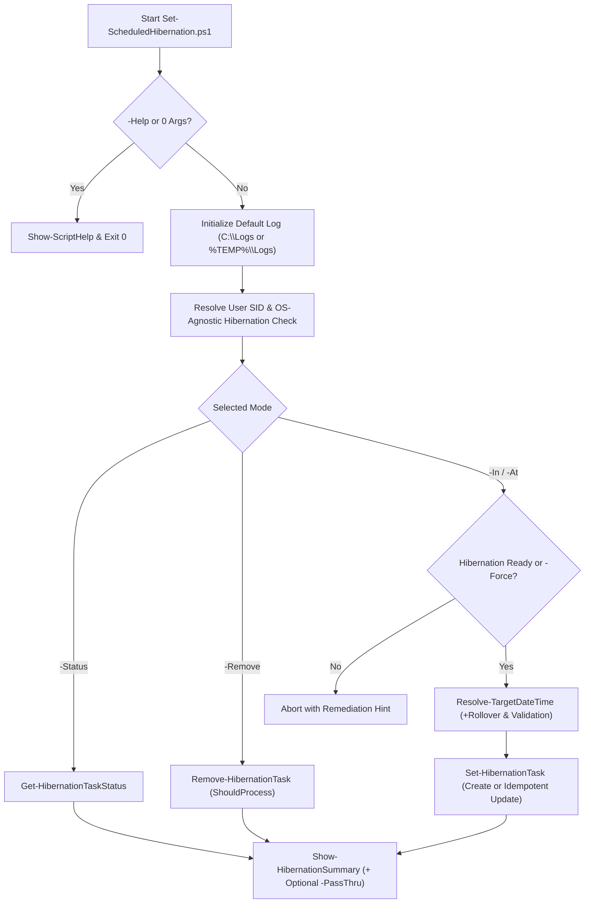

# Set-ScheduledHibernation

[](https://microsoft.com/powershell)
[](https://www.microsoft.com/windows)
[]()
[]()
[](https://opensource.org/licenses/MIT)

## Problem Statement

Unlike shutdown (`shutdown /s /t`) and reboot (`shutdown /r /t`), Windows `shutdown.exe /h` does **not** accept a delay timer (`/t`). Configuring one-time delayed hibernation manually in Windows Task Scheduler is tedious and error-prone: default Task Scheduler jobs refuse to start when a laptop is on battery power (`DisallowStartIfOnBatteries = $true`), stay behind as stale tasks after firing, and require manual cleanup whenever you want to push back or cancel the hibernation window.

## Overview

`Set-ScheduledHibernation.ps1` is an idempotent, standard-user PowerShell tool for **Windows 10**, **Windows 11**, and **Windows Server** (dual-compatible with **PowerShell 5.1** and **PowerShell 7+**) that:

* **Registers automatically** a one-time Windows Task Scheduler job (`C:\Windows\System32\shutdown.exe /h`) bound to the current user's SID (`LogonType = Interactive`, `RunLevel = Limited`) — **no UAC / Administrator elevation required**.
* **Updates idempotently** on subsequent invocations with a new relative delay (`-In "+2h"`, `"+45m"`, `"+1h30m"`) or specific clock time/date (`-At "23:30"`, `-At "2026-11-27 01:15"`), displaying both the **previous** and **newly scheduled** timestamps and live countdown.
* **Protects laptop workflows** by enabling battery execution by default, disabling missed-run catch-up (`StartWhenAvailable = $false`), keeping `WakeToRun` disabled by default for bag safety, and auto-expiring/deleting the one-time task after completion.
* **Validates hibernation readiness language-independently** (PL / EN / any Windows locale) via `HKLM:\SYSTEM\CurrentControlSet\Control\Power\HibernateEnabled` and `hiberfil.sys`.
* **Logs every execution by default** to `C:\Logs\` (with automatic fallback to `%TEMP%\Logs`) and supports `-Status`, `-Remove` (`-Cancel`), `-WhatIf` / `-Confirm`, and `-PassThru` pipeline objects.

---

## Technical Architecture



```text
+-----------------------------------------------------------------------------+
|                        Set-ScheduledHibernation.ps1                         |
+-------------------------+-------------------------+-------------------------+
| Time Parser & Guard     | Task Scheduler Engine   | Output & Telemetry      |
| - -In "+2h", "+1h30m"   | - User SID (No UAC)     | - Colorized Summary     |
| - -At "23:30" rollover  | - shutdown.exe /h       | - Before/After Diff     |
| - ISO & dd.MM.yyyy      | - Battery Allowed       | - -PassThru Object      |
| - Registry + hiberfil   | - Auto-Expire & Cleanup | - Default C:\Logs\      |
+-------------------------+-------------------------+-------------------------+
```

---

## Prerequisites & Unblocking

* **Operating System:** Windows 10, Windows 11, or Windows Server (Desktop Experience).
* **PowerShell Version:** Windows PowerShell 5.1 or PowerShell 7+.
* **Permissions:** Standard User (**no Administrator / UAC elevation required**).
* **System Hibernation:** Hibernation must be enabled on the machine (`HibernateEnabled = 1` and `hiberfil.sys` present). If disabled, enable it once as Administrator via `powercfg /hibernate on` or [`Enable-Hibernation.ps1`](../Enable-Hibernation/README.md).
* **Unblock Downloaded Script:**
  ```powershell
  Unblock-File -Path ".\Set-ScheduledHibernation.ps1"
  ```

---

## Script Parameters

| Parameter | Aliases | Type | Default | Description |
| :--- | :--- | :--- | :--- | :--- |
| `-In` | `-Delay`, `-After`, `-Offset` | `[string]` | — | Relative delay from now (`d`, `h`, `m`, `s`, optional `+` and decimals). Examples: `"+2h"`, `"45m"`, `"+1h30m"`, `"1.5h"`, `"+1d 2h"`. |
| `-At` | `-Time`, `-DateTime` | `[string]` | — | Specific clock time (`"22:30"`, rolls over to tomorrow if already passed today) or full date and time (`"2026-11-27 01:15"`, `"27.11.2026 01:15"`). |
| `-Status` | `-Show`, `-Info` | `[switch]` | `$false` | Inspects the current scheduled hibernation task, countdown, settings, and hibernation readiness (read-only). |
| `-Remove` | `-Cancel`, `-Delete`, `-Unregister` | `[switch]` | `$false` | Cancels and unregisters the scheduled hibernation task. Supports `-WhatIf` and `-Confirm`. |
| `-TaskName` | `-Name` | `[string]` | `'ScheduledHibernation'` | Custom Windows Task Scheduler task name in the root folder (`\`). |
| `-ExpirationMinutes` | `-ExpireAfter` | `[int]` | `5` | Trigger expiration window in minutes after run time (`1`–`1440`); auto-deletes expired task after 1 minute (`PT1M`). |
| `-DisallowOnBattery` | — | `[switch]` | `$false` | Restricts execution to AC power only (battery execution is enabled by default). |
| `-WakeToRun` | — | `[switch]` | `$false` | Attempts to wake the PC from Sleep (S3/S0) to enter Hibernation (disabled by default for laptop bag safety). |
| `-Force` | — | `[switch]` | `$false` | Bypasses confirmations and allows scheduling even when the hibernation readiness check reports disabled. |
| `-LogDirectory` | `-LogPath` | `[string]` | `'C:\Logs'` | Directory for UTF-8 execution logs (falls back automatically to `%TEMP%\Logs`). |
| `-NoLog` | — | `[switch]` | `$false` | Disables default file logging. |
| `-PassThru` | — | `[switch]` | `$false` | Outputs the structured `[PSCustomObject]` result to the PowerShell pipeline. |
| `-WhatIf` / `-Confirm` | — | `[switch]` | — | Native `SupportsShouldProcess` dry-run preview and confirmation support. |
| `-Help` | `-h` | `[switch]` | `$false` | Displays interactive console help and exits cleanly (also shown when run with zero arguments). |

---

## Usage Examples

### 1. Display Interactive Help
```powershell
.\Set-ScheduledHibernation.ps1
.\Set-ScheduledHibernation.ps1 -Help
```

### 2. Schedule One-Time Hibernation in 2 Hours (Creates Task)
```powershell
.\Set-ScheduledHibernation.ps1 -In "+2h"
```

### 3. Reschedule / Update Existing Task to a New Delay (Shows Previous vs. New Time)
```powershell
.\Set-ScheduledHibernation.ps1 -In "+1h30m"
```

### 4. Update to a Specific Clock Time (Automatic Tomorrow Rollover if Already Passed)
```powershell
.\Set-ScheduledHibernation.ps1 -At "23:30"
```

### 5. Schedule for a Specific Date & Time (AC Power Only)
```powershell
.\Set-ScheduledHibernation.ps1 -At "2026-11-27 01:15" -DisallowOnBattery
```

### 6. Inspect Active Schedule & Hibernation Readiness
```powershell
.\Set-ScheduledHibernation.ps1 -Status
```

### 7. Preview Changes Safely (`-WhatIf`)
```powershell
.\Set-ScheduledHibernation.ps1 -In "+45m" -WhatIf
```

### 8. Cancel Scheduled Hibernation
```powershell
.\Set-ScheduledHibernation.ps1 -Remove
```

### 9. Capture Structured Result in Automation Pipeline (`-PassThru`)
```powershell
$job = .\Set-ScheduledHibernation.ps1 -In "+2h" -PassThru
$job | Select-Object Action, TaskName, ScheduledRunTime, PreviousRunTime, RemainingTime
```

### 10. Run Directly from GitHub (via `Invoke-GitHubScript.ps1`)
```powershell
.\Invoke-GitHubScript.ps1 -UrlToDownload "https://github.com/romanpindela/Windows-Desktop/blob/main/Set-ScheduledHibernation/Set-ScheduledHibernation.ps1" -ScriptArgs "-In '+2h'"
```

---

## Screenshots & Assets

Visual verification captures can be stored in the [`assets/`](assets/) directory following repository conventions:

* `assets/Standard_run.jpg` — Zero-argument interactive help screen (`.\Set-ScheduledHibernation.ps1`).
* `assets/Schedule_and_update.jpg` — Creating and idempotently rescheduling a one-time hibernation task (`-In "+2h"` followed by `-At "23:30"`).

---

## Logging & Troubleshooting

* **Default Log Path:** `C:\Logs\<yyyyMMdd-HHmmss>-Set-ScheduledHibernation-<COMPUTERNAME>-<USERNAME>.log` (enabled by default; disable with `-NoLog` or redirect via `-LogDirectory`).
* **Standard-User Write Fallback:** If `C:\Logs\` cannot be created or written to without administrator rights, logs automatically fall back to `%TEMP%\Logs\`.
* **System Hibernation Disabled:** If the script reports `HibernationReady = False`, run `powercfg /hibernate on` in an elevated PowerShell prompt or execute [`Enable-Hibernation.ps1 -EnableHibernation`](../Enable-Hibernation/README.md).
* **Locked Screen vs. Sleep Behavior:** Because the task uses `LogonType = Interactive`, it runs cleanly while the workstation screen is locked (`Win+L`) as long as the user session stays logged on. If the laptop enters Sleep (S3/S0) before the scheduled time, hibernation will **not** wake the laptop unless `-WakeToRun` is explicitly enabled, and missed triggers will **never** execute retroactively (`StartWhenAvailable = $false`).

---

## Changelog

### v1.0.0 (2026-11-26)
* Initial release featuring idempotent one-time hibernation task registration and rescheduling (`-In` relative delays and `-At` absolute time/date with smart next-day rollover), `-Status` inspection, `-Remove` cancellation, standard-user SID principal binding without UAC, laptop-safe battery & auto-expiration settings, OS language-independent hibernation readiness verification, `-WhatIf` / `-Confirm`, `-PassThru` pipeline objects, and default UTF-8 logging to `C:\Logs\`.

---

## Author & Metadata

* **Author:** Roman Pindela
* **Email:** roman.pindela@gmail.com
* **GitHub:** [https://github.com/romanpindela](https://github.com/romanpindela)
* **Version:** `1.0.0` (SemVer)
* **Last Modified:** `2026-11-26`
