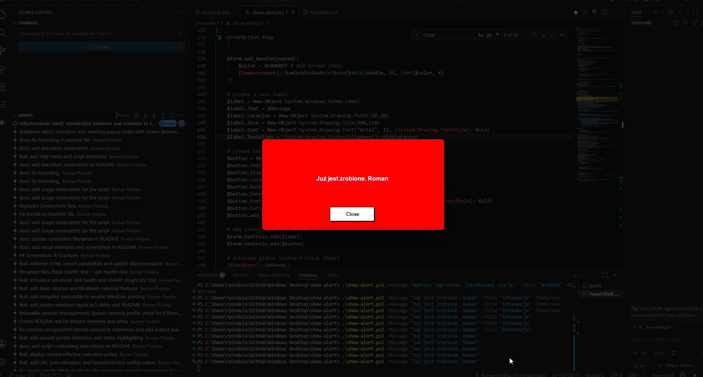
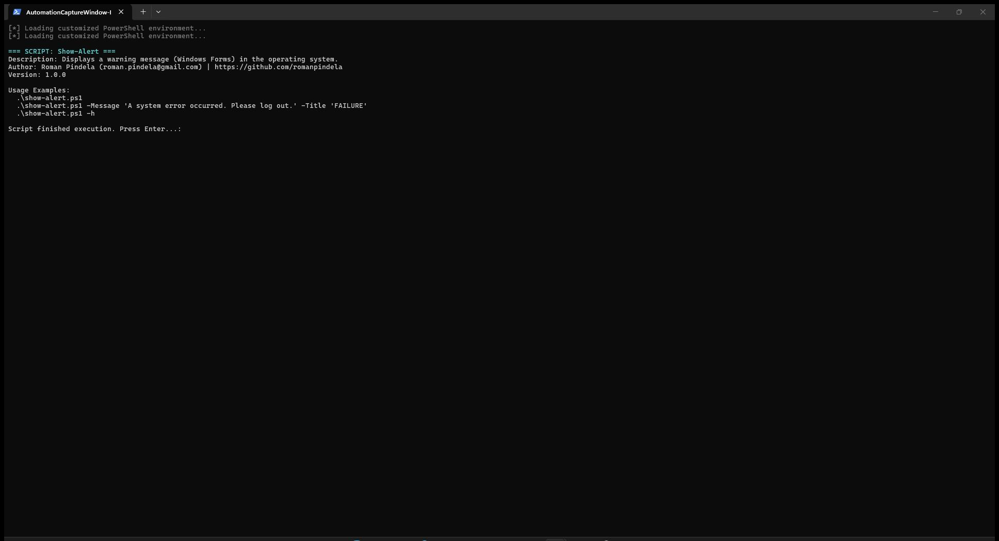

# Show-Alert

[](https://microsoft.com/powershell)
[](https://www.microsoft.com/windows)

## Problem Statement

Broadcasting urgent IT maintenance or security notices to logged-on desktop users over WinRM fails in native Session 0 isolation because remote WinRM commands cannot render interactive GUI dialogs on the user's active desktop. Administrators need a high-visibility modal warning window (`Show-Alert.ps1`) along with a companion Session-0-bypass launcher (`Invoke-InteractiveScript.ps1`) to display alerts on local or remote interactive desktops.

## Overview

`Show-Alert.ps1` displays a bright red, topmost Windows Forms warning modal (`DwmWatermark` dark/red title bar styling) that blocks Alt+F4 and background focus switching until the user clicks Close, supporting custom `-Message`, `-Title`, and `-ShowHelp`. The companion script `Invoke-InteractiveScript.ps1` copies a local `.ps1` script (such as `.\Show-Alert.ps1`) to a remote host over WinRM and launches it interactively in the logged-on user's desktop session via a temporary Scheduled Task, then cleans up the task and temporary script.

## Environment & Prerequisites

- **OS:** Windows 10 / Windows 11 (Windows 11/10 with DWM for `Show-Alert.ps1`; WinRM + Task Scheduler on target host for `Invoke-InteractiveScript.ps1`)
- **PowerShell:** Windows PowerShell 5.1 (recommended for WinForms/PresentationFramework GUI) or PowerShell 7.x+
- **Dependencies:** .NET `PresentationFramework`, `System.Windows.Forms`, `System.Drawing`, and `dwmapi.dll`; no external modules required.

## Permissions Required

- **`Show-Alert.ps1`:** **User** — Displays UI inside the current interactive desktop session without elevation.
- **`Invoke-InteractiveScript.ps1`:** **User** locally, **Admin** on remote `-ComputerName` — Creating a WinRM `PSSession`, registering/starting a Scheduled Task in the `Users` (`S-1-5-32-545`) group context, and writing/removing temporary payload files in `$env:PUBLIC` require administrative rights on the remote target.

## Safety & Impact

- **Risk Level:** `Read-Only / Non-destructive` (for `Show-Alert.ps1`, UI dialog only) / `Modifies system state` temporarily (for `Invoke-InteractiveScript.ps1`, copies script to remote `$env:PUBLIC\interactive_payload_<random>.ps1` and registers/removes a temporary Scheduled Task). Note that `Show-Alert.ps1` keeps focus on top until dismissed.
- **WhatIf / Confirm & Backup:** Neither script supports `-WhatIf` / `-Confirm` or creates backups (`Invoke-InteractiveScript.ps1` removes the temporary task and file automatically after launching).

## Usage Examples

```powershell
# Display built-in help for Show-Alert.ps1 or Invoke-InteractiveScript.ps1
.\Show-Alert.ps1 -ShowHelp
.\Invoke-InteractiveScript.ps1 -ShowHelp

# Show default warning alert on the local desktop
.\Show-Alert.ps1

# Show custom alert message and window title locally
.\Show-Alert.ps1 -Message 'A system error occurred. Please log out.' -Title 'FAILURE'

# Trigger Show-Alert.ps1 interactively on a remote workstation's active desktop session
.\Invoke-InteractiveScript.ps1 -ComputerName '10.10.1.96' -ScriptPath '.\Show-Alert.ps1' -ArgumentList '-Message "Please save your work and reboot."'
```

### Parameters (`Show-Alert.ps1`)

| Parameter | Alias | Type | Default | Description |
| :--- | :--- | :--- | :--- | :--- |
| `-Message` | | `[string]` | `"Please contact the administrator..."` | Warning text displayed inside the alert dialog. |
| `-Title` | | `[string]` | `" "` | Dialog window title text. |
| `-ShowHelp` | `-h`, `-Help` | `[switch]` | `$false` | Displays help and usage examples. |

### Parameters (`Invoke-InteractiveScript.ps1`)

| Parameter | Alias | Type | Default | Description |
| :--- | :--- | :--- | :--- | :--- |
| `-ComputerName` | | `[string]` | `$null` | Hostname or IP address of the remote target machine. |
| `-ScriptPath` | | `[string]` | `$null` | Local path to the `.ps1` script to execute interactively remotely. |
| `-Credential` | | `[PSCredential]` | `$null` | Optional remote credentials (`Get-Credential` used if omitted). |
| `-ArgumentList` | | `[object[]]` | `$null` | Arguments forwarded to the interactive script. |
| `-ShowHelp` | `-h`, `-Help` | `[switch]` | `$false` | Displays help and usage examples. |

### Screenshots





## Author

- **Roman Pindela**
- **Email:** [roman.pindela@gmail.com](mailto:roman.pindela@gmail.com)
- **GitHub:** [https://github.com/romanpindela](https://github.com/romanpindela)
