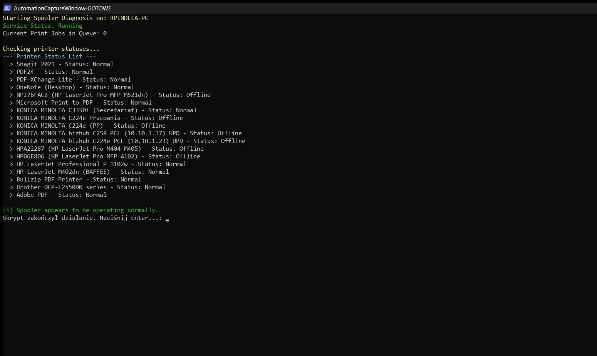
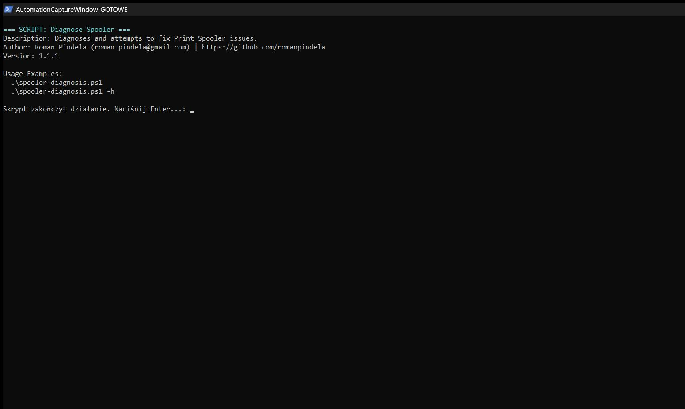

# Test-PrintSpooler

[](https://microsoft.com/powershell)
[](https://www.microsoft.com/windows)

## Problem Statement

When users report printing failures, administrators need a fast, non-destructive way to inspect whether the Windows Print Spooler (`Spooler`) service is running, how many print jobs are backed up in the queue, and whether any local or network printer objects are currently stuck in a `Paused` state before restarting services or clearing jobs.

## Overview

`Test-PrintSpooler.ps1` performs a read-only check of the Windows Print Spooler subsystem via CIM (`Win32_Service`, `Win32_PrintJob`) and `Get-Printer`. It reports service health, queued print job counts, individual printer states (highlighting any paused printers), and prints actionable remediation guidance if anomalies are detected.

## Environment & Prerequisites

- **OS:** Windows 10, Windows 11, or Windows Server
- **PowerShell:** Windows PowerShell 5.1 or PowerShell 7.x+
- **Dependencies:** Native `PrintManagement` (`Get-Printer`) and CIM (`Win32_Service`, `Win32_PrintJob`); no external modules required.

## Permissions Required

**User** — Querying print spooler service status, active print job counts, and installed printer statuses runs cleanly under standard user permissions without elevation.

## Safety & Impact

- **Risk Level:** `Read-Only / Non-destructive` — Inspects service status, print job count, and printer states without restarting the spooler, deleting spool files, or changing configuration.
- **WhatIf / Confirm & Backup:** Does not support `-WhatIf` / `-Confirm` and creates no backups because no changes are performed.

## Usage Examples

```powershell
# Display built-in help and usage examples
.\Test-PrintSpooler.ps1 -ShowHelp
.\Test-PrintSpooler.ps1 -h

# Run read-only Print Spooler diagnostics on the local workstation
.\Test-PrintSpooler.ps1
```

### Parameters

| Parameter | Alias | Type | Default | Description |
| :--- | :--- | :--- | :--- | :--- |
| `-ShowHelp` | `-h`, `-Help` | `[switch]` | `$false` | Displays help, description, and usage examples. |

### Screenshots





## Author

- **Roman Pindela**
- **Email:** [roman.pindela@gmail.com](mailto:roman.pindela@gmail.com)
- **GitHub:** [https://github.com/romanpindela](https://github.com/romanpindela)
