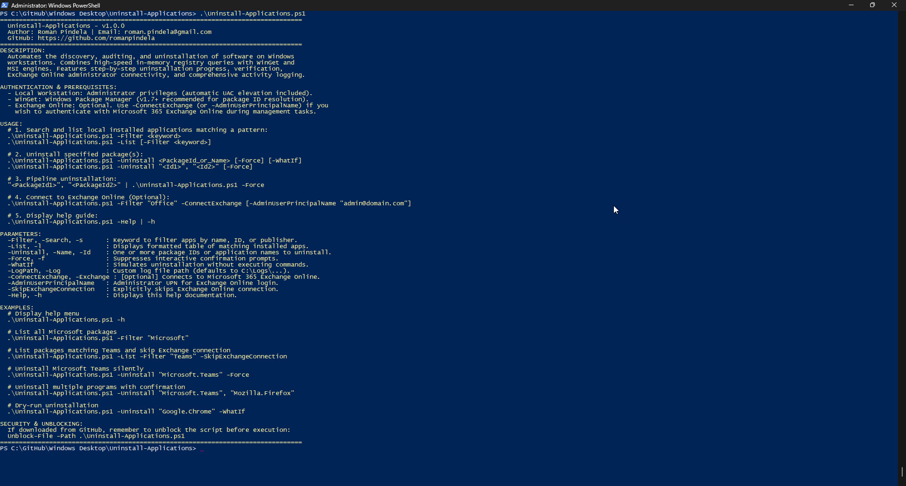
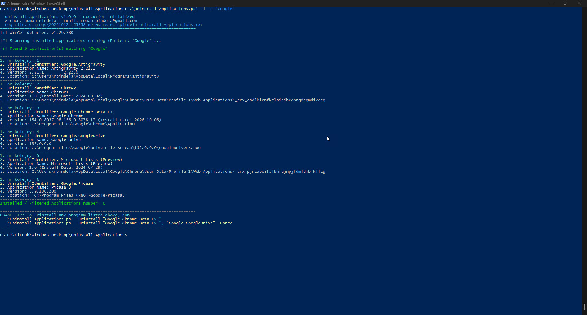
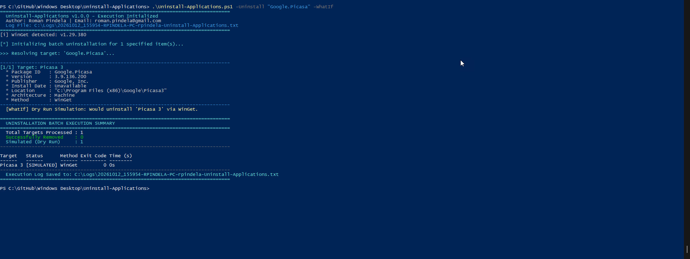

# Uninstall-Applications

[](https://microsoft.com/powershell)
[](https://www.microsoft.com/windows)

## Problem Statement

Removing unwanted applications across Windows workstations manually is tedious and inconsistent because installed software is scattered across 64-bit `HKLM`, 32-bit `WOW6432Node`, `HKCU` registry hives, and `winget` sources with varying MSI vs. EXE quiet uninstallers. Administrators need an automated uninstaller that discovers exact application IDs fast, previews removals safely (`-WhatIf`), uninstalls batches silently, verifies removal, and logs outcomes.

## Overview

`Uninstall-Applications.ps1` searches installed workstation software via fast `.NET` Registry APIs and WinGet integration, lists filtered matches (`-List`, `-Filter`), and performs single, multi-package, or pipeline uninstallation (`-Uninstall`) with automatic fallback across WinGet, MSI (`msiexec.exe`), and registry uninstall strings. It supports explicit `-WhatIf` dry runs, unattended mode (`-Force`), optional Exchange Online connectivity (`-ConnectExchange` / `-SkipExchangeConnection`), post-removal verification, and structured UTF-8 logging (`C:\Logs\`).

## Environment & Prerequisites

- **OS:** Windows 10 / Windows 11 (x64 / x86; English and Polish editions)
- **PowerShell:** Windows PowerShell 5.1 or PowerShell 7.x+
- **Modules / Dependencies:** Windows Package Manager (`winget.exe`) and native .NET Registry / `msiexec.exe`; optional `ExchangeOnlineManagement` module when using `-ConnectExchange`.

## Permissions Required

**Admin** — Removing system-wide applications via WinGet, `msiexec.exe`, and `HKLM` uninstallers requires elevated Administrator privileges (`S-1-5-32-544`), and the script automatically elevates when needed. Read-only searching/listing (`-Filter` / `-List`) and `-Help` operate without elevation when administrative removal is not invoked.

## Safety & Impact

- **Risk Level:** `Modifies system state` (for `-Uninstall`; `-List`, `-Filter`, and `-Help` are `Read-Only / Non-destructive`) — Silently uninstalls target software packages from the workstation and writes logs to `C:\Logs\`.
- **WhatIf / Confirm & Backup:** Supports simulation via explicit `-WhatIf` parameter (`SupportsShouldProcess` style dry-run) and prompts for user confirmation prior to uninstallation unless `-Force` is specified; creates no system restore point or application backup prior to removal.

## Usage Examples

```powershell
# Display built-in help menu and usage examples
.\Uninstall-Applications.ps1 -Help
.\Uninstall-Applications.ps1 -h

# Search and list installed applications matching a keyword
.\Uninstall-Applications.ps1 -Filter "Microsoft"
.\Uninstall-Applications.ps1 -List -Filter "Teams"

# Uninstall a single application (prompts for confirmation)
.\Uninstall-Applications.ps1 -Uninstall "Microsoft.Teams"

# Silently uninstall multiple applications without confirmation prompts
.\Uninstall-Applications.ps1 -Uninstall "Google.Chrome.Beta.EXE", "Mozilla.Firefox" -Force

# Uninstall applications supplied via the PowerShell pipeline
"Google.Chrome.Beta.EXE", "7-Zip" | .\Uninstall-Applications.ps1 -Force

# Simulate uninstallation without removing software (-WhatIf)
.\Uninstall-Applications.ps1 -Uninstall "Google.Chrome.Beta.EXE" -WhatIf

# Specify a custom log file destination or connect Exchange Online during audit
.\Uninstall-Applications.ps1 -Uninstall "Google.Chrome.Beta.EXE" -Force -LogPath "C:\Deploy\Logs\removal-report.txt"
.\Uninstall-Applications.ps1 -Filter "Office" -ConnectExchange -AdminUserPrincipalName "admin@contoso.onmicrosoft.com"
```

### Parameter Reference

| Parameter | Type | Aliases | Description |
| :--- | :--- | :--- | :--- |
| `-Filter` | `[string]` | `-Search`, `-Pattern`, `-Query`, `-s` | Keyword filtering applications by Display Name, Package ID, or Publisher. |
| `-List` | `[switch]` | `-l`, `-ShowInstalled` | Displays formatted table of matching installed applications. |
| `-Uninstall` | `[string[]]` | `-Name`, `-PackageId`, `-Package`, `-Id`, `-App` | Package ID(s) or name(s) to uninstall (supports pipeline input). |
| `-Force` | `[switch]` | `-f`, `-Quiet`, `-Silent` | Suppresses interactive confirmation prompts. |
| `-WhatIf` | `[switch]` | | Simulates uninstallation actions without modifying the system. |
| `-LogPath` | `[string]` | `-Log`, `-ReportPath` | Custom path for the UTF-8 execution log (`C:\Logs\...` default). |
| `-ConnectExchange` | `[switch]` | `-ExchangeOnline`, `-Exchange` | Connects to Microsoft 365 Exchange Online when needed. |
| `-AdminUserPrincipalName` | `[string]` | `-AdminUPN`, `-AdminEmail` | Administrator UPN for Exchange Online sign-in. |
| `-SkipExchangeConnection` | `[switch]` | `-NoExchange`, `-SkipExchange` | Bypasses Exchange Online connection. |
| `-Help` | `[switch]` | `-h` | Displays interactive help, parameters, and examples. |

### Screenshots







## Author

- **Roman Pindela**
- **Email:** [roman.pindela@gmail.com](mailto:roman.pindela@gmail.com)
- **GitHub:** [https://github.com/romanpindela](https://github.com/romanpindela)
- **Version:** 1.0.0 (`2026-10-12`) | **License:** MIT
