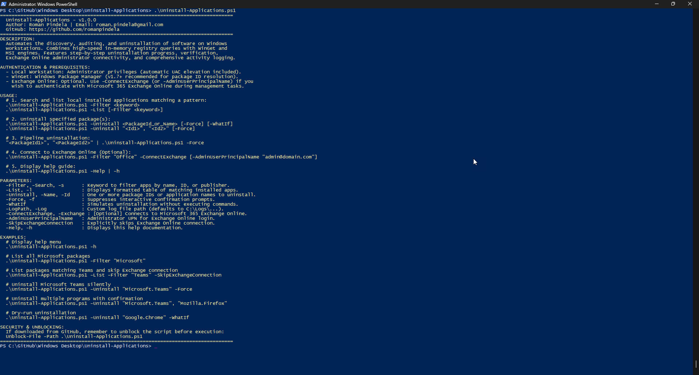
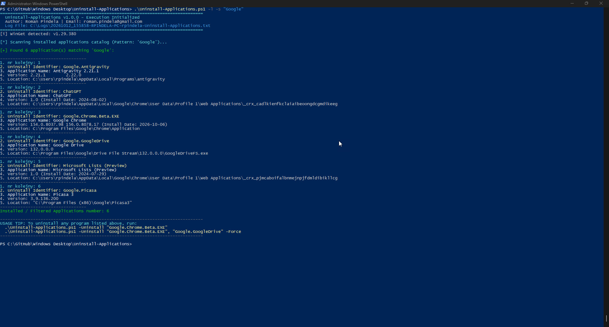
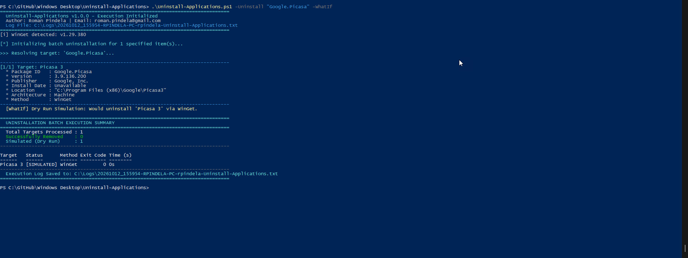

# Uninstall-Applications

A production-ready, enterprise PowerShell automation script designed for Windows workstation software auditing, pattern-based discovery, and batch uninstallation. Operates completely locally on the workstation by default, with native **.NET Registry API** performance, **Windows Package Manager (WinGet)**, and **Windows Installer (MSI)** integration, as well as optional **Exchange Online** administrator connectivity.

---

## Overview

`Uninstall-Applications.ps1` enables system administrators to quickly discover, audit, and silently remove applications across enterprise Windows workstations.

Key capabilities:
1. **Local Workstation Discovery by Default**: Searches, audits, and uninstalls local applications without any dependencies on or prompts for cloud services.
2. **Optional Exchange Online Integration (`-ConnectExchange`)**: Administrators can optionally authenticate to Exchange Online if their deployment workflow requires checking Microsoft 365 tenant context.
3. **Pattern-Based Application Discovery (`-Filter`, `-List`)**: Rapidly searches installed software by Program Name, Package ID, or Publisher (e.g. `Microsoft`, `Teams`, `Chrome`).
4. **Detailed Installation Telemetry**: Lists the exact **Install Date** (`yyyy-MM-dd`) and the physical **Install Location** directory extracted via registry and executable paths.
5. **Actionable Uninstall Identifiers**: Outputs a structured table where each application is assigned an unambiguous **Uninstall Identifier** that can be directly passed to the uninstallation command in the next step.
6. **Multi-Engine Uninstallation**:
   - **WinGet**: Silent package uninstallation via `winget uninstall --exact --id <PackageId> --silent`.
   - **Windows Installer (MSI)**: Quiet GUID-based removal via `msiexec.exe /x <GUID> /qn /norestart`.
   - **Native Registry Uninstallers**: Executes silent/quiet uninstallation strings extracted directly from Windows registry.
7. **Real-Time Step-by-Step Progress**: Shows detailed progress indicators (`Write-Progress`) and step-by-step console and log tracking for every package.
8. **Post-Removal Verification**: Re-scans the Windows registry and package catalog post-removal to verify whether the software was successfully purged or requires a reboot (`[REBOOT_REQUIRED]`).
9. **Comprehensive Activity Logging**: Automatically records full telemetry, timestamps, return codes, and summary tables to `C:\Logs\<Timestamp>-<Computer>-<User>-Uninstall-Applications.txt` (analogous to `Install-Applications.ps1`).
10. **Cross-Language Windows Support**: Features language-independent Well-Known SID verification (`BuiltInAdministratorsSid`), ensuring compatibility across Polish, English, and all localized Windows Desktop and Server editions.
11. **Automatic UAC Elevation**: Automatically requests elevation and relaunches with Administrator privileges when uninstalling software.

---

## Features

- **Self-Documenting CLI**: Displays interactive help menu, parameter guide, and examples when invoked without parameters or via `-Help` / `-h`.
- **Pure Local Execution**: No mandatory sign-ins; instant execution on workstations.
- **Batch & Pipeline Uninstallation**: Supports passing multiple package names/IDs via array (`-Uninstall "App1", "App2"`) or PowerShell pipeline (`"App1", "App2" | .\Uninstall-Applications.ps1`).
- **Unattended Mode (`-Force`, `-f`)**: Suppresses confirmation prompts for automated deployment or remote management scripts.
- **Dry-Run Simulation Mode (`-WhatIf`)**: Simulates the exact uninstallation command and target resolution without modifying the workstation.
- **Input Sanitization & Protection**: Strict input validation defending against malicious command injections or illegal characters.

---

## Prerequisites

* **Operating System**: Windows 10, Windows 11, Windows Server 2016/2019/2022 (x64 / x86).
* **PowerShell Version**: Windows PowerShell 5.1 or PowerShell 7.x+.
* **Workstation Rights**: Administrator privileges (automatic UAC elevation prompt included for uninstallation).
* **Package Manager**: Windows Package Manager (`winget.exe`, included in modern Windows 10/11) recommended for package ID resolution.
* **Exchange Online Module** *(Optional)*: `ExchangeOnlineManagement` (only required when using `-ConnectExchange`).

---

## Important: Unblock File After Download

When downloading scripts from GitHub, Windows tags them with an alternative data stream (`Zone.Identifier`). You must unblock the script before execution:

```powershell
Unblock-File -Path .\Uninstall-Applications.ps1
```

---

## Usage Examples

### 1. Display Built-In Help Menu
Running the script without arguments or with `-h` displays full guidance and usage examples:

```powershell
.\Uninstall-Applications.ps1
# Or explicitly:
.\Uninstall-Applications.ps1 -h
.\Uninstall-Applications.ps1 -Help
```



---

### 2. Search & List Local Programs by Pattern
Search for all programs containing `"Chrome"` in their Name, Package ID, or Publisher:

```powershell
.\Uninstall-Applications.ps1 -Filter "Chrome"
```

*Example Output:*
```text
----------------------------------
1. nr kolejny: 1
2. Uninstall Identifier: ChatGPT
3. Application Name: ChatGPT
4. Version: 1.0 (Install Date: 2024-08-02)
5. Location: C:\Users\rpindela\AppData\Local\Google\Chrome\User Data\Profile 1\Web Applications\_crx_cadlkienfkclaiaibeoongdcgmdikeeg
----------------------------------
1. nr kolejny: 2
2. Uninstall Identifier: Google.Chrome.Beta.EXE
3. Application Name: Google Chrome
4. Version: 154.0.8037.98 156.0.8078.17 (Install Date: 2026-10-06)
5. Location: C:\Program Files\Google\Chrome\Application
----------------------------------
1. nr kolejny: 3
2. Uninstall Identifier: Microsoft Lists (Preview)
3. Application Name: Microsoft Lists (Preview)
4. Version: 1.0 (Install Date: 2024-07-29)
5. Location: C:\Users\rpindela\AppData\Local\Google\Chrome\User Data\Profile 1\Web Applications\_crx_pjmcaboifalbnmejnpjfdmldibikllcg
----------------------------------
Installed / Filtered Applications number: 3

USAGE TIP: To uninstall any program listed above, run:
  .\Uninstall-Applications.ps1 -Uninstall "Google.Chrome.Beta.EXE"
  .\Uninstall-Applications.ps1 -Uninstall "Google.Chrome.Beta.EXE", "Microsoft Lists (Preview)" -Force
```



---

### 3. Uninstall a Specific Application by Identifier
Uninstall a single package (prompts for confirmation before proceeding):

```powershell
.\Uninstall-Applications.ps1 -Uninstall "Google.Chrome.Beta.EXE"
```

---

### 4. Silently Uninstall Multiple Packages (`-Force`)
Remove multiple applications in a single batch without interactive prompts:

```powershell
.\Uninstall-Applications.ps1 -Uninstall "Google.Chrome.Beta.EXE", "Mozilla.Firefox" -Force
```



---

### 5. Pipeline Uninstallation
Pipe package names or IDs directly into the uninstaller:

```powershell
"Google.Chrome.Beta.EXE", "7-Zip" | .\Uninstall-Applications.ps1 -Force
```

---

### 6. Simulation / Dry-Run Mode (`-WhatIf`)
Preview what would be resolved and uninstalled without modifying the system:

```powershell
.\Uninstall-Applications.ps1 -Uninstall "Google.Chrome.Beta.EXE" -WhatIf
```

---

### 7. Custom Log File Destination
Specify an alternative log location for enterprise audit retention:

```powershell
.\Uninstall-Applications.ps1 -Uninstall "Google.Chrome.Beta.EXE" -Force -LogPath "C:\Deploy\Logs\removal-report.txt"
```

---

### 8. Optional Exchange Online Authentication
If your administrative process requires connecting to Exchange Online:

```powershell
.\Uninstall-Applications.ps1 -Filter "Office" -ConnectExchange -AdminUserPrincipalName "admin@contoso.onmicrosoft.com"
```

---

## Uninstallation Telemetry & Summary Preview

During and after uninstallation, the script displays real-time progress and prints an Executive Summary table:

```text
================================================================================
  UNINSTALLATION BATCH EXECUTION SUMMARY
================================================================================
  Total Targets Processed : 1
  Successfully Removed    : 1
  Reboot Required         : 0
  Failed / Not Found      : 0
--------------------------------------------------------------------------------

Target        Status    Method Exit Code Time (s)
------        ------    ------ --------- --------
Google Chrome [SUCCESS] WinGet         0 12.4s
--------------------------------------------------------------------------------
  Execution Log Saved to: C:\Logs\20261012_150635-RPINDELA-PC-rpindela-Uninstall-Applications.txt
================================================================================
```

---

## Parameter Reference

| Parameter | Type | Aliases | Description |
| :--- | :--- | :--- | :--- |
| `-Filter` | String | `-Search`, `-Pattern`, `-Query`, `-s` | Pattern or keyword to search applications by name, ID, or publisher. |
| `-List` | Switch | `-l`, `-ShowInstalled` | Displays formatted table of matching installed applications. |
| `-Uninstall` | String[] | `-Name`, `-PackageId`, `-Package`, `-Id`, `-App` | One or more package IDs or application names to uninstall. Supports pipeline. |
| `-Force` | Switch | `-f`, `-Quiet`, `-Silent` | Suppresses confirmation prompts for unattended execution. |
| `-WhatIf` | Switch | *(None)* | Simulates uninstallation actions without altering the workstation (Dry Run). |
| `-LogPath` | String | `-Log`, `-ReportPath` | Custom file path for execution logging (defaults to `C:\Logs\...`). |
| `-ConnectExchange` | Switch | `-ExchangeOnline`, `-Exchange` | [Optional] Connects to Microsoft 365 Exchange Online if required. |
| `-AdminUserPrincipalName` | String | `-AdminUPN`, `-AdminEmail` | Administrator UPN for interactive Exchange Online sign-in. |
| `-SkipExchangeConnection` | Switch | `-NoExchange`, `-SkipExchange` | Explicitly bypasses connecting to Exchange Online. |
| `-Help` | Switch | `-h` | Displays detailed interactive help, parameters, and examples. |

---

## Author & Version Information

* **Author**: Roman Pindela
* **Email**: [roman.pindela@gmail.com](mailto:roman.pindela@gmail.com)
* **GitHub**: [https://github.com/romanpindela](https://github.com/romanpindela)
* **Version**: `1.0.0`
* **Release Date**: `2026-10-12`
* **License**: MIT
