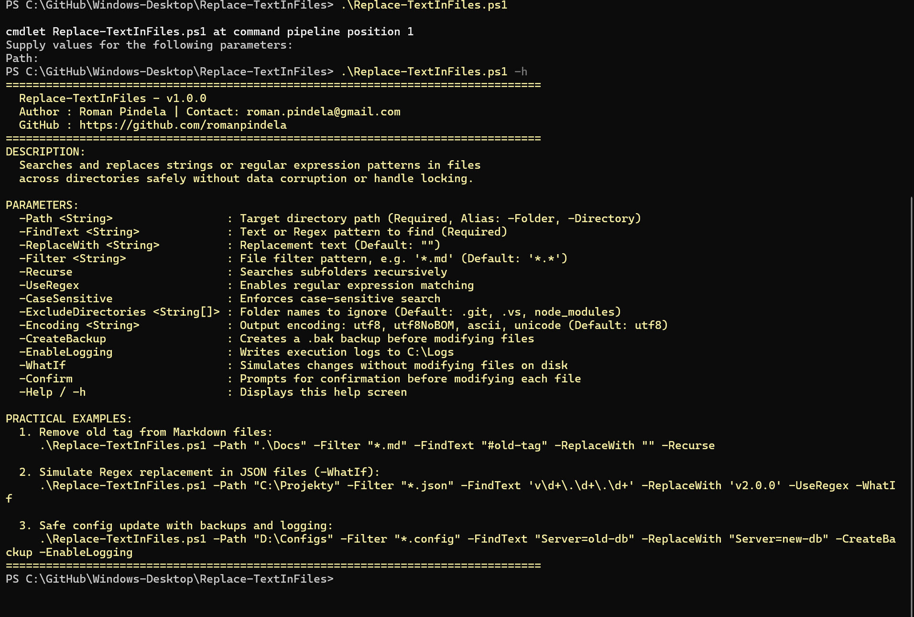
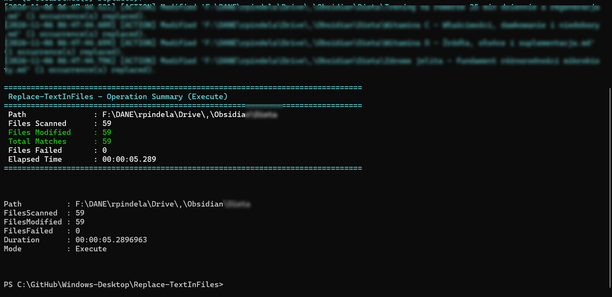

# Update-TextInFiles

[](https://microsoft.com/powershell)
[](https://www.microsoft.com/windows)

## Problem Statement

Performing bulk find-and-replace across codebases, configuration trees, or documentation files with naive PowerShell one-liners (`Get-Content | ForEach-Object`) risks file-locking errors, accidental binary file corruption, lost diacritics or line endings (CRLF vs. LF), and unintended overwrites without backups or previewing changes first. Developers and administrators need a safe, atomic text replacement utility with regex, encoding, binary detection, diff preview, and backup controls.

## Overview

`Update-TextInFiles.ps1` performs in-memory literal, regex (`-UseRegex`, `-RegexSingleline`, `-RegexMultiline`), and dynamic `[scriptblock]` (`-MatchEvaluator`) replacements across filtered directory trees. It detects and skips binary files by default, enforces `-MaxFileSizeMB`, retains original line endings and UTF-8/UTF8NoBOM/ASCII/Unicode encodings, supports colorized line diffs (`-ShowDiff`), creates `.bak` or directory-tree backups (`-CreateBackup`, `-BackupDirectory`), exports CSV/JSON reports (`-ExportReportPath`), and returns a structured `[PSCustomObject]` summary.

## Environment & Prerequisites

- **OS:** Windows 10, Windows 11, or Windows Server 2016+
- **PowerShell:** Windows PowerShell 5.1 or PowerShell 7.x+
- **Dependencies:** Native PowerShell and .NET file/regex APIs; no external modules required.

## Permissions Required

**User** — Standard read/write filesystem permissions for `-Path` (and `-BackupDirectory` / `-ExportReportPath`, or `C:\Logs\` when `-EnableLogging` is set) are sufficient; `Admin` is only required when modifying protected system directories.

## Safety & Impact

- **Risk Level:** `Modifies system state` (files within `-Path`) — Atomically rewrites matched text files on disk (`SupportsShouldProcess` enabled; binary files skipped by default; unmodified files keep original timestamps).
- **WhatIf / Confirm & Backup:** Full support for `-WhatIf` and `-Confirm` (`SupportsShouldProcess`), plus optional visual preview (`-ShowDiff`), in-place `.bak` backups (`-CreateBackup`), or mirrored backup trees (`-BackupDirectory`).

## Usage Examples

```powershell
# Display built-in help and parameter guide
.\Update-TextInFiles.ps1 -Help
.\Update-TextInFiles.ps1 -h

# Recursively remove a tag from Markdown files
.\Update-TextInFiles.ps1 -Path ".\Docs" -Filter "*.md" -FindText "#stary-tag" -ReplaceWith "" -Recurse

# Simulate regex replacement with visual diff preview (-WhatIf + -ShowDiff)
.\Update-TextInFiles.ps1 -Path "C:\Projekty" -Filter "*.json" -FindText 'v(\d+)\.(\d+)\.(\d+)' -ReplaceWith 'v2.$2.$3' -UseRegex -ShowDiff -WhatIf

# Multiline regex replacement with dedicated backup directory and JSON audit report
.\Update-TextInFiles.ps1 -Path "D:\Configs" -Filter "*.config", "*.xml" -FindText "(?s)<connectionString>.*?</connectionString>" -ReplaceWith "<connectionString>Server=prod-db;Port=5432</connectionString>" -UseRegex -RegexSingleline -BackupDirectory "D:\Backups" -ExportReportPath ".\audit-report.json"

# Dynamic regex replacement using ScriptBlock evaluator and .bak backups
.\Update-TextInFiles.ps1 -Path ".\Source" -Filter "*.cs", "*.ts" -FindText '\b[A-Za-z0-9._%+-]+@company\.com\b' -MatchEvaluator { param($m) $m.Value.ToLower() } -CreateBackup -ShowDiff
```

### Parameter Reference

| Parameter | Type | Default | Description |
| :--- | :--- | :--- | :--- |
| `-Path` | `[string]` | *(Mandatory)* | Target directory path (aliases `-Folder`, `-Directory`). |
| `-FindText` | `[string]` | *(Mandatory)* | Literal string or regex pattern to match. |
| `-ReplaceWith` | `[string]` | `""` | Replacement string. |
| `-MatchEvaluator` | `[scriptblock]` | `$null` | ScriptBlock evaluator enabling dynamic regex transforms. |
| `-Filter` | `[string[]]` | `'*.*'` | File filter mask(s) (e.g., `'*.md'`, `'*.json'`). |
| `-Recurse` | `[switch]` | `$false` | Recursively processes subdirectories. |
| `-UseRegex` | `[switch]` | `$false` | Interprets `-FindText` as a Regular Expression. |
| `-RegexSingleline` | `[switch]` | `$false` | Enables `RegexOptions.Singleline` (`.` matches `\n`). |
| `-RegexMultiline` | `[switch]` | `$false` | Enables `RegexOptions.Multiline` (`^`/`$` match per line). |
| `-CaseSensitive` | `[switch]` | `$false` | Performs case-sensitive matching. |
| `-ExcludeDirectories` | `[string[]]` | `@('.git', '.vs', 'node_modules')` | Folder names skipped during traversal. |
| `-ExcludeFiles` | `[string[]]` | `$null` | Filename patterns to exclude. |
| `-Encoding` | `[string]` | `'utf8'` | Output encoding: `utf8`, `utf8NoBOM`, `ascii`, or `unicode`. |
| `-CreateBackup` | `[switch]` | `$false` | Creates `.bak` backup copies alongside modified files. |
| `-BackupDirectory` | `[string]` | `""` | Dedicated backup root preserving relative paths. |
| `-IncludeBinary` | `[switch]` | `$false` | Disables binary-file skip guard. |
| `-SkipBinary` | `[switch]` | `$true` | Explicit switch to skip binary files (default behavior). |
| `-MaxFileSizeMB` | `[int]` | `50` | Max file size in MB (`0` = unlimited). |
| `-ShowDiff` | `[switch]` | `$false` | Prints colorized line-by-line diff previews. |
| `-ExportReportPath` | `[string]` | `""` | Exports audit report to `.csv` or `.json`. |
| `-EnableLogging` | `[switch]` | `$false` | Writes execution logs to `C:\Logs\`. |
| `-Help` | `[switch]` | `$false` | Displays interactive help (`-h`, `-HelpMe`). |

### Screenshots





## Author

- **Roman Pindela**
- **Email:** [roman.pindela@gmail.com](mailto:roman.pindela@gmail.com)
- **GitHub:** [https://github.com/romanpindela](https://github.com/romanpindela)
