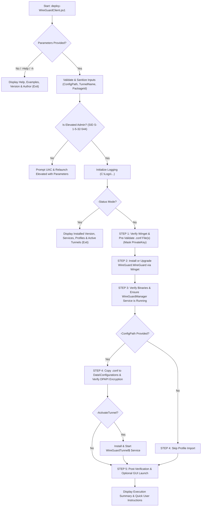

# Deploy WireGuard VPN Client (`deploy-WireGuardClient`)

**Version:** 1.2.0  
**Release Date:** 2026-10-18  
**Author:** Roman Pindela  
**License:** MIT  

An enterprise-grade, clean-code PowerShell automation script for deploying and updating the official **WireGuard VPN Client** (`WireGuard.WireGuard`) via **Windows Package Manager (`winget`)**, configuring the `WireGuardManager` service, and importing optional WireGuard tunnel configuration files (`.conf` / `.conf.dpapi`) across **Windows 10**, **Windows 11**, and **Windows Server** (English and Polish editions).

---

## 📋 Project Information

| Parameter | Value |
| :--- | :--- |
| **Project Name** | Deploy WireGuard VPN Client |
| **Script Name** | `deploy-WireGuardClient.ps1` |
| **Author** | Roman Pindela |
| **Email** | [roman.pindela@gmail.com](mailto:roman.pindela@gmail.com) |
| **GitHub** | [https://github.com/romanpindela](https://github.com/romanpindela) |
| **Version** | 1.2.0 |
| **Release Date** | 2026-10-18 |
| **License** | MIT |

---

## 🚀 Overview

Deploying the WireGuard VPN Client across corporate workstations or servers often requires downloading the installer manually, starting the `WireGuardManager` Windows service, importing user-specific `.conf` profiles into the ACL-protected `C:\Program Files\WireGuard\Data\Configurations` store, and instructing end users on how to connect.

`deploy-WireGuardClient.ps1` automates the entire workflow in a single, safe, and standards-compliant CLI tool:
1. **Zero-Parameter Interactive Help (`-Help` / `-h`):** Displays full usage documentation, syntax, practical examples, version (`1.2.0`), and author details when launched without arguments—without triggering an unnecessary UAC elevation prompt.
2. **Automated WireGuard Client Installation & Update via `winget`:** Verifies `winget` availability (automatically repairing it via `Microsoft.WinGet.Client` if missing), checks the current WireGuard installation state, downloads and installs (or updates) the official `WireGuard.WireGuard` package, and ensures the `WireGuardManager` Windows service is installed and running.
3. **Optional Configuration File Import (`-ConfigPath`):** Accepts one or more `.conf` (or `.conf.dpapi`) configuration files via CLI parameters, validates syntax (`[Interface]`, `[Peer]`, endpoints, allowed IPs) while redacting sensitive cryptographic keys (`PrivateKey`, `PresharedKey`), stages the profile into `C:\Program Files\WireGuard\Data\Configurations\`, verifies automatic Windows DPAPI encryption (`.conf.dpapi`) by `WireGuardManager`, and optionally activates the VPN tunnel service immediately (`-ActivateTunnel`).
4. **Granular Step-by-Step Progress, Final Summary & End-User Guide:** Prints detailed status messages for every stage (`[STEP 1/5]` through `[STEP 5/5]`), outputs a structured **Deployment Execution Summary**, and concludes with a **Quick User Instructions** block (English & Polish UI labels) explaining how to connect and disconnect.

---

## 🌟 Key Features

* **Zero-Parameter Console Help:** Running `.\deploy-WireGuardClient.ps1` without parameters displays complete help, examples, version (`1.2.0`), and author information.
* **Winget-Powered Client Provisioning:** Automatically installs `WireGuard.WireGuard` if missing or upgrades an existing installation to the latest release via `winget`.
* **Secure Configuration Profile Import (`-ConfigPath`):**
  * Validates `.conf` syntax and tunnel naming rules (`^[a-zA-Z0-9_=+.\-]{1,32}$`).
  * Masks `PrivateKey` and `PresharedKey` values so secrets are never leaked to the console or log files.
  * Automatically integrates with `WireGuardManager` so imported `.conf` files are encrypted with Windows DPAPI (`.conf.dpapi`) and immediately visible in the WireGuard GUI.
  * Supports custom tunnel naming (`-TunnelName`), unattended overwrite (`-ForceOverwrite`), and immediate VPN connection activation (`-ActivateTunnel`).
* **Language-Independent UAC Auto-Elevation:** Validates Administrator privileges using the well-known Windows Security Identifier (`S-1-5-32-544` / `WellKnownSidType::BuiltInAdministratorsSid`), ensuring 100% compatibility across both **Polish (`Administratorzy`)** and **English (`Administrators`)** Windows editions. Automatically prompts for UAC elevation and preserves all command-line parameters.
* **Input Sanitization & Defensive Validation:** Defends against command injection, shell metacharacters, and invalid file paths.
* **Dry-Run Simulation (`-DryRun`) & Status Inspection (`-Status`):** Preview all actions safely without modifying the OS, or audit installed WireGuard versions, services, and active tunnels anytime.
* **Enterprise Audit Logging:** Automatically writes UTF-8 timestamped execution logs to `C:\Logs\<yyyyMMdd_HHmmss>-deploy-WireGuardClient-<ComputerName>-<UserName>.logs`.

---

## 📂 Directory Structure

```shell
deploy-WireGuardClient/
├── deploy-WireGuardClient.ps1   # Main PowerShell deployment & configuration script
└── README.md                    # Technical documentation and usage guide
```

---

## 💻 System Requirements

* **Operating System:** Windows 10, Windows 11, Windows Server 2016 / 2019 / 2022 / 2025 (x64 / ARM64, English & Polish editions).
* **PowerShell Version:** Windows PowerShell 5.1 or PowerShell 7+.
* **Package Manager:** Windows Package Manager (`winget.exe`). If missing, the script attempts automatic provisioning via `Microsoft.WinGet.Client`.
* **Privileges:** Administrator privileges required for installing WireGuard, managing `WireGuardManager` / `WireGuardTunnel$*` services, and accessing `C:\Program Files\WireGuard\Data\Configurations` (the script automatically requests UAC elevation if started in a non-elevated console). Viewing help (`-h` or zero parameters) runs without elevation.

---

## 📥 Getting Started

### 1. Unblock the Script (Required After Downloading from GitHub)

When downloading PowerShell scripts from GitHub or the Internet, Windows attaches an `Alternate Data Stream (Zone.Identifier)` that may block execution. Unblock the file before running it:

```powershell
Unblock-File -Path .\deploy-WireGuardClient.ps1
```

If script execution is disabled by your local policy, allow signed/local scripts for the current user:

```powershell
Set-ExecutionPolicy -ExecutionPolicy RemoteSigned -Scope CurrentUser
```

---

## 📖 Parameter Reference

| Parameter | Alias | Type | Default | Description |
| :--- | :--- | :--- | :--- | :--- |
| `-ConfigPath` | `-Config`, `-ConfigFile`, `-Path`, `-File`, `-c` | `[string[]]` | `$null` | Optional path(s) to WireGuard `.conf` (or `.conf.dpapi`) tunnel configuration file(s) to import into client settings. |
| `-Install` | `-Deploy`, `-Setup`, `-i` | `[switch]` | `$false` | Installs or updates the WireGuard client via `winget` even when no `-ConfigPath` is provided. |
| `-TunnelName` | `-Name` | `[string]` | `$null` | Custom tunnel name (1–32 chars) when importing a single `.conf` file. Defaults to the `.conf` file's base name. |
| `-ActivateTunnel` | `-Activate`, `-Connect`, `-StartTunnel` | `[switch]` | `$false` | Immediately installs and starts the `WireGuardTunnel$<TunnelName>` Windows service after importing the profile. |
| `-LaunchGUI` | `-OpenClient`, `-ShowGUI` | `[switch]` | `$false` | Launches the WireGuard GUI application (`wireguard.exe`) after deployment completes. |
| `-ForceUpgrade` | `-Upgrade`, `-Update`, `-u` | `[switch]` | `$false` | Forces a `winget upgrade` check for the WireGuard client. |
| `-ForceOverwrite` | `-Overwrite`, `-Force`, `-f` | `[switch]` | `$false` | Overwrites an existing tunnel configuration with the same name without interactive confirmation (`Y/N` or `T/N`). |
| `-Status` | `-Check`, `-Verify`, `-Info` | `[switch]` | `$false` | Inspects and displays current WireGuard version, service states, imported profiles, and active `wg.exe show` interfaces. |
| `-PackageId` | | `[string]` | `WireGuard.WireGuard` | Winget package identifier for the WireGuard client. |
| `-InstallDir` | | `[string]` | `C:\Program Files\WireGuard` | Target installation directory of WireGuard. |
| `-DryRun` | `-Simulate`, `-Preview` | `[switch]` | `$false` | Simulates installation and configuration import without modifying the system. |
| `-SkipAdminCheck` | | `[switch]` | `$false` | Skips the automatic UAC elevation check. |
| `-PassThru` | | `[switch]` | `$false` | Outputs a structured deployment summary `[PSCustomObject]` to the PowerShell pipeline. |
| `-LogPath` | `-Log`, `-l` | `[string]` | `C:\Logs\...` | Custom path for the UTF-8 execution log file. |
| `-NoLog` | | `[switch]` | `$false` | Disables writing execution logs to disk. |
| `-Help` | `-h` | `[switch]` | `$false` | Displays interactive help, examples, version, and author information. |

---

## 💡 Practical Usage Examples

### Example 1: Display Help, Version, and Author Information (Zero-Parameter Run)
Running the script without parameters or with `-Help` / `-h` prints full instructions and examples without requiring UAC elevation:
```powershell
.\deploy-WireGuardClient.ps1
```
or
```powershell
.\deploy-WireGuardClient.ps1 -Help
```

---

### Example 2: Install or Update the WireGuard Client Only (No Configuration File)
Downloads and installs (or updates) the official WireGuard client via `winget`, verifies the `WireGuardManager` service, and prints the summary and user instructions:
```powershell
.\deploy-WireGuardClient.ps1 -Install
```

---

### Example 3: Install WireGuard Client and Import a Configuration File (`.conf`)
Ensures WireGuard is installed/up-to-date and imports `office-vpn.conf` into the WireGuard client settings (`C:\Program Files\WireGuard\Data\Configurations\office-vpn.conf.dpapi`):
```powershell
.\deploy-WireGuardClient.ps1 -ConfigPath "C:\VPN\office-vpn.conf"
```
*(Positional shorthand is also supported: `.\deploy-WireGuardClient.ps1 "C:\VPN\office-vpn.conf"`)*

---

### Example 4: Deploy WireGuard, Import Configuration, Activate VPN Tunnel Immediately, and Open GUI
Imports the configuration file, immediately installs and starts the `WireGuardTunnel$office-vpn` Windows service so the VPN connects right away, and opens the WireGuard GUI window:
```powershell
.\deploy-WireGuardClient.ps1 -ConfigPath "C:\VPN\office-vpn.conf" -ActivateTunnel -LaunchGUI
```

---

### Example 5: Import a Configuration with a Custom Tunnel Name and Unattended Overwrite
Imports `client01.conf` under the tunnel name `Corp-HQ` and overwrites any existing `Corp-HQ` configuration without prompting:
```powershell
.\deploy-WireGuardClient.ps1 -ConfigPath "C:\VPN\client01.conf" -TunnelName "Corp-HQ" -ForceOverwrite
```

---

### Example 6: Inspect Current WireGuard Status, Services, and Imported Tunnels
Displays the installed WireGuard GUI & CLI versions, `WireGuardManager` service health, all imported `.conf.dpapi` profiles, and active `wg.exe show` tunnel interfaces:
```powershell
.\deploy-WireGuardClient.ps1 -Status
```

---

### Example 7: Simulate Deployment and Configuration Validation (`-DryRun`)
Validates the `.conf` file structure (interface address, DNS, peer endpoints, allowed IPs) and previews all deployment steps without modifying the system:
```powershell
.\deploy-WireGuardClient.ps1 -ConfigPath "C:\VPN\office-vpn.conf" -ActivateTunnel -DryRun
```

---

## 🔄 Execution Workflow



---

## 🔒 Security & Quality Standards

1. **Automatic UAC Elevation (Multi-Language Safe):** Verifies Administrator privileges via well-known SID `S-1-5-32-544` (`[Security.Principal.WellKnownSidType]::BuiltInAdministratorsSid`), working identically on Polish (`Administratorzy`) and English (`Administrators`) editions of Windows 10/11 and Windows Server.
2. **Cryptographic Key Redaction:** When parsing `.conf` files to display step-by-step telemetry, `PrivateKey` and `PresharedKey` values are strictly redacted (`[PRESENT - REDACTED FOR SECURITY]`) and never written to the console or log files.
3. **DPAPI Configuration Encryption:** Imported `.conf` files are handed off to `WireGuardManager` inside the SYSTEM/Administrators ACL-protected directory (`C:\Program Files\WireGuard\Data\Configurations\`), which automatically encrypts them into `.conf.dpapi`.
4. **Strict Input Validation:** Defends against command injection by validating tunnel names (`^[a-zA-Z0-9_=+.\-]{1,32}$`), package IDs, and rejecting file paths containing shell metacharacters.
5. **Enterprise Audit Logging:** Writes detailed, UTF-8 timestamped logs to `C:\Logs\<yyyyMMdd_HHmmss>-deploy-WireGuardClient-<ComputerName>-<UserName>.logs`.

---

## 📜 Version History

* **v1.2.0 (2026-10-18):**
  * Implemented an automatic UAC elevation prompt that relaunches the script with Administrator privileges if they are missing, preserving all CLI parameters.
  * Replaced manual administrator group name checks with a secure, language-independent SID verification (`S-1-5-32-544`).
  * Added automated `winget` installation and update checking for `WireGuard.WireGuard` along with `WireGuardManager` service initialization.
  * Added optional `.conf` / `.conf.dpapi` configuration file validation, key-redacted metadata inspection, DPAPI store import, and optional immediate tunnel activation (`-ActivateTunnel`).
  * Added detailed step-by-step progress output, final execution summary, bilingual quick user instructions, and default logging to `C:\Logs`.

---

## 👤 Author & Support

* **Author:** Roman Pindela
* **Email:** [roman.pindela@gmail.com](mailto:roman.pindela@gmail.com)
* **GitHub:** [https://github.com/romanpindela](https://github.com/romanpindela)
* **License:** MIT
