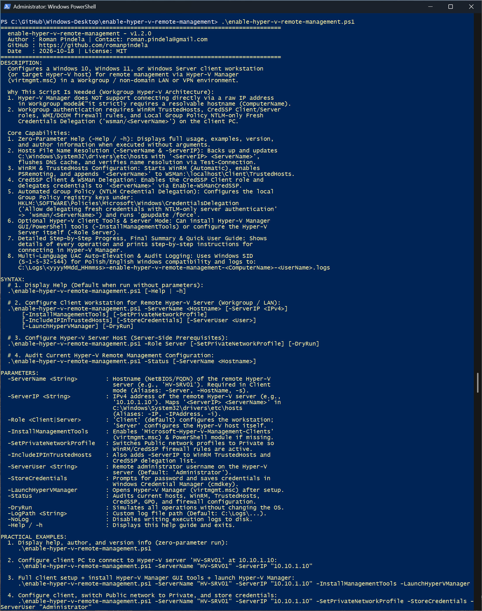
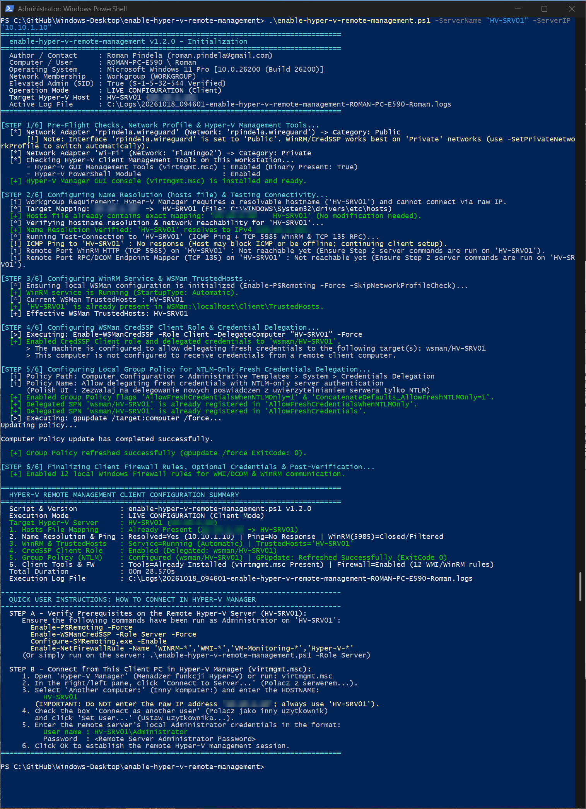
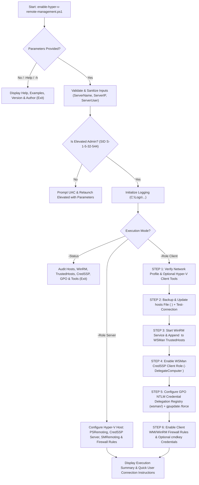

# Enable Hyper-V Remote Management (`enable-hyper-v-remote-management`)

**Version:** 1.2.0  
**Release Date:** 2026-10-18  
**Author:** Roman Pindela  
**License:** MIT  

An enterprise-grade, clean-code PowerShell automation tool that configures a **Windows 10**, **Windows 11**, or **Windows Server** client workstation (or target Hyper-V host) for seamless remote management via **Hyper-V Manager (`virtmgmt.msc`)** and PowerShell in a **Workgroup / non-domain LAN or VPN environment** (supporting both English and Polish Windows editions).

---

## 📋 Project Information

| Parameter | Value |
| :--- | :--- |
| **Project Name** | Enable Hyper-V Remote Management |
| **Script Name** | `enable-hyper-v-remote-management.ps1` |
| **Author** | Roman Pindela |
| **Email** | [roman.pindela@gmail.com](mailto:roman.pindela@gmail.com) |
| **GitHub** | [https://github.com/romanpindela](https://github.com/romanpindela) |
| **Version** | 1.2.0 |
| **Release Date** | 2026-10-18 |
| **License** | MIT |

---

## 🚀 Overview & Workgroup Architecture

Connecting the graphical **Hyper-V Manager (`virtmgmt.msc`)** console from a Windows 10/11 client PC to a standalone Hyper-V Server in a **Workgroup** (without Active Directory / Kerberos) fails by default even when WinRM is enabled on the server. This is due to two core architectural barriers in Windows:

1. **Mandatory Hostname Resolution:** Hyper-V Manager does **not** allow connecting directly via a raw IPv4 address (e.g., `10.10.1.10`) in Workgroup mode—it strictly requires a resolvable NetBIOS or FQDN hostname (`ComputerName`).
2. **Client-Side WinRM, CredSSP & NTLM Credential Delegation:** Workgroup authentication requires explicit client-side configuration of `WSMan:\localhost\Client\TrustedHosts`, the **CredSSP Client** role (`Enable-WSManCredSSP -Role Client -DelegateComputer <ServerName>`), and the **Local Group Policy** rule *"Allow delegating fresh credentials with NTLM-only server authentication"* (`wsman/<ServerName>`).

`enable-hyper-v-remote-management.ps1` automates the entire client-side (and optional server-side) configuration in a single, idempotent run:

1. **Zero-Parameter Interactive Help (`-Help` / `-h`):** Displays full usage documentation, syntax, practical examples, version (`1.2.0`), and author details when launched without arguments—without triggering an unnecessary UAC elevation prompt.
2. **Pre-Flight Checks & Optional Hyper-V Client Tools (`-InstallManagementTools`):** Inspects active network connection profiles (optionally switching `Public` interfaces to `Private` via `-SetPrivateNetworkProfile`) and verifies or installs `Microsoft-Hyper-V-Management-Clients` (`virtmgmt.msc`) and `Microsoft-Hyper-V-Management-PowerShell`.
3. **Automated `hosts` File Mapping & Connectivity Verification (`-ServerName` & `-ServerIP`):** Creates a timestamped backup of `C:\Windows\System32\drivers\etc\hosts`, idempotently adds or updates `<ServerIP> <ServerName>`, flushes the local DNS cache (`Clear-DnsClientCache`), and verifies hostname resolution, ICMP Ping (`Test-Connection`), and TCP ports `5985` (WinRM) and `135` (RPC/DCOM).
4. **WinRM & `TrustedHosts` Provisioning:** Configures the `WinRM` service (`Automatic` / `Running`), initializes PSRemoting, and appends `<ServerName>` (and optionally `<ServerIP>`) to `WSMan:\localhost\Client\TrustedHosts` without duplicating existing entries.
5. **CredSSP Client Role & WSMan Delegation:** Enables `Enable-WSManCredSSP -Role Client -DelegateComputer <ServerName> -Force`.
6. **Automated Group Policy Registry Configuration (`gpedit.msc` Equivalent):** Directly configures `HKLM:\SOFTWARE\Policies\Microsoft\Windows\CredentialsDelegation` (`AllowFreshCredentialsWhenNTLMOnly = 1`, `ConcatenateDefaults_AllowFreshNTLMOnly = 1`, and `wsman/<ServerName>` under `AllowFreshCredentialsWhenNTLMOnly` and `AllowFreshCredentials`) and runs `gpupdate /target:computer /force`—working seamlessly even on Windows editions where `gpedit.msc` is unavailable.
7. **Granular Step-by-Step Progress, Final Summary & End-User Guide:** Displays detailed telemetry for every stage (`[STEP 1/6]` through `[STEP 6/6]`), prints a structured **Configuration Summary**, and provides step-by-step instructions (in English & Polish UI terminology) for connecting in Hyper-V Manager.

---

## 🌟 Key Features

* **Zero-Parameter Console Help:** Running `.\enable-hyper-v-remote-management.ps1` without parameters displays complete help, examples, version (`1.2.0`), and author information.
* **Idempotent `hosts` File Management:** Safely backs up `C:\Windows\System32\drivers\etc\hosts` before adding or updating the `<ServerIP> <ServerName>` mapping, preventing duplicate entries.
* **Complete CredSSP & NTLM GPO Automation:** Eliminates manual `gpedit.msc` navigation by configuring `AllowFreshCredentialsWhenNTLMOnly` (`wsman/<ServerName>`) in the Windows Policy Registry and refreshing Group Policy automatically.
* **Dual-Role Support (`-Role Client` & `-Role Server`):**
  * `-Role Client` *(Default)*: Configures the administrator's Windows 10/11 PC to connect to a remote Hyper-V host.
  * `-Role Server`: Configures the Hyper-V host itself (`Enable-PSRemoting -Force`, `Enable-WSManCredSSP -Role Server -Force`, `Configure-SMRemoting.exe -Enable`, and language-independent WMI/WinRM/Hyper-V firewall rules).
* **Optional Credential Caching (`-StoreCredentials`):** Securely prompts for the remote administrator password and registers credentials in Windows Credential Manager (`cmdkey`) for both `<ServerName>` and `TERMSRV/<ServerName>` (VMConnect).
* **Language-Independent UAC Auto-Elevation:** Validates Administrator privileges using the well-known Windows Security Identifier (`S-1-5-32-544` / `WellKnownSidType::BuiltInAdministratorsSid`), ensuring 100% compatibility across both **Polish (`Administratorzy`)** and **English (`Administrators`)** Windows systems. Automatically prompts for UAC elevation while preserving all CLI parameters.
* **Input Sanitization & Defensive Validation:** Validates IPv4 addresses and NetBIOS/FQDN hostnames, blocks raw IP addresses mistakenly passed as `-ServerName`, and defends against command injection.
* **Dry-Run Simulation (`-DryRun`) & Audit Mode (`-Status`):** Preview all changes safely without modifying the OS, or inspect current `hosts`, `TrustedHosts`, CredSSP, and GPO settings at any time.
* **Enterprise Audit Logging:** Automatically writes UTF-8 timestamped execution logs to `C:\Logs\<yyyyMMdd_HHmmss>-enable-hyper-v-remote-management-<ComputerName>-<UserName>.logs`.

---

## 📂 Directory Structure

```shell
enable-hyper-v-remote-management/
├── assets/
│   ├── Configuring_hyper-v_client.jpg      # Screenshot of live client configuration for Hyper-V remote management
│   └── Standard_run.jpg                    # Screenshot of zero-parameter run / interactive help menu
├── enable-hyper-v-remote-management.ps1    # Main PowerShell client/server configuration script
└── README.md                               # Technical documentation and usage guide
```

---

## 💻 System Requirements

* **Operating System:** Windows 10, Windows 11, Windows Server 2016 / 2019 / 2022 / 2025 (English & Polish editions).
* **PowerShell Version:** Windows PowerShell 5.1 or PowerShell 7+.
* **Privileges:** Administrator privileges required for modifying `C:\Windows\System32\drivers\etc\hosts`, configuring `WSMan` / `CredSSP`, updating `HKLM:\SOFTWARE\Policies` Group Policy keys, and enabling Windows Firewall rules (the script automatically requests UAC elevation if started in a non-elevated console). Viewing help (`-h` or zero parameters) runs without elevation.

---

## 📥 Getting Started

### Unblock the Script (Required After Downloading from GitHub)

When downloading PowerShell scripts from GitHub or the Internet, Windows attaches an `Alternate Data Stream (Zone.Identifier)` that may block execution. Unblock the file before running it:

```powershell
Unblock-File -Path .\enable-hyper-v-remote-management.ps1
```

If script execution is disabled by your local policy, allow signed/local scripts for the current user:

```powershell
Set-ExecutionPolicy -ExecutionPolicy RemoteSigned -Scope CurrentUser
```

---

## 📖 Parameter Reference

| Parameter | Alias | Type | Default | Description |
| :--- | :--- | :--- | :--- | :--- |
| `-ServerName` | `-Server`, `-HostName`, `-ComputerName`, `-TargetServer`, `-s` | `[string]` | `$null` | NetBIOS hostname or FQDN of the remote Hyper-V server (e.g., `HV-SRV01`). Required in Client mode. |
| `-ServerIP` | `-IP`, `-IPAddress`, `-TargetIP`, `-i` | `[string]` | `$null` | IPv4 address of the remote Hyper-V server (e.g., `10.10.1.10`). Maps `<ServerIP> <ServerName>` in the `hosts` file. |
| `-Role` | `-Mode` | `[string]` | `Client` | Configuration mode: `Client` (configures local workstation) or `Server` (configures Hyper-V host prerequisites). |
| `-InstallManagementTools` | `-EnableHyperVTools`, `-InstallTools` | `[switch]` | `$false` | Enables `Microsoft-Hyper-V-Management-Clients` (`virtmgmt.msc`) and `Microsoft-Hyper-V-Management-PowerShell` if missing. |
| `-SetPrivateNetworkProfile` | | `[switch]` | `$false` | Switches active `Public` network connection profiles to `Private` so WinRM and CredSSP firewall rules are active. |
| `-IncludeIPInTrustedHosts` | | `[switch]` | `$false` | Also appends `-ServerIP` (in addition to `-ServerName`) to `TrustedHosts` and CredSSP delegation. |
| `-ServerUser` | `-User`, `-RemoteUser` | `[string]` | `Administrator` | Remote administrator username on the Hyper-V host (used in connection instructions and `-StoreCredentials`). |
| `-StoreCredentials` | `-SaveCredentials` | `[switch]` | `$false` | Securely prompts for the password and stores credentials in Windows Credential Manager (`cmdkey`). |
| `-LaunchHyperVManager` | `-OpenGUI`, `-StartManager` | `[switch]` | `$false` | Opens the Hyper-V Manager GUI console (`virtmgmt.msc`) after configuration completes. |
| `-Status` | `-Check`, `-Verify`, `-Info` | `[switch]` | `$false` | Audits and displays current `hosts`, `WinRM`, `TrustedHosts`, `CredSSP`, GPO, and Hyper-V tools status without modifying the OS. |
| `-DryRun` | `-Simulate`, `-Preview` | `[switch]` | `$false` | Simulates all operations without making any changes to the system. |
| `-SkipAdminCheck` | | `[switch]` | `$false` | Skips the automatic UAC elevation check. |
| `-PassThru` | | `[switch]` | `$false` | Outputs a structured summary `[PSCustomObject]` to the PowerShell pipeline. |
| `-LogPath` | `-Log`, `-l` | `[string]` | `C:\Logs\...` | Custom path for the UTF-8 execution log file. |
| `-NoLog` | | `[switch]` | `$false` | Disables writing execution logs to disk. |
| `-Help` | `-h` | `[switch]` | `$false` | Displays interactive help, examples, version, and author information. |

---

## 💡 Practical Usage Examples

### Example 1: Display Help, Version, and Author Information (Zero-Parameter Run)
Running the script without parameters or with `-Help` / `-h` prints full instructions and examples without requiring UAC elevation:
```powershell
.\enable-hyper-v-remote-management.ps1
```
or
```powershell
.\enable-hyper-v-remote-management.ps1 -Help
```

---

### Example 2: Configure Client Workstation for a Remote Hyper-V Server in a Workgroup
Backs up and updates `C:\Windows\System32\drivers\etc\hosts` with `10.10.1.10 HV-SRV01`, verifies resolution and connectivity via `Test-Connection`, enables `WinRM`, appends `HV-SRV01` to `TrustedHosts`, enables `CredSSP Client` delegation, configures the Group Policy NTLM-only credential delegation registry rule (`wsman/HV-SRV01`), and runs `gpupdate /force`:
```powershell
.\enable-hyper-v-remote-management.ps1 -ServerName "HV-SRV01" -ServerIP "10.10.1.10"
```

---

### Example 3: Full Client Setup + Install Hyper-V Manager GUI Tools + Launch Console
Configures the workstation, installs the Hyper-V Manager GUI (`Microsoft-Hyper-V-Management-Clients`) and PowerShell module if not yet installed, and opens `virtmgmt.msc`:
```powershell
.\enable-hyper-v-remote-management.ps1 -ServerName "HV-SRV01" -ServerIP "10.10.1.10" -InstallManagementTools -LaunchHyperVManager
```

---

### Example 4: Configure Client, Switch Network Profile to Private, and Save Credentials in Vault
Automatically changes any `Public` network profile to `Private`, configures all Workgroup settings, and prompts to save the remote administrator credentials in Windows Credential Manager (`cmdkey`):
```powershell
.\enable-hyper-v-remote-management.ps1 -ServerName "HV-SRV01" -ServerIP "10.10.1.10" -SetPrivateNetworkProfile -StoreCredentials -ServerUser "Administrator"
```

---

### Example 5: Configure the Target Hyper-V Server (`-Role Server`)
Run the script directly on the Hyper-V Server (`10.10.1.10`) to enable `PSRemoting`, `CredSSP Server` role, `Configure-SMRemoting.exe -Enable`, and language-independent Windows Firewall rules for WMI/DCOM, WinRM, and Hyper-V Management Clients:
```powershell
.\enable-hyper-v-remote-management.ps1 -Role Server
```

---

### Example 6: Audit Current Hyper-V Remote Management Configuration (`-Status`)
Inspects the local computer's `hosts` mappings, `WinRM` service state, `TrustedHosts`, `CredSSP` settings, Group Policy NTLM delegation SPNs, and Hyper-V client tools status without making any changes:
```powershell
.\enable-hyper-v-remote-management.ps1 -Status
```

---

### Example 7: Simulate Configuration in Dry-Run Mode (`-DryRun`)
Previews all operations that would be performed for `HV-SRV01` (`10.10.1.10`) without modifying the operating system:
```powershell
.\enable-hyper-v-remote-management.ps1 -ServerName "HV-SRV01" -ServerIP "10.10.1.10" -DryRun
```

---

## 📸 Screenshots & Visual Verification

### 1. Standard Run & Interactive Help Menu (`.\enable-hyper-v-remote-management.ps1`)


### 2. Configuring Hyper-V Client Workstation (`-ServerName` & `-ServerIP`)


---

## 🔄 Execution Workflow



---

## 🖥️ How to Connect in Hyper-V Manager After Running the Script

1. Open **Hyper-V Manager** (*Menadżer funkcji Hyper-V*) or run `virtmgmt.msc`.
2. Click **Connect to Server...** (*Połącz z serwerem...*).
3. Select **Another computer:** (*Inny komputer:*) and enter the **Server Name** (e.g., `HV-SRV01`)—**do NOT enter the raw IP address** (`10.10.1.10`).
4. Check **Connect as another user** (*Połącz jako inny użytkownik*) and click **Set User...** (*Ustaw użytkownika...*).
5. Enter the remote server's administrator credentials in the format:
   * **User name:** `<ServerName>\<AdministratorUser>` (e.g., `HV-SRV01\Administrator`)
   * **Password:** `<Password>`
6. Click **OK** to establish the connection.

---

## 🔒 Security & Quality Standards

1. **Automatic UAC Elevation (Multi-Language Safe):** Verifies Administrator privileges via well-known SID `S-1-5-32-544` (`[Security.Principal.WellKnownSidType]::BuiltInAdministratorsSid`), working identically on Polish (`Administratorzy`) and English (`Administrators`) editions of Windows 10/11 and Windows Server.
2. **Scoped Credential Delegation:** Rather than delegating credentials to wildcard `*`, the script scopes `TrustedHosts`, `CredSSP`, and Group Policy `AllowFreshCredentialsWhenNTLMOnly` specifically to the target `<ServerName>` (`wsman/<ServerName>`).
3. **Safe `hosts` File Backup & Encoding:** Always creates a timestamped backup before modifying `C:\Windows\System32\drivers\etc\hosts` and writes UTF-8 without BOM to preserve native Windows resolver compatibility.
4. **Strict Input Validation:** Prevents raw IP addresses from being passed as `-ServerName` (which would fail in Hyper-V Manager), validates IPv4 syntax, and blocks shell metacharacters.
5. **Enterprise Audit Logging:** Writes detailed, UTF-8 timestamped logs to `C:\Logs\<yyyyMMdd_HHmmss>-enable-hyper-v-remote-management-<ComputerName>-<UserName>.logs`.

---

## 📜 Version History

* **v1.2.0 (2026-10-18):**
  * Implemented an automatic UAC elevation prompt that relaunches the script with Administrator privileges if they are missing, preserving all CLI parameters.
  * Replaced manual administrator group name checks with a secure, language-independent SID verification (`S-1-5-32-544`).
  * Automated the complete Workgroup Hyper-V Client configuration (`hosts` file mapping with backup, `Test-Connection` verification, `WinRM` + `TrustedHosts`, `CredSSP Client` delegation, and Local Group Policy `AllowFreshCredentialsWhenNTLMOnly` registry configuration + `gpupdate /force`).
  * Added optional `-InstallManagementTools`, `-Role Server` host preparation, `-StoreCredentials` (`cmdkey`), `-Status` auditing, `-DryRun` simulation, and default logging to `C:\Logs`.

---

## 👤 Author & Support

* **Author:** Roman Pindela
* **Email:** [roman.pindela@gmail.com](mailto:roman.pindela@gmail.com)
* **GitHub:** [https://github.com/romanpindela](https://github.com/romanpindela)
* **License:** MIT
