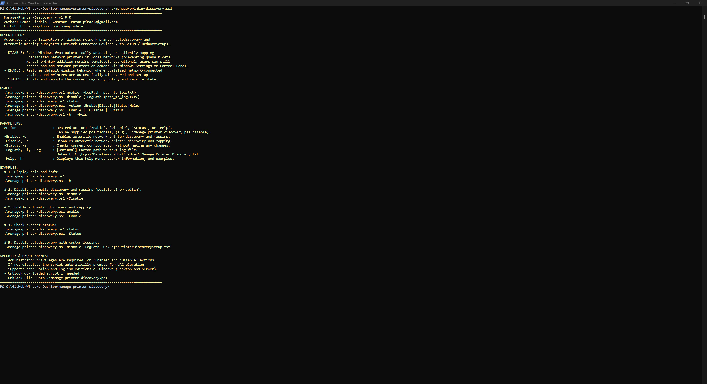
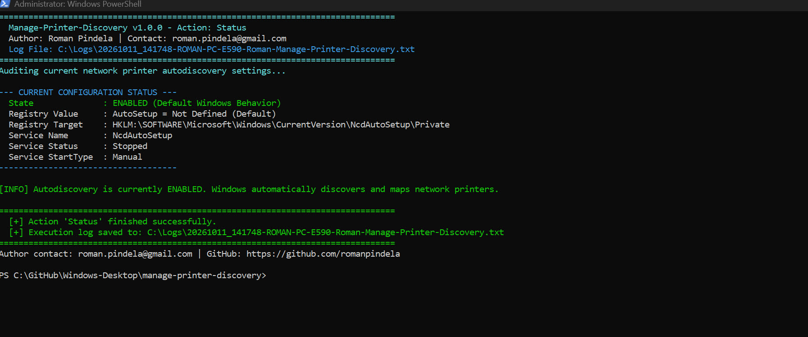

# Manage Network Printer Discovery (`manage-printer-discovery`)

**Version:** 1.0.0  
**Release Date:** 2026-10-11  
**Author:** Roman Pindela  
**License:** MIT  

A robust, enterprise-grade PowerShell utility for managing automatic network printer discovery and unsolicited background mapping on Windows 10, Windows 11, and Windows Server (x64/ARM64).

---

## Project Information

| Parameter | Value |
| :--- | :--- |
| **Project Name** | Manage Network Printer Discovery |
| **Script Name** | `manage-printer-discovery.ps1` |
| **Author** | Roman Pindela |
| **Email** | [roman.pindela@gmail.com](mailto:roman.pindela@gmail.com) |
| **GitHub** | [https://github.com/romanpindela](https://github.com/romanpindela) |
| **Version** | 1.0.0 |
| **Release Date** | 2026-10-11 |
| **License** | MIT |

---

## Overview

In modern Windows environments, the **Network Connected Devices Auto-Setup** (`NcdAutoSetup`) subsystem continuously monitors the local network for broadcasted devices (using WSD, mDNS, UPnP, and LLTD). By default, Windows silently and automatically installs printer queues for devices discovered on the local subnet without administrative consent or user interaction.

This behavior frequently causes:
* **Printer Queue Clutter:** Unwanted shared office printers, home devices, or virtual print devices populate the user's printer list.
* **Accidental Printing:** Users inadvertently submit sensitive print jobs to the wrong physical device on shared or multi-subnet networks.
* **Print Server Bypass:** Users circumvent centralized print accounting solutions (e.g., PaperCut, Equitrac, or corporate print servers).

### How This Script Solves It
`manage-printer-discovery.ps1` provides granular, bidirectional control:
* **Disable Autodiscovery & Mapping:** Sets `AutoSetup = 0` in `HKLM:\SOFTWARE\Microsoft\Windows\CurrentVersion\NcdAutoSetup\Private` and suspends the `NcdAutoSetup` background service. Windows will no longer silently map broadcasted printers.
* **On-Demand Manual Discovery Preserved:** Disabling background mapping does **not** restrict manual printer installation. Users can still click **Add a printer or scanner** in Windows Settings or Control Panel; Windows will search the network on demand and allow the user to select and install desired printers.
* **Restore Default Auto-Setup:** Sets `AutoSetup = 1` and restores the `NcdAutoSetup` service to its default trigger-start configuration.
* **Status Auditing:** Inspects and reports the current registry policy and service state without making modifications.

---

## Key Features

* **Zero-Parameter Interactive Help:** Running the script without parameters or with `-Help` / `-h` immediately displays the help screen, version info, author metadata, and usage examples.
* **Input Sanitization & Protection:** Strict parameter validation (`[ValidateSet]`, path boundary checks, injection mitigation) prevents accidental or malicious input execution.
* **Language-Agnostic UAC Auto-Elevation:** Automatically validates administrator rights using well-known SIDs (`WellKnownSidType::BuiltInAdministratorsSid`), ensuring 100% compatibility with both English (`Administrators`) and Polish (`Administratorzy`) Windows operating systems. If unprivileged, it prompts for UAC elevation while preserving all command-line arguments.
* **Enterprise Text Logging:** Generates comprehensive, timestamped execution logs in `C:\Logs` or a custom directory specified via `-LogPath`.
* **Idempotent Operations:** Audits existing system configuration prior to modifying values, safely skipping redundant writes.

---

## Directory Structure

```shell
manage-printer-discovery/
├── assets/
│   ├── Checking_status.jpg         # Screenshot of auditing current discovery status
│   └── Standard_run.jpg            # Screenshot of standard run / help menu view
├── manage-printer-discovery.ps1    # Main PowerShell administration script
└── README.md                       # Technical documentation and deployment guide
```

---

## System Requirements

* **Operating System:** Windows 10, Windows 11, Windows Server 2016 / 2019 / 2022 / 2025 (x64 and ARM64).
* **PowerShell Version:** Windows PowerShell 5.1 or PowerShell 7+.
* **Privileges:** Administrator privileges required for `Enable` and `Disable` operations (script automatically requests elevation via UAC). `Status` and `Help` can run under standard user rights.

---

## Getting Started

### 1. Unblock the Script (Required After Download)

When downloading PowerShell scripts from GitHub or the Internet, Windows marks them with an alternate data stream (`Zone.Identifier`). Unblock the file before execution:

```powershell
Unblock-File -Path .\manage-printer-discovery.ps1
```

If execution is restricted by PowerShell policy, set the execution policy for the current user:

```powershell
Set-ExecutionPolicy -ExecutionPolicy RemoteSigned -Scope CurrentUser
```

---

## Usage Guide & Examples

### 1. Display Help and Author Information
Executing without parameters or with `-h` displays comprehensive syntax and examples:

```powershell
.\manage-printer-discovery.ps1
```
*or:*
```powershell
.\manage-printer-discovery.ps1 -h
```
*or:*
```powershell
.\manage-printer-discovery.ps1 -Help
```

---

### 2. Disable Automatic Network Printer Discovery & Mapping
Stops Windows from silently adding network printers in the background:

```powershell
.\manage-printer-discovery.ps1 disable
```
*or with named switch:*
```powershell
.\manage-printer-discovery.ps1 -Disable
```

> **Note:** Once disabled, users can still manually discover and connect printers by navigating to **Settings > Bluetooth & devices > Printers & scanners > Add device** (or Control Panel > Devices and Printers > Add a printer).

---

### 3. Enable Automatic Network Printer Discovery & Mapping
Restores the default Windows behavior where discovered network devices are automatically configured:

```powershell
.\manage-printer-discovery.ps1 enable
```
*or with named switch:*
```powershell
.\manage-printer-discovery.ps1 -Enable
```

---

### 4. Check Current Configuration Status
Audits the registry and service state without applying any system changes:

```powershell
.\manage-printer-discovery.ps1 status
```
*or with named switch:*
```powershell
.\manage-printer-discovery.ps1 -Status
```

---

### 5. Execute with Custom Log File Path
Specify a custom destination for execution logs:

```powershell
.\manage-printer-discovery.ps1 disable -LogPath "C:\Logs\PrinterPolicySetup.txt"
```

---

## Technical Details

### Registry Configuration

| Key Path | Value Name | Type | Value | Function |
| :--- | :--- | :--- | :--- | :--- |
| `HKLM:\SOFTWARE\Microsoft\Windows\CurrentVersion\NcdAutoSetup\Private` | `AutoSetup` | `REG_DWORD` | `0` | Disables automatic background mapping of network printers and devices. |
| `HKLM:\SOFTWARE\Microsoft\Windows\CurrentVersion\NcdAutoSetup\Private` | `AutoSetup` | `REG_DWORD` | `1` | Enables default automatic network printer and device mapping. |

### Service Management

| Service Name | Display Name | State on Disable | State on Enable |
| :--- | :--- | :--- | :--- |
| `NcdAutoSetup` | Network Connected Devices Auto-Setup | Stopped, StartupType: `Disabled` | StartupType: `Manual` (Trigger-Start) |

---

## Example Console Output

### Audit Status (`status`)
```text
================================================================================
  Manage-Printer-Discovery v1.0.0 - Action: Status
  Author: Roman Pindela | Contact: roman.pindela@gmail.com
  Log File: C:\Logs\20261011_094033-ROMAN-PC-E590-Roman-Manage-Printer-Discovery.txt
================================================================================
Auditing current network printer autodiscovery settings...

--- CURRENT CONFIGURATION STATUS ---
  State              : ENABLED (Default Windows Behavior)
  Registry Value     : AutoSetup = Not Defined (Default)
  Registry Target    : HKLM:\SOFTWARE\Microsoft\Windows\CurrentVersion\NcdAutoSetup\Private
  Service Name       : NcdAutoSetup
  Service Status     : Stopped
  Service StartType  : Manual
------------------------------------

[INFO] Autodiscovery is currently ENABLED. Windows automatically discovers and maps network printers.

================================================================================
  [+] Action 'Status' finished successfully.
  [+] Execution log saved to: C:\Logs\20261011_094033-ROMAN-PC-E590-Roman-Manage-Printer-Discovery.txt
================================================================================
Author contact: roman.pindela@gmail.com | GitHub: https://github.com/romanpindela
```

### Disabling Autodiscovery (`disable`)
```text
================================================================================
  Manage-Printer-Discovery v1.0.0 - Action: Disable
  Author: Roman Pindela | Contact: roman.pindela@gmail.com
  Log File: C:\Logs\20261011_094500-ROMAN-PC-E590-Roman-Manage-Printer-Discovery.txt
================================================================================
[1/3] Configuring HKLM Registry policy: AutoSetup = 0 (Disabled)...
    [*] Creating missing Private registry subkey under NcdAutoSetup...
    [+] Success: Set HKLM:\SOFTWARE\Microsoft\Windows\CurrentVersion\NcdAutoSetup\Private\AutoSetup = 0 (DWORD).
[2/3] Stopping and disabling for service: NcdAutoSetup...
    [+] Service NcdAutoSetup StartupType configured to 'Disabled'.
[3/3] Auditing final system configuration...
    ----------------------------------------------------------------
    CONFIGURATION AUDIT REPORT:
      * Autodiscovery & Mapping State : DISABLED (Manual Discovery Only)
      * Registry Value (AutoSetup)    : 0
      * Registry Path                 : HKLM:\SOFTWARE\Microsoft\Windows\CurrentVersion\NcdAutoSetup\Private
      * Service Name                  : NcdAutoSetup
      * Service Status / StartType    : Stopped / Disabled
    ----------------------------------------------------------------
    [NOTE] Windows will no longer automatically discover and install network printers.
           Manual printer addition remains available via Windows Settings or Control Panel.

================================================================================
  [+] Action 'Disable' finished successfully.
================================================================================
Author contact: roman.pindela@gmail.com | GitHub: https://github.com/romanpindela
```

---

## Screenshots

### Standard Run / Help Menu (`.\manage-printer-discovery.ps1`)


### Checking Status (`.\manage-printer-discovery.ps1 status`)


---

## Exit Codes & Diagnostics

| Exit Code | Description | Corrective Action |
| :---: | :--- | :--- |
| **0** | Success / Status audited / Help shown | None. Operation completed as expected. |
| **1** | Execution error / Elevation canceled | Inspect error message or check execution log file in `C:\Logs`. Run PowerShell as Administrator. |

---

## Version History

### v1.0.0 (2026-10-11)
* Initial production release.
* Added `enable`, `disable`, and `status` operations.
* Added automatic UAC elevation handling using language-independent Administrator SID.
* Implemented HKLM 64-bit registry manipulation for `NcdAutoSetup\Private\AutoSetup`.
* Implemented automatic configuration of `NcdAutoSetup` Windows service.
* Built-in interactive help system when called without parameters or with `-Help` / `-h`.
* Integrated timestamped file logging with custom `-LogPath` parameter.
* Input validation and protection against malformed parameters.

---

## Author & Contact

**Roman Pindela**  
* Systems Administrator | Automation Engineer | PowerShell Developer  
* Email: [roman.pindela@gmail.com](mailto:roman.pindela@gmail.com)  
* GitHub: [https://github.com/romanpindela](https://github.com/romanpindela)  

---

## License

This project is licensed under the MIT License - see the LICENSE file for details.
