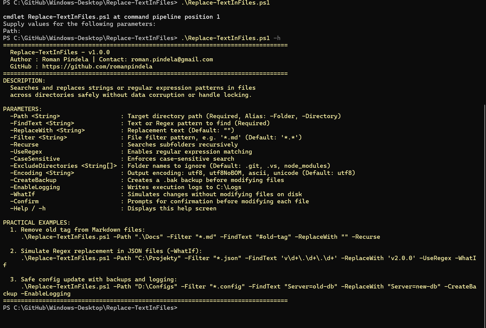
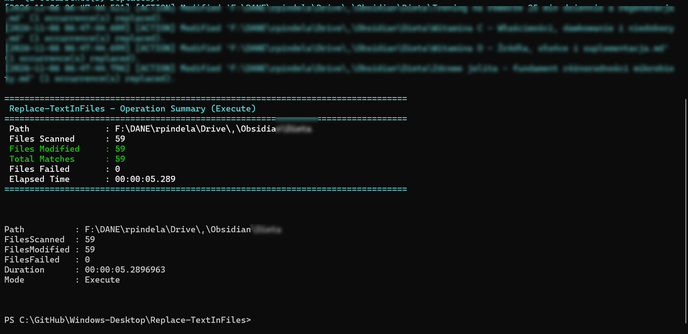
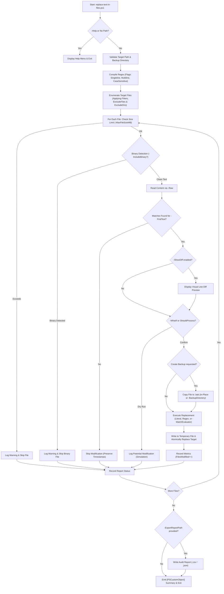

# Replace Text in Files (`replace-text-in-files`)

**Version:** 1.1.0  
**Release Date:** 2026-11-07  
**Author:** Roman Pindela  
**License:** MIT  

An enterprise-grade, high-performance PowerShell automation utility for bulk search-and-replace operations in text files across projects and directory trees with zero data corruption risk.

[](https://docs.microsoft.com/en-us/powershell/)
[](https://www.microsoft.com/windows)
[](https://opensource.org/licenses/MIT)

---

## 📋 Project Information

| Parameter | Value |
| :--- | :--- |
| **Project Name** | Replace Text in Files |
| **Script Name** | `replace-text-in-files.ps1` |
| **Author** | Roman Pindela |
| **Email** | [roman.pindela@gmail.com](mailto:roman.pindela@gmail.com) |
| **GitHub** | [https://github.com/romanpindela](https://github.com/romanpindela) |
| **Repository** | [Windows-Desktop](https://github.com/romanpindela/Windows-Desktop) |
| **Version** | 1.1.0 |
| **Release Date** | 2026-11-07 |
| **License** | MIT |

---

## 🚀 Overview

Performing mass search-and-replace operations across multiple files often leads to file corruption, lock contention, broken character encodings, or accidental data loss when using naive one-liners such as `(Get-Content) | Set-Content`.

`replace-text-in-files.ps1` provides an enterprise-ready pipeline:
* **Safe In-Memory & Atomic Pipeline:** Reads file contents entirely into memory (`-Raw`) before performing replacements and writes modifications through temporary staging files before atomic replacement.
* **Smart Binary Protection:** Automatically inspects file headers to detect binary files (e.g. images, executables, compiled libraries) and skips them safely, preventing file corruption.
* **Large File Safeguard (`-MaxFileSizeMB`):** Prevents `OutOfMemoryException` crashes by automatically enforcing file size boundaries (default: 50 MB, configurable).
* **Advanced Regular Expressions:** Native support for regex groups, multiline matching (`-RegexMultiline`), singleline dot-matches-all (`-RegexSingleline`), and dynamic PowerShell ScriptBlock replacement (`-MatchEvaluator`).
* **Visual Diff Previews (`-ShowDiff`):** Colorized terminal output showing matched lines, line numbers, and exact before/after snippets.
* **Flexible Filtering:** Accepts multiple filter masks (e.g. `*.json, *.xml`) and specific file exclusion patterns (`-ExcludeFiles`).
* **Backup Management:** Automatically creates backups either in-place (`.bak`) or routed to an isolated directory tree (`-BackupDirectory`).
* **Enterprise Audit Reports (`-ExportReportPath`):** Exports comprehensive execution metrics and file statuses directly to CSV or JSON.

---

## ✨ Key Features

* **Non-Destructive & In-Memory Pipeline:** Prevents file locking and data loss typical of `(Get-Content) | Set-Content` by reading files with `-Raw`, verifying modifications in memory, and writing to a temporary file before atomic replacement.
* **Dual-PowerShell Compatibility:** Seamless execution under both **Windows PowerShell 5.1** and **PowerShell 7+**.
* **Safety First (`-WhatIf` & `-Confirm`):** Full native support for `SupportsShouldProcess` allowing dry-run simulations before applying changes.
* **Preserves Encodings, Diacritics & Line Endings:** Full support for `utf8` (PS7 BOM-less, PS5.1 BOM), `utf8NoBOM`, `ascii`, and `unicode`. Maintains `CRLF` and `LF` line endings and Polish/international diacritics.
* **Smart Modification Tracking:** Files are modified only if matching strings or patterns are detected, keeping file timestamps intact on untouched files.
* **Dynamic ScriptBlock Evaluation (`-MatchEvaluator`):** Transform matches dynamically via PowerShell script blocks (e.g. casing adjustments, arithmetic increments, or custom logic).
* **Visual Line-by-Line Diff (`-ShowDiff`):** Displays clear terminal previews of line numbers, removed content, and proposed replacements.
* **Directory & File Pattern Exclusions:** Safely ignores dependency and VCS folders (`.git`, `.vs`, `node_modules`) and files (`*.min.js`, `package-lock.json`).
* **Structured Audit Logging & Reporting:** Writes timestamped logs to `C:\Logs` and exports structured audit datasets to `.csv` or `.json`.

---

## 📂 Directory Structure

```shell
replace-text-in-files/
├── assets/
│   ├── Replace_results.jpg         # Screenshot of search & replace execution results
│   └── Standard_run.jpg            # Screenshot of zero-parameter run / interactive help menu
├── replace-text-in-files.ps1       # Main PowerShell search-and-replace utility
└── README.md                       # Comprehensive technical documentation
```

---

## 💻 Technical Prerequisites

* **Operating System:** Windows 10, Windows 11, Windows Server 2016+
* **PowerShell Version:** Windows PowerShell 5.1 or PowerShell 7+
* **Privileges:** Standard user session (Run as Administrator required only when targeting protected system directories).

---

## ⚙️ Parameters

| Parameter | Type | Required | Default | Description |
| :--- | :--- | :--- | :--- | :--- |
| `-Path` | `string` | **Yes** | — | Target directory path to scan. (Aliases: `-Folder`, `-Directory`) |
| `-FindText` | `string` | **Yes** | — | Literal string or Regular Expression pattern to search for. |
| `-ReplaceWith` | `string` | No | `""` | Replacement text (empty string removes matches). |
| `-MatchEvaluator`| `scriptblock`| No | `$null` | PowerShell ScriptBlock for dynamic replacement (e.g. `{$args[0].Value.ToUpper()}`). Automatically enables regex. |
| `-Filter` | `string[]` | No | `*.*` | One or more file mask filters (e.g. `*.md`, `*.json, *.xml`). |
| `-Recurse` | `switch` | No | `$false` | Recursively processes subdirectories. |
| `-UseRegex` | `switch` | No | `$false` | Treats `-FindText` as a Regular Expression pattern. |
| `-RegexSingleline`| `switch` | No | `$false` | Allows `.` to match newline characters (`\n`), enabling multiline block replacement. |
| `-RegexMultiline` | `switch` | No | `$false` | Changes `^` and `$` to match the start and end of every line. |
| `-CaseSensitive`| `switch` | No | `$false` | Performs case-sensitive matching (default: case-insensitive). |
| `-ExcludeDirectories`| `string[]` | No | `@('.git', '.vs', 'node_modules')` | List of folder names to exclude from processing. |
| `-ExcludeFiles` | `string[]` | No | `@()` | File patterns to exclude (e.g. `*.min.js`, `package-lock.json`). |
| `-Encoding` | `string` | No | `'utf8'` | File encoding (`utf8`, `utf8NoBOM`, `ascii`, `unicode`). |
| `-CreateBackup` | `switch` | No | `$false` | Creates an in-place `.bak` backup copy before modifying files. |
| `-BackupDirectory`| `string` | No | `""` | Dedicated folder to receive backups, preserving relative folder structure. |
| `-IncludeBinary`| `switch` | No | `$false` | Disables binary file protection and allows processing binary files. |
| `-MaxFileSizeMB`| `int` | No | `50` | Maximum file size in MB to process (0 = unlimited). Guards against `OutOfMemory`. |
| `-ShowDiff` | `switch` | No | `$false` | Displays visual colorized line-by-line diff preview before modifying files. |
| `-ExportReportPath`| `string` | No | `""` | Exports execution audit log to `.csv` or `.json`. |
| `-EnableLogging`| `switch` | No | `$false` | Writes execution logs to `C:\Logs\`. |
| `-Help` | `switch` | No | `$false` | Displays interactive help guide (Aliases: `-h`, `-HelpMe`). |

---

## 📖 Usage Guide & Practical Examples

### 1. Interactive Help Menu
```powershell
.\replace-text-in-files.ps1 -Help
# or
.\replace-text-in-files.ps1 -h
```

### 2. Remove Tag from Markdown Files (Recursive)
```powershell
.\replace-text-in-files.ps1 -Path ".\Docs" -Filter "*.md" -FindText "#stary-tag" -ReplaceWith "" -Recurse
```

### 3. Dry-Run Regex Simulation with Visual Diff (`-ShowDiff` & `-WhatIf`)
```powershell
.\replace-text-in-files.ps1 -Path "C:\Projekty" -Filter "*.json" -FindText 'v(\d+)\.(\d+)\.(\d+)' -ReplaceWith 'v2.$2.$3' -UseRegex -ShowDiff -WhatIf
```

### 4. Multiline Configuration Replacement with Isolated Backups & JSON Report
```powershell
.\replace-text-in-files.ps1 -Path "D:\Configs" -Filter "*.config", "*.xml" -FindText "(?s)<connectionString>.*?</connectionString>" -ReplaceWith "<connectionString>Server=prod-db;Port=5432</connectionString>" -UseRegex -RegexSingleline -BackupDirectory "D:\Backups" -ExportReportPath ".\audit-report.json"
```

### 5. Dynamic Transformation with ScriptBlock Evaluator (`-MatchEvaluator`)
```powershell
.\replace-text-in-files.ps1 -Path ".\Source" -Filter "*.cs", "*.ts" -FindText '\b[A-Za-z0-9._%+-]+@company\.com\b' -MatchEvaluator { param($m) $m.Value.ToLower() } -ShowDiff
```

### 6. Filter Specific Files and Exclude Bundles
```powershell
.\replace-text-in-files.ps1 -Path ".\WebApp" -Filter "*.js", "*.ts" -ExcludeFiles "*.min.js", "bundle.js" -FindText "http://api.local" -ReplaceWith "https://api.domain.com" -CreateBackup
```

---

## 📸 Screenshots & Visual Verification

### 1. Standard Run & Interactive Help Menu (`.\replace-text-in-files.ps1 -Help`)


*Zero-parameter execution of `.\replace-text-in-files.ps1 -Help` displaying parameter reference, encoding options, and practical usage examples.*

### 2. Search & Replace Execution Results


*Live search-and-replace execution across directory files with detailed summary statistics and pipeline object output.*

---

## 🔄 Execution Workflow



---

## 📊 Pipeline Output

The script returns an extended `[PSCustomObject]` summary to the PowerShell pipeline:

```powershell
Path               : C:\Projekty\Docs
FilesScanned       : 48
FilesModified      : 12
FilesFailed        : 0
FilesSkippedBinary : 3
FilesSkippedSize   : 0
TotalMatches       : 37
Duration           : 00:00:01.420
Mode               : Execute
```
