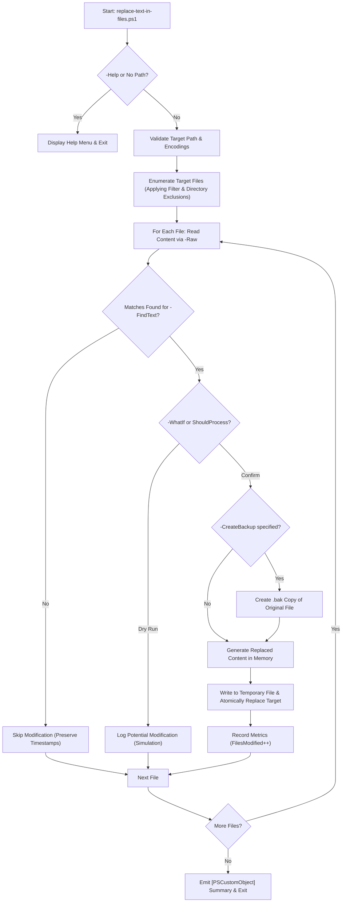

# Replace Text in Files (`replace-text-in-files`)

**Version:** 1.0.0  
**Release Date:** 2026-11-06  
**Author:** Roman Pindela  
**License:** MIT  

A high-performance, robust, and production-ready PowerShell utility for bulk search-and-replace operations in text files across directories and projects.

[](https://docs.microsoft.com/en-us/powershell/)
[](https://www.microsoft.com/windows)
[](https://opensource.org/licenses/MIT)

---

## 📋 Project Information

| Parameter | Value |
| :--- | :--- |
| **Project Name** | Replace Text in Files |
| **Script Name** | `replace-text-in-files.ps1` |
| **Author** | Roman Pindela |
| **Email** | [roman.pindela@gmail.com](mailto:roman.pindela@gmail.com) |
| **GitHub** | [https://github.com/romanpindela](https://github.com/romanpindela) |
| **Repository** | [Windows-Desktop](https://github.com/romanpindela/Windows-Desktop) |
| **Version** | 1.0.0 |
| **Release Date** | 2026-11-06 |
| **License** | MIT |

---

## 🚀 Overview

Performing mass search-and-replace operations across multiple files often leads to file corruption, lock contention, broken character encodings, or accidental data loss when using naive one-liners such as `(Get-Content) | Set-Content`.

`replace-text-in-files.ps1` provides an enterprise-grade solution:
* Reads file contents entirely into memory (`-Raw`) before performing replacements.
* Validates modifications in-memory and verifies whether replacement occurrences actually exist.
* Writes modifications atomically via temporary staging files before replacing target files.
* Preserves original file modification timestamps on untouched files.
* Provides full support for native PowerShell `-WhatIf` / `-Confirm` simulation modes.
* Generates automatic `.bak` safety backups and detailed audit logging to `C:\Logs`.

---

## ✨ Key Features

* **Non-Destructive & In-Memory Pipeline:** Prevents file locking and data loss typical of `(Get-Content) | Set-Content` by reading files with `-Raw`, verifying modifications in memory, and writing to a temporary file before atomic replacement.
* **Dual-PowerShell Compatibility:** Seamless execution under both **Windows PowerShell 5.1** and **PowerShell 7+**.
* **Safety First (`-WhatIf` & `-Confirm`):** Full native support for `SupportsShouldProcess` allowing dry-run simulations before applying changes.
* **Preserves Encodings, Diacritics & Line Endings:** Full support for `utf8` (PS7 BOM-less, PS5.1 BOM), `utf8NoBOM`, `ascii`, and `unicode`. Maintains `CRLF` and `LF` line endings and Polish/international diacritics.
* **Smart Modification Tracking:** Files are modified only if matching strings or patterns are detected, keeping file timestamps intact on untouched files.
* **Optional Automatic Backups:** Automatically generates `.bak` copies before overwriting any file when `-CreateBackup` is enabled.
* **Structured Audit Logging:** Writes detailed timestamped audit logs to `C:\Logs` with `[INFO]`, `[WARN]`, `[ERROR]`, and `[ACTION]` entries when `-EnableLogging` is specified.
* **Directory Exclusion:** Safely ignores dependency and VCS folders like `.git`, `.vs`, and `node_modules` by default.

---

## 📂 Directory Structure

```shell
replace-text-in-files/
├── assets/
│   ├── Replace_results.jpg         # Screenshot of search & replace execution results
│   └── Standard_run.jpg            # Screenshot of zero-parameter run / interactive help menu
├── replace-text-in-files.ps1       # Main PowerShell search-and-replace utility
└── README.md                       # Comprehensive technical documentation
```

---

## 💻 Technical Prerequisites

* **Operating System:** Windows 10, Windows 11, Windows Server 2016+
* **PowerShell Version:** Windows PowerShell 5.1 or PowerShell 7+
* **Privileges:** Standard user session (Run as Administrator required only when targeting protected system directories).

---

## ⚙️ Parameters

| Parameter | Type | Required | Default | Description |
| :--- | :--- | :--- | :--- | :--- |
| `-Path` | `string` | **Yes** | — | Target directory path to scan. (Aliases: `-Folder`, `-Directory`) |
| `-FindText` | `string` | **Yes** | — | Literal string or Regular Expression pattern to search for. |
| `-ReplaceWith` | `string` | No | `""` | Replacement text (empty string removes matches). |
| `-Filter` | `string` | No | `*.*` | File mask filter (e.g. `*.md`, `*.config`). |
| `-Recurse` | `switch` | No | `$false` | Recursively processes subdirectories. |
| `-UseRegex` | `switch` | No | `$false` | Treats `-FindText` as a Regular Expression pattern. |
| `-CaseSensitive` | `switch` | No | `$false` | Performs case-sensitive matching. |
| `-ExcludeDirectories`| `string[]` | No | `@('.git', '.vs', 'node_modules')` | List of folder names to exclude from processing. |
| `-Encoding` | `string` | No | `'utf8'` | File encoding (`utf8`, `utf8NoBOM`, `ascii`, `unicode`). |
| `-CreateBackup` | `switch` | No | `$false` | Creates a `.bak` backup before modifying files. |
| `-EnableLogging` | `switch` | No | `$false` | Writes execution logs to `C:\Logs\`. |
| `-Help` | `switch` | No | `$false` | Displays interactive help guide (Aliases: `-h`, `-HelpMe`). |

---

## 📖 Usage Guide & Practical Examples

### 1. Interactive Help Menu
```powershell
.\replace-text-in-files.ps1 -Help
# or
.\replace-text-in-files.ps1 -h
```

### 2. Remove Tag from Markdown Files (Recursive)
```powershell
.\replace-text-in-files.ps1 -Path ".\Docs" -Filter "*.md" -FindText "#stary-tag" -ReplaceWith "" -Recurse
```

### 3. Dry-Run Simulation with Regular Expressions (`-WhatIf`)
```powershell
.\replace-text-in-files.ps1 -Path "C:\Projekty" -Filter "*.json" -FindText 'v\d+\.\d+\.\d+' -ReplaceWith 'v2.0.0' -UseRegex -WhatIf
```

### 4. Safe Production Update with Backups and Logging
```powershell
.\replace-text-in-files.ps1 -Path "D:\Configs" -Filter "*.config" -FindText "Server=old-db" -ReplaceWith "Server=new-db" -CreateBackup -EnableLogging
```

---

## 📸 Screenshots & Visual Verification

### 1. Standard Run & Interactive Help Menu (`.\replace-text-in-files.ps1 -Help`)


*Zero-parameter execution of `.\replace-text-in-files.ps1 -Help` displaying parameter reference, encoding options, and practical usage examples.*

### 2. Search & Replace Execution Results


*Live search-and-replace execution across directory files with detailed summary statistics and pipeline object output.*

---

## 🔄 Execution Workflow



---

## 📊 Pipeline Output

The script returns a `[PSCustomObject]` summary to the PowerShell pipeline:

```powershell
Path          : C:\Projekty\Docs
FilesScanned  : 24
FilesModified : 5
FilesFailed   : 0
Duration      : 00:00:01.234
Mode          : Execute
```
